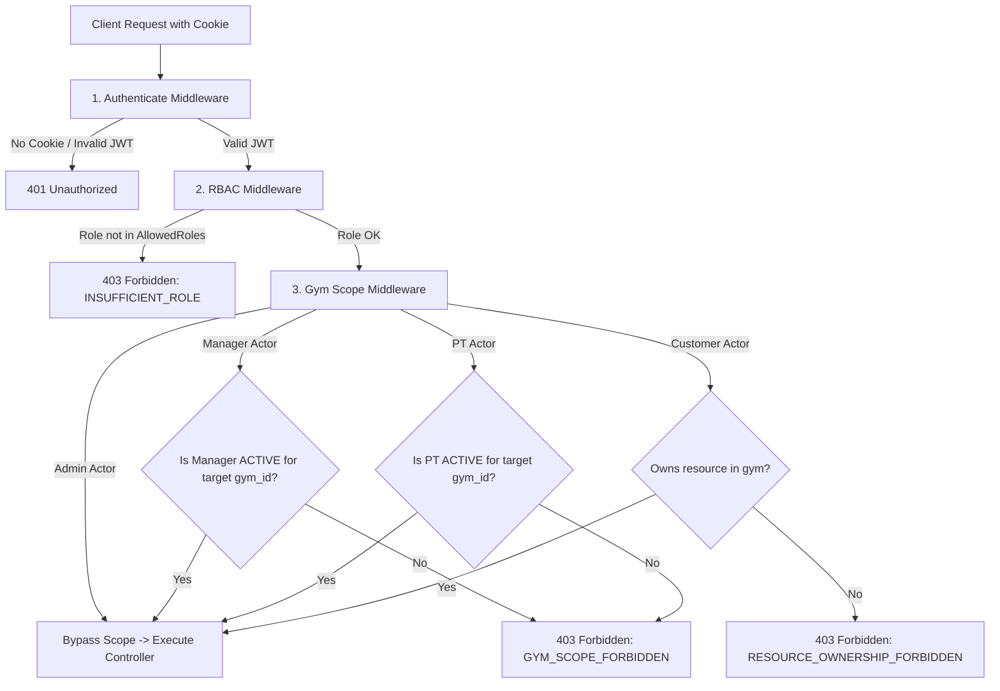
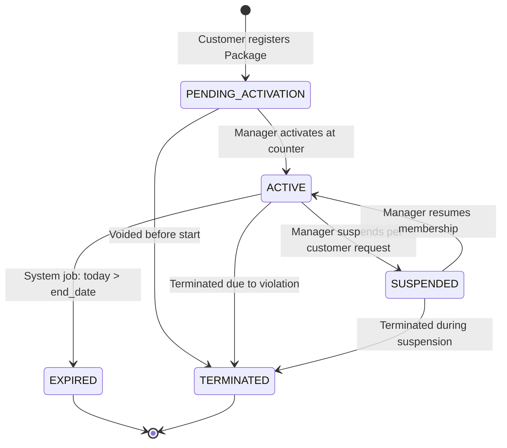
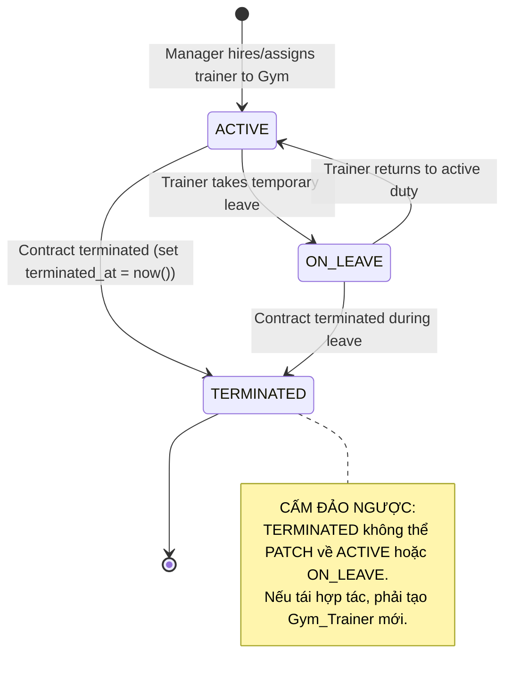
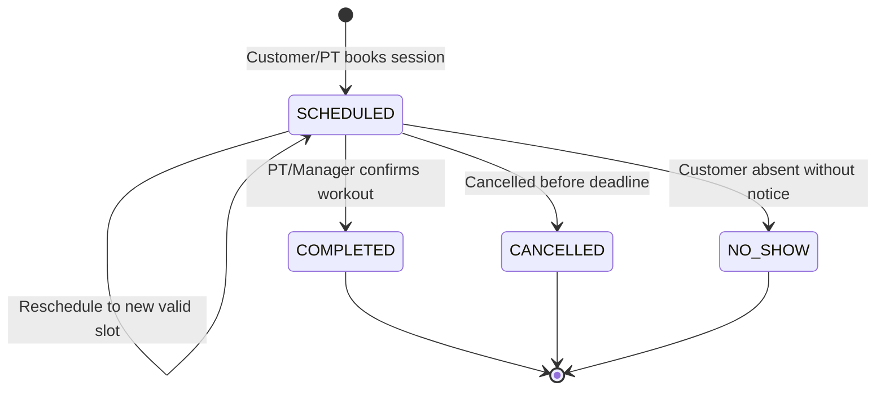
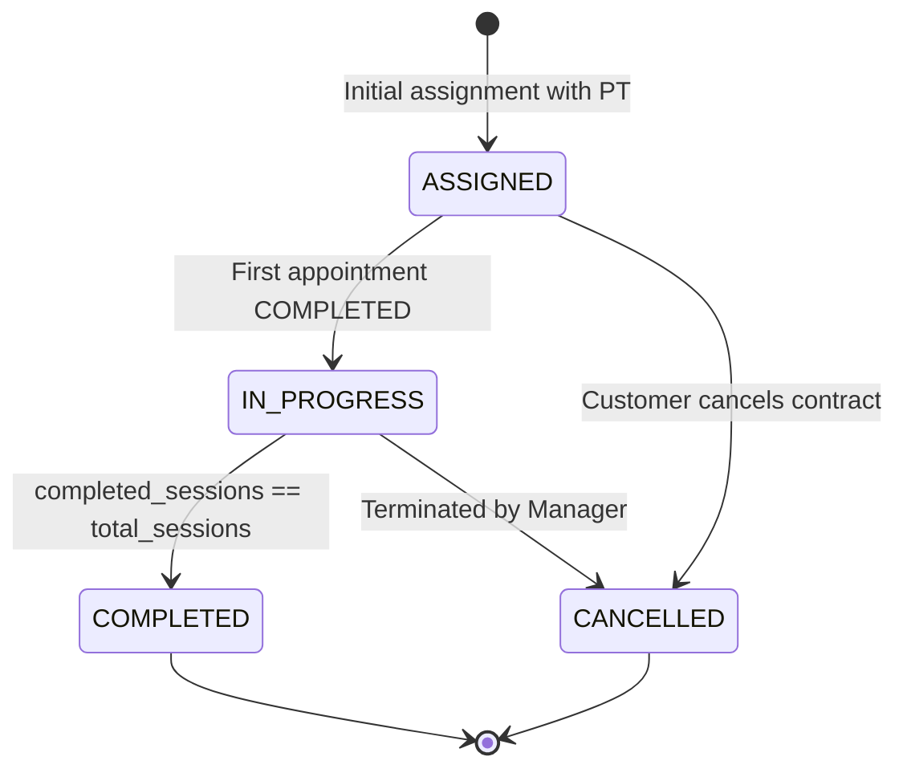
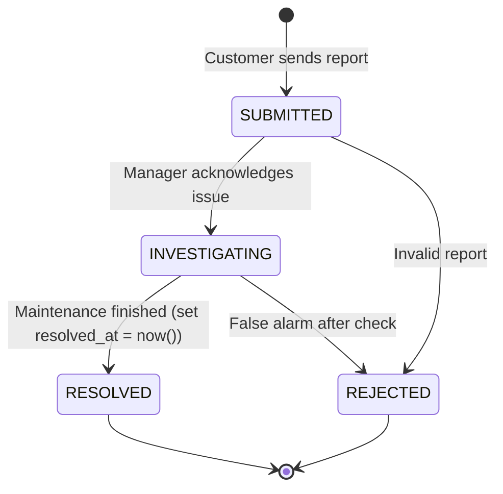
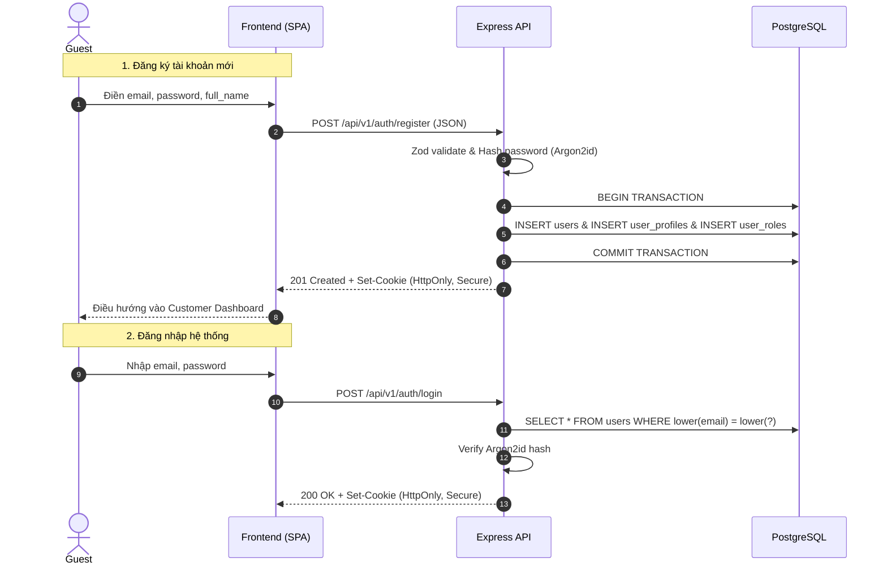
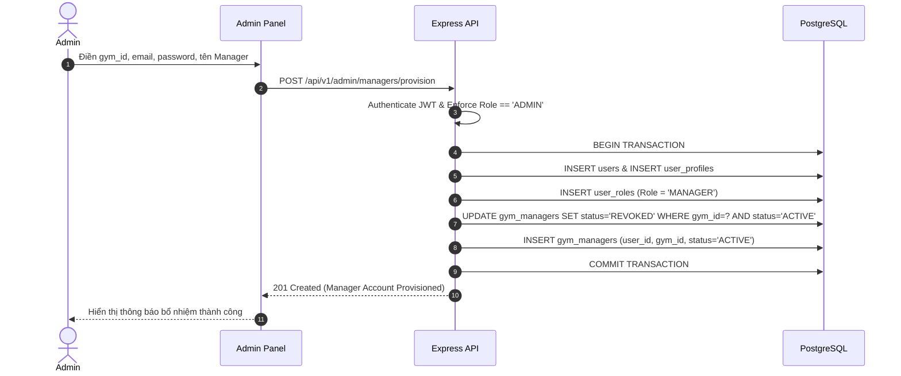
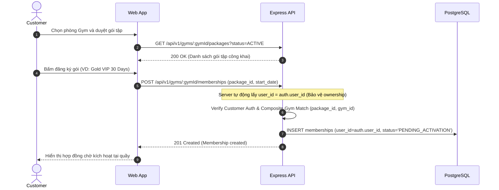
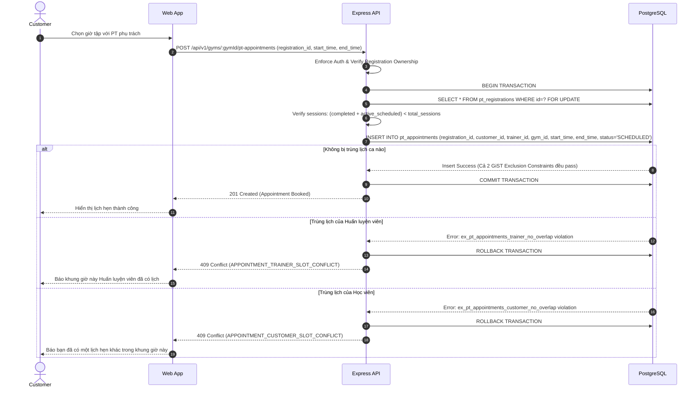

# Multi-Gym Platform — REST API Specification

## 1. Mục Đích & Chuẩn Mực Thiết Kế

Tài liệu này xác lập đặc tả giao diện lập trình ứng dụng (**REST API Specification**) chính thức cho nền tảng **Multi-Gym Platform**. 

Đặc tả này được xây dựng dựa trên sự kế thừa và hiện thực hóa các nguyên tắc từ:
- [`docs/ARCHITECTURE_DECISIONS.md`](file:///srv/gym/docs/ARCHITECTURE_DECISIONS.md) (Kiến trúc phân lớp, Auth JWT Cookie, RBAC + Gym Scope, công nghệ Express + Zod).
- [`docs/PROJECT_RULES.md`](file:///srv/gym/docs/PROJECT_RULES.md) (Quy chuẩn thiết kế API, an toàn dữ liệu, chống rò rỉ ranh giới phòng tập).
- [`docs/DOMAIN_RULES.md`](file:///srv/gym/docs/DOMAIN_RULES.md) (Quy tắc 5 Actor, 12 Domain Entities, Business Invariants, State Lifecycles).
- [`docs/DATABASE_SPEC.md`](file:///srv/gym/docs/DATABASE_SPEC.md) (Schema 12 bảng PostgreSQL 17, Foreign Keys, Composite Constraints, Exclusion Constraints chống trùng lịch tập).

### Các nguyên tắc nền tảng bắt buộc:
1. **API Versioning:** Đồng nhất toàn bộ endpoint sử dụng tiền tố `/api/v1/...`.
2. **RESTful Resource-Oriented:** Danh từ số nhiều (`/gyms`, `/packages`, `/memberships`), phân biệt rõ Collection và Single Resource.
3. **Phục vụ nghiệp vụ thực tế:** Tuyệt đối **không** tạo CRUD máy móc cho mọi bảng cơ sở dữ liệu (ví dụ: không có `POST /user_roles` độc lập mà thông qua business actions).
4. **Phạm vi 12 Entities:** Chỉ đặc tả API cho đúng 12 domain entities đã được phê duyệt (`User`, `User_Profile`, `Role`, `User_Role`, `Gym`, `Gym_Manager`, `Gym_Trainer`, `Package`, `Membership`, `PT_Registration`, `PT_Appointment`, `Gym_Report`).
5. **Payment Scope:** **OUT OF SCOPE — CURRENT PHASE**. Tuyệt đối không có endpoint thanh toán, webhook, hoặc xử lý cổng thanh toán nào.
6. **Bảo mật tuyệt đối:** Không lưu trữ token tại `localStorage`/`sessionStorage`. Toàn bộ token vận chuyển qua **HttpOnly, Secure, SameSite Cookie**.
7. **Không rò rỉ dữ liệu nhạy cảm:** Tuyệt đối không trả về `password_hash`, internal tokens hoặc dữ liệu phòng gym khác ngoài phạm vi được phân quyền.

---

## 2. Tiêu Chuẩn Giao Thức & Cấu Trúc Chung

### 2.1. Base URL & Giao Thức
- **Development:** `http://localhost:4000/api/v1`
- **Production:** `https://api.gymplatform.vn/api/v1`
- **Giao thức:** HTTPS bắt buộc ở môi trường Production.
- **Content-Type:** `application/json; charset=utf-8` cho tất cả request và response có payload.

### 2.2. Chuẩn Hóa HTTP Status Codes
Hệ thống sử dụng mã trạng thái HTTP chuẩn xác theo ngữ nghĩa:

| HTTP Status | Ý nghĩa chuẩn | Ngữ cảnh sử dụng |
| :--- | :--- | :--- |
| **`200 OK`** | Thành công | Thao tác đọc danh sách, chi tiết, cập nhật thành công hoặc trả về kết quả truy vấn. |
| **`201 Created`** | Khởi tạo thành công | Tạo mới resource thành công (User, Gym, Package, Membership, Appointment...). |
| **`204 No Content`** | Thành công không nội dung | Thao tác xóa hoặc logout thành công (không trả kèm body). |
| **`400 Bad Request`** | Lỗi định dạng dữ liệu | Payload không khớp Zod schema, query params sai kiểu dữ liệu, thiếu trường bắt buộc. |
| **`401 Unauthorized`** | Chưa xác thực | Không có cookie xác thực, JWT hết hạn, JWT sai chữ ký, hoặc tài khoản bị khóa/thu hồi phiên. |
| **`403 Forbidden`** | Không có quyền hạn | Đã xác thực nhưng vi phạm RBAC (Role không đủ quyền) hoặc vi phạm Gym Scope / Resource Ownership. |
| **`404 Not Found`** | Không tìm thấy | Resource ID không tồn tại hoặc resource thuộc phòng gym khác (giấu thông tin để chống enumeration). |
| **`409 Conflict`** | Xung đột trạng thái / Dữ liệu | Trùng lặp email, trùng lịch tập PT (Appointment overlap), vi phạm status transition không hợp lệ. |
| **`422 Unprocessable Entity`** | Không thể xử lý ngữ nghĩa | Dữ liệu đúng schema cú pháp nhưng vi phạm business logic sâu (ví dụ: ngày kết thúc trước ngày bắt đầu). |
| **`500 Internal Server Error`** | Lỗi nội bộ hệ thống | Lỗi cơ sở dữ liệu không mong muốn, unhandled exception (ẩn toàn bộ chi tiết stack trace với client). |

---

## 3. Định Dạng Payload Thống Nhất (Envelope Format)

Toàn bộ response của hệ thống đều được chuẩn hóa theo cấu trúc Envelope:

### 3.1. Phản hồi thành công cho Single Resource (Object)
```json
{
  "success": true,
  "data": {
    "id": "7c9e6679-7425-40de-944b-e07fc1f90ae7",
    "name": "Elite Fitness District 1",
    "status": "ACTIVE"
  }
}
```

### 3.2. Phản hồi thành công cho Collection có Phân trang (Paginated List)
```json
{
  "success": true,
  "data": [
    {
      "id": "7c9e6679-7425-40de-944b-e07fc1f90ae7",
      "name": "Elite Fitness District 1",
      "status": "ACTIVE"
    }
  ],
  "pagination": {
    "page": 1,
    "pageSize": 20,
    "totalItems": 45,
    "totalPages": 3,
    "hasNextPage": true,
    "hasPreviousPage": false
  }
}
```

### 3.3. Phản hồi lỗi chuẩn (Standard Error Envelope)
```json
{
  "success": false,
  "error": {
    "code": "GYM_SCOPE_FORBIDDEN",
    "message": "You do not have administrative permission to access resources belonging to Gym ID 7c9e6679-7425-40de-944b-e07fc1f90ae7.",
    "details": null
  }
}
```

### 3.4. Phản hồi lỗi Validation (Zod Validation Error)
```json
{
  "success": false,
  "error": {
    "code": "VALIDATION_ERROR",
    "message": "Request validation failed.",
    "details": [
      {
        "field": "price",
        "message": "Price must be greater than or equal to 0"
      },
      {
        "field": "duration_days",
        "message": "Duration days must be greater than 0"
      }
    ]
  }
}
```

---

## 4. Kiến Trúc Xác Thực (Authentication) & Quản Lý Phiên

### 4.1. Cơ chế JWT + HttpOnly Cookie
1. **Transport:** Khi người dùng Login hoặc Register thành công, server sinh JSON Web Token (JWT) và thiết lập thông qua HTTP Response Header `Set-Cookie`.
2. **Cookie Flags bắt buộc:**
   - `HttpOnly = true`: Ngăn chặn JavaScript chạy trên trình duyệt truy cập cookie (chống tấn công XSS).
   - `Secure = true`: Cookie chỉ được truyền qua kênh HTTPS (cho phép HTTP ở môi trường localhost dev).
   - `SameSite = Lax`: Chống tấn công Cross-Site Request Forgery (CSRF) trong khi vẫn duy trì trải nghiệm chuyển trang thông thường.
   - `Path = /api/v1`: Giới hạn phạm vi cookie chỉ gửi kèm các request đến API backend.
   - `Max-Age = 604800` (7 ngày).
3. **Cấm tuyệt đối:** Client không bao giờ lưu trữ token trong `localStorage` hay `sessionStorage`.
4. **Argon2id Hashing:** Toàn bộ mật khẩu người dùng được băm bằng thuật toán Argon2id với thông số an toàn: Memory cost = 65536 KB (64MB), Iterations = 3, Parallelism = 4.
5. **Token Payload Claims:**
   - `sub`: `user_id` (UUID).
   - `email`: Email người dùng.
   - `roles`: Mảng các mã vai trò cấp hệ thống `['CUSTOMER']` hoặc `['MANAGER']` hoặc `['PT']` hoặc `['ADMIN']`.
   - `iat`: Timestamp cấp phát.
   - `exp`: Timestamp hết hạn.

---

## 5. Phân Quyền Hai Lớp (RBAC + Gym Scope Verification)

Hệ thống bắt buộc thực hiện kiểm tra quyền truy cập qua **Hai Lớp (Two-Tier Check)** trước khi cho phép request chạm vào tầng Service hoặc Database:



### 5.1. Phân Biệt Rạch Ròi: Public Resource Scope vs Authenticated Gym Scope

Hệ thống phân định rõ hai khái niệm phạm vi phòng gym:

1. **Public Resource Scope (Lọc theo URL Path Parameter):**
   - Áp dụng cho các endpoint công khai (ví dụ: `GET /api/v1/gyms/:gymId/packages`, `GET /api/v1/gyms/:gymId/trainers`).
   - `:gymId` trên URL đóng vai trò là tiêu chí lọc (filter scope) tài nguyên công khai thuộc cơ sở đó.
   - **Guest là Unauthenticated Actor:** Khách vãng lai không cần đăng nhập và **không có quyền hạn Gym Scope gắn kèm**. Việc xem dữ liệu chỉ đơn thuần là đọc dữ liệu công khai được gắn nhãn `gym_id`.
2. **Authenticated Gym Scope (Xác Thực Quyền Hạn Nghiệp Vụ):**
   - Áp dụng cho các thao tác tác động dữ liệu (Write/Update) hoặc xem dữ liệu nội bộ/riêng tư.
   - Bắt buộc kiểm tra quyền quản lý hoặc công tác của Actor đối với `:gymId`.

### 5.2. Nguồn Gốc Xác Định Authenticated Gym Scope (Cấm Giả Định `user.gym_id`)
Bảng `users` trong cơ sở dữ liệu **hoàn toàn không có cột `gym_id`**. Do đó, Gym Scope được xác định nghiêm ngặt qua các quan hệ:
- **Manager Scope:** Truy vấn bảng `gym_managers` với điều kiện `user_id = auth.user_id AND gym_id = target_gym_id AND status = 'ACTIVE'`.
- **PT Scope:** Truy vấn bảng `gym_trainers` với điều kiện `user_id = auth.user_id AND gym_id = target_gym_id AND status = 'ACTIVE'`.
- **Customer Scope:** Truy vấn quyền sở hữu tài nguyên cụ thể thông qua `memberships.user_id = auth.user_id`, `pt_registrations.customer_id = auth.user_id`, hoặc `gym_reports.user_id = auth.user_id`.
- **Admin Scope:** Sở hữu phạm vi toàn sàn (System Scope), được phép truy cập tài nguyên của mọi cơ sở phòng tập.

> [!CAUTION]
> Backend **tuyệt đối không tin cậy** trường `gym_id` do client gửi lên trong Request Body hoặc Query Parameters. Mọi `gym_id` phải được đối chiếu và xác thực quyền hạn thông qua Middleware chuyên trách `enforceGymScope`.

---

## 6. Danh Mục Tổng Hợp API Endpoints (Endpoint Catalog)

| Nhóm (Group) | Method | Endpoint | Actor / Role | Auth Req | Scope Enforcement | Mục đích nghiệp vụ (Purpose) |
| :--- | :--- | :--- | :--- | :---: | :--- | :--- |
| **Authentication** | `POST` | `/api/v1/auth/register` | Guest | Public | Public | Đăng ký tài khoản Customer mới, gán role CUSTOMER |
| | `POST` | `/api/v1/auth/login` | Guest | Public | Public | Xác thực email/password, trả HttpOnly Cookie |
| | `POST` | `/api/v1/auth/logout` | All Authenticated | Required | None | Xóa cookie phiên làm việc trên trình duyệt |
| | `GET` | `/api/v1/auth/me` | All Authenticated | Required | Personal | Lấy thông tin user hiện tại kèm profile và roles |
| | `POST` | `/api/v1/auth/change-password` | All Authenticated | Required | Personal | Đổi mật khẩu tài khoản đăng nhập |
| **User / Profile** | `GET` | `/api/v1/users/me/profile` | All Authenticated | Required | Personal | Xem chi tiết hồ sơ cá nhân của chính mình |
| | `PATCH` | `/api/v1/users/me/profile` | All Authenticated | Required | Personal | Cập nhật thông tin hồ sơ (họ tên, phone, DOB, avatar) |
| **Gym** | `GET` | `/api/v1/gyms` | Guest, All Roles | Public | Public List | Lấy danh sách các phòng gym công khai (filter, paginate) |
| | `GET` | `/api/v1/gyms/:gymId` | Guest, All Roles | Public | Public Item | Xem thông tin chi tiết một phòng gym cụ thể |
| | `POST` | `/api/v1/gyms` | Admin | Required | System Scope | Admin tạo mới cơ sở phòng gym |
| | `PATCH` | `/api/v1/gyms/:gymId` | Admin, Manager | Required | Gym Scope (Active Mgr) | Cập nhật thông tin cơ sở phòng gym |
| | `PATCH` | `/api/v1/gyms/:gymId/status` | Admin | Required | System Scope | Admin chuyển trạng thái Gym (ACTIVE/MAINTENANCE/CLOSED) |
| **Manager** | `GET` | `/api/v1/gyms/:gymId/managers` | Admin, Manager | Required | Gym Scope (Active Mgr) | Xem lịch sử/danh sách Manager của phòng gym |
| | `POST` | `/api/v1/gyms/:gymId/managers/assign` | Admin | Required | System Scope | Bổ nhiệm Manager mới cho Gym (thu hồi Manager cũ nếu có) |
| | `POST` | `/api/v1/gyms/:gymId/managers/:managerId/revoke` | Admin | Required | System Scope | Bãi nhiệm quản lý điều hành cơ sở gym |
| **Trainer** | `GET` | `/api/v1/gyms/:gymId/trainers` | Guest, All Roles | Public | Public Resource Scope | Lấy danh sách huấn luyện viên công khai của phòng gym |
| | `GET` | `/api/v1/gyms/:gymId/trainers/:trainerId` | Guest, All Roles | Public | Public Resource Scope | Xem chi tiết thông tin huấn luyện viên |
| | `POST` | `/api/v1/gyms/:gymId/trainers` | Admin, Manager | Required | Gym Scope (Active Mgr) | Tiếp nhận/Gán hợp đồng huấn luyện viên vào phòng gym |
| | `PATCH` | `/api/v1/gyms/:gymId/trainers/:trainerId/status` | Admin, Manager | Required | Gym Scope (Active Mgr) | Chuyển trạng thái PT theo lifecycle (chống đổi tùy ý) |
| **Package** | `GET` | `/api/v1/gyms/:gymId/packages` | Guest, All Roles | Public | Public Resource Scope | Danh sách các gói tập công khai đang ACTIVE của Gym |
| | `GET` | `/api/v1/gyms/:gymId/packages/:packageId` | Guest, All Roles | Public | Public Resource Scope | Xem chi tiết gói tập |
| | `POST` | `/api/v1/gyms/:gymId/packages` | Admin, Manager | Required | Gym Scope (Active Mgr) | Tạo mới gói tập thuộc phòng gym quản lý |
| | `PATCH` | `/api/v1/gyms/:gymId/packages/:packageId` | Admin, Manager | Required | Gym Scope (Active Mgr) | Cập nhật thông tin gói tập |
| | `PATCH` | `/api/v1/gyms/:gymId/packages/:packageId/activate` | Admin, Manager | Required | Gym Scope (Active Mgr) | Mở bán lại gói tập (chuyển sang ACTIVE) |
| | `PATCH` | `/api/v1/gyms/:gymId/packages/:packageId/deactivate` | Admin, Manager | Required | Gym Scope (Active Mgr) | Ngừng bán gói tập (chuyển sang INACTIVE) |
| **Membership** | `GET` | `/api/v1/gyms/:gymId/memberships` | Admin, Manager | Required | Gym Scope (Active Mgr) | Danh sách hội viên có hợp đồng tại cơ sở |
| | `GET` | `/api/v1/memberships/me` | Customer | Required | Personal Scope | Customer xem danh sách hợp đồng hội viên của chính mình |
| | `GET` | `/api/v1/memberships/:membershipId` | Admin, Manager, Customer | Required | Scope / Ownership | Xem chi tiết một hợp đồng hội viên cụ thể |
| | `POST` | `/api/v1/gyms/:gymId/memberships` | Customer, Manager | Required | Auth Identity / Scope | Đăng ký gói tập (Customer: auth.id; Manager: customer_id) |
| | `PATCH` | `/api/v1/memberships/:membershipId/activate` | Admin, Manager | Required | Gym Scope (Active Mgr) | Kích hoạt hợp đồng hội viên tại quầy (sang ACTIVE) |
| | `PATCH` | `/api/v1/memberships/:membershipId/suspend` | Admin, Manager | Required | Gym Scope (Active Mgr) | Bảo lưu hợp đồng hội viên theo yêu cầu (sang SUSPENDED) |
| | `PATCH` | `/api/v1/memberships/:membershipId/terminate` | Admin, Manager | Required | Gym Scope (Active Mgr) | Chấm dứt hợp đồng hội viên trước hạn |
| **PT Registration** | `GET` | `/api/v1/gyms/:gymId/pt-registrations` | Admin, Manager | Required | Gym Scope (Active Mgr) | Quản lý danh sách đăng ký huấn luyện viên tại Gym |
| | `GET` | `/api/v1/pt-registrations/me` | Customer, PT | Required | Personal / PT Scope | Xem hợp đồng huấn luyện viên cá nhân của mình |
| | `POST` | `/api/v1/gyms/:gymId/pt-registrations` | Customer, Manager | Required | Auth Identity / Scope | Tạo đăng ký PT (Customer: auth.id; Manager: customer_id) |
| | `PATCH` | `/api/v1/gyms/:gymId/pt-registrations/:id/assign` | Admin, Manager | Required | Gym Scope (Active Mgr) | Đổi/gán huấn luyện viên phụ trách mới |
| | `PATCH` | `/api/v1/gyms/:gymId/pt-registrations/:id/cancel` | Admin, Manager | Required | Gym Scope (Active Mgr) | Hủy hợp đồng đăng ký huấn luyện viên |
| **PT Appointment** | `GET` | `/api/v1/gyms/:gymId/pt-appointments` | Admin, Manager | Required | Gym Scope (Active Mgr) | Xem lịch vận hành ca tập PT tại phòng gym |
| | `GET` | `/api/v1/pt-appointments/me` | Customer, PT | Required | Personal / PT Scope | Xem lịch hẹn ca tập cá nhân của Customer hoặc PT |
| | `POST` | `/api/v1/gyms/:gymId/pt-appointments` | Customer, PT, Manager | Required | Scope & Anti-Overlap | Đặt lịch hẹn mới (chống trùng lịch cả PT & Customer) |
| | `PATCH` | `/api/v1/gyms/:gymId/pt-appointments/:id/reschedule` | Customer, PT, Manager | Required | Scope & Anti-Overlap | Đổi giờ ca tập (chống trùng lịch cả PT & Customer) |
| | `PATCH` | `/api/v1/gyms/:gymId/pt-appointments/:id/cancel` | Customer, PT, Manager | Required | Scope / Ownership | Hủy lịch hẹn ca tập |
| | `PATCH` | `/api/v1/gyms/:gymId/pt-appointments/:id/complete` | PT, Manager | Required | PT / Gym Scope | Xác nhận hoàn thành ca tập (cộng completed_sessions) |
| | `PATCH` | `/api/v1/gyms/:gymId/pt-appointments/:id/no-show` | PT, Manager | Required | PT / Gym Scope | Đánh dấu học viên vắng mặt không lý do |
| **Gym Report** | `POST` | `/api/v1/gyms/:gymId/reports` | Customer | Required | Personal / Public Gym | Gửi phản ánh sự cố (tối đa 1 ảnh) tới Ban Quản Lý |
| | `GET` | `/api/v1/gyms/:gymId/reports` | Admin, Manager | Required | Gym Scope (Active Mgr) | Danh sách báo cáo phản ánh tại phòng gym |
| | `GET` | `/api/v1/reports/me` | Customer | Required | Personal Scope | Khách hàng xem lịch sử phản ánh của mình |
| | `PATCH` | `/api/v1/gyms/:gymId/reports/:reportId/investigate` | Admin, Manager | Required | Gym Scope (Active Mgr) | Tiếp nhận xử lý phản ánh (sang INVESTIGATING) |
| | `PATCH` | `/api/v1/gyms/:gymId/reports/:reportId/resolve` | Admin, Manager | Required | Gym Scope (Active Mgr) | Đánh dấu sự cố đã khắc phục (set resolved_at = now()) |
| | `PATCH` | `/api/v1/gyms/:gymId/reports/:reportId/reject` | Admin, Manager | Required | Gym Scope (Active Mgr) | Từ chối phản ánh không hợp lệ/sai sự thật |
| **Admin** | `POST` | `/api/v1/admin/managers/provision` | Admin | Required | System Scope | Provision tài khoản Manager và gán vào Gym |
| | `GET` | `/api/v1/admin/users` | Admin | Required | System Scope | Quản lý danh sách tài khoản toàn sàn |
| | `PATCH` | `/api/v1/admin/users/:userId/status` | Admin | Required | System Scope | Khóa/Kích hoạt tài khoản User toàn sàn |

---

## 7. Chi Tiết Đặc Tả Kỹ Thuật Từng Endpoint (Request / Response Spec)

---

### 7.1. Nhóm Authentication

#### Endpoint 7.1.1: `POST /api/v1/auth/register`
- **Mô tả:** Đăng ký tài khoản mới cho khách hàng (`Customer`). Tự động khởi tạo `User`, `User_Profile`, gán `Role = 'CUSTOMER'` trong 1 Database Transaction duy nhất.
- **Quyền hạn:** Public (Guest).
- **Request Body (Zod Validation):**
  ```json
  {
    "email": "customer@example.com",
    "password": "SecurePassword123!",
    "full_name": "Nguyen Van A",
    "phone_number": "0912345678"
  }
  ```
  - `email`: `z.string().email().transform(v => v.trim().toLowerCase())`.
  - `password`: `z.string().min(8).max(128).regex(/[A-Z]/, "Must contain uppercase").regex(/[0-9]/, "Must contain number")`.
  - `full_name`: `z.string().min(2).max(100).trim()`.
  - `phone_number`: `z.string().regex(/^0[0-9]{9}$/, "Invalid Vietnamese phone format").optional()`.
- **Response `201 Created`:**
  - Header: `Set-Cookie: auth_token=jwt_value; Path=/api/v1; HttpOnly; Secure; SameSite=Lax; Max-Age=604800`
  ```json
  {
    "success": true,
    "data": {
      "user": {
        "id": "11111111-1111-1111-1111-111111111111",
        "email": "customer@example.com",
        "status": "ACTIVE",
        "roles": ["CUSTOMER"],
        "profile": {
          "full_name": "Nguyen Van A",
          "phone_number": "0912345678",
          "avatar_url": null
        },
        "created_at": "2026-09-19T10:00:00.000Z"
      }
    }
  }
  ```
- **Error Codes:**
  - `400 VALIDATION_ERROR`: Thông tin đăng ký không thỏa mãn schema.
  - `409 EMAIL_ALREADY_EXISTS`: Email đã được sử dụng trên hệ thống.

---

#### Endpoint 7.1.2: `POST /api/v1/auth/login`
- **Mô tả:** Đăng nhập hệ thống bằng email và mật khẩu. Đối chiếu băm Argon2id. Nếu hợp lệ, cấp phát JWT qua HttpOnly Cookie.
- **Quyền hạn:** Public (Guest).
- **Request Body (Zod Validation):**
  ```json
  {
    "email": "customer@example.com",
    "password": "SecurePassword123!"
  }
  ```
  - `email`: `z.string().email().transform(v => v.trim().toLowerCase())`.
  - `password`: `z.string().min(1, "Password is required")`.
- **Response `200 OK`:**
  - Header: `Set-Cookie: auth_token=jwt_value; Path=/api/v1; HttpOnly; Secure; SameSite=Lax; Max-Age=604800`
  ```json
  {
    "success": true,
    "data": {
      "user": {
        "id": "11111111-1111-1111-1111-111111111111",
        "email": "customer@example.com",
        "status": "ACTIVE",
        "roles": ["CUSTOMER"],
        "profile": {
          "full_name": "Nguyen Van A",
          "phone_number": "0912345678",
          "avatar_url": null
        }
      }
    }
  }
  ```
- **Error Codes:**
  - `401 AUTH_INVALID_CREDENTIALS`: Sai email hoặc mật khẩu (thông báo chung, không tiết lộ email có tồn tại hay không).
  - `403 AUTH_ACCOUNT_SUSPENDED`: Tài khoản đang ở trạng thái `SUSPENDED` hoặc `DEACTIVATED`.

---

#### Endpoint 7.1.3: `POST /api/v1/auth/logout`
- **Mô tả:** Xóa bỏ cookie xác thực của phiên làm việc hiện tại.
- **Quyền hạn:** Authenticated.
- **Response `200 OK`:**
  - Header: `Set-Cookie: auth_token=; Path=/api/v1; HttpOnly; Secure; SameSite=Lax; Max-Age=0; Expires=Thu, 01 Jan 1970 00:00:00 GMT`
  ```json
  {
    "success": true,
    "data": {
      "message": "Logged out successfully."
    }
  }
  ```

---

#### Endpoint 7.1.4: `GET /api/v1/auth/me`
- **Mô tả:** Lấy thông tin tài khoản đang đăng nhập hiện tại cùng hồ sơ cá nhân và danh sách vai trò.
- **Quyền hạn:** Authenticated.
- **Response `200 OK`:**
  ```json
  {
    "success": true,
    "data": {
      "id": "11111111-1111-1111-1111-111111111111",
      "email": "customer@example.com",
      "status": "ACTIVE",
      "roles": ["CUSTOMER"],
      "profile": {
        "full_name": "Nguyen Van A",
        "phone_number": "0912345678",
        "date_of_birth": "1995-05-15",
        "gender": "MALE",
        "avatar_url": "https://assets.gymplatform.vn/avatars/u1.jpg"
      },
      "active_gym_assignments": []
    }
  }
  ```

---

### 7.2. Nhóm User & Hồ Sơ Cá Nhân (`User_Profile`)

#### Endpoint 7.2.1: `PATCH /api/v1/users/me/profile`
- **Mô tả:** Người dùng tự cập nhật hồ sơ cá nhân của chính mình.
- **Quyền hạn:** Authenticated (Chính chủ).
- **Request Body (Zod Validation):**
  ```json
  {
    "full_name": "Nguyen Van B",
    "phone_number": "0987654321",
    "date_of_birth": "1995-06-20",
    "gender": "MALE",
    "avatar_url": "https://assets.gymplatform.vn/avatars/new.jpg"
  }
  ```
  - `full_name`: `z.string().min(2).max(100).trim().optional()`.
  - `phone_number`: `z.string().regex(/^0[0-9]{9}$/).optional().nullable()`.
  - `date_of_birth`: `z.string().regex(/^\d{4}-\d{2}-\d{2}$/, "Format YYYY-MM-DD").optional().nullable()`.
  - `gender`: `z.enum(["MALE", "FEMALE", "OTHER"]).optional().nullable()`.
  - `avatar_url`: `z.string().url().max(2048).optional().nullable()`.
- **Response `200 OK`:** Trả về đối tượng `profile` đã được cập nhật thành công.

---

### 7.3. Nhóm Phòng Tập (`Gym`)

#### Endpoint 7.3.1: `GET /api/v1/gyms`
- **Mô tả:** Lấy danh sách các cơ sở phòng gym công khai cho khách duyệt tìm kiếm.
- **Quyền hạn:** Public (Guest, All Roles).
- **Query Parameters:**
  - `page`: `number` (Default: `1`).
  - `pageSize`: `number` (Default: `20`, Max: `100`).
  - `search`: `string` (Tìm kiếm theo tên phòng gym hoặc địa chỉ).
  - `status`: `ACTIVE` (Mặc định lọc `ACTIVE` đối với khách; Admin có thể lọc `MAINTENANCE`, `CLOSED`).
- **Response `200 OK` (Paginated List):**
  ```json
  {
    "success": true,
    "data": [
      {
        "id": "22222222-2222-2222-2222-222222222222",
        "name": "Multi-Gym Quan 1",
        "address": "123 Nguyen Thi Minh Khai, Phuong Ben Thanh, Quan 1, TP.HCM",
        "phone_number": "02839998888",
        "description": "Phòng gym cao cấp chuẩn quốc tế trung tâm Quận 1",
        "status": "ACTIVE",
        "created_at": "2026-09-01T00:00:00.000Z"
      }
    ],
    "pagination": {
      "page": 1,
      "pageSize": 20,
      "totalItems": 1,
      "totalPages": 1,
      "hasNextPage": false,
      "hasPreviousPage": false
    }
  }
  ```

---

#### Endpoint 7.3.2: `POST /api/v1/gyms`
- **Mô tả:** Khởi tạo một cơ sở phòng gym mới trên nền tảng.
- **Quyền hạn:** Authenticated, Bắt buộc Role `ADMIN`.
- **Request Body (Zod Validation):**
  ```json
  {
    "name": "Multi-Gym Binh Thanh",
    "address": "456 Dien Bien Phu, Phuong 25, Quan Binh Thanh, TP.HCM",
    "phone_number": "02838889999",
    "description": "Cơ sở mới hiện đại với đầy đủ tiện ích"
  }
  ```
  - `name`: `z.string().min(3).max(255).trim()`.
  - `address`: `z.string().min(5).max(500).trim()`.
  - `phone_number`: `z.string().max(20).trim().optional()`.
  - `description`: `z.string().max(2000).optional()`.
- **Response `201 Created`:** Trả về đối tượng `Gym` mới tạo kèm `status = "ACTIVE"`.

---

### 7.4. Nhóm Quản Lý Cơ Sở (`Gym_Manager`) & Admin Provisioning

#### Endpoint 7.4.1: `POST /api/v1/admin/managers/provision`
- **Mô tả:** Admin khởi tạo trọn gói một tài khoản quản lý và bổ nhiệm vào một phòng Gym trong 1 Database Transaction duy nhất:
  1. Kiểm tra phòng gym `gymId` tồn tại và đang hoạt động.
  2. Tạo tài khoản `User` với email và mật khẩu (Argon2id).
  3. Tạo `User_Profile`.
  4. Gán vai trò `MANAGER` vào bảng `user_roles`.
  5. Nếu phòng gym này đang có Manager `ACTIVE`, chuyển bản ghi cũ sang `REVOKED` và cập nhật `revoked_at = now()`.
  6. Tạo bản ghi mới trong `gym_managers` với `status = 'ACTIVE'`.
- **Quyền hạn:** Authenticated, Bắt buộc Role `ADMIN`.
- **Transaction:** Bắt buộc Database Transaction.
- **Request Body (Zod Validation):**
  ```json
  {
    "gym_id": "22222222-2222-2222-2222-222222222222",
    "email": "manager.q1@gymplatform.vn",
    "password": "TemporarySecurePass123!",
    "full_name": "Tran Van Quan Ly",
    "phone_number": "0909111222"
  }
  ```
- **Response `201 Created`:**
  ```json
  {
    "success": true,
    "data": {
      "user_id": "33333333-3333-3333-3333-333333333333",
      "gym_id": "22222222-2222-2222-2222-222222222222",
      "email": "manager.q1@gymplatform.vn",
      "full_name": "Tran Van Quan Ly",
      "role": "MANAGER",
      "status": "ACTIVE",
      "assigned_at": "2026-09-19T10:30:00.000Z"
    }
  }
  ```
- **Error Codes:**
  - `404 GYM_NOT_FOUND`: `gym_id` không tồn tại.
  - `409 EMAIL_ALREADY_EXISTS`: Email đã được đăng ký.

---

#### Endpoint 7.4.2: `POST /api/v1/gyms/:gymId/managers/:managerId/revoke`
- **Mô tả:** Admin bãi nhiệm Manager hiện tại của cơ sở phòng tập. Chuyển trạng thái sang `REVOKED`, cập nhật `revoked_at = now()`.
- **Quyền hạn:** Authenticated, Bắt buộc Role `ADMIN`.
- **Response `200 OK`:** Trả về bản ghi `Gym_Manager` với `status = "REVOKED"`.

---

### 7.5. Nhóm Huấn Luyện Viên (`Gym_Trainer`)

#### Endpoint 7.5.1: `GET /api/v1/gyms/:gymId/trainers`
- **Mô tả:** Lấy danh sách các huấn luyện viên công tác tại phòng Gym cụ thể (`:gymId` là Public Resource Scope).
- **Quyền hạn:** Public (Guest/Customer xem danh sách PT đang `ACTIVE`; Manager/Admin cơ sở xem toàn bộ trạng thái).
- **Query Parameters:** `page`, `pageSize`, `status` (`ACTIVE`, `ON_LEAVE`, `TERMINATED`).
- **Response `200 OK` (Paginated List):**
  ```json
  {
    "success": true,
    "data": [
      {
        "id": "44444444-4444-4444-4444-444444444444",
        "user_id": "55555555-5555-5555-5555-555555555555",
        "gym_id": "22222222-2222-2222-2222-222222222222",
        "trainer_name": "Le Huấn Luyện Viên",
        "phone_number": "0988777666",
        "avatar_url": "https://assets.gymplatform.vn/trainers/t1.jpg",
        "status": "ACTIVE",
        "hired_at": "2026-01-10T00:00:00.000Z"
      }
    ],
    "pagination": { "page": 1, "pageSize": 20, "totalItems": 1, "totalPages": 1 }
  }
  ```

---

#### Endpoint 7.5.2: `POST /api/v1/gyms/:gymId/trainers`
- **Mô tả:** Tiếp nhận và ký hợp đồng huấn luyện viên vào phòng gym. Gán quyền `PT` vào bảng `user_roles` (nếu chưa có) và tạo bản ghi trong `gym_trainers`.
- **Quyền hạn:** Authenticated, Role `ADMIN` hoặc `MANAGER` đang `ACTIVE` của đúng `gymId`.
- **Request Body (Zod Validation):**
  ```json
  {
    "user_id": "55555555-5555-5555-5555-555555555555"
  }
  ```
  - `user_id`: `z.string().uuid()`.
- **Response `201 Created`:** Bản ghi `Gym_Trainer` mới tạo với `status = "ACTIVE"`.
- **Error Codes:**
  - `403 GYM_SCOPE_FORBIDDEN`: Manager cơ sở khác cố tình can thiệp.
  - `409 TRAINER_ALREADY_ASSIGNED`: Huấn luyện viên đã có hợp đồng `ACTIVE` tại cơ sở này.

---

#### Endpoint 7.5.3: `PATCH /api/v1/gyms/:gymId/trainers/:trainerId/status`
- **Mô tả:** Cập nhật trạng thái công tác của huấn luyện viên tuân thủ nghiêm ngặt đồ hình State Lifecycle.
- **Quy tắc chuyển trạng thái hợp lệ (Trainer Status Transition Rules):**
  - `ACTIVE` $\rightarrow$ `ON_LEAVE` (PT tạm nghỉ phép)
  - `ON_LEAVE` $\rightarrow$ `ACTIVE` (PT quay trở lại làm việc)
  - `ACTIVE` $\rightarrow$ `TERMINATED` (Chấm dứt hợp đồng khi đang làm việc; cập nhật `terminated_at = now()`)
  - `ON_LEAVE` $\rightarrow$ `TERMINATED` (Chấm dứt hợp đồng khi đang nghỉ phép; cập nhật `terminated_at = now()`)
  - **CẤM TUYỆT ĐỐI:** `TERMINATED` $\rightarrow$ `ACTIVE` hoặc `TERMINATED` $\rightarrow$ `ON_LEAVE`. Hợp đồng đã chấm dứt không thể đảo ngược trạng thái qua PATCH status (Nếu tái hợp tác, phải tạo hợp đồng mới qua `POST /trainers`). Vi phạm sẽ trả về lỗi `409 INVALID_STATUS_TRANSITION`.
- **Quyền hạn:** Authenticated, Role `ADMIN` hoặc `MANAGER` đang `ACTIVE` của đúng `gymId`.
- **Request Body (Zod Validation):**
  ```json
  {
    "status": "ON_LEAVE"
  }
  ```
  - `status`: `z.enum(["ACTIVE", "ON_LEAVE", "TERMINATED"])`.
- **Response `200 OK`:** Bản ghi huấn luyện viên với trạng thái mới.
- **Error Codes:**
  - `403 GYM_SCOPE_FORBIDDEN`: Manager không phụ trách gym này.
  - `404 TRAINER_NOT_FOUND`: Huấn luyện viên không tồn tại trong gym.
  - `409 INVALID_STATUS_TRANSITION`: Chuyển trạng thái vi phạm quy tắc (ví dụ: cố chuyển từ `TERMINATED` sang `ACTIVE`).

---

### 7.6. Nhóm Gói Dịch Vụ Tập Luyện (`Package`)

#### Endpoint 7.6.1: `GET /api/v1/gyms/:gymId/packages`
- **Mô tả:** Lấy danh sách các gói dịch vụ tập luyện của cơ sở phòng tập (`:gymId` là Public Resource Scope).
- **Quyền hạn:** Public (Guest/Customer xem các gói `ACTIVE`; Manager/Admin xem được cả gói `INACTIVE`).
- **Query Parameters:** `page`, `pageSize`, `status`.
- **Response `200 OK` (Paginated List):**
  ```json
  {
    "success": true,
    "data": [
      {
        "id": "66666666-6666-6666-6666-666666666666",
        "gym_id": "22222222-2222-2222-2222-222222222222",
        "name": "Gold VIP 30 Days",
        "description": "Gói tập 30 ngày bao gồm 5 buổi tập kèm PT cá nhân",
        "price": "1500000.00",
        "duration_days": 30,
        "pt_session_count": 5,
        "status": "ACTIVE"
      }
    ],
    "pagination": { "page": 1, "pageSize": 20, "totalItems": 1, "totalPages": 1 }
  }
  ```

---

#### Endpoint 7.6.2: `POST /api/v1/gyms/:gymId/packages`
- **Mô tả:** Ban Quản Lý tạo mới một gói dịch vụ thuộc cơ sở phòng gym của mình.
- **Quyền hạn:** Authenticated, Role `ADMIN` hoặc `MANAGER` đang `ACTIVE` của đúng `gymId`.
- **Request Body (Zod Validation):**
  ```json
  {
    "name": "Platinum 90 Days",
    "description": "Gói tập 3 tháng kèm 10 buổi huấn luyện viên cá nhân",
    "price": 3800000,
    "duration_days": 90,
    "pt_session_count": 10
  }
  ```
  - `name`: `z.string().min(2).max(150).trim()`.
  - `description`: `z.string().max(2000).optional()`.
  - `price`: `z.number().min(0, "Price must be >= 0")`.
  - `duration_days`: `z.number().int().positive("Duration must be > 0 days")`.
  - `pt_session_count`: `z.number().int().min(0, "PT session count must be >= 0").default(0)`.
- **Response `201 Created`:** Trả về thông tin gói tập mới tạo với `status = "ACTIVE"`.

---

#### Endpoint 7.6.3: `PATCH /api/v1/gyms/:gymId/packages/:packageId/deactivate`
- **Mô tả:** Ngừng mở bán gói tập. Gói chuyển sang trạng thái `INACTIVE`. Các hội viên cũ đang sử dụng vẫn tiếp tục có hiệu lực đến hết ngày hết hạn.
- **Quyền hạn:** Authenticated, Role `ADMIN` hoặc `MANAGER` đang `ACTIVE` của đúng `gymId`.
- **Response `200 OK`:** Trả về đối tượng gói tập với `status = "INACTIVE"`.

---

### 7.7. Nhóm Hợp Đồng Hội Viên (`Membership`)

#### Endpoint 7.7.1: `POST /api/v1/gyms/:gymId/memberships`
- **Mô tả:** Đăng ký mua gói tập tại một cơ sở phòng gym. Khởi tạo hợp đồng ở trạng thái `PENDING_ACTIVATION`.
- **Lưu ý kiến trúc Payment:** Không tích hợp thanh toán (Out of Scope). Việc kích hoạt hợp đồng được thực hiện bởi quy trình nghiệp vụ hoặc Manager quầy.
- **Quyền hạn & Quy tắc Actor (`customer_id` Enforcement):**
  - **Trường hợp Customer gọi API:**
    - `customer_id` (trường `user_id` trong bảng `memberships`) **BẮT BUỘC PHẢI LẤY TỪ AUTHENTICATED USER (`auth.user_id`)**.
    - Server **KHÔNG CHẤP NHẬN** `customer_id` từ client payload. Nếu client cố tình gửi `customer_id` khác với `auth.user_id`, request bị từ chối ngay với mã lỗi `403 RESOURCE_OWNERSHIP_FORBIDDEN`.
    - Request Body Schema của Customer:
      ```json
      {
        "package_id": "66666666-6666-6666-6666-666666666666",
        "start_date": "2026-09-20"
      }
      ```
  - **Trường hợp Manager gọi API:**
    - Manager tạo hợp đồng hỗ trợ khách hàng tại quầy.
    - Request **BẮT BUỘC PHẢI CÓ** trường `customer_id` (`z.string().uuid()`) để xác định đích danh khách hàng nhận thẻ hội viên.
    - Request Body Schema của Manager:
      ```json
      {
        "customer_id": "11111111-1111-1111-1111-111111111111",
        "package_id": "66666666-6666-6666-6666-666666666666",
        "start_date": "2026-09-20"
      }
      ```
- **Business Validation:**
  - `customer_id` phải tồn tại trong bảng `users` và có vai trò `CUSTOMER`.
  - Gói tập `package_id` phải có trạng thái `ACTIVE` và thuộc chính xác cơ sở `gymId` (Ràng buộc toàn vẹn Composite FK `(package_id, gym_id)`).
  - Ngày bắt đầu `start_date` hợp lệ (định dạng `YYYY-MM-DD`).
- **Quy tắc tính toán ngày kết thúc (`end_date`):**
  $$\text{end\_date} = \text{start\_date} + \text{Package.duration\_days}$$
- **Response `201 Created`:**
  ```json
  {
    "success": true,
    "data": {
      "id": "77777777-7777-7777-7777-777777777777",
      "user_id": "11111111-1111-1111-1111-111111111111",
      "gym_id": "22222222-2222-2222-2222-222222222222",
      "package_id": "66666666-6666-6666-6666-666666666666",
      "start_date": "2026-09-20",
      "end_date": "2026-10-20",
      "status": "PENDING_ACTIVATION",
      "created_at": "2026-09-19T11:00:00.000Z"
    }
  }
  ```
- **Error Codes:**
  - `400 VALIDATION_ERROR`: Thiếu `customer_id` khi Manager gọi API.
  - `403 RESOURCE_OWNERSHIP_FORBIDDEN`: Customer cố tình truyền `customer_id` của tài khoản khác.
  - `404 CUSTOMER_NOT_FOUND`: `customer_id` không tồn tại trong hệ thống.
  - `404 PACKAGE_NOT_FOUND`: Gói tập không tồn tại hoặc đã bị ẩn.
  - `409 PACKAGE_INACTIVE`: Gói tập đã bị ngừng mở bán.
  - `422 MEMBERSHIP_INVALID_GYM`: `package_id` không thuộc `gym_id` trong route.

---

#### Endpoint 7.7.2: `PATCH /api/v1/memberships/:membershipId/activate`
- **Mô tả:** Ban Quản Lý kích hoạt hợp đồng hội viên tại quầy. Chuyển trạng thái từ `PENDING_ACTIVATION` $\rightarrow$ `ACTIVE`. Hội viên chính thức được phép check-in tập luyện.
- **Quyền hạn:** Authenticated, Role `ADMIN` hoặc `MANAGER` đang `ACTIVE` của Gym sở hữu hợp đồng.
- **Response `200 OK`:** Trả về đối tượng `Membership` với `status = "ACTIVE"`.
- **Error Codes:**
  - `403 GYM_SCOPE_FORBIDDEN`: Manager Gym khác cố kích hoạt hợp đồng.
  - `409 INVALID_STATUS_TRANSITION`: Hợp đồng không ở trạng thái `PENDING_ACTIVATION` hoặc `SUSPENDED`.

---

#### Endpoint 7.7.3: `PATCH /api/v1/memberships/:membershipId/suspend`
- **Mô tả:** Ban Quản Lý cơ sở thực hiện bảo lưu/tạm ngưng hợp đồng hội viên theo yêu cầu của khách hàng hoặc theo chính sách phòng tập (Theo đúng phân quyền quản lý danh sách và gia hạn/bảo lưu hợp đồng hội viên tại `DOMAIN_RULES.md` mục 2.4 & 3.9). Chuyển trạng thái `ACTIVE` $\rightarrow$ `SUSPENDED`.
- **Quyền hạn:** Authenticated, Role `ADMIN` hoặc `MANAGER` đang `ACTIVE` của Gym sở hữu hợp đồng.
- **Response `200 OK`:** Trả về `Membership` với `status = "SUSPENDED"`.
- **Error Codes:**
  - `403 GYM_SCOPE_FORBIDDEN`: Manager cơ sở khác cố tình can thiệp.
  - `409 INVALID_STATUS_TRANSITION`: Hợp đồng không ở trạng thái `ACTIVE`.

---

#### Endpoint 7.7.4: `PATCH /api/v1/memberships/:membershipId/terminate`
- **Mô tả:** Chấm dứt hợp đồng hội viên trước hạn do vi phạm quy chế hoặc yêu cầu bồi hoàn ngoài quầy. Chuyển trạng thái sang `TERMINATED`.
- **Quyền hạn:** Authenticated, Role `ADMIN` hoặc `MANAGER` đang `ACTIVE` của Gym sở hữu hợp đồng.
- **Response `200 OK`:** Trả về `Membership` với `status = "TERMINATED"`.

---

### 7.8. Nhóm Đăng Ký Dịch Vụ Huấn Luyện Viên (`PT_Registration`)

#### Endpoint 7.8.1: `POST /api/v1/gyms/:gymId/pt-registrations`
- **Mô tả:** Đăng ký dịch vụ huấn luyện viên cá nhân với một PT cụ thể tại phòng gym.
- **Quyền hạn & Quy tắc Actor (`customer_id` Enforcement):**
  - **Trường hợp Customer gọi API:**
    - `customer_id` **LUÔN ĐƯỢC LẤY TỪ `auth.user_id`**.
    - Tuyệt đối không tin cậy `customer_id` do client gửi. Nếu Customer truyền `customer_id !== auth.user_id`, server từ chối ngay lập tức với lỗi `403 RESOURCE_OWNERSHIP_FORBIDDEN`.
    - Request Body Schema của Customer:
      ```json
      {
        "trainer_id": "44444444-4444-4444-4444-444444444444",
        "total_sessions": 12
      }
      ```
  - **Trường hợp Manager gọi API:**
    - Manager đăng ký dịch vụ cho khách hàng tại quầy.
    - Request **BẮT BUỘC PHẢI CHỈ ĐỊNH** `customer_id` (`z.string().uuid()`).
    - Request Body Schema của Manager:
      ```json
      {
        "customer_id": "11111111-1111-1111-1111-111111111111",
        "trainer_id": "44444444-4444-4444-4444-444444444444",
        "total_sessions": 12
      }
      ```
- **Business Validation:**
  - `trainer_id` bắt buộc phải là Huấn luyện viên đang ở trạng thái `ACTIVE` tại đúng cơ sở `gymId` (Kiểm tra Composite FK `(trainer_id, gym_id)`).
  - `customer_id` phải là tài khoản hợp lệ có vai trò `CUSTOMER`.
  - `total_sessions` phải lớn hơn 0.
- **Response `201 Created`:**
  ```json
  {
    "success": true,
    "data": {
      "id": "88888888-8888-8888-8888-888888888888",
      "customer_id": "11111111-1111-1111-1111-111111111111",
      "trainer_id": "44444444-4444-4444-4444-444444444444",
      "gym_id": "22222222-2222-2222-2222-222222222222",
      "total_sessions": 12,
      "completed_sessions": 0,
      "status": "ASSIGNED",
      "created_at": "2026-09-19T11:15:00.000Z"
    }
  }
  ```
- **Error Codes:**
  - `400 VALIDATION_ERROR`: Thiếu `customer_id` khi Manager gọi API.
  - `403 RESOURCE_OWNERSHIP_FORBIDDEN`: Customer cố tình tạo hợp đồng đăng ký cho khách hàng khác.
  - `404 CUSTOMER_NOT_FOUND`: Khách hàng không tồn tại.
  - `404 TRAINER_NOT_FOUND`: Huấn luyện viên không tồn tại.
  - `409 TRAINER_NOT_ACTIVE`: Huấn luyện viên đang nghỉ phép (`ON_LEAVE`) hoặc đã thôi việc (`TERMINATED`).
  - `422 PT_TRAINER_INVALID_GYM`: Huấn luyện viên không thuộc phòng tập `gymId`.

---

#### Endpoint 7.8.2: `PATCH /api/v1/gyms/:gymId/pt-registrations/:id/assign`
- **Mô tả:** Ban Quản Lý thực hiện đổi huấn luyện viên phụ trách mới cho học viên (khi PT cũ nghỉ việc hoặc có yêu cầu đổi PT).
- **Quyền hạn:** Authenticated, Role `ADMIN` hoặc `MANAGER` đang `ACTIVE` của đúng `gymId`.
- **Request Body (Zod Validation):**
  ```json
  {
    "new_trainer_id": "99999999-9999-9999-9999-999999999999"
  }
  ```
  - `new_trainer_id`: `z.string().uuid()`.
- **Response `200 OK`:** Bản ghi `PT_Registration` đã cập nhật `trainer_id` mới.

---

### 7.9. Nhóm Lịch Hẹn Ca Tập Huấn Luyện Viên (`PT_Appointment`)

#### Endpoint 7.9.1: `POST /api/v1/gyms/:gymId/pt-appointments`
- **Mô tả:** Đặt lịch một ca tập cụ thể giữa Customer và PT trong một khung giờ xác định.
- **Quyền hạn:** Authenticated (`Customer` sở hữu registration, `PT` phụ trách ca tập, hoặc `Manager` của Gym).
- **Ngăn chặn Race Condition & Bảo Vệ Trùng Lịch Song Song (Trainer Overlap & Customer Overlap):**
  Hệ thống thiết lập cơ chế bảo vệ 2 lớp nghiêm ngặt:
  1. **Lớp Giao dịch & Khóa dòng (Transaction & Row-Locking):**
     - Bắt đầu Database Transaction.
     - Khóa dòng bản ghi `pt_registrations` bằng `SELECT FOR UPDATE` để kiểm tra:
       - Hợp đồng PT đang ở trạng thái `ASSIGNED` hoặc `IN_PROGRESS`.
       - Số ca tập hợp lệ: $\text{completed\_sessions} + \text{scheduled\_appointments} < \text{total\_sessions}$.
     - Kiểm tra logic: `start_time < end_time` và `start_time > now()`.
  2. **Lớp Cơ sở dữ liệu (PostgreSQL GiST Exclusion Constraints):**
     - **Bảo vệ Huấn luyện viên (`ex_pt_appointments_trainer_no_overlap`):**
       Ngăn chặn triệt để 2 ca tập cùng lúc của 1 PT:
       ```sql
       EXCLUDE USING gist (
         trainer_id WITH =,
         tstzrange(start_time, end_time) WITH &&
       ) WHERE (status = 'SCHEDULED');
       ```
     - **Bảo vệ Học viên (`ex_pt_appointments_customer_no_overlap`):**
       Ngăn chặn triệt để 1 Customer đặt 2 ca tập trùng thời gian (kể cả tại các phòng gym khác nhau):
       ```sql
       EXCLUDE USING gist (
         customer_id WITH =,
         tstzrange(start_time, end_time) WITH &&
       ) WHERE (status = 'SCHEDULED');
       ```
     - Nếu bất kỳ ràng buộc nào bị vi phạm do 2 request gửi đồng thời, PostgreSQL tự động quăng lỗi vi phạm Exclusion Constraint, Transaction được rollback lập tức.
- **Request Body (Zod Validation):**
  ```json
  {
    "registration_id": "88888888-8888-8888-8888-888888888888",
    "start_time": "2026-09-21T09:00:00.000Z",
    "end_time": "2026-09-21T10:00:00.000Z",
    "notes": "Tập nhóm cơ lưng và ngực"
  }
  ```
  - `registration_id`: `z.string().uuid()`.
  - `start_time`: `z.string().datetime()`.
  - `end_time`: `z.string().datetime()`.
  - `notes`: `z.string().max(500).optional()`.
- **Response `201 Created`:**
  ```json
  {
    "success": true,
    "data": {
      "id": "aaaaaaaa-aaaa-aaaa-aaaa-aaaaaaaaaaaa",
      "registration_id": "88888888-8888-8888-8888-888888888888",
      "customer_id": "11111111-1111-1111-1111-111111111111",
      "trainer_id": "44444444-4444-4444-4444-444444444444",
      "gym_id": "22222222-2222-2222-2222-222222222222",
      "start_time": "2026-09-21T09:00:00.000Z",
      "end_time": "2026-09-21T10:00:00.000Z",
      "status": "SCHEDULED",
      "notes": "Tập nhóm cơ lưng và ngực",
      "created_at": "2026-09-19T11:30:00.000Z"
    }
  }
  ```
- **Error Codes:**
  - `400 INVALID_TIME_RANGE`: `end_time <= start_time` hoặc `start_time` trong quá khứ.
  - `403 APPOINTMENT_OWNERSHIP_FORBIDDEN`: User không phải Customer/PT thuộc registration này.
  - `409 APPOINTMENT_TRAINER_SLOT_CONFLICT`: Huấn luyện viên đã có lịch dạy khác trong khung giờ này (trùng lịch PT).
  - `409 APPOINTMENT_CUSTOMER_SLOT_CONFLICT`: Học viên đã có lịch tập khác trong khung giờ này (trùng lịch Customer).
  - `409 PT_SESSIONS_EXHAUSTED`: Gói tập đã hết buổi khả dụng.
  - `422 APPOINTMENT_CONSISTENCY_VIOLATION`: `registration_id` không khớp với `gym_id`.

---

#### Endpoint 7.9.2: `PATCH /api/v1/gyms/:gymId/pt-appointments/:id/reschedule`
- **Mô tả:** Dời lịch hẹn ca tập sang khung giờ mới.
- **Quyền hạn:** Authenticated (`Customer`, `PT`, `Manager`).
- **Business Rule:** Chỉ được phép đổi lịch khi buổi tập đang ở trạng thái `SCHEDULED` và trước thời điểm bắt đầu tối thiểu 2 giờ. Đồng thời được bảo vệ bởi cả 2 ràng buộc Exclusion Constraint (chống trùng lịch PT và Customer).
- **Request Body (Zod Validation):**
  ```json
  {
    "new_start_time": "2026-09-21T14:00:00.000Z",
    "new_end_time": "2026-09-21T15:00:00.000Z",
    "notes": "Dời lịch do bận công việc đột xuất"
  }
  ```
- **Response `200 OK`:** Trả về đối tượng `PT_Appointment` với thời gian mới.
- **Error Codes:**
  - `409 APPOINTMENT_TRAINER_SLOT_CONFLICT`: Khung giờ mới bị trùng lịch của Huấn luyện viên.
  - `409 APPOINTMENT_CUSTOMER_SLOT_CONFLICT`: Khung giờ mới bị trùng lịch của Học viên.
  - `409 INVALID_STATUS_TRANSITION`: Buổi tập đã hoàn thành hoặc đã bị hủy trước đó.

---

#### Endpoint 7.9.3: `PATCH /api/v1/gyms/:gymId/pt-appointments/:id/complete`
- **Mô tả:** Huấn luyện viên hoặc Quản lý xác nhận ca tập đã diễn ra và hoàn thành thành công.
- **Transaction & Side Effect:**
  - Cập nhật trạng thái buổi tập: `SCHEDULED` $\rightarrow$ `COMPLETED`.
  - Tự động tăng `completed_sessions` của `PT_Registration` lên 1:
    $$\text{completed\_sessions} = \text{completed\_sessions} + 1$$
  - Nếu `completed_sessions == total_sessions`, cập nhật trạng thái `PT_Registration` sang `COMPLETED`.
  - Nếu trước đó `PT_Registration` đang là `ASSIGNED`, chuyển sang `IN_PROGRESS`.
- **Quyền hạn:** Authenticated, Role `PT` (phụ trách ca tập) hoặc `MANAGER`/`ADMIN` của đúng `gymId`.
- **Response `200 OK`:** Trả về đối tượng `PT_Appointment` với `status = "COMPLETED"`.

---

#### Endpoint 7.9.4: `PATCH /api/v1/gyms/:gymId/pt-appointments/:id/no-show`
- **Mô tả:** Đánh dấu học viên không đến tham gia buổi tập mà không thông báo trước.
- **Quyền hạn:** Authenticated, Role `PT` hoặc `MANAGER`.
- **Response `200 OK`:** Trả về đối tượng `PT_Appointment` với `status = "NO_SHOW"`.

---

### 7.10. Nhóm Báo Cáo Sự Cố (`Gym_Report`)

#### Endpoint 7.10.1: `POST /api/v1/gyms/:gymId/reports`
- **Mô tả:** Customer gửi báo cáo phản ánh sự cố kỹ thuật hoặc dịch vụ tới Ban Quản Lý cơ sở phòng tập.
- **Tuân thủ chặt chẽ Schema đã phê duyệt:**
  - Bảng `gym_reports` trong `DATABASE_SPEC.md` và `DOMAIN_RULES.md` chỉ gồm các trường: `id`, `gym_id`, `user_id`, `title`, `description`, `image_url`, `status`, `resolved_at`, `created_at`, `updated_at`.
  - Tuyệt đối **không tự ý thêm các trường không tồn tại** như `admin_notes`, `category`, `priority`.
  - Giới hạn: Tối đa **1 ảnh minh chứng duy nhất** (`image_url`).
- **Quyền hạn:** Authenticated, Role `CUSTOMER`.
- **Request Body (Zod Validation):**
  ```json
  {
    "title": "Máy chạy bộ số 04 bị kẹt thảm chạy",
    "description": "Máy phát ra tiếng kêu to và thảm chạy bị giật khi đạt tốc độ trên 8km/h, đề nghị kỹ thuật kiểm tra sửa chữa.",
    "image_url": "https://assets.gymplatform.vn/reports/machine04.jpg"
  }
  ```
  - `title`: `z.string().min(5).max(200).trim()`.
  - `description`: `z.string().min(10).max(3000).trim()`.
  - `image_url`: `z.string().url().max(2048).optional().nullable()`.
- **Response `201 Created`:**
  ```json
  {
    "success": true,
    "data": {
      "id": "bbbbbbbb-bbbb-bbbb-bbbb-bbbbbbbbbbbb",
      "gym_id": "22222222-2222-2222-2222-222222222222",
      "user_id": "11111111-1111-1111-1111-111111111111",
      "title": "Máy chạy bộ số 04 bị kẹt thảm chạy",
      "description": "Máy phát ra tiếng kêu to và thảm chạy bị giật khi đạt tốc độ trên 8km/h...",
      "image_url": "https://assets.gymplatform.vn/reports/machine04.jpg",
      "status": "SUBMITTED",
      "resolved_at": null,
      "created_at": "2026-09-19T11:45:00.000Z",
      "updated_at": "2026-09-19T11:45:00.000Z"
    }
  }
  ```

---

#### Endpoint 7.10.2: `PATCH /api/v1/gyms/:gymId/reports/:reportId/investigate`
- **Mô tả:** Ban Quản Lý tiếp nhận sự cố và chuyển sang trạng thái đang kiểm tra/sửa chữa (`INVESTIGATING`).
- **Quyền hạn:** Authenticated, Role `ADMIN` hoặc `MANAGER` đang `ACTIVE` của đúng `gymId`.
- **Response `200 OK`:** Trả về đối tượng `Gym_Report` với `status = "INVESTIGATING"`.

---

#### Endpoint 7.10.3: `PATCH /api/v1/gyms/:gymId/reports/:reportId/resolve`
- **Mô tả:** Ban Quản Lý xác nhận sự cố đã được khắc phục thỏa đáng. Hệ thống cập nhật `status = 'RESOLVED'` và tự động gán `resolved_at = now()` (theo đúng thiết kế tại `DATABASE_SPEC.md`).
- **Không có trường `admin_notes`:** Request không cần body phức tạp; chỉ kích hoạt hành vi nghiệp vụ resolve.
- **Quyền hạn:** Authenticated, Role `ADMIN` hoặc `MANAGER` đang `ACTIVE` của đúng `gymId`.
- **Response `200 OK`:**
  ```json
  {
    "success": true,
    "data": {
      "id": "bbbbbbbb-bbbb-bbbb-bbbb-bbbbbbbbbbbb",
      "gym_id": "22222222-2222-2222-2222-222222222222",
      "user_id": "11111111-1111-1111-1111-111111111111",
      "title": "Máy chạy bộ số 04 bị kẹt thảm chạy",
      "description": "Máy phát ra tiếng kêu to và thảm chạy bị giật khi đạt tốc độ trên 8km/h...",
      "image_url": "https://assets.gymplatform.vn/reports/machine04.jpg",
      "status": "RESOLVED",
      "resolved_at": "2026-09-19T14:30:00.000Z",
      "created_at": "2026-09-19T11:45:00.000Z",
      "updated_at": "2026-09-19T14:30:00.000Z"
    }
  }
  ```

---

#### Endpoint 7.10.4: `PATCH /api/v1/gyms/:gymId/reports/:reportId/reject`
- **Mô tả:** Ban Quản Lý từ chối phản ánh do không đúng sự thật hoặc spam. Cập nhật `status = 'REJECTED'`.
- **Quyền hạn:** Authenticated, Role `ADMIN` hoặc `MANAGER` đang `ACTIVE` của đúng `gymId`.
- **Response `200 OK`:** Trả về đối tượng `Gym_Report` với `status = "REJECTED"`.

---

## 8. Sơ Đồ Chuyển Đổi Trạng Thái (Status State Transitions)

Các entity có vòng đời nghiệp vụ phức tạp phải tuân thủ nghiêm ngặt đồ hình chuyển trạng thái. Mọi nỗ lực chuyển trạng thái không hợp lệ sẽ bị từ chối với mã lỗi `409 INVALID_STATUS_TRANSITION`.

### 8.1. Vòng đời Hợp Đồng Hội Viên (`Membership`)


### 8.2. Vòng đời Huấn Luyện Viên (`Gym_Trainer`)


### 8.3. Vòng đời Lịch Hẹn Ca Tập (`PT_Appointment`)


### 8.4. Vòng đời Đăng Ký Huấn Luyện Viên (`PT_Registration`)


### 8.5. Vòng đời Báo Cáo Sự Cố (`Gym_Report`)


---

## 9. Phân Trang, Lọc & Sắp Xếp Chuẩn Hóa (Pagination / Filter / Sort)

### 9.1. Quy ước Phân trang (Pagination)
- Mọi endpoint trả về danh sách đều bắt buộc hỗ trợ hai query parameters:
  - `page`: Số thứ tự trang bắt đầu từ `1` (Default: `1`).
  - `pageSize`: Số phần tử trên mỗi trang (Default: `20`, Max: `100`).
- Nếu client truyền `pageSize > 100`, server tự động gán về `100` để bảo vệ tài nguyên cơ sở dữ liệu.

### 9.2. Quy ước Tìm kiếm & Lọc (Search & Filter)
- `search`: Chuỗi tìm kiếm ký tự (case-insensitive, áp dụng toán tử `ILIKE %text%` trên các cột được đánh index như tên, số điện thoại).
- `status`: Lọc theo giá trị enum được phép của từng entity (ví dụ: `?status=ACTIVE`).
- Cấm tuyệt đối: Không cho phép client truyền các điều kiện lọc tùy tiện ngoài danh sách whitelist được định nghĩa trong Zod query schema.

### 9.3. Quy ước Sắp xếp (Sorting)
- `sortBy`: Tên cột được phép sắp xếp. Mỗi endpoint quy định whitelist cột rõ ràng (ví dụ: `created_at`, `name`, `price`, `start_time`).
- `sortOrder`: Thứ tự sắp xếp, chỉ chấp nhận `asc` hoặc `desc` (Default: `desc`).
- Sắp xếp mặc định của toàn hệ thống là: `sortBy=created_at&sortOrder=desc`.

---

## 10. Danh Mục Mã Lỗi Toàn Hệ Thống (Error Catalog)

Hệ thống thống nhất sử dụng các mã lỗi cố định viết hoa (Screaming Snake Case) giúp client nhận diện và ánh xạ đa ngôn ngữ (i18n):

| Error Code | HTTP Status | Ý nghĩa chi tiết |
| :--- | :---: | :--- |
| `AUTH_INVALID_CREDENTIALS` | `401` | Sai thông tin email hoặc mật khẩu đăng nhập. |
| `AUTH_UNAUTHORIZED` | `401` | Request không có cookie phiên hoặc cookie JWT đã hết hạn. |
| `AUTH_ACCOUNT_SUSPENDED` | `403` | Tài khoản người dùng đang bị tạm khóa hoặc đã bị vô hiệu hóa. |
| `AUTH_FORBIDDEN` | `403` | Người dùng không đủ quyền hạn (Role không được phép thực hiện). |
| `GYM_SCOPE_FORBIDDEN` | `403` | Quản lý/Huấn luyện viên cố tình truy cập tài nguyên của phòng gym khác. |
| `RESOURCE_OWNERSHIP_FORBIDDEN`| `403` | Khách hàng cố tình đọc/tạo/chỉnh sửa tài nguyên thay cho khách hàng khác. |
| `RESOURCE_NOT_FOUND` | `404` | Tài nguyên yêu cầu không tồn tại trong hệ thống. |
| `GYM_NOT_FOUND` | `404` | Phòng gym không tồn tại hoặc đã bị xóa vĩnh viễn. |
| `CUSTOMER_NOT_FOUND` | `404` | Khách hàng được chỉ định không tồn tại trong hệ thống. |
| `PACKAGE_NOT_FOUND` | `404` | Gói tập không tồn tại trong cơ sở phòng gym. |
| `TRAINER_NOT_FOUND` | `404` | Huấn luyện viên không tồn tại trong hệ thống. |
| `REGISTRATION_NOT_FOUND` | `404` | Hợp đồng đăng ký PT không tồn tại. |
| `APPOINTMENT_NOT_FOUND` | `404` | Lịch hẹn ca tập không tồn tại. |
| `REPORT_NOT_FOUND` | `404` | Báo cáo sự cố không tồn tại. |
| `EMAIL_ALREADY_EXISTS` | `409` | Địa chỉ email đã được đăng ký cho một tài khoản khác. |
| `TRAINER_ALREADY_ASSIGNED` | `409` | Huấn luyện viên đã có hợp đồng đang hoạt động tại cơ sở này. |
| `TRAINER_NOT_ACTIVE` | `409` | Huấn luyện viên đang nghỉ phép (`ON_LEAVE`) hoặc đã chấm dứt hợp đồng (`TERMINATED`). |
| `PACKAGE_INACTIVE` | `409` | Gói tập đã ngừng mở bán, không thể đăng ký mới. |
| `APPOINTMENT_TRAINER_SLOT_CONFLICT` | `409` | Khung giờ ca tập bị trùng với lịch hiện tại của Huấn luyện viên (Exclusion Constraint PT). |
| `APPOINTMENT_CUSTOMER_SLOT_CONFLICT` | `409` | Khung giờ ca tập bị trùng với lịch hiện tại của Học viên (Exclusion Constraint Customer). |
| `PT_SESSIONS_EXHAUSTED` | `409` | Hợp đồng huấn luyện viên đã hết số buổi tập khả dụng. |
| `INVALID_STATUS_TRANSITION` | `409` | Trạng thái chuyển đổi không hợp lệ theo quy tắc vòng đời của thực thể. |
| `MEMBERSHIP_INVALID_GYM` | `422` | Gói tập đăng ký không thuộc về cơ sở phòng gym đã chỉ định. |
| `PT_TRAINER_INVALID_GYM` | `422` | Huấn luyện viên được chỉ định không làm việc tại cơ sở phòng gym này. |
| `APPOINTMENT_CONSISTENCY_VIOLATION` | `422` | Thông tin lịch hẹn không nhất quán giữa học viên, huấn luyện viên và phòng gym. |
| `VALIDATION_ERROR` | `400` | Payload request không vượt qua Zod schema validation. |
| `INTERNAL_SERVER_ERROR` | `500` | Lỗi máy chủ ngoài dự kiến (đã log ẩn phía backend). |

---

## 11. Các Luồng Nghiệp Vụ Chuẩn Bằng Sơ Đồ Tuần Tự (Mermaid API Flows)

### 11.1. Luồng Đăng Ký & Đăng Nhập (Guest $\rightarrow$ Authenticated User)


---

### 11.2. Luồng Admin Cấp Quyền & Điều Phối Quản Lý Cơ Sở (Provision Manager)


---

### 11.3. Luồng Khách Hàng Đăng Ký Gói Tập (Membership Registration Flow)


---

### 11.4. Luồng Đặt Lịch Ca Tập PT (PT Appointment Scheduling with Dual Anti-Overlap)


---

## 12. Ranh Giới Giao Dịch & Kiểm Soát Đồng Thời (Transactions & Concurrency)

Nhằm đảm bảo tính toàn vẹn tuyệt đối của dữ liệu nghiệp vụ theo chuẩn ACID, các endpoint sau **bắt buộc phải chạy trong Database Transaction**:

1. **`POST /api/v1/auth/register`:** 
   - Đảm bảo tính nguyên tử giữa `users`, `user_profiles`, và `user_roles`. Nếu bất kỳ bước nào thất bại, toàn bộ tài khoản sẽ bị rollback, không để lại bản ghi rác.
2. **`POST /api/v1/admin/managers/provision`:**
   - Tạo `User`, gán role `MANAGER`, revoke Manager cũ của Gym và gán `Gym_Manager` mới phải đồng thời thành công.
3. **`POST /api/v1/gyms/:gymId/pt-appointments`:**
   - Khóa bản ghi `pt_registrations` bằng `FOR UPDATE` để kiểm đếm số buổi khả dụng, đồng thời kích hoạt 2 ràng buộc **`EXCLUSION CONSTRAINT` trên PostgreSQL** (`ex_pt_appointments_trainer_no_overlap` và `ex_pt_appointments_customer_no_overlap`) để triệt tiêu toàn bộ race condition đặt lịch song song.
4. **`PATCH /api/v1/gyms/:gymId/pt-appointments/:id/complete`:**
   - Cập nhật trạng thái buổi tập sang `COMPLETED` và tăng biến đếm `completed_sessions` của `PT_Registration` trong cùng 1 transaction.
5. **`POST /api/v1/gyms/:gymId/trainers`:**
   - Gán role `PT` cho User và tạo bản ghi `gym_trainers` nguyên tử.

---

## 13. Nguyên Tắc Bảo Mật Bắt Buộc (Security Guidelines)

1. **Chống Tấn Công IDOR (Insecure Direct Object References):**
   - Không bao giờ cho phép người dùng truy cập hoặc sửa đổi tài nguyên chỉ dựa trên `id` truyền vào URL mà không kiểm tra quyền sở hữu hoặc Gym Scope.
   - Endpoint dạng `/api/v1/memberships/:id` luôn phải truy vấn kèm điều kiện: `WHERE id = :id AND (user_id = :authUserId OR gym_id = :managerGymId)`.
2. **Chống Rò Rỉ Dữ Liệu Chéo Giữa Các Gym (Cross-Gym Leakage Prevention):**
   - Mọi truy vấn từ tài khoản Manager/PT đều bắt buộc inject điều kiện `WHERE gym_id = :userGymId`.
   - Nếu Manager phòng gym A cố tình gọi API tác động tới tài nguyên thuộc phòng gym B, server trả về ngay lập tức `403 GYM_SCOPE_FORBIDDEN`.
3. **Bảo Vệ Cookie & Phiên Làm Việc:**
   - Bắt buộc cờ `HttpOnly`, `Secure`, `SameSite=Lax`.
   - Giới hạn `Path=/api/v1`.
4. **Rate Limiting:**
   - Giới hạn tần suất gọi API xác thực: `POST /api/v1/auth/login` và `POST /api/v1/auth/register` tối đa **10 requests / phút** trên mỗi địa chỉ IP để chống tấn công brute-force mật khẩu.
5. **Không Log Dữ Liệu Nhạy Cảm:**
   - Tuyệt đối không in (log) mật khẩu, chuỗi băm password, mã token, hoặc dữ liệu xác thực ra file log hoặc terminal.

---

## 14. Sự Bất Đồ / Nhất Quán Về Mặt Nghiệp Vụ (Domain Consistency Issues)

Trong quá trình đối chiếu giữa [`docs/DOMAIN_RULES.md`](file:///srv/gym/docs/DOMAIN_RULES.md), [`docs/DATABASE_SPEC.md`](file:///srv/gym/docs/DATABASE_SPEC.md), và [`docs/ARCHITECTURE_DECISIONS.md`](file:///srv/gym/docs/ARCHITECTURE_DECISIONS.md), các điểm mâu thuẫn/bất đồng nghiệp vụ tiềm ẩn đã được nhận diện và xử lý triệt để như sau:

1. **Vấn đề Gym Scope của User:**
   - *Thực tế:* User không có `gym_id`.
   - *Giải pháp thiết kế:* API Spec đã xây dựng toàn bộ cơ chế xác định Gym Scope thông qua quan hệ gián tiếp (`gym_managers`, `gym_trainers`, `memberships`) thay vì giả định ngây thơ `user.gym_id`.
2. **Vấn đề Cardinality Active Manager của Gym:**
   - *Thực tế:* Mỗi phòng gym tại một thời điểm chỉ có duy nhất 1 Manager đang đương nhiệm (`ACTIVE`).
   - *Giải pháp thiết kế:* Database Spec đã thiết lập partial unique index `idx_uq_gym_managers_active_gym`. API Spec tại endpoint `provision` và `assign` tự động bãi nhiệm (`REVOKED`) Manager cũ trước khi gán Manager mới.
3. **Vấn đề Bảo lưu Hợp đồng Hội viên (Membership Suspension Tension):**
   - *Mâu thuẫn phát hiện:* `DOMAIN_RULES.md` mô tả trạng thái `SUSPENDED: Đang bị bảo lưu hoặc tạm ngưng hợp đồng theo yêu cầu` (gợi ý nhu cầu từ Customer), nhưng tại mục phân quyền quản trị (mục 2.4 & 3.9) lại chỉ định thẩm quyền thực thi thuộc về Ban Quản Lý (`Manager`).
   - *Giải pháp API:* Chuẩn hóa API `PATCH /api/v1/memberships/:membershipId/suspend` là hành vi quản trị do **Manager (hoặc Admin)** thực hiện tại quầy theo đơn/yêu cầu của khách hàng. Giữ câu hỏi về việc mở cổng API self-service cho Customer trong mục Open Questions.
4. **Vấn đề Payment:**
   - *Thực tế:* Payment là hoàn toàn Out of Scope.
   - *Giải pháp thiết kế:* API Spec không chứa bất kỳ endpoint nào liên quan đến Payment hay Webhook. Hợp đồng Membership sinh ra ở trạng thái `PENDING_ACTIVATION` và được kích hoạt bởi Manager/nhân viên tại quầy.

---

## 15. Câu Hỏi Mở (Open Questions)

1. **API Self-Service Bảo Lưu Thẻ Cho Customer:**
   - *Hiện tại:* `PATCH /api/v1/memberships/:membershipId/suspend` đang chỉ mở cho Manager/Admin thực hiện tại quầy theo chính sách quản lý hợp đồng. Liệu trong tương lai nền tảng có cho phép Customer tự gửi yêu cầu bảo lưu trực tuyến (self-service request) kèm giới hạn số lần bảo lưu tối đa hay không? (Sẽ được quyết định ở bản `FEATURE_SPEC_MEMBERSHIP`).
2. **Cơ Chế Bù Ngày Khi Kích Hoạt Lại Thẻ Đang Bảo Lưu:**
   - *Hiện tại:* Cho phép Manager chuyển hợp đồng từ `SUSPENDED` quay lại `ACTIVE`. Khi kích hoạt lại, ngày kết thúc (`end_date`) có được tự động cộng dồn số ngày đã bảo lưu hay không? (Sẽ được chốt chi tiết ở bản `FEATURE_SPEC_MEMBERSHIP`).
3. **Thời Hạn Hủy Lịch Tập Tối Thiểu Của PT Appointment:**
   - *Hiện tại:* Đang quy định thời điểm hủy hoặc dời lịch ca tập tối thiểu trước **2 giờ** trước khi buổi tập diễn ra. Có cần cho phép cấu hình tham số này linh hoạt theo từng phòng Gym trong tương lai không?

---

## 16. Bảng Kiểm Tra Tính Nhất Quán Chung (Consistency Check)

- [x] **API dùng chuẩn `/api/v1`:** Toàn bộ endpoints trong tài liệu đều sử dụng tiền tố `/api/v1/...`.
- [x] **Đúng chuẩn RESTful:** Định danh bằng danh từ số nhiều, sử dụng đúng HTTP verbs (`GET`, `POST`, `PATCH`, `DELETE`).
- [x] **Đúng chính xác 12 domain entities:** Không thiếu và không tự ý sinh thêm bất kỳ entity nào.
- [x] **Tuyệt đối không có Payment API:** Không có endpoint thanh toán, không có webhook, không có payment entity.
- [x] **Guest không phải là Role:** Phân định rõ ràng Guest là Unauthenticated Actor, không lưu trong cơ sở dữ liệu.
- [x] **Xác thực JWT + HttpOnly Secure Cookie:** Đã đặc tả chi tiết cơ chế Cookie, tuyệt đối không dùng localStorage/sessionStorage.
- [x] **Mật khẩu Argon2id:** Được chỉ định bắt buộc cho luồng đăng ký, đăng nhập và provision.
- [x] **RBAC được phân định rõ:** 4 persisted roles (`CUSTOMER`, `PT`, `MANAGER`, `ADMIN`) kèm quyền hạn cụ thể.
- [x] **Gym Scope được xác định đúng bản chất:** Xác thực qua `gym_managers`, `gym_trainers`, không giả định `user.gym_id`.
- [x] **Cross-Gym access bị chặn đứng:** Cơ chế phân quyền và middleware từ chối truy cập chéo giữa các cơ sở.
- [x] **Customer Ownership được bảo vệ:** Ngăn chặn IDOR trên các tài nguyên cá nhân (Profile, Membership, Appointment, Report).
- [x] **Manager & PT Scope đúng cơ sở:** Giới hạn dữ liệu học viên, ca tập, gói tập trong đúng phạm vi phòng gym trực thuộc.
- [x] **Chống trùng lịch tập PT (Appointment Overlap):** Kết hợp Database Transaction, khóa bản ghi và 2 PostgreSQL Exclusion Constraints (chống trùng cả PT lẫn Customer).
- [x] **Validation Zod được mô tả chi tiết:** Rõ ràng kiểu dữ liệu, ràng buộc biên cho từng request body.
- [x] **Envelope Format thống nhất:** Thành công (`success: true, data`), Lỗi (`success: false, error: { code, message }`).
- [x] **HTTP Status Codes ngữ nghĩa:** Dùng chuẩn `200`, `201`, `204`, `400`, `401`, `403`, `404`, `409`, `422`, `500`.
- [x] **Tuyệt đối không trả `password_hash`:** Mọi response User đều loại bỏ trường mật khẩu băm.
- [x] **Không tự ý phát sinh nghiệp vụ ngoài Domain Rules:** Bám sát tuyệt đối các quy tắc nghiệp vụ đã phê duyệt.
- [x] **Không viết mã nguồn implementation:** Chỉ tài liệu đặc tả, không có mã nguồn Express hay Drizzle.

---

## 17. API / Domain Consistency Check (Xác Nhận Xử Lý 7 Điểm Trọng Yếu)

Bảng đối chiếu xác nhận toàn bộ 7 yêu cầu nghiệp vụ và toàn vẹn dữ liệu đã được rà soát và chuẩn hóa:

| STT | Vấn đề nghiệp vụ / Integrity | Hiện trạng sau chuẩn hóa trong API Spec | Trạng thái |
| :---: | :--- | :--- | :---: |
| **1** | **Membership `customer_id`**<br>`POST /gyms/:gymId/memberships` | - Nếu Customer gọi: `user_id` bắt buộc lấy từ `auth.user_id`, cấm truyền `customer_id` khác (trả `403 RESOURCE_OWNERSHIP_FORBIDDEN` nếu vi phạm).<br>- Nếu Manager gọi: Body bắt buộc có `customer_id` (`z.string().uuid()`), kiểm tra role `CUSTOMER`. | **ĐÃ XỬ LÝ TRIỆT ĐỂ** |
| **2** | **PT Registration `customer_id`**<br>`POST /gyms/:gymId/pt-registrations` | - Customer: Luôn lấy từ `auth.user_id`, không tin client, chặn tạo hộ người khác (`403 RESOURCE_OWNERSHIP_FORBIDDEN`).<br>- Manager: Bắt buộc chỉ định `customer_id` trong body để tạo hợp đồng tại quầy. | **ĐÃ XỬ LÝ TRIỆT ĐỂ** |
| **3** | **PT Appointment Dual Overlap** | - Đặc tả rõ cơ chế phòng vệ 2 lớp:<br>  + **Trainer Overlap**: PostgreSQL GiST Exclusion Constraint `ex_pt_appointments_trainer_no_overlap` $\rightarrow$ lỗi `APPOINTMENT_TRAINER_SLOT_CONFLICT`.<br>  + **Customer Overlap**: PostgreSQL GiST Exclusion Constraint `ex_pt_appointments_customer_no_overlap` $\rightarrow$ lỗi `APPOINTMENT_CUSTOMER_SLOT_CONFLICT`. | **ĐÃ XỬ LÝ TRIỆT ĐỂ** |
| **4** | **Gym Report Schema Alignment** | - Khớp chính xác với `DATABASE_SPEC.md` và `DOMAIN_RULES.md`: `id`, `gym_id`, `user_id`, `title`, `description`, `image_url`, `status`, `resolved_at`, `created_at`, `updated_at`.<br>- **Loại bỏ hoàn toàn** trường tự chế `admin_notes`.<br>- Giữ nguyên giới hạn tối đa 01 ảnh (`image_url`).<br>- Endpoint `resolve` chỉ cập nhật `status = 'RESOLVED'` và `resolved_at = now()`. | **ĐÃ XỬ LÝ TRIỆT ĐỂ** |
| **5** | **Membership Suspension Tension** | - Không tự tiện chọn bừa: Ghi nhận rõ mâu thuẫn giữa mô tả trạng thái (Customer requests) và thẩm quyền thực thi (Manager executes) trong mục 14.<br>- Chuẩn hóa API `PATCH /memberships/:id/suspend` cho `ADMIN` / `MANAGER` tại quầy.<br>- Đưa việc mở API self-service cho Customer vào Open Questions mục 15. | **ĐÃ XỬ LÝ TRIỆT ĐỂ** |
| **6** | **Trainer Status Transition** | - Enforce chặt chẽ đồ hình vòng đời trong Endpoint 7.5.3 và Mục 8.2:<br>  `ACTIVE` $\leftrightarrow$ `ON_LEAVE` $\rightarrow$ `TERMINATED`.<br>- Cấm tuyệt đối: `TERMINATED` $\rightarrow$ `ACTIVE` hoặc `TERMINATED` $\rightarrow$ `ON_LEAVE`.<br>- Vi phạm trả về `409 INVALID_STATUS_TRANSITION`. | **ĐÃ XỬ LÝ TRIỆT ĐỂ** |
| **7** | **Public Scope vs Authenticated Scope** | - Phân biệt rõ ràng trong Mục 5.1 và Endpoint Catalog:<br>  + **Public Resource Scope**: Resource thuộc `:gymId` trên URL (Guest/Customer duyệt xem gói tập, PT). Guest là Unauthenticated Actor, không gán "Gym Scope" như Manager.<br>  + **Authenticated Gym Scope**: Đòi hỏi Actor (Manager/PT) có hợp đồng/bổ nhiệm `ACTIVE` tại `:gymId`. | **ĐÃ XỬ LÝ TRIỆT ĐỂ** |
