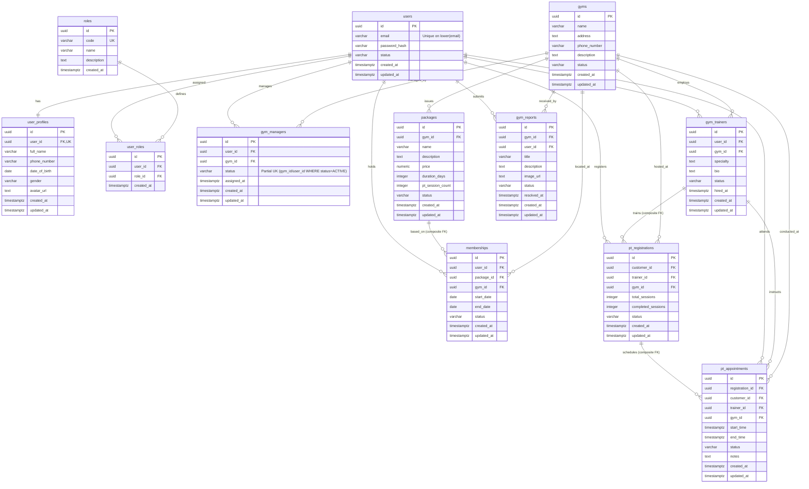

# Multi-Gym Platform — Database Specification

## 1. Mục Đích & Tổng Quan Thiết Kế

Tài liệu này xác lập bản **Đặc tả Thiết kế Cơ sở Dữ liệu (Database Specification)** chính thức cho dự án **Multi-Gym Platform**.

Mục tiêu cốt lõi:
- Cụ thể hóa 12 Domain Entities từ [`docs/DOMAIN_RULES.md`](file:///srv/gym/docs/DOMAIN_RULES.md) thành 12 bảng cơ sở dữ liệu quan hệ (PostgreSQL 17).
- Định nghĩa chi tiết: Tên bảng, cấu trúc cột, kiểu dữ liệu, ràng buộc khóa chính (PK), khóa ngoại (FK), ràng buộc duy nhất (UNIQUE), kiểm tra tính hợp lệ (CHECK) và chiến lược đánh chỉ mục (Index).
- Xác lập cơ chế phân lập dữ liệu phòng tập (**Gym Scope Strategy**) ở cấp độ database schema bằng các **Composite Foreign Keys**, ngăn chặn triệt để nguy cơ rò rỉ hoặc sai lệch dữ liệu chéo giữa các phòng gym.
- Quy định chính sách xóa/cập nhật khóa ngoại (ON DELETE / ON UPDATE) nhằm bảo toàn tính toàn vẹn dữ liệu lịch sử vận hành.
- Ngăn chặn triệt để hiện tượng race condition khi đặt lịch hẹn huấn luyện viên (Appointment Overlap).
- Chuẩn bị tài liệu kỹ thuật làm cơ sở trực tiếp cho bước sinh schema Drizzle ORM và các file migration tiếp theo.

> [!IMPORTANT]
> - **Phạm vi nghiêm ngặt:** Chỉ thiết kế đúng **12 bảng**. Tuyệt đối không thêm bất kỳ bảng nào ngoài 12 bảng này (Không có `Payment`, `Invoice`, `Transaction`, `Audit_Log`, `Report_Attachment`, v.v.).
> - **Thanh toán (Payment):** Được xác định là **OUT OF SCOPE — CURRENT PHASE**.
> - Tài liệu này là **đặc tả kỹ thuật thiết kế**, KHÔNG chứa mã code migration, Drizzle schema implementation hay backend code.

---

## 2. Tiêu Chuẩn Kỹ Thuật Cơ Sở Dữ Liệu

### 2.1. Động cơ & Chuẩn Đặt Tên (Database Engine & Naming Conventions)
- **Hệ quản trị CSDL:** **PostgreSQL 17** (Chạy trên Docker container `multi_gym_postgres` qua image `postgres:17-alpine`).
- **Tên bảng (Table Names):** Danh từ số nhiều, chữ thường, dạng `snake_case` (ví dụ: `users`, `user_profiles`, `gym_managers`, `pt_appointments`).
- **Tên cột (Column Names):** Chữ thường, dạng `snake_case` (ví dụ: `user_id`, `gym_id`, `start_date`, `created_at`).
- **Khóa chính (Primary Key):** Mọi bảng bắt buộc sử dụng cột `id` kiểu `UUID`, sinh tự động bằng hàm `gen_random_uuid()`.
- **Khóa ngoại (Foreign Keys):** Đặt tên theo cú pháp `<singular_parent_table>_id` (ví dụ: `user_id`, `gym_id`, `package_id`, `registration_id`).

### 2.2. Chiến Lược Thời Gian & Timezone
- Mọi cột thời gian lưu vết (`created_at`, `updated_at`, `start_time`, `end_time`, `resolved_at`) bắt buộc dùng kiểu **`TIMESTAMPTZ` (Timestamp with Time Zone)**.
- Mặc định khởi tạo: `DEFAULT now()`.
- Quy chuẩn lưu trữ: Lưu trữ theo mốc chuẩn UTC; việc hiển thị múi giờ địa phương (ví dụ `Asia/Ho_Chi_Minh` UTC+7) do tầng Application/Client định dạng.
- Cột chỉ lưu ngày tháng (`start_date`, `end_date`, `date_of_birth`): Sử dụng kiểu **`DATE`**.

### 2.3. Chiến Lược Lưu Trữ Trạng Thái (Status & Enum Strategy)
- Nhằm đảm bảo tính linh hoạt khi migration và tương thích tối đa với Drizzle ORM, các cột trạng thái được thiết kế dưới dạng **`VARCHAR(32)` kết hợp ràng buộc `CHECK (status IN (...))`**.
- Giải pháp này vừa bảo vệ toàn vẹn dữ liệu tại tầng DB như native enum, vừa tránh được các phức tạp khi thêm giá trị mới vào native `CREATE TYPE ... AS ENUM` trong PostgreSQL.

---

## 3. Đặc Tả Chi Tiết 12 Bảng Dữ Liệu (Table Specifications)

---

### 3.1. Bảng `users`

#### Purpose
Lưu trữ thông tin tài khoản đăng nhập, danh tính xác thực cốt lõi của người dùng trên toàn bộ nền tảng.

#### Columns
| Column | Type | Nullable | Default | PK | FK | Unique | Description |
| :--- | :--- | :---: | :---: | :---: | :---: | :---: | :--- |
| `id` | `UUID` | No | `gen_random_uuid()` | Yes | No | Yes | Khóa chính định danh tài khoản toàn cục |
| `email` | `VARCHAR(255)` | No | None | No | No | Case-Insensitive | Địa chỉ email dùng để đăng nhập |
| `password_hash` | `VARCHAR(255)` | No | None | No | No | No | Chuỗi băm mật khẩu bảo mật bằng Argon2id |
| `status` | `VARCHAR(32)` | No | `'ACTIVE'` | No | No | No | Trạng thái tài khoản: `ACTIVE`, `SUSPENDED`, `DEACTIVATED` |
| `created_at` | `TIMESTAMPTZ` | No | `now()` | No | No | No | Thời điểm tạo tài khoản |
| `updated_at` | `TIMESTAMPTZ` | No | `now()` | No | No | No | Thời điểm cập nhật thông tin gần nhất |

#### Constraints
- `pk_users`: `PRIMARY KEY (id)`
- `uq_users_email_lower`: `CREATE UNIQUE INDEX uq_users_email_lower ON users (lower(email));`
  *(Ràng buộc kỹ thuật bắt buộc: Bảo vệ tính duy nhất không phân biệt hoa thường - Case-Insensitive Uniqueness. Ngăn chặn triệt để trường hợp `son@gmail.com` và `Son@gmail.com` cùng tồn tại. Đồng thời, tầng Application vẫn bắt buộc normalize `email.trim().toLowerCase()` trước khi ghi/truy vấn).*
- `chk_users_status`: `CHECK (status IN ('ACTIVE', 'SUSPENDED', 'DEACTIVATED'))`
- `chk_users_email_format`: `CHECK (email ~* '^[A-Za-z0-9._%+-]+@[A-Za-z0-9.-]+\.[A-Za-z]{2,}$')`

#### Indexes
- `idx_users_email_lower`: Unique Functional Index trên `lower(email)` (hỗ trợ tìm kiếm đăng nhập cực nhanh).
- `idx_users_status`: B-Tree trên `status` (phục vụ lọc tài khoản hoạt động/bị khóa).

#### Relationships
- $1 - 1$ với `user_profiles` (qua `user_profiles.user_id`).
- $1 - N$ với `user_roles` (qua `user_roles.user_id`).
- $1 - N$ với `gym_managers` (qua `gym_managers.user_id`).
- $1 - N$ với `gym_trainers` (qua `gym_trainers.user_id`).
- $1 - N$ với `memberships` (qua `memberships.user_id`).
- $1 - N$ với `pt_registrations` (qua `pt_registrations.customer_id`).
- $1 - N$ với `gym_reports` (qua `gym_reports.user_id`).

#### Gym Scope
- **Phân loại:** **System-scoped**.
- **Cách xác định:** Không có cột `gym_id`. Tài khoản User tồn tại toàn sàn; việc liên kết với Gym nào được thực hiện thông qua các bảng quan hệ tương ứng.

---

### 3.2. Bảng `user_profiles`

#### Purpose
Lưu trữ thông tin hồ sơ nhân thân mở rộng của người dùng (tách biệt khỏi tài khoản đăng nhập).

#### Columns
| Column | Type | Nullable | Default | PK | FK | Unique | Description |
| :--- | :--- | :---: | :---: | :---: | :---: | :---: | :--- |
| `id` | `UUID` | No | `gen_random_uuid()` | Yes | No | Yes | Khóa chính hồ sơ |
| `user_id` | `UUID` | No | None | No | Yes | Yes | Khóa ngoại trỏ tới `users(id)` |
| `full_name` | `VARCHAR(150)` | No | None | No | No | No | Họ và tên hiển thị của người dùng |
| `phone_number` | `VARCHAR(20)` | Yes | None | No | No | No | Số điện thoại liên lạc |
| `date_of_birth` | `DATE` | Yes | None | No | No | No | Ngày tháng năm sinh |
| `gender` | `VARCHAR(20)` | Yes | None | No | No | No | Giới tính: `MALE`, `FEMALE`, `OTHER` |
| `avatar_url` | `TEXT` | Yes | None | No | No | No | Đường dẫn ảnh đại diện |
| `created_at` | `TIMESTAMPTZ` | No | `now()` | No | No | No | Thời điểm khởi tạo hồ sơ |
| `updated_at` | `TIMESTAMPTZ` | No | `now()` | No | No | No | Thời điểm cập nhật hồ sơ |

#### Constraints
- `pk_user_profiles`: `PRIMARY KEY (id)`
- `fk_user_profiles_user`: `FOREIGN KEY (user_id) REFERENCES users(id) ON DELETE CASCADE ON UPDATE CASCADE`
- `uq_user_profiles_user_id`: `UNIQUE (user_id)` (Bảo đảm tuyệt đối quan hệ $1 - 1$, một User không thể có 2 Profile).
- `chk_user_profiles_gender`: `CHECK (gender IS NULL OR gender IN ('MALE', 'FEMALE', 'OTHER'))`

#### Indexes
- `idx_user_profiles_user_id`: B-Tree trên `user_id` (tự động tạo bởi Unique constraint, hỗ trợ join nhanh).
- `idx_user_profiles_phone`: B-Tree trên `phone_number` (hỗ trợ tìm kiếm học viên theo số điện thoại).

#### Relationships
- $N - 1$ (Thực tế là $1 - 1$) với `users`.

#### Gym Scope
- **Phân loại:** **System-scoped** (Đi theo vòng đời của `User`).

---

### 3.3. Bảng `roles`

#### Purpose
Bảng danh mục định nghĩa các vai trò/quyền hạn cốt lõi được hệ thống công nhận.

#### Columns
| Column | Type | Nullable | Default | PK | FK | Unique | Description |
| :--- | :--- | :---: | :---: | :---: | :---: | :---: | :--- |
| `id` | `UUID` | No | `gen_random_uuid()` | Yes | No | Yes | Khóa chính danh mục vai trò |
| `code` | `VARCHAR(32)` | No | None | No | No | Yes | Mã vai trò chuẩn: `CUSTOMER`, `PT`, `MANAGER`, `ADMIN` |
| `name` | `VARCHAR(100)` | No | None | No | No | No | Tên hiển thị của vai trò |
| `description` | `TEXT` | Yes | None | No | No | No | Mô tả chi tiết quyền hạn của vai trò |
| `created_at` | `TIMESTAMPTZ` | No | `now()` | No | No | No | Thời điểm khởi tạo vai trò |

#### Constraints
- `pk_roles`: `PRIMARY KEY (id)`
- `uq_roles_code`: `UNIQUE (code)`
- `chk_roles_code_allowed`: `CHECK (code IN ('CUSTOMER', 'PT', 'MANAGER', 'ADMIN'))` (Cấm thêm role tùy tiện; Guest không nằm trong bảng này).

#### Indexes
- `idx_roles_code`: B-Tree trên `code`.

#### Relationships
- $1 - N$ với `user_roles` (qua `user_roles.role_id`).

#### Gym Scope
- **Phân loại:** **System-scoped** (Master data toàn hệ thống).

---

### 3.4. Bảng `user_roles`

#### Purpose
Bảng quan hệ nhiều - nhiều ($N - N$) gán vai trò (`Role`) cho người dùng (`User`).

#### Columns
| Column | Type | Nullable | Default | PK | FK | Unique | Description |
| :--- | :--- | :---: | :---: | :---: | :---: | :---: | :--- |
| `id` | `UUID` | No | `gen_random_uuid()` | Yes | No | Yes | Khóa chính bản ghi gán vai trò |
| `user_id` | `UUID` | No | None | No | Yes | No | Khóa ngoại trỏ tới `users(id)` |
| `role_id` | `UUID` | No | None | No | Yes | No | Khóa ngoại trỏ tới `roles(id)` |
| `created_at` | `TIMESTAMPTZ` | No | `now()` | No | No | No | Thời điểm gán vai trò |

#### Constraints
- `pk_user_roles`: `PRIMARY KEY (id)`
- `fk_user_roles_user`: `FOREIGN KEY (user_id) REFERENCES users(id) ON DELETE CASCADE ON UPDATE CASCADE`
- `fk_user_roles_role`: `FOREIGN KEY (role_id) REFERENCES roles(id) ON DELETE RESTRICT ON UPDATE CASCADE`
- `uq_user_roles_user_role`: `UNIQUE (user_id, role_id)` (Ngăn chặn hoàn toàn việc gán trùng lặp 1 Role cho 1 User).

#### Indexes
- `idx_user_roles_user_id`: B-Tree trên `user_id` (truy vấn danh sách roles của user khi xác thực request).
- `idx_user_roles_role_id`: B-Tree trên `role_id` (truy vấn danh sách users theo role).

#### Relationships
- $N - 1$ với `users`.
- $N - 1$ với `roles`.

#### Gym Scope
- **Phân loại:** **System-scoped**.

---

### 3.5. Bảng `gyms`

#### Purpose
Thực thể gốc đại diện cho từng cơ sở/chi nhánh phòng tập (Tenant / Business Location).

#### Columns
| Column | Type | Nullable | Default | PK | FK | Unique | Description |
| :--- | :--- | :---: | :---: | :---: | :---: | :---: | :--- |
| `id` | `UUID` | No | `gen_random_uuid()` | Yes | No | Yes | Khóa chính định danh phòng Gym |
| `name` | `VARCHAR(200)` | No | None | No | No | No | Tên cơ sở phòng tập (ví dụ: Gym Tân Bình) |
| `address` | `TEXT` | No | None | No | No | No | Địa chỉ chi tiết cơ sở |
| `phone_number` | `VARCHAR(30)` | Yes | None | No | No | No | Số điện thoại hotline cơ sở |
| `description` | `TEXT` | Yes | None | No | No | No | Mô tả cơ sở vật chất, tiện ích |
| `status` | `VARCHAR(32)` | No | `'ACTIVE'` | No | No | No | Trạng thái: `ACTIVE`, `MAINTENANCE`, `CLOSED` |
| `created_at` | `TIMESTAMPTZ` | No | `now()` | No | No | No | Thời điểm đăng ký cơ sở |
| `updated_at` | `TIMESTAMPTZ` | No | `now()` | No | No | No | Thời điểm cập nhật thông tin cơ sở |

#### Constraints
- `pk_gyms`: `PRIMARY KEY (id)`
- `chk_gyms_status`: `CHECK (status IN ('ACTIVE', 'MAINTENANCE', 'CLOSED'))`

#### Indexes
- `idx_gyms_status`: B-Tree trên `status` (phục vụ lọc các phòng gym đang mở cửa cho khách xem).
- `idx_gyms_name`: B-Tree trên `name` (phục vụ tìm kiếm chi nhánh theo tên).

#### Relationships
- $1 - N$ với `gym_managers`.
- $1 - N$ với `gym_trainers`.
- $1 - N$ với `packages`.
- $1 - N$ với `memberships`.
- $1 - N$ với `gym_reports`.

#### Gym Scope
- **Phân loại:** **Root Entity của Gym Scope**. Tự định danh chính mình qua `id`.

---

### 3.6. Bảng `gym_managers`

#### Purpose
Lưu trữ quan hệ bổ nhiệm người dùng (`User`) làm Quản lý điều hành tại một cơ sở phòng tập (`Gym`) cụ thể.

#### Columns
| Column | Type | Nullable | Default | PK | FK | Unique | Description |
| :--- | :--- | :---: | :---: | :---: | :---: | :---: | :--- |
| `id` | `UUID` | No | `gen_random_uuid()` | Yes | No | Yes | Khóa chính bản ghi bổ nhiệm |
| `user_id` | `UUID` | No | None | No | Yes | No | Khóa ngoại trỏ tới `users(id)` |
| `gym_id` | `UUID` | No | None | No | Yes | No | Khóa ngoại trỏ tới `gyms(id)` |
| `status` | `VARCHAR(32)` | No | `'ACTIVE'` | No | No | No | Trạng thái: `ACTIVE`, `REVOKED` |
| `assigned_at` | `TIMESTAMPTZ` | No | `now()` | No | No | No | Thời điểm bổ nhiệm |
| `created_at` | `TIMESTAMPTZ` | No | `now()` | No | No | No | Thời điểm tạo bản ghi |
| `updated_at` | `TIMESTAMPTZ` | No | `now()` | No | No | No | Thời điểm cập nhật trạng thái |

#### Constraints
- `pk_gym_managers`: `PRIMARY KEY (id)`
- `fk_gym_managers_user`: `FOREIGN KEY (user_id) REFERENCES users(id) ON DELETE CASCADE ON UPDATE CASCADE`
- `fk_gym_managers_gym`: `FOREIGN KEY (gym_id) REFERENCES gyms(id) ON DELETE RESTRICT ON UPDATE CASCADE`
- `chk_gym_managers_status`: `CHECK (status IN ('ACTIVE', 'REVOKED'))`
- `uq_gym_managers_active_per_gym`: Partial Unique Index:
  ```sql
  CREATE UNIQUE INDEX uq_gym_managers_active_per_gym ON gym_managers (gym_id) WHERE (status = 'ACTIVE');
  ```
  *(Bảo vệ Cardinality cốt lõi: Tại một thời điểm, một phòng Gym chỉ có DUY NHẤT một Manager ở trạng thái ACTIVE điều hành).*
- `uq_gym_managers_active_per_user`: Partial Unique Index:
  ```sql
  CREATE UNIQUE INDEX uq_gym_managers_active_per_user ON gym_managers (user_id) WHERE (status = 'ACTIVE');
  ```
  *(Bảo vệ ranh giới Manager: Tại một thời điểm, một User chỉ được nắm quyền ACTIVE điều hành tại DUY NHẤT một phòng Gym).*
- `uq_gym_managers_user_gym_revoked`: Bảng vẫn cho phép lưu giữ lịch sử nhiều lần bổ nhiệm và miễn nhiệm (`REVOKED`) của cùng một user trên một gym mà không bị xung đột khóa.

#### Indexes
- `idx_gym_managers_active_gym`: Partial index trên `(gym_id) WHERE status = 'ACTIVE'` (tìm kiếm tức thì Manager đương nhiệm của phòng gym).
- `idx_gym_managers_active_user`: Partial index trên `(user_id) WHERE status = 'ACTIVE'` (middleware kiểm tra ngay lập tức phòng gym mà user đang quản lý).
- `idx_gym_managers_history`: B-Tree trên `(user_id, gym_id, assigned_at)` (truy vết lịch sử bổ nhiệm).

#### Relationships
- $N - 1$ với `users`.
- $N - 1$ với `gyms`.

#### Gym Scope
- **Phân loại:** **Gym-scoped**. Xác định trực tiếp qua cột `gym_id`.
- **Ranh giới:** Căn cứ xác thực để Backend cấm Manager can thiệp phòng Gym khác.

---

### 3.7. Bảng `gym_trainers`

#### Purpose
Lưu trữ thông tin hợp đồng và phân công của Huấn luyện viên (`User` có vai trò PT) làm việc tại một phòng Gym xác định.

#### Columns
| Column | Type | Nullable | Default | PK | FK | Unique | Description |
| :--- | :--- | :---: | :---: | :---: | :---: | :---: | :--- |
| `id` | `UUID` | No | `gen_random_uuid()` | Yes | No | Yes | Khóa chính bản ghi huấn luyện viên tại Gym |
| `user_id` | `UUID` | No | None | No | Yes | No | Khóa ngoại trỏ tới `users(id)` |
| `gym_id` | `UUID` | No | None | No | Yes | No | Khóa ngoại trỏ tới `gyms(id)` |
| `specialty` | `TEXT` | Yes | None | No | No | No | Chuyên môn (ví dụ: Tăng cơ, Giảm cân, Boxing) |
| `bio` | `TEXT` | Yes | None | No | No | No | Giới thiệu kinh nghiệm, chứng chỉ |
| `status` | `VARCHAR(32)` | No | `'ACTIVE'` | No | No | No | Trạng thái: `ACTIVE`, `ON_LEAVE`, `TERMINATED` |
| `hired_at` | `TIMESTAMPTZ` | No | `now()` | No | No | No | Ngày bắt đầu ký hợp đồng làm việc |
| `created_at` | `TIMESTAMPTZ` | No | `now()` | No | No | No | Thời điểm tạo bản ghi |
| `updated_at` | `TIMESTAMPTZ` | No | `now()` | No | No | No | Thời điểm cập nhật bản ghi |

#### Constraints
- `pk_gym_trainers`: `PRIMARY KEY (id)`
- `fk_gym_trainers_user`: `FOREIGN KEY (user_id) REFERENCES users(id) ON DELETE CASCADE ON UPDATE CASCADE`
- `fk_gym_trainers_gym`: `FOREIGN KEY (gym_id) REFERENCES gyms(id) ON DELETE RESTRICT ON UPDATE CASCADE`
- `uq_gym_trainers_composite`: `UNIQUE (id, gym_id)`
  *(Ràng buộc kỹ thuật bắt buộc: Đóng vai trò làm đích tham chiếu cho Composite FK từ `pt_registrations`, bảo đảm tính toàn vẹn Gym Scope của PT).*
- `uq_gym_trainers_user_gym`: `UNIQUE (user_id, gym_id)` (Một người dùng chỉ có 1 hợp đồng phân công tại 1 cơ sở).
- `chk_gym_trainers_status`: `CHECK (status IN ('ACTIVE', 'ON_LEAVE', 'TERMINATED'))`

#### Indexes
- `idx_gym_trainers_gym_status`: B-Tree trên `(gym_id, status)` (truy vấn danh sách PT đang hoạt động tại chi nhánh).
- `idx_gym_trainers_user_id`: B-Tree trên `user_id` (truy vấn thông tin cơ sở làm việc của tài khoản PT).

#### Relationships
- $N - 1$ với `users`.
- $N - 1$ với `gyms`.
- $1 - N$ với `pt_registrations`.
- $1 - N$ với `pt_appointments`.

#### Gym Scope
- **Phân loại:** **Gym-scoped**. Xác định trực tiếp qua cột `gym_id`.

---

### 3.8. Bảng `packages`

#### Purpose
Lưu trữ danh mục gói sản phẩm / dịch vụ tập luyện do từng phòng Gym phát hành.

#### Columns
| Column | Type | Nullable | Default | PK | FK | Unique | Description |
| :--- | :--- | :---: | :---: | :---: | :---: | :---: | :--- |
| `id` | `UUID` | No | `gen_random_uuid()` | Yes | No | Yes | Khóa chính gói tập |
| `gym_id` | `UUID` | No | None | No | Yes | No | Khóa ngoại trỏ tới `gyms(id)` cơ sở phát hành |
| `name` | `VARCHAR(150)` | No | None | No | No | No | Tên gói tập (ví dụ: Gói 3 Tháng Tiêu Chuẩn) |
| `description` | `TEXT` | Yes | None | No | No | No | Quyền lợi chi tiết của gói |
| `price` | `NUMERIC(12, 2)` | No | None | No | No | No | Giá niêm yết của gói (VND), không âm |
| `duration_days` | `INTEGER` | No | None | No | No | No | Thời hạn sử dụng tính theo ngày ($> 0$) |
| `pt_session_count` | `INTEGER` | No | `0` | No | No | No | Số buổi tập cùng PT đi kèm ($\ge 0$) |
| `status` | `VARCHAR(32)` | No | `'ACTIVE'` | No | No | No | Trạng thái mở bán: `ACTIVE`, `INACTIVE` |
| `created_at` | `TIMESTAMPTZ` | No | `now()` | No | No | No | Thời điểm tạo gói |
| `updated_at` | `TIMESTAMPTZ` | No | `now()` | No | No | No | Thời điểm cập nhật gói |

#### Constraints
- `pk_packages`: `PRIMARY KEY (id)`
- `fk_packages_gym`: `FOREIGN KEY (gym_id) REFERENCES gyms(id) ON DELETE RESTRICT ON UPDATE CASCADE`
- `chk_packages_price`: `CHECK (price >= 0)`
- `chk_packages_duration`: `CHECK (duration_days > 0)`
- `chk_packages_pt_sessions`: `CHECK (pt_session_count >= 0)`
- `chk_packages_status`: `CHECK (status IN ('ACTIVE', 'INACTIVE'))`
- `uq_packages_composite`: `UNIQUE (id, gym_id)`
  *(Ràng buộc kỹ thuật bắt buộc: Đóng vai trò làm đích tham chiếu cho Composite FK từ `memberships`).*

#### Indexes
- `idx_packages_gym_status`: B-Tree trên `(gym_id, status)` (truy vấn danh sách gói tập mở bán tại một phòng Gym).

#### Relationships
- $N - 1$ với `gyms`.
- $1 - N$ với `memberships`.

#### Gym Scope
- **Phân loại:** **Gym-scoped**. Xác định trực tiếp qua cột `gym_id`.

---

### 3.9. Bảng `memberships`

#### Purpose
Lưu trữ hợp đồng hội viên thực tế của khách hàng gắn liền với gói tập đã chọn tại một phòng Gym xác định.

#### Columns
| Column | Type | Nullable | Default | PK | FK | Unique | Description |
| :--- | :--- | :---: | :---: | :---: | :---: | :---: | :--- |
| `id` | `UUID` | No | `gen_random_uuid()` | Yes | No | Yes | Khóa chính hợp đồng hội viên |
| `user_id` | `UUID` | No | None | No | Yes | No | Khóa ngoại trỏ tới `users(id)` (Customer) |
| `package_id` | `UUID` | No | None | No | Yes | No | Khóa ngoại trỏ tới `packages(id)` |
| `gym_id` | `UUID` | No | None | No | Yes | No | Khóa ngoại trỏ tới `gyms(id)` cơ sở áp dụng |
| `start_date` | `DATE` | No | None | No | No | No | Ngày bắt đầu có hiệu lực tập |
| `end_date` | `DATE` | No | None | No | No | No | Ngày hết hạn hợp đồng tập |
| `status` | `VARCHAR(32)` | No | `'PENDING_ACTIVATION'` | No | No | No | Trạng thái: `PENDING_ACTIVATION`, `ACTIVE`, `EXPIRED`, `SUSPENDED`, `TERMINATED` |
| `created_at` | `TIMESTAMPTZ` | No | `now()` | No | No | No | Thời điểm đăng ký hợp đồng |
| `updated_at` | `TIMESTAMPTZ` | No | `now()` | No | No | No | Thời điểm cập nhật hợp đồng |

#### Constraints
- `pk_memberships`: `PRIMARY KEY (id)`
- `fk_memberships_user`: `FOREIGN KEY (user_id) REFERENCES users(id) ON DELETE RESTRICT ON UPDATE CASCADE`
- `fk_memberships_gym`: `FOREIGN KEY (gym_id) REFERENCES gyms(id) ON DELETE RESTRICT ON UPDATE CASCADE`
- `fk_memberships_package_composite`: `FOREIGN KEY (package_id, gym_id) REFERENCES packages(id, gym_id) ON DELETE RESTRICT ON UPDATE CASCADE`
  *(Ràng buộc kỹ thuật tối quan trọng: Bảo đảm tuyệt đối tại tầng DB rằng `gym_id` của Membership phải trùng 100% với `gym_id` của Package, ngăn chặn hoàn toàn việc đăng ký gói của Gym A nhưng gán thẻ vào Gym B).*
- `chk_memberships_dates`: `CHECK (end_date >= start_date)`
- `chk_memberships_status`: `CHECK (status IN ('PENDING_ACTIVATION', 'ACTIVE', 'EXPIRED', 'SUSPENDED', 'TERMINATED'))`

#### Indexes
- `idx_memberships_gym_status`: B-Tree trên `(gym_id, status)` (Manager kiểm tra danh sách hội viên tại phòng gym).
- `idx_memberships_user_status`: B-Tree trên `(user_id, status)` (Customer kiểm tra các thẻ tập đang hoạt động của mình).
- `idx_memberships_checkin`: B-Tree trên `(gym_id, user_id, status, start_date, end_date)` (truy vấn siêu tốc khi hội viên quét thẻ check-in vào cửa).

#### Relationships
- $N - 1$ với `users`.
- $N - 1$ với `packages`.
- $N - 1$ với `gyms`.

#### Gym Scope
- **Phân loại:** **Gym-scoped**. Xác định trực tiếp qua cột `gym_id`.

---

### 3.10. Bảng `pt_registrations`

#### Purpose
Lưu trữ hợp đồng đăng ký dịch vụ huấn luyện cá nhân giữa khách hàng và một PT cụ thể tại phòng Gym.

#### Columns
| Column | Type | Nullable | Default | PK | FK | Unique | Description |
| :--- | :--- | :---: | :---: | :---: | :---: | :---: | :--- |
| `id` | `UUID` | No | `gen_random_uuid()` | Yes | No | Yes | Khóa chính bản đăng ký PT |
| `customer_id` | `UUID` | No | None | No | Yes | No | Khóa ngoại trỏ tới `users(id)` (Customer) |
| `trainer_id` | `UUID` | No | None | No | Yes | No | Khóa ngoại trỏ tới `gym_trainers(id)` (PT) |
| `gym_id` | `UUID` | No | None | No | Yes | No | Khóa ngoại trỏ tới `gyms(id)` cơ sở diễn ra tập luyện |
| `total_sessions` | `INTEGER` | No | None | No | No | No | Tổng số buổi tập được quyền sử dụng ($> 0$) |
| `completed_sessions` | `INTEGER` | No | `0` | No | No | No | Số buổi tập đã hoàn thành ($\ge 0$) |
| `status` | `VARCHAR(32)` | No | `'ASSIGNED'` | No | No | No | Trạng thái: `ASSIGNED`, `IN_PROGRESS`, `COMPLETED`, `CANCELLED` |
| `created_at` | `TIMESTAMPTZ` | No | `now()` | No | No | No | Thời điểm đăng ký dịch vụ |
| `updated_at` | `TIMESTAMPTZ` | No | `now()` | No | No | No | Thời điểm cập nhật tiến độ |

#### Constraints
- `pk_pt_registrations`: `PRIMARY KEY (id)`
- `fk_pt_registrations_customer`: `FOREIGN KEY (customer_id) REFERENCES users(id) ON DELETE RESTRICT ON UPDATE CASCADE`
- `fk_pt_registrations_gym`: `FOREIGN KEY (gym_id) REFERENCES gyms(id) ON DELETE RESTRICT ON UPDATE CASCADE`
- `fk_pt_registrations_trainer_composite`: `FOREIGN KEY (trainer_id, gym_id) REFERENCES gym_trainers(id, gym_id) ON DELETE RESTRICT ON UPDATE CASCADE`
  *(Ràng buộc kỹ thuật bắt buộc: Ngăn chặn triệt để dữ liệu lỗi khi tạo Registration thuộc Gym A nhưng gán trainer_id thuộc Gym B. Huấn luyện viên bắt buộc phải có hợp đồng ACTIVE tại chính Gym đó).*
- `uq_pt_registrations_composite`: `UNIQUE (id, customer_id, trainer_id, gym_id)`
  *(Ràng buộc kỹ thuật bắt buộc: Đóng vai trò làm đích tham chiếu Composite FK cho `pt_appointments`, bảo đảm tính đồng nhất giữa Lịch hẹn và Hợp đồng PT).*
- `chk_pt_registrations_sessions_total`: `CHECK (total_sessions > 0)`
- `chk_pt_registrations_sessions_completed`: `CHECK (completed_sessions >= 0)`
- `chk_pt_registrations_sessions_boundary`: `CHECK (completed_sessions <= total_sessions)` (Bảo vệ bất biến: Số buổi hoàn thành không vượt tổng buổi).
- `chk_pt_registrations_status`: `CHECK (status IN ('ASSIGNED', 'IN_PROGRESS', 'COMPLETED', 'CANCELLED'))`

#### Indexes
- `idx_pt_reg_trainer_status`: B-Tree trên `(trainer_id, status)` (PT kiểm tra danh sách học viên đang phụ trách).
- `idx_pt_reg_customer_status`: B-Tree trên `(customer_id, status)` (Customer theo dõi gói PT của mình).
- `idx_pt_reg_gym_id`: B-Tree trên `gym_id` (Manager quản lý phân bổ PT tại chi nhánh).

#### Relationships
- $N - 1$ với `users` (`customer_id`).
- $N - 1$ với `gym_trainers`.
- $N - 1$ với `gyms`.
- $1 - N$ với `pt_appointments`.

#### Gym Scope
- **Phân loại:** **Gym-scoped**. Xác định trực tiếp qua cột `gym_id`.

---

### 3.11. Bảng `pt_appointments`

#### Purpose
Lưu trữ lịch hẹn từng ca tập luyện cụ thể trong một khung giờ xác định giữa học viên và huấn luyện viên.

#### Columns
| Column | Type | Nullable | Default | PK | FK | Unique | Description |
| :--- | :--- | :---: | :---: | :---: | :---: | :---: | :--- |
| `id` | `UUID` | No | `gen_random_uuid()` | Yes | No | Yes | Khóa chính lịch hẹn buổi tập |
| `registration_id` | `UUID` | No | None | No | Yes | No | Khóa ngoại trỏ tới `pt_registrations(id)` |
| `customer_id` | `UUID` | No | None | No | Yes | No | Khóa ngoại trỏ tới `users(id)` (Customer) |
| `trainer_id` | `UUID` | No | None | No | Yes | No | Khóa ngoại trỏ tới `gym_trainers(id)` (PT) |
| `gym_id` | `UUID` | No | None | No | Yes | No | Khóa ngoại trỏ tới `gyms(id)` cơ sở diễn ra buổi tập |
| `start_time` | `TIMESTAMPTZ` | No | None | No | No | No | Thời điểm bắt đầu ca tập |
| `end_time` | `TIMESTAMPTZ` | No | None | No | No | No | Thời điểm kết thúc ca tập |
| `status` | `VARCHAR(32)` | No | `'SCHEDULED'` | No | No | No | Trạng thái: `SCHEDULED`, `COMPLETED`, `CANCELLED`, `NO_SHOW` |
| `notes` | `TEXT` | Yes | None | No | No | No | Ghi chú bài tập hoặc lý do hủy |
| `created_at` | `TIMESTAMPTZ` | No | `now()` | No | No | No | Thời điểm đặt lịch |
| `updated_at` | `TIMESTAMPTZ` | No | `now()` | No | No | No | Thời điểm cập nhật trạng thái |

#### Constraints
- `pk_pt_appointments`: `PRIMARY KEY (id)`
- `fk_pt_appointments_registration_composite`: 
  ```sql
  FOREIGN KEY (registration_id, customer_id, trainer_id, gym_id) 
  REFERENCES pt_registrations(id, customer_id, trainer_id, gym_id) 
  ON DELETE RESTRICT ON UPDATE CASCADE
  ```
  *(Ràng buộc kỹ thuật đồng nhất tuyệt đối: Bảo đảm 100% tại tầng database rằng customer_id, trainer_id, và gym_id trong bản ghi lịch hẹn bắt buộc phải trùng khớp hoàn toàn với bản đăng ký pt_registrations gốc. Ngăn chặn triệt để lỗi logic: Appointment thuộc Registration Gym A nhưng bị gán gym_id Gym B, hoặc Appointment trỏ sai Customer/PT).*
- `chk_pt_appointments_time_order`: `CHECK (end_time > start_time)` (Bảo đảm thời gian kết thúc phải lớn hơn thời gian bắt đầu).
- `chk_pt_appointments_status`: `CHECK (status IN ('SCHEDULED', 'COMPLETED', 'CANCELLED', 'NO_SHOW'))`
- `ex_pt_appointments_trainer_no_overlap`:
  ```sql
  -- Yêu cầu PostgreSQL extension btree_gist
  ALTER TABLE pt_appointments 
  ADD CONSTRAINT ex_pt_appointments_trainer_no_overlap 
  EXCLUDE USING gist (
    trainer_id WITH =,
    tstzrange(start_time, end_time) WITH &&
  ) WHERE (status = 'SCHEDULED');
  ```
  *(Ràng buộc chống trùng lịch PT - Race Condition Elimination: Bảo vệ ở cấp độ engine cơ sở dữ liệu. Ngăn chặn triệt để trường hợp 2 request đồng thời (concurrent requests) cùng đặt lịch ca tập giao nhau về thời gian cho cùng 1 PT).*
- `ex_pt_appointments_customer_no_overlap`:
  ```sql
  -- Yêu cầu PostgreSQL extension btree_gist
  ALTER TABLE pt_appointments 
  ADD CONSTRAINT ex_pt_appointments_customer_no_overlap 
  EXCLUDE USING gist (
    customer_id WITH =,
    tstzrange(start_time, end_time) WITH &&
  ) WHERE (status = 'SCHEDULED');
  ```
  *(Ràng buộc chống trùng lịch học viên: Một Customer không thể có 2 ca tập SCHEDULED trùng thời gian).*

#### Indexes
- `idx_pt_app_composite_fk`: B-Tree trên `(registration_id, customer_id, trainer_id, gym_id)`.
- `idx_pt_app_trainer_schedule`: GiST index tự động sinh bởi `EXCLUDE CONSTRAINT` trên `(trainer_id, tstzrange(start_time, end_time))` (vừa chống trùng lịch, vừa hỗ trợ query lịch dạy cực nhanh).
- `idx_pt_app_customer_schedule`: GiST index trên `(customer_id, tstzrange(start_time, end_time))`.
- `idx_pt_app_gym_date`: B-Tree trên `(gym_id, start_time)` (Manager theo dõi lịch vận hành phòng tập theo ngày).

#### Relationships
- $N - 1$ với `pt_registrations`.
- $N - 1$ với `users` (`customer_id`).
- $N - 1$ với `gym_trainers`.
- $N - 1$ với `gyms`.

#### Gym Scope
- **Phân loại:** **Gym-scoped**. Xác định trực tiếp qua cột `gym_id`.

---

### 3.12. Bảng `gym_reports`

#### Purpose
Lưu trữ báo cáo phản ánh sự cố hoặc góp ý chất lượng dịch vụ do học viên gửi đích danh tới Ban Quản Lý phòng Gym.

#### Columns
| Column | Type | Nullable | Default | PK | FK | Unique | Description |
| :--- | :--- | :---: | :---: | :---: | :---: | :---: | :--- |
| `id` | `UUID` | No | `gen_random_uuid()` | Yes | No | Yes | Khóa chính báo cáo phản ánh |
| `gym_id` | `UUID` | No | None | No | Yes | No | Khóa ngoại trỏ tới `gyms(id)` cơ sở tiếp nhận |
| `user_id` | `UUID` | No | None | No | Yes | No | Khóa ngoại trỏ tới `users(id)` người gửi phản ánh |
| `title` | `VARCHAR(200)` | No | None | No | No | No | Tiêu đề tóm tắt sự cố |
| `description` | `TEXT` | No | None | No | No | No | Mô tả chi tiết nội dung sự cố/góp ý |
| `image_url` | `TEXT` | Yes | None | No | No | No | Đường dẫn 01 ảnh minh chứng duy nhất |
| `status` | `VARCHAR(32)` | No | `'SUBMITTED'` | No | No | No | Trạng thái xử lý: `SUBMITTED`, `INVESTIGATING`, `RESOLVED`, `REJECTED` |
| `resolved_at` | `TIMESTAMPTZ` | Yes | None | No | No | No | Thời điểm đánh dấu xử lý xong sự cố |
| `created_at` | `TIMESTAMPTZ` | No | `now()` | No | No | No | Thời điểm gửi phản ánh |
| `updated_at` | `TIMESTAMPTZ` | No | `now()` | No | No | No | Thời điểm cập nhật trạng thái xử lý |

#### Constraints
- `pk_gym_reports`: `PRIMARY KEY (id)`
- `fk_gym_reports_gym`: `FOREIGN KEY (gym_id) REFERENCES gyms(id) ON DELETE RESTRICT ON UPDATE CASCADE`
- `fk_gym_reports_user`: `FOREIGN KEY (user_id) REFERENCES users(id) ON DELETE RESTRICT ON UPDATE CASCADE`
- `chk_gym_reports_status`: `CHECK (status IN ('SUBMITTED', 'INVESTIGATING', 'RESOLVED', 'REJECTED'))`

#### Indexes
- `idx_gym_reports_gym_status`: B-Tree trên `(gym_id, status, created_at)` (Manager theo dõi danh sách sự cố cần xử lý tại cơ sở theo thời gian).
- `idx_gym_reports_user_id`: B-Tree trên `user_id` (Customer theo dõi các phản ánh do mình tạo).

#### Relationships
- $N - 1$ với `gyms`.
- $N - 1$ với `users`.

#### Gym Scope
- **Phân loại:** **Gym-scoped**. Xác định trực tiếp qua cột `gym_id`.

---

## 4. Phân Loại & Cơ Chế Gym Scope (Gym Scope Strategy)

Bảng phân loại chi tiết ranh giới dữ liệu cho 12 bảng:

```text
┌────────────────────────────────────────────────────────┐
│               SYSTEM-SCOPED TABLES                     │
│  (Không có gym_id, dùng chung trên toàn hệ thống)      │
│  - users                                               │
│  - user_profiles                                       │
│  - roles                                               │
│  - user_roles                                          │
└────────────────────────────────────────────────────────┘
                           │
                           ▼
┌────────────────────────────────────────────────────────┐
│                   ROOT TENANT TABLE                    │
│  - gyms (Tự định danh chính mình qua gyms.id)          │
└────────────────────────────────────────────────────────┘
                           │
                           ▼
┌────────────────────────────────────────────────────────┐
│                GYM-SCOPED TABLES                       │
│  (Bắt buộc có gym_id trực tiếp để phân lập truy vấn)   │
│  - gym_managers      - packages                        │
│  - gym_trainers      - memberships                     │
│  - pt_registrations  - pt_appointments                 │
│  - gym_reports                                         │
└────────────────────────────────────────────────────────┘
```

### 4.1. Ma Trận Bảo Vệ Ranh Giới Dữ Liệu Chéo (Cross-Gym Leakage Prevention)

Hệ thống bảo vệ Gym Scope ở 3 cấp độ đồng bộ:

1. **Cấp độ Membership $\rightarrow$ Package $\rightarrow$ Gym:**
   - Composite FK: `memberships(package_id, gym_id) REFERENCES packages(id, gym_id)`.
   - *Đảm bảo:* Khách hàng không thể mua gói của Gym A mà lại đăng ký thẻ hội viên tại Gym B.
2. **Cấp độ PT_Registration $\rightarrow$ Gym_Trainer $\rightarrow$ Gym:**
   - Composite FK: `pt_registrations(trainer_id, gym_id) REFERENCES gym_trainers(id, gym_id)`.
   - *Đảm bảo:* Huấn luyện viên chỉ được chỉ định vào gói tập của chính phòng Gym mà mình có hợp đồng làm việc.
3. **Cấp độ PT_Appointment $\rightarrow$ PT_Registration $\rightarrow$ Gym:**
   - Composite FK: `pt_appointments(registration_id, customer_id, trainer_id, gym_id) REFERENCES pt_registrations(id, customer_id, trainer_id, gym_id)`.
   - *Đảm bảo:* Từng buổi tập không bao giờ bị lệch sang chi nhánh khác, lệch học viên hoặc lệch huấn luyện viên so với hợp đồng đào tạo ban đầu.
4. **Cấp độ Gym_Report $\rightarrow$ Gym:**
   - Trực tiếp qua `gym_reports.gym_id REFERENCES gyms(id)`.

---

## 5. Chính Sách Xóa & Cập Nhật Khóa Ngoại (ON DELETE / ON UPDATE Policy)

| Parent Table | Child Table | Foreign Key Column | ON DELETE Policy | ON UPDATE Policy | Lý do kỹ thuật & nghiệp vụ |
| :--- | :--- | :--- | :---: | :---: | :--- |
| `users` | `user_profiles` | `user_id` | **CASCADE** | **CASCADE** | Hồ sơ cá nhân gắn liền $1-1$ với tài khoản; khi xóa User thì xóa Profile tương ứng. |
| `users` | `user_roles` | `user_id` | **CASCADE** | **CASCADE** | Xóa tài khoản thì thu hồi toàn bộ phân quyền liên kết. |
| `roles` | `user_roles` | `role_id` | **RESTRICT** | **CASCADE** | Không cho phép xóa Role danh mục nếu vẫn đang có User được gán vai trò này. |
| `users` | `gym_managers` | `user_id` | **CASCADE** | **CASCADE** | Xóa tài khoản thì hủy quyền quản lý cơ sở. |
| `gyms` | `gym_managers` | `gym_id` | **RESTRICT** | **CASCADE** | Không cho phép xóa Gym khi đang có bản ghi quản lý liên kết. |
| `users` | `gym_trainers` | `user_id` | **CASCADE** | **CASCADE** | Xóa tài khoản User thì hủy liên kết hợp đồng PT. |
| `gyms` | `gym_trainers` | `gym_id` | **RESTRICT** | **CASCADE** | Không xóa cơ sở phòng tập nếu đang có dữ liệu phân công PT. |
| `gyms` | `packages` | `gym_id` | **RESTRICT** | **CASCADE** | Không được xóa Gym khi cơ sở đó đã phát hành gói tập. |
| `gyms` | `memberships` | `gym_id` | **RESTRICT** | **CASCADE** | Bảo toàn dữ liệu hợp đồng hội viên; cấm xóa Gym nếu còn hợp đồng. |
| `packages` | `memberships` | `package_id, gym_id` | **RESTRICT** | **CASCADE** | Không được xóa gói tập nếu đã có hội viên đăng ký (Chỉ chuyển status sang `INACTIVE`). |
| `users` | `memberships` | `user_id` | **RESTRICT** | **CASCADE** | Bảo vệ lịch sử tài chính và hợp đồng; không xóa tài khoản nếu đang nắm hợp đồng còn hiệu lực. |
| `gyms` | `pt_registrations`| `gym_id` | **RESTRICT** | **CASCADE** | Bảo toàn dữ liệu đào tạo của chi nhánh. |
| `gym_trainers`| `pt_registrations`| `trainer_id, gym_id` | **RESTRICT** | **CASCADE** | Không xóa huấn luyện viên nếu đang còn học viên đăng ký tập dở dang. |
| `pt_registrations`| `pt_appointments`| `registration_id, ...` | **RESTRICT** | **CASCADE** | Không xóa hợp đồng PT nếu đã phát sinh các ca tập lịch hẹn. |
| `gyms` | `gym_reports` | `gym_id` | **RESTRICT** | **CASCADE** | Bảo toàn dữ liệu báo cáo phản ánh sự cố của chi nhánh. |
| `users` | `gym_reports` | `user_id` | **RESTRICT** | **CASCADE** | Lưu vết ai là người đã gửi phản ánh sự cố. |

---

## 6. Quy Tắc Toàn Vẹn Dữ Liệu (Data Integrity Rules)

Phân định rõ ràng giữa các quy tắc được **Database bảo vệ trực tiếp** và các quy tắc do **Tầng Ứng Dụng (Application Layer / Service)** thẩm định:

### 6.1. Database-Enforceable Invariants (Database tự bảo vệ qua DDL)
1. **Email Unique không phân biệt hoa thường:** Bảo vệ bởi functional unique index `uq_users_email_lower` trên `lower(email)`.
2. **Profile $1 - 1$ với User:** Bảo vệ bởi `uq_user_profiles_user_id`.
3. **Chống Duplicate Role:** Bảo vệ bởi `uq_user_roles_user_role`.
4. **Mỗi Gym chỉ có 1 Manager ACTIVE:** Bảo vệ bởi partial unique index `uq_gym_managers_active_per_gym` trên `(gym_id) WHERE status = 'ACTIVE'`.
5. **Mỗi Manager chỉ điều hành 1 Gym ACTIVE:** Bảo vệ bởi partial unique index `uq_gym_managers_active_per_user` trên `(user_id) WHERE status = 'ACTIVE'`.
6. **Đồng nhất Gym Scope giữa Membership và Package:** Bảo vệ bởi composite foreign key `fk_memberships_package_composite`.
7. **Đồng nhất Gym Scope giữa PT_Registration và Gym_Trainer:** Bảo vệ bởi composite foreign key `fk_pt_registrations_trainer_composite`.
8. **Đồng nhất tuyệt đối giữa PT_Appointment và PT_Registration:** Bảo vệ bởi composite foreign key `fk_pt_appointments_registration_composite`.
9. **Chống trùng lịch ca tập của PT (Zero Race Conditions):** Bảo vệ bởi `EXCLUDE USING gist` constraint `ex_pt_appointments_trainer_no_overlap`.
10. **Chống trùng lịch ca tập của Học viên:** Bảo vệ bởi `EXCLUDE USING gist` constraint `ex_pt_appointments_customer_no_overlap`.
11. **Giới hạn số buổi tập:** `completed_sessions <= total_sessions` bảo vệ bởi `chk_pt_registrations_sessions_boundary`.
12. **Thời gian lịch hẹn hợp lệ:** `end_time > start_time` bảo vệ bởi `chk_pt_appointments_time_order`.

### 6.2. Application-Level Enforced Invariants (Tầng Service / Business Logic bảo vệ)
1. **Quyền Hạn Huấn Luyện Viên:** Kiểm tra PT có đang ở trạng thái `ACTIVE` (không phải `ON_LEAVE` hoặc `TERMINATED`) khi tạo lịch hẹn mới.
2. **Giới hạn Đặt lịch trước:** Kiểm tra thời điểm đặt lịch có nằm trong khoảng cho phép (ví dụ: đặt trước tối thiểu 2 tiếng, không quá 14 ngày).
3. **Bảo lưu và Gia hạn Hợp đồng:** Tự động tính toán lại `end_date` khi hội viên xin bảo lưu thẻ tập.

---

## 7. Sơ Đồ Quan Hệ Cơ Sở Dữ Liệu (Mermaid ER Diagram)

Sơ đồ thể hiện chính xác 12 bảng, khóa chính, composite foreign keys và quan hệ:



---

## 8. Các Quyết Định Thiết Kế Database (Database Decisions)

1. **UUIDv4 Khóa Chính Toàn Cục:** Toàn bộ 12 bảng sử dụng UUID (`gen_random_uuid()`) làm khóa chính, ngăn chặn tấn công liệt kê ID tuần tự (ID Enumeration Attack) và tương thích hoàn hảo với kiến trúc multi-tenant phân tán.
2. **Email Case-Insensitive Uniqueness:** Sử dụng PostgreSQL functional unique index trên `lower(email)` để bảo vệ tài khoản chống duplicate do ký tự hoa thường.
3. **Partial Unique Index Cho Active Manager:** Áp dụng `UNIQUE (gym_id) WHERE (status = 'ACTIVE')` và `UNIQUE (user_id) WHERE (status = 'ACTIVE')` trên bảng `gym_managers` để vừa bảo đảm mỗi phòng Gym chỉ có 1 Manager đương nhiệm duy nhất, vừa lưu vết được lịch sử bổ nhiệm/miễn nhiệm (`REVOKED`).
4. **Bộ Ba Composite Foreign Keys Bảo Vệ Toàn Vẹn Gym Scope:**
   - `memberships (package_id, gym_id) -> packages (id, gym_id)`
   - `pt_registrations (trainer_id, gym_id) -> gym_trainers (id, gym_id)`
   - `pt_appointments (registration_id, customer_id, trainer_id, gym_id) -> pt_registrations (id, customer_id, trainer_id, gym_id)`
   *Quyết định này triệt tiêu hoàn toàn rủi ro dữ liệu mồ côi hoặc tham chiếu chéo giữa các chi nhánh phòng tập ngay tại tầng vật lý của PostgreSQL.*
5. **Chống Trùng Lịch Hẹn Bằng PostgreSQL EXCLUSION CONSTRAINT:** Kích hoạt extension `btree_gist` trong migration đầu tiên để sử dụng `EXCLUDE USING gist (trainer_id WITH =, tstzrange(start_time, end_time) WITH &&) WHERE (status = 'SCHEDULED')`. Đây là giải pháp dứt điểm loại bỏ race condition khi nhiều request đặt lịch gửi đồng thời.
6. **Chính Sách Chống Xóa Nhầm (RESTRICT by Default):** Mọi dữ liệu tài chính, hợp đồng (`memberships`, `packages`), và dữ liệu vận hành phòng tập đều dùng `ON DELETE RESTRICT` để không làm mất dấu vết lịch sử hoạt động. Chỉ các liên kết phụ thuộc trực tiếp vào User (`user_profiles`, `user_roles`) mới sử dụng `CASCADE`.
7. **Giới Hạn 1 Ảnh Báo Cáo:** Bảng `gym_reports` tích hợp trực tiếp cột `image_url TEXT NULL`, loại bỏ hoàn toàn nhu cầu sinh thêm bảng phụ `report_attachments` theo đúng nguyên tắc tối giản.

---

## 9. Vấn Đề Nhất Quán Nghiệp Vụ Cần Lưu Ý (Domain Consistency Issues)

Đã rà soát và xử lý toàn bộ các điểm nhất quán nghiệp vụ:
- **Manager Cardinality:** Đã chuẩn hóa qua partial unique index: Mỗi Gym có duy nhất 1 Manager `ACTIVE`, và mỗi User chỉ làm Manager `ACTIVE` tại 1 Gym.
- **PT & Appointment Consistency:** Đã chuẩn hóa qua chuỗi Composite Foreign Keys: Appointment gắn chặt với đúng Registration, đúng Customer, đúng PT và đúng Gym.
- **Không còn bất kỳ Domain Consistency Issue nào gây cản trở thiết kế database.**

---

## 10. Các Câu Hỏi Kỹ Thuật Chưa Xác Định (Database Open Questions)

1. **Lưu Trữ Ảnh Upload (Storage Strategy):**  
   - Cột `avatar_url` và `image_url` lưu URL chuỗi. Hạ tầng thực tế sẽ lưu trữ trên Object Storage (như S3/Cloudflare R2/MinIO) hay qua volume tĩnh? (Sẽ được quyết định ở Feature Specification).

---

## 11. Bảng Kiểm Tra Tính Nhất Quán (Consistency Check)

- [x] **Đúng 12 tables:** Chỉ có 12 bảng được đặc tả, không thừa không thiếu.
- [x] **Không có Payment:** Hoàn toàn tuân thủ `OUT OF SCOPE — CURRENT PHASE`.
- [x] **Không có entity thứ 13:** Không thêm Audit_Log, Notification hay Report_Attachment.
- [x] **Guest không phải Role:** Không có role 'GUEST' trong ràng buộc CHECK của `roles`.
- [x] **System-scoped entities không bị ép gym_id:** `users`, `user_profiles`, `roles`, `user_roles` không có `gym_id`.
- [x] **Gym-scoped entities có cách xác định Gym rõ ràng:** Cả 7 bảng Gym-scoped đều có cột `gym_id UUID NOT NULL REFERENCES gyms(id)`.
- [x] **Package thuộc đúng Gym:** `packages.gym_id` NOT NULL và có FK rõ ràng.
- [x] **Membership có Gym context:** Có cả `gym_id` và Composite FK với `packages`.
- [x] **PT Registration $\neq$ Appointment:** Tách biệt rõ ràng hợp đồng dịch vụ và buổi tập thực tế.
- [x] **PT Registration đồng nhất Trainer & Gym:** Bảo vệ bằng Composite FK `(trainer_id, gym_id) -> gym_trainers(id, gym_id)`.
- [x] **PT Appointment đồng nhất Registration:** Bảo vệ bằng Composite FK 4 trường `(registration_id, customer_id, trainer_id, gym_id) -> pt_registrations(...)`.
- [x] **User_Profile $1 - 1$ với User:** Bảo vệ bằng UNIQUE `user_id`.
- [x] **User_Role chống duplicate:** Bảo vệ bằng UNIQUE `(user_id, role_id)`.
- [x] **Email Case-Insensitive Uniqueness:** Bảo vệ bằng functional unique index trên `lower(email)`.
- [x] **Chống Appointment Overlap Race Condition:** Bảo vệ bằng PostgreSQL `EXCLUSION CONSTRAINT` qua `btree_gist`.
- [x] **Cross-Gym isolation được hỗ trợ:** Chỉ mục và composite FK đánh đầy đủ trên các trường `gym_id`.
- [x] **FK behavior được xác định:** Đầy đủ bảng phân tích ON DELETE/ON UPDATE cho từng liên kết.
- [x] **Index có lý do:** 100% index đều phục vụ trực tiếp cho truy vấn thực tế.
- [x] **Không có code migration/implementation:** 100% tài liệu là đặc tả kỹ thuật thiết kế, không tạo code Drizzle hay migration SQL.
