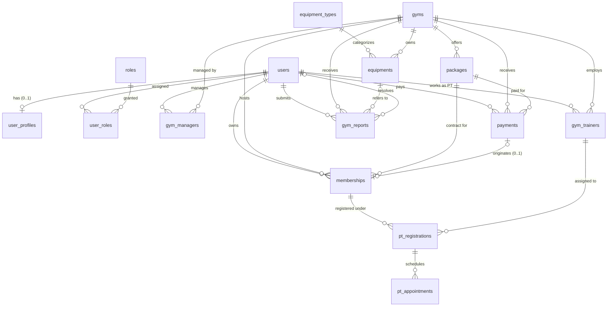

# Database Specification — Multi-Gym Platform

## 1. Mục tiêu Database Specification

Tài liệu này là **Source of Truth (Nguồn chân lý duy nhất)** cho thiết kế vật lý Cơ sở dữ liệu PostgreSQL 17 của hệ thống **Multi-Gym Platform**. 

Mô hình dữ liệu bao gồm **chính xác 15 bảng** theo ERD chuẩn được phê duyệt, phục vụ kiến trúc **Shared-Database, Shared-Schema với Application-Level Multi-Gym Isolation**.

Tài liệu xác định chi tiết:
- Danh sách 15 bảng và toàn bộ các cột (Columns).
- Kiểu dữ liệu chuẩn PostgreSQL (PostgreSQL Data Types).
- Khóa chính (PRIMARY KEY).
- Khóa ngoại (FOREIGN KEY) kèm quy tắc toàn vẹn tham chiếu `ON DELETE` và `ON UPDATE`.
- Tính bắt buộc (`NULL` / `NOT NULL`).
- Giá trị mặc định (`DEFAULT`).
- Ràng buộc duy nhất (`UNIQUE`, bao gồm Partial Unique Index).
- Ràng buộc kiểm tra (`CHECK` constraints).
- Chiến lược đánh chỉ mục (`INDEX Strategy`).
- Các quy tắc bảo toàn toàn vẹn dữ liệu Multi-Gym (Multi-Gym Integrity Rules).
- Các câu hỏi mở và quyết định chưa chốt (`Open Questions & Unresolved Decisions`).

> [!IMPORTANT]
> **Quy tắc thực thi:**
> - Tài liệu này thuộc **Giai đoạn 1 (Database Spec)**.
> - **Tuyệt đối KHÔNG** viết code, KHÔNG tạo schema Drizzle, KHÔNG tạo migration, KHÔNG chạy migration, KHÔNG kết nối database, KHÔNG seed dữ liệu, KHÔNG tạo API trong giai đoạn này.
> - Bất kỳ thay đổi nào đối với ERD, kiểu dữ liệu, hoặc ràng buộc vật lý phải được cập nhật tại tài liệu này và được người dùng phê duyệt trước khi chuyển sang giai đoạn tiếp theo.

---

## 2. Nguyên tắc Multi-Gym Scope

Hệ thống hoạt động dưới mô hình quản lý chuỗi phòng tập đa cơ sở. Các nguyên tắc phân định phạm vi (Scope) bao gồm:

1. **Role xác định quyền hành vi; liên kết bảng xác định Gym Scope:**
   - Role (ADMIN, MANAGER, PT, CUSTOMER) chỉ xác định người dùng có thể thực hiện loại hành động nào.
   - Việc người dùng được thao tác trên chi nhánh (Gym) nào được xác định hoàn toàn bởi các bản ghi liên kết trong database (`gym_managers`, `gym_trainers`, hoặc `memberships`).
2. **Manager Scope:**
   - Manager chỉ được quyền xem, cập nhật và thao tác trên dữ liệu thuộc Gym mà User đó được bổ nhiệm trong `gym_managers` với trạng thái `status = 'ACTIVE'`.
   - Một Gym tại một thời điểm chỉ có tối đa một Manager `ACTIVE`, và một Manager tại một thời điểm chỉ quản lý tối đa một Gym `ACTIVE` (Quy tắc `INV-010`).
3. **PT Scope:**
   - PT thuộc Gym thông qua bản ghi `gym_trainers`. PT chỉ được xem học viên và quản lý lịch hẹn (`pt_appointments`) được phân công cho chính mình tại cơ sở đó.
4. **Direct Gym Scoping:**
   - Các bảng có cột `gym_id` trực tiếp: `gym_managers`, `gym_trainers`, `packages`, `payments`, `memberships`, `equipments`, `gym_reports`.
   - Mọi thao tác ghi/đọc trên các bảng này đều phải ràng buộc phạm vi `gym_id`.
5. **Indirect Gym Scoping:**
   - Bảng `pt_registrations` xác định Gym gián tiếp thông qua quan hệ: `membership_id → memberships.gym_id` và `gym_trainer_id → gym_trainers.gym_id`.
   - Bảng `pt_appointments` xác định Gym gián tiếp thông qua: `registration_id → pt_registrations → memberships.gym_id`.
   - Tuyệt đối không tự ý bổ sung cột `gym_id` vào `pt_registrations` hay `pt_appointments` khi chưa có yêu cầu thay đổi ERD.
6. **System-wide Entities:**
   - `users`, `user_profiles`, `roles`, `user_roles`, `equipment_types` là các thực thể dùng chung toàn hệ thống, không thuộc riêng bất kỳ Gym nào.
7. **Không tin tưởng dữ liệu client:**
   - Backend tuyệt đối không tin tưởng `gym_id`, `role`, hay `user_id` do client gửi lên trong header/body.
   - Mọi quyền truy cập và dữ liệu ghi phải được xác thực từ phiên làm việc (Session/JWT Cookie) đối chiếu với quan hệ trong database.

---

## 3. Danh mục 15 Bảng Hệ thống

| STT | Tên bảng | Phạm vi (Scope) | Trách nhiệm dữ liệu |
| :---: | :--- | :--- | :--- |
| 1 | `users` | Toàn hệ thống | Danh tính tài khoản, email đăng nhập, số điện thoại, mật khẩu băm (Argon2id), trạng thái hoạt động. |
| 2 | `user_profiles` | Toàn hệ thống | Thông tin cá nhân mở rộng (họ tên, ngày sinh, giới tính, địa chỉ, ảnh đại diện). Quan hệ 1–1 với User. |
| 3 | `roles` | Toàn hệ thống | Danh mục vai trò hệ thống: `ADMIN`, `MANAGER`, `PT`, `CUSTOMER`. |
| 4 | `user_roles` | Toàn hệ thống | Bảng liên kết N–N gán vai trò cho User. Khóa chính tổ hợp `(user_id, role_id)`. |
| 5 | `gyms` | Gốc Gym Scope | Cơ sở phòng tập thể hình (tên, địa chỉ, số điện thoại, email, tọa độ địa lý, giờ đóng/mở cửa, trạng thái). |
| 6 | `gym_managers` | Trực tiếp Gym | Phân công User làm quản lý tại Gym. Đảm bảo giới hạn 1 Manager ACTIVE per Gym và 1 Gym ACTIVE per Manager. |
| 7 | `gym_trainers` | Trực tiếp Gym | Phân công User làm Huấn luyện viên (PT) tại Gym, lưu chuyên môn, số năm kinh nghiệm, tiểu sử. |
| 8 | `packages` | Trực tiếp Gym | Gói tập hội viên do từng Gym phát hành (tên gói, thời hạn ngày, giá niêm yết hiện tại, trạng thái). |
| 9 | `payments` | Trực tiếp Gym | Lịch sử giao dịch thanh toán mua gói tập của Customer tại một Gym cụ thể. |
| 10 | `memberships` | Trực tiếp Gym | Hợp đồng hội viên của Customer tại Gym, ghi nhận giá mua lịch sử (`purchase_price`), liên kết tùy chọn với Payment nguồn. |
| 11 | `pt_registrations` | Gián tiếp Gym | Đăng ký dịch vụ tập với PT dựa trên một Membership hợp lệ và một PT cùng thuộc Gym đó. |
| 12 | `pt_appointments` | Gián tiếp Gym | Lịch hẹn từng ca tập cụ thể thuộc một đăng ký PT (`pt_registrations`). |
| 13 | `equipment_types` | Toàn hệ thống | Danh mục phân loại thiết bị/dụng cụ tập luyện dùng chung cho toàn bộ hệ thống (ví dụ: Máy chạy bộ, Khung gánh tạ). |
| 14 | `equipments` | Trực tiếp Gym | Từng thiết bị/máy móc vật lý cụ thể thuộc sở hữu của một Gym (mã máy trong Gym, tình trạng vật lý, trạng thái quản lý). |
| 15 | `gym_reports` | Trực tiếp Gym | Phản ánh/khiếu nại của hội viên gửi tới Gym, có thể liên kết trực tiếp tới một thiết bị cụ thể thuộc Gym đó. |

---

## 4. Chi tiết Thiết kế Vật lý 15 Bảng

### Convention Chung Toàn Bộ Database

1. **Quy ước đặt tên (Naming Convention):**
   - Tên bảng và tên cột dùng `snake_case`.
   - Khóa chính đơn: `<singular_table_name>_id` (ví dụ `user_id`, `gym_id`), kiểu `uuid DEFAULT gen_random_uuid()`.
   - Khóa ngoại đơn: trùng tên với khóa chính của bảng được tham chiếu (ví dụ `gym_id`, `user_id`).
   - Tên Primary Key constraint: `<table>_pkey`.
   - Tên Foreign Key constraint: `<table>_<column(s)>_fk` hoặc `<table>_<purpose>_fk`.
   - Tên Unique constraint: `<table>_<column(s)>_key`.
   - Tên Check constraint: `<table>_<column/purpose>_check`.
   - Tên Index: `<table>_<column(s)>_idx`.
2. **Kiểu dữ liệu thời gian & tiền tệ:**
   - Thời điểm (Timestamps): dùng `timestamptz(3)` (độ chính xác mili-giây). Kết nối database luôn chạy UTC, client xử lý múi giờ địa phương.
   - Ngày tháng (Dates): dùng `date` (`YYYY-MM-DD`).
   - Giờ trong ngày (Times): dùng `time(0) without time zone` (`HH:MI:SS`).
   - Tiền tệ (Currency): dùng `numeric(14,2)` (tối đa 12 chữ số nguyên và 2 chữ số thập phân), tuyệt đối không dùng `float` hay `double precision`.
   - Tọa độ địa lý: `numeric(9,6)` cho cả vĩ độ (latitude) và kinh độ (longitude).
3. **Audit Columns:**
   - Mọi bảng có lifecycle đều có `created_at timestamptz(3) NOT NULL DEFAULT now()` và `updated_at timestamptz(3) NOT NULL DEFAULT now()`.
   - Không sử dụng Database Trigger để tự cập nhật `updated_at` trong thiết kế này; tầng Data Access Layer (Drizzle ORM) hoặc câu lệnh UPDATE bắt buộc phải set `updated_at = now()` một cách tường minh.
4. **Quy ước Trạng thái (Status/Enums):**
   - Sử dụng kiểu dữ liệu `varchar(20)` kết hợp với ràng buộc `CHECK (col IN ('VAL1', 'VAL2', ...))`.
   - Không sử dụng PostgreSQL Native `ENUM` type để đảm bảo tính linh hoạt khi migration và đồng bộ schema.

---

### 4.1. Bảng `users`

**Mục đích:** Quản lý tài khoản đăng nhập, danh tính xác thực và trạng thái hoạt động dùng chung toàn hệ thống.

#### Danh sách cột

| Tên cột | PostgreSQL Data Type | Nullability | Default | Ràng buộc vật lý | Ý nghĩa nghiệp vụ |
| :--- | :--- | :---: | :--- | :--- | :--- |
| `user_id` | `uuid` | NOT NULL | `gen_random_uuid()` | PK | Định danh duy nhất của User |
| `email` | `varchar(254)` | NOT NULL | — | UNIQUE, CHECK | Email định danh đăng nhập (chuẩn hóa RFC 5321) |
| `phone` | `varchar(20)` | NULL | — | UNIQUE, CHECK | Số điện thoại liên hệ cá nhân |
| `password_hash` | `text` | NOT NULL | — | — | Mật khẩu được băm bằng thuật toán Argon2id |
| `email_verified_at` | `timestamptz(3)` | NULL | — | — | Thời điểm xác thực email; NULL khi chưa xác thực |
| `must_change_password`| `boolean` | NOT NULL | `false` | — | Cờ yêu cầu đổi mật khẩu (Manager/PT được cấp mật khẩu tạm) |
| `status` | `varchar(20)` | NOT NULL | `'ACTIVE'` | CHECK | Trạng thái tài khoản (`user_status`) |
| `created_at` | `timestamptz(3)` | NOT NULL | `now()` | — | Thời điểm tạo tài khoản |
| `updated_at` | `timestamptz(3)` | NOT NULL | `now()` | — | Thời điểm cập nhật tài khoản gần nhất |

#### Ràng buộc (Constraints) & Khóa (Keys)

- **PRIMARY KEY:** `users_pkey` PRIMARY KEY (`user_id`)
- **FOREIGN KEYS:** Không có.
- **UNIQUE CONSTRAINTS:**
  - `users_email_key` UNIQUE (`email`)
  - `users_phone_key` UNIQUE (`phone`) (Áp dụng ngữ nghĩa `NULLS DISTINCT` mặc định của Postgres: cho phép nhiều bản ghi NULL, nhưng giá trị đã nhập không được trùng).
- **CHECK CONSTRAINTS:**
  - `users_email_check` CHECK (`email = lower(btrim(email)) AND email <> ''`): Bắt buộc email đã được trim khoảng trắng và đưa về chữ thường.
  - `users_phone_check` CHECK (`phone IS NULL OR btrim(phone) <> ''`): Không cho phép lưu chuỗi rỗng làm số điện thoại.
  - `users_status_check` CHECK (`status IN ('ACTIVE', 'INACTIVE', 'SUSPENDED')`)

#### Chỉ mục (Indexes)

| Tên Index | Kiểu | Các cột index | Mục đích truy vấn |
| :--- | :---: | :--- | :--- |
| `users_pkey` | B-tree | `(user_id)` | Truy vấn theo khóa chính (Tự động tạo) |
| `users_email_key` | B-tree | `(email)` | Đăng nhập bằng email, kiểm tra trùng lặp (Tự động tạo) |
| `users_phone_key` | B-tree | `(phone)` | Tra cứu theo số điện thoại (Tự động tạo) |

---

### 4.2. Bảng `user_profiles`

**Mục đích:** Hồ sơ thông tin cá nhân mở rộng của User (Quan hệ 1–1 với `users`).

#### Danh sách cột

| Tên cột | PostgreSQL Data Type | Nullability | Default | Ràng buộc vật lý | Ý nghĩa nghiệp vụ |
| :--- | :--- | :---: | :--- | :--- | :--- |
| `profile_id` | `uuid` | NOT NULL | `gen_random_uuid()` | PK | Định danh hồ sơ cá nhân |
| `user_id` | `uuid` | NOT NULL | — | FK, UNIQUE | Tham chiếu đến tài khoản người dùng |
| `full_name` | `varchar(100)` | NOT NULL | — | CHECK | Họ và tên đầy đủ |
| `date_of_birth` | `date` | NULL | — | — | Ngày tháng năm sinh |
| `gender` | `text` | NULL | — | — | Giới tính (tùy chọn, chưa có allowlist cứng) |
| `address` | `text` | NULL | — | — | Địa chỉ cư trú thường trú |
| `avatar_url` | `text` | NULL | — | — | Đường dẫn URL ảnh đại diện |
| `created_at` | `timestamptz(3)` | NOT NULL | `now()` | — | Thời điểm tạo hồ sơ |
| `updated_at` | `timestamptz(3)` | NOT NULL | `now()` | — | Thời điểm cập nhật hồ sơ |

#### Ràng buộc (Constraints) & Khóa (Keys)

- **PRIMARY KEY:** `user_profiles_pkey` PRIMARY KEY (`profile_id`)
- **FOREIGN KEYS:**
  - `user_profiles_user_fk` FOREIGN KEY (`user_id`) REFERENCES `users`(`user_id`) ON DELETE CASCADE ON UPDATE RESTRICT
- **UNIQUE CONSTRAINTS:**
  - `user_profiles_user_key` UNIQUE (`user_id`): Đảm bảo quan hệ 1–1 (Mỗi User có tối đa một hồ sơ Profile).
- **CHECK CONSTRAINTS:**
  - `user_profiles_full_name_check` CHECK (`char_length(btrim(full_name)) BETWEEN 2 AND 100`): Họ tên không được để khoảng trắng thừa và phải từ 2 đến 100 ký tự.

#### Chỉ mục (Indexes)

| Tên Index | Kiểu | Các cột index | Mục đích truy vấn |
| :--- | :---: | :--- | :--- |
| `user_profiles_pkey` | B-tree | `(profile_id)` | Khóa chính |
| `user_profiles_user_key` | B-tree | `(user_id)` | Tìm kiếm hồ sơ của User khi đăng nhập/lấy thông tin phiên |

---

### 4.3. Bảng `roles`

**Mục đích:** Danh mục vai trò và quyền hạn dùng chung toàn hệ thống.

#### Danh sách cột

| Tên cột | PostgreSQL Data Type | Nullability | Default | Ràng buộc vật lý | Ý nghĩa nghiệp vụ |
| :--- | :--- | :---: | :--- | :--- | :--- |
| `role_id` | `uuid` | NOT NULL | `gen_random_uuid()` | PK | Định danh vai trò |
| `role_name` | `varchar(20)` | NOT NULL | — | UNIQUE, CHECK | Tên vai trò: `ADMIN`, `MANAGER`, `PT`, `CUSTOMER` |
| `description` | `text` | NULL | — | — | Mô tả chi tiết quyền hạn của vai trò |

#### Ràng buộc (Constraints) & Khóa (Keys)

- **PRIMARY KEY:** `roles_pkey` PRIMARY KEY (`role_id`)
- **FOREIGN KEYS:** Không có.
- **UNIQUE CONSTRAINTS:**
  - `roles_role_name_key` UNIQUE (`role_name`)
- **CHECK CONSTRAINTS:**
  - `roles_role_name_check` CHECK (`role_name IN ('ADMIN', 'MANAGER', 'PT', 'CUSTOMER')`)

#### Chỉ mục (Indexes)

| Tên Index | Kiểu | Các cột index | Mục đích truy vấn |
| :--- | :---: | :--- | :--- |
| `roles_pkey` | B-tree | `(role_id)` | Khóa chính |
| `roles_role_name_key` | B-tree | `(role_name)` | Tra cứu vai trò theo tên định danh |

---

### 4.4. Bảng `user_roles`

**Mục đích:** Gán vai trò cho người dùng (Quan hệ N–N giữa `users` và `roles`).

#### Danh sách cột

| Tên cột | PostgreSQL Data Type | Nullability | Default | Ràng buộc vật lý | Ý nghĩa nghiệp vụ |
| :--- | :--- | :---: | :--- | :--- | :--- |
| `user_id` | `uuid` | NOT NULL | — | PK tổ hợp, FK | Người dùng được gán vai trò |
| `role_id` | `uuid` | NOT NULL | — | PK tổ hợp, FK | Vai trò được gán |
| `assigned_at` | `timestamptz(3)` | NOT NULL | `now()` | — | Thời điểm gán vai trò |

#### Ràng buộc (Constraints) & Khóa (Keys)

- **PRIMARY KEY:** `user_roles_pkey` PRIMARY KEY (`user_id`, `role_id`): Đảm bảo không thể gán trùng một vai trò cho cùng một người dùng.
- **FOREIGN KEYS:**
  - `user_roles_user_fk` FOREIGN KEY (`user_id`) REFERENCES `users`(`user_id`) ON DELETE CASCADE ON UPDATE RESTRICT
  - `user_roles_role_fk` FOREIGN KEY (`role_id`) REFERENCES `roles`(`role_id`) ON DELETE RESTRICT ON UPDATE RESTRICT
- **CHECK CONSTRAINTS:** Không có.

#### Chỉ mục (Indexes)

| Tên Index | Kiểu | Các cột index | Mục đích truy vấn |
| :--- | :---: | :--- | :--- |
| `user_roles_pkey` | B-tree | `(user_id, role_id)` | Khóa chính tổ hợp, hỗ trợ tra cứu toàn bộ roles của một user |
| `user_roles_role_idx` | B-tree | `(role_id)` | Tra cứu danh sách người dùng mang một vai trò cụ thể |

---

### 4.5. Bảng `gyms`

**Mục đích:** Thông tin chi nhánh phòng tập thể hình; gốc của toàn bộ Gym Scope.

#### Danh sách cột

| Tên cột | PostgreSQL Data Type | Nullability | Default | Ràng buộc vật lý | Ý nghĩa nghiệp vụ |
| :--- | :--- | :---: | :--- | :--- | :--- |
| `gym_id` | `uuid` | NOT NULL | `gen_random_uuid()` | PK | Định danh chi nhánh Gym |
| `gym_name` | `text` | NOT NULL | — | — | Tên phòng tập chi nhánh |
| `description` | `text` | NULL | — | — | Mô tả giới thiệu cơ sở vật chất |
| `phone` | `varchar(20)` | NULL | — | — | Số điện thoại liên hệ của chi nhánh |
| `email` | `varchar(254)` | NULL | — | — | Email liên hệ của chi nhánh |
| `address` | `text` | NOT NULL | — | — | Địa chỉ vật lý chi nhánh |
| `latitude` | `numeric(9,6)` | NULL | — | CHECK | Vĩ độ tọa độ GPS (-90 đến 90) |
| `longitude` | `numeric(9,6)` | NULL | — | CHECK | Kinh độ tọa độ GPS (-180 đến 180) |
| `logo_url` | `text` | NULL | — | — | URL logo/hình ảnh đại diện chi nhánh |
| `opening_time` | `time(0) without time zone`| NULL | — | — | Giờ mở cửa hàng ngày |
| `closing_time` | `time(0) without time zone`| NULL | — | — | Giờ đóng cửa hàng ngày |
| `status` | `varchar(20)` | NOT NULL | `'ACTIVE'` | CHECK | Trạng thái hoạt động chi nhánh (`gym_status`) |
| `created_at` | `timestamptz(3)` | NOT NULL | `now()` | — | Thời điểm tạo cơ sở |
| `updated_at` | `timestamptz(3)` | NOT NULL | `now()` | — | Thời điểm cập nhật thông tin cơ sở |

#### Ràng buộc (Constraints) & Khóa (Keys)

- **PRIMARY KEY:** `gyms_pkey` PRIMARY KEY (`gym_id`)
- **FOREIGN KEYS:** Không có.
- **CHECK CONSTRAINTS:**
  - `gyms_latitude_check` CHECK (`latitude IS NULL OR (latitude >= -90 AND latitude <= 90)`)
  - `gyms_longitude_check` CHECK (`longitude IS NULL OR (longitude >= -180 AND longitude <= 180)`)
  - `gyms_status_check` CHECK (`status IN ('ACTIVE', 'INACTIVE')`)
  *(Ghi chú: Không đặt CHECK `closing_time > opening_time` vì phòng gym có thể mở qua đêm hoặc hoạt động 24/7).*

#### Chỉ mục (Indexes)

| Tên Index | Kiểu | Các cột index | Mục đích truy vấn |
| :--- | :---: | :--- | :--- |
| `gyms_pkey` | B-tree | `(gym_id)` | Khóa chính |

---

### 4.6. Bảng `gym_managers`

**Mục đích:** Phân công User làm Quản lý điều hành tại một Gym.

#### Danh sách cột

| Tên cột | PostgreSQL Data Type | Nullability | Default | Ràng buộc vật lý | Ý nghĩa nghiệp vụ |
| :--- | :--- | :---: | :--- | :--- | :--- |
| `gym_manager_id` | `uuid` | NOT NULL | `gen_random_uuid()` | PK | Định danh bản ghi phân công |
| `gym_id` | `uuid` | NOT NULL | — | FK | Chi nhánh Gym được quản lý |
| `user_id` | `uuid` | NOT NULL | — | FK | User mang vai trò Quản lý |
| `assigned_at` | `timestamptz(3)` | NOT NULL | `now()` | — | Thời điểm bổ nhiệm |
| `status` | `varchar(20)` | NOT NULL | `'ACTIVE'` | CHECK | Trạng thái bổ nhiệm (`assignment_status`) |
| `created_at` | `timestamptz(3)` | NOT NULL | `now()` | — | Thời điểm tạo bản ghi |
| `updated_at` | `timestamptz(3)` | NOT NULL | `now()` | — | Thời điểm cập nhật bản ghi |

#### Ràng buộc (Constraints) & Khóa (Keys)

- **PRIMARY KEY:** `gym_managers_pkey` PRIMARY KEY (`gym_manager_id`)
- **FOREIGN KEYS:**
  - `gym_managers_gym_fk` FOREIGN KEY (`gym_id`) REFERENCES `gyms`(`gym_id`) ON DELETE RESTRICT ON UPDATE RESTRICT
  - `gym_managers_user_fk` FOREIGN KEY (`user_id`) REFERENCES `users`(`user_id`) ON DELETE RESTRICT ON UPDATE RESTRICT
- **UNIQUE CONSTRAINTS:**
  - `gym_managers_gym_user_key` UNIQUE (`gym_id`, `user_id`): Cấm tạo nhiều dòng trùng cặp Gym/User.
- **PARTIAL UNIQUE INDEXES (Thực thi INV-010 ở Database level):**
  - `gym_managers_active_gym_key` UNIQUE INDEX on (`gym_id`) WHERE `status = 'ACTIVE'`: Đảm bảo tại một thời điểm, mỗi Gym chỉ có DUY NHẤT 1 Manager đang `ACTIVE`.
  - `gym_managers_active_user_key` UNIQUE INDEX on (`user_id`) WHERE `status = 'ACTIVE'`: Đảm bảo tại một thời điểm, mỗi User chỉ làm Manager `ACTIVE` tại DUY NHẤT 1 Gym.
- **CHECK CONSTRAINTS:**
  - `gym_managers_status_check` CHECK (`status IN ('ACTIVE', 'INACTIVE')`)

#### Chỉ mục (Indexes)

| Tên Index | Kiểu | Các cột index | Mục đích truy vấn |
| :--- | :---: | :--- | :--- |
| `gym_managers_pkey` | B-tree | `(gym_manager_id)` | Khóa chính |
| `gym_managers_gym_user_key` | B-tree | `(gym_id, user_id)` | Ràng buộc duy nhất cặp Gym/User |
| `gym_managers_active_gym_key` | B-tree | `(gym_id)` WHERE `status = 'ACTIVE'` | Kiểm tra Manager ACTIVE của Gym |
| `gym_managers_active_user_key` | B-tree | `(user_id)` WHERE `status = 'ACTIVE'` | Kiểm tra Gym ACTIVE của User |
| `gym_managers_user_idx` | B-tree | `(user_id)` | Tra cứu lịch sử phân công theo User |

---

### 4.7. Bảng `gym_trainers`

**Mục đích:** Phân công User làm Huấn luyện viên cá nhân (PT) tại một Gym.

#### Danh sách cột

| Tên cột | PostgreSQL Data Type | Nullability | Default | Ràng buộc vật lý | Ý nghĩa nghiệp vụ |
| :--- | :--- | :---: | :--- | :--- | :--- |
| `gym_trainer_id` | `uuid` | NOT NULL | `gen_random_uuid()` | PK | Định danh phân công PT |
| `gym_id` | `uuid` | NOT NULL | — | FK | Chi nhánh Gym nơi PT làm việc |
| `user_id` | `uuid` | NOT NULL | — | FK | User mang vai trò PT |
| `specialization` | `text` | NULL | — | — | Chuyên môn huấn luyện (Gym, Yoga, Boxing,...) |
| `experience_years` | `integer` | NULL | — | CHECK | Số năm kinh nghiệm làm nghề (>= 0) |
| `bio` | `text` | NULL | — | — | Giới thiệu ngắn về bản thân huấn luyện viên |
| `status` | `varchar(20)` | NOT NULL | `'ACTIVE'` | CHECK | Trạng thái làm việc của PT (`trainer_status`) |
| `joined_at` | `timestamptz(3)` | NOT NULL | `now()` | — | Thời điểm bắt đầu làm việc tại Gym |
| `created_at` | `timestamptz(3)` | NOT NULL | `now()` | — | Thời điểm tạo bản ghi |
| `updated_at` | `timestamptz(3)` | NOT NULL | `now()` | — | Thời điểm cập nhật bản ghi |

#### Ràng buộc (Constraints) & Khóa (Keys)

- **PRIMARY KEY:** `gym_trainers_pkey` PRIMARY KEY (`gym_trainer_id`)
- **FOREIGN KEYS:**
  - `gym_trainers_gym_fk` FOREIGN KEY (`gym_id`) REFERENCES `gyms`(`gym_id`) ON DELETE RESTRICT ON UPDATE RESTRICT
  - `gym_trainers_user_fk` FOREIGN KEY (`user_id`) REFERENCES `users`(`user_id`) ON DELETE RESTRICT ON UPDATE RESTRICT
- **UNIQUE CONSTRAINTS:**
  - `gym_trainers_gym_user_key` UNIQUE (`gym_id`, `user_id`): Cấm tạo nhiều bản ghi phân công cho cùng một User tại cùng một Gym.
- **CHECK CONSTRAINTS:**
  - `gym_trainers_experience_years_check` CHECK (`experience_years IS NULL OR experience_years >= 0`)
  - `gym_trainers_status_check` CHECK (`status IN ('ACTIVE', 'INACTIVE')`)

#### Chỉ mục (Indexes)

| Tên Index | Kiểu | Các cột index | Mục đích truy vấn |
| :--- | :---: | :--- | :--- |
| `gym_trainers_pkey` | B-tree | `(gym_trainer_id)` | Khóa chính |
| `gym_trainers_gym_user_key` | B-tree | `(gym_id, user_id)` | Ràng buộc duy nhất cặp Gym/User |
| `gym_trainers_user_idx` | B-tree | `(user_id)` | Tra cứu thông tin phân công PT theo User ID |

---

### 4.8. Bảng `packages`

**Mục đích:** Gói tập hội viên do từng phòng Gym phát hành và quản lý.

#### Danh sách cột

| Tên cột | PostgreSQL Data Type | Nullability | Default | Ràng buộc vật lý | Ý nghĩa nghiệp vụ |
| :--- | :--- | :---: | :--- | :--- | :--- |
| `package_id` | `uuid` | NOT NULL | `gen_random_uuid()` | PK | Định danh gói tập |
| `gym_id` | `uuid` | NOT NULL | — | FK | Chi nhánh Gym phát hành gói |
| `package_name` | `text` | NOT NULL | — | — | Tên gói tập (ví dụ: Gói Cơ Bản 1 Tháng) |
| `description` | `text` | NULL | — | — | Mô tả chi tiết quyền lợi gói tập |
| `duration_days` | `integer` | NOT NULL | — | CHECK | Thời hạn hiệu lực tính theo ngày (> 0) |
| `price` | `numeric(14,2)` | NOT NULL | — | CHECK | Giá niêm yết hiện tại của gói tập (>= 0) |
| `status` | `varchar(20)` | NOT NULL | `'ACTIVE'` | CHECK | Trạng thái phát hành gói (`package_status`) |
| `created_at` | `timestamptz(3)` | NOT NULL | `now()` | — | Thời điểm tạo gói tập |
| `updated_at` | `timestamptz(3)` | NOT NULL | `now()` | — | Thời điểm cập nhật gói tập |

#### Ràng buộc (Constraints) & Khóa (Keys)

- **PRIMARY KEY:** `packages_pkey` PRIMARY KEY (`package_id`)
- **FOREIGN KEYS:**
  - `packages_gym_fk` FOREIGN KEY (`gym_id`) REFERENCES `gyms`(`gym_id`) ON DELETE RESTRICT ON UPDATE RESTRICT
- **UNIQUE CONSTRAINTS:**
  - `packages_package_gym_key` UNIQUE (`package_id`, `gym_id`): Khóa duy nhất tổ hợp đóng vai trò **khóa đích (Referenced Key)** cho các Khóa ngoại tổ hợp từ bảng `payments` và `memberships`.
- **CHECK CONSTRAINTS:**
  - `packages_duration_days_check` CHECK (`duration_days > 0`)
  - `packages_price_check` CHECK (`price >= 0 AND price <> 'NaN'::numeric`)
  - `packages_status_check` CHECK (`status IN ('ACTIVE', 'INACTIVE')`)

#### Chỉ mục (Indexes)

| Tên Index | Kiểu | Các cột index | Mục đích truy vấn |
| :--- | :---: | :--- | :--- |
| `packages_pkey` | B-tree | `(package_id)` | Khóa chính |
| `packages_package_gym_key` | B-tree | `(package_id, gym_id)` | Đích tham chiếu cho Foreign Key tổ hợp |
| `packages_gym_status_created_idx` | B-tree | `(gym_id, status, created_at DESC)` | Lấy danh sách gói tập theo Gym và trạng thái |

---

### 4.9. Bảng `payments`

**Mục đích:** Ghi nhận giao dịch thanh toán mua gói tập của khách hàng tại một Gym cụ thể.

#### Danh sách cột

| Tên cột | PostgreSQL Data Type | Nullability | Default | Ràng buộc vật lý | Ý nghĩa nghiệp vụ |
| :--- | :--- | :---: | :--- | :--- | :--- |
| `payment_id` | `uuid` | NOT NULL | `gen_random_uuid()` | PK | Định danh giao dịch thanh toán |
| `user_id` | `uuid` | NOT NULL | — | FK | Khách hàng thực hiện thanh toán |
| `gym_id` | `uuid` | NOT NULL | — | FK | Chi nhánh Gym thụ hưởng thanh toán |
| `package_id` | `uuid` | NOT NULL | — | FK tổ hợp | Gói tập được chọn mua |
| `amount` | `numeric(14,2)` | NOT NULL | — | CHECK | Số tiền thanh toán thực tế (>= 0) |
| `payment_method` | `text` | NOT NULL | — | — | Phương thức thanh toán (VNPAY, MOMO, CASH,...) |
| `transaction_code` | `text` | NULL | — | UNIQUE, CHECK | Mã giao dịch cổng thanh toán (toàn hệ thống) |
| `payment_status` | `varchar(20)` | NOT NULL | `'PENDING'` | CHECK | Trạng thái giao dịch (`payment_status`) |
| `paid_at` | `timestamptz(3)` | NULL | — | — | Thời điểm giao dịch thành công |
| `created_at` | `timestamptz(3)` | NOT NULL | `now()` | — | Thời điểm khởi tạo giao dịch |
| `updated_at` | `timestamptz(3)` | NOT NULL | `now()` | — | Thời điểm cập nhật giao dịch |

#### Ràng buộc (Constraints) & Khóa (Keys)

- **PRIMARY KEY:** `payments_pkey` PRIMARY KEY (`payment_id`)
- **FOREIGN KEYS:**
  - `payments_user_fk` FOREIGN KEY (`user_id`) REFERENCES `users`(`user_id`) ON DELETE RESTRICT ON UPDATE RESTRICT
  - `payments_gym_fk` FOREIGN KEY (`gym_id`) REFERENCES `gyms`(`gym_id`) ON DELETE RESTRICT ON UPDATE RESTRICT
  - `payments_package_gym_fk` FOREIGN KEY (`package_id`, `gym_id`) REFERENCES `packages`(`package_id`, `gym_id`) ON DELETE RESTRICT ON UPDATE RESTRICT: **Ràng buộc toàn vẹn Multi-Gym cấp Database**, ngăn chặn triệt để tình trạng thanh toán tại Gym A nhưng lại tham chiếu Package thuộc Gym B.
- **UNIQUE CONSTRAINTS:**
  - `payments_transaction_code_key` UNIQUE (`transaction_code`) (Cho phép nhiều bản ghi NULL theo mặc định NULLS DISTINCT, nhưng khi có giá trị thì không được trùng toàn hệ thống).
  - `payments_payment_user_gym_package_key` UNIQUE (`payment_id`, `user_id`, `gym_id`, `package_id`): Khóa duy nhất tổ hợp làm **khóa đích** cho FK nguồn từ bảng `memberships`.
- **CHECK CONSTRAINTS:**
  - `payments_amount_check` CHECK (`amount >= 0 AND amount <> 'NaN'::numeric`)
  - `payments_transaction_code_check` CHECK (`transaction_code IS NULL OR btrim(transaction_code) <> ''`)
  - `payments_payment_status_check` CHECK (`payment_status IN ('PENDING', 'SUCCESS', 'FAILED', 'CANCELLED', 'REFUNDED')`)

#### Chỉ mục (Indexes)

| Tên Index | Kiểu | Các cột index | Mục đích truy vấn |
| :--- | :---: | :--- | :--- |
| `payments_pkey` | B-tree | `(payment_id)` | Khóa chính |
| `payments_transaction_code_key` | B-tree | `(transaction_code)` | Tra cứu giao dịch theo mã cổng thanh toán |
| `payments_payment_user_gym_package_key` | B-tree | `(payment_id, user_id, gym_id, package_id)` | Đích tham chiếu cho Membership FK |
| `payments_user_created_idx` | B-tree | `(user_id, created_at DESC)` | Lịch sử thanh toán của khách hàng |
| `payments_gym_status_created_idx` | B-tree | `(gym_id, payment_status, created_at DESC)` | Báo cáo giao dịch tài chính của phòng Gym |
| `payments_package_gym_idx` | B-tree | `(package_id, gym_id)` | Hỗ trợ Foreign Key kiểm tra toàn vẹn sang Package |

---

### 4.10. Bảng `memberships`

**Mục đích:** Hợp đồng hội viên của khách hàng tại Gym, ghi nhận giá mua lịch sử và thời hạn sử dụng.

#### Danh sách cột

| Tên cột | PostgreSQL Data Type | Nullability | Default | Ràng buộc vật lý | Ý nghĩa nghiệp vụ |
| :--- | :--- | :---: | :--- | :--- | :--- |
| `membership_id` | `uuid` | NOT NULL | `gen_random_uuid()` | PK | Định danh hợp đồng hội viên |
| `user_id` | `uuid` | NOT NULL | — | FK | Khách hàng sở hữu hợp đồng hội viên |
| `gym_id` | `uuid` | NOT NULL | — | FK | Chi nhánh Gym áp dụng hợp đồng |
| `package_id` | `uuid` | NOT NULL | — | FK tổ hợp | Gói tập hội viên đã mua |
| `payment_id` | `uuid` | NULL | — | FK tổ hợp, UNIQUE | Giao dịch thanh toán gốc (tùy chọn) |
| `start_date` | `date` | NOT NULL | — | — | Ngày bắt đầu có hiệu lực |
| `end_date` | `date` | NOT NULL | — | CHECK | Ngày hết hạn hợp đồng (>= `start_date`) |
| `purchase_price` | `numeric(14,2)` | NOT NULL | — | CHECK | Giá tiền mua thực tế tại thời điểm lập hợp đồng |
| `status` | `varchar(20)` | NOT NULL | — | CHECK | Trạng thái thẻ hội viên (`membership_status`) |
| `created_at` | `timestamptz(3)` | NOT NULL | `now()` | — | Thời điểm lập hợp đồng |
| `updated_at` | `timestamptz(3)` | NOT NULL | `now()` | — | Thời điểm cập nhật hợp đồng |

#### Ràng buộc (Constraints) & Khóa (Keys)

- **PRIMARY KEY:** `memberships_pkey` PRIMARY KEY (`membership_id`)
- **FOREIGN KEYS:**
  - `memberships_user_fk` FOREIGN KEY (`user_id`) REFERENCES `users`(`user_id`) ON DELETE RESTRICT ON UPDATE RESTRICT
  - `memberships_gym_fk` FOREIGN KEY (`gym_id`) REFERENCES `gyms`(`gym_id`) ON DELETE RESTRICT ON UPDATE RESTRICT
  - `memberships_package_gym_fk` FOREIGN KEY (`package_id`, `gym_id`) REFERENCES `packages`(`package_id`, `gym_id`) ON DELETE RESTRICT ON UPDATE RESTRICT: Đảm bảo gói tập tham chiếu phải thuộc cùng Gym.
  - `memberships_payment_source_fk` FOREIGN KEY (`payment_id`, `user_id`, `gym_id`, `package_id`) REFERENCES `payments`(`payment_id`, `user_id`, `gym_id`, `package_id`) ON DELETE RESTRICT ON UPDATE RESTRICT: **Ràng buộc toàn vẹn 4 thuộc tính nguồn ở Database level**. Với ngữ nghĩa PostgreSQL `MATCH SIMPLE`, nếu `payment_id` là `NULL` thì bỏ qua kiểm tra FK này; nếu `payment_id` có giá trị thì bắt buộc `user_id`, `gym_id`, và `package_id` của Membership phải khớp 100% với giao dịch Payment gốc.
- **UNIQUE CONSTRAINTS:**
  - `memberships_payment_id_key` UNIQUE (`payment_id`): Đảm bảo 1 Payment tối đa chỉ sinh ra DUY NHẤT 1 Membership.
- **CHECK CONSTRAINTS:**
  - `memberships_end_date_check` CHECK (`end_date >= start_date`)
  - `memberships_purchase_price_check` CHECK (`purchase_price >= 0 AND purchase_price <> 'NaN'::numeric`)
  - `memberships_status_check` CHECK (`status IN ('PENDING', 'ACTIVE', 'EXPIRED', 'CANCELLED')`)

#### Chỉ mục (Indexes)

| Tên Index | Kiểu | Các cột index | Mục đích truy vấn |
| :--- | :---: | :--- | :--- |
| `memberships_pkey` | B-tree | `(membership_id)` | Khóa chính |
| `memberships_payment_id_key` | B-tree | `(payment_id)` | Đảm bảo duy nhất 1 thẻ / 1 payment và tìm kiếm thẻ theo payment |
| `memberships_user_created_idx` | B-tree | `(user_id, created_at DESC)` | Danh sách thẻ hội viên của khách hàng |
| `memberships_gym_status_created_idx` | B-tree | `(gym_id, status, created_at DESC)` | Quản lý danh sách hội viên tại phòng Gym theo trạng thái |
| `memberships_package_gym_idx` | B-tree | `(package_id, gym_id)` | Hỗ trợ Foreign Key kiểm tra Package cùng Gym |

---

### 4.11. Bảng `pt_registrations`

**Mục đích:** Đăng ký dịch vụ huấn luyện viên cá nhân (PT) dựa trên một Membership hợp lệ.

#### Danh sách cột

| Tên cột | PostgreSQL Data Type | Nullability | Default | Ràng buộc vật lý | Ý nghĩa nghiệp vụ |
| :--- | :--- | :---: | :--- | :--- | :--- |
| `registration_id` | `uuid` | NOT NULL | `gen_random_uuid()` | PK | Định danh đăng ký PT |
| `membership_id` | `uuid` | NOT NULL | — | FK | Thẻ hội viên làm cơ sở đăng ký |
| `gym_trainer_id` | `uuid` | NOT NULL | — | FK | Huấn luyện viên được chỉ định/lựa chọn |
| `registered_at` | `timestamptz(3)` | NOT NULL | `now()` | — | Thời điểm đăng ký |
| `status` | `varchar(20)` | NOT NULL | — | CHECK | Trạng thái đăng ký (`registration_status`) |
| `note` | `text` | NULL | — | — | Ghi chú yêu cầu thể trạng/mục tiêu tập luyện |
| `created_at` | `timestamptz(3)` | NOT NULL | `now()` | — | Thời điểm tạo bản ghi |
| `updated_at` | `timestamptz(3)` | NOT NULL | `now()` | — | Thời điểm cập nhật bản ghi |

#### Ràng buộc (Constraints) & Khóa (Keys)

- **PRIMARY KEY:** `pt_registrations_pkey` PRIMARY KEY (`registration_id`)
- **FOREIGN KEYS:**
  - `pt_registrations_membership_fk` FOREIGN KEY (`membership_id`) REFERENCES `memberships`(`membership_id`) ON DELETE RESTRICT ON UPDATE RESTRICT
  - `pt_registrations_gym_trainer_fk` FOREIGN KEY (`gym_trainer_id`) REFERENCES `gym_trainers`(`gym_trainer_id`) ON DELETE RESTRICT ON UPDATE RESTRICT
- **CHECK CONSTRAINTS:**
  - `pt_registrations_status_check` CHECK (`status IN ('ACTIVE', 'CANCELLED', 'COMPLETED')`)
- **Lưu ý toàn vẹn Multi-Gym:**
  - Bảng này không có cột `gym_id` trực tiếp theo đúng ERD gốc.
  - Quy tắc bất biến `INV-004` (Membership và Gym Trainer phải cùng thuộc một Gym) phải được kiểm tra nghiêm ngặt tại **Backend Service Layer** trong một Transaction với khóa bi quan (`SELECT FOR UPDATE`) trước khi thực hiện INSERT.

#### Chỉ mục (Indexes)

| Tên Index | Kiểu | Các cột index | Mục đích truy vấn |
| :--- | :---: | :--- | :--- |
| `pt_registrations_pkey` | B-tree | `(registration_id)` | Khóa chính |
| `pt_registrations_membership_idx` | B-tree | `(membership_id)` | Lấy các đăng ký PT theo hợp đồng hội viên |
| `pt_registrations_gym_trainer_idx` | B-tree | `(gym_trainer_id)` | Lấy danh sách học viên đăng ký của một Huấn luyện viên |

---

### 4.12. Bảng `pt_appointments`

**Mục đích:** Từng ca tập/lịch hẹn cụ thể thuộc về một đăng ký PT.

#### Danh sách cột

| Tên cột | PostgreSQL Data Type | Nullability | Default | Ràng buộc vật lý | Ý nghĩa nghiệp vụ |
| :--- | :--- | :---: | :--- | :--- | :--- |
| `appointment_id` | `uuid` | NOT NULL | `gen_random_uuid()` | PK | Định danh lịch hẹn ca tập |
| `registration_id` | `uuid` | NOT NULL | — | FK | Đăng ký PT nguồn |
| `start_time` | `timestamptz(3)` | NOT NULL | — | — | Thời điểm bắt đầu ca tập |
| `end_time` | `timestamptz(3)` | NOT NULL | — | CHECK | Thời điểm kết thúc ca tập (> `start_time`) |
| `status` | `varchar(20)` | NOT NULL | — | CHECK | Trạng thái ca tập (`appointment_status`) |
| `note` | `text` | NULL | — | — | Ghi chú bài tập hoặc lý do điều chỉnh lịch |
| `created_at` | `timestamptz(3)` | NOT NULL | `now()` | — | Thời điểm tạo lịch hẹn |
| `updated_at` | `timestamptz(3)` | NOT NULL | `now()` | — | Thời điểm cập nhật lịch hẹn |

#### Ràng buộc (Constraints) & Khóa (Keys)

- **PRIMARY KEY:** `pt_appointments_pkey` PRIMARY KEY (`appointment_id`)
- **FOREIGN KEYS:**
  - `pt_appointments_registration_fk` FOREIGN KEY (`registration_id`) REFERENCES `pt_registrations`(`registration_id`) ON DELETE RESTRICT ON UPDATE RESTRICT
- **CHECK CONSTRAINTS:**
  - `pt_appointments_time_check` CHECK (`end_time > start_time`)
  - `pt_appointments_status_check` CHECK (`status IN ('PENDING', 'CONFIRMED', 'COMPLETED', 'CANCELLED')`)
  *(Ghi chú: Không đặt CHECK `start_time > now()` ở database vì dữ liệu lịch sử trong quá khứ phải tiếp tục hợp lệ khi thời gian trôi qua).*

#### Chỉ mục (Indexes)

| Tên Index | Kiểu | Các cột index | Mục đích truy vấn |
| :--- | :---: | :--- | :--- |
| `pt_appointments_pkey` | B-tree | `(appointment_id)` | Khóa chính |
| `pt_appointments_registration_start_idx` | B-tree | `(registration_id, start_time)` | Tra cứu lịch tập của một hợp đồng theo thời gian |
| `pt_appointments_start_idx` | B-tree | `(start_time)` | Lọc ca tập theo khoảng thời gian khi tổng hợp lịch PT |

---

### 4.13. Bảng `equipment_types`

**Mục đích:** Danh mục định nghĩa các loại máy móc, thiết bị tập luyện dùng chung toàn hệ thống.

#### Danh sách cột

| Tên cột | PostgreSQL Data Type | Nullability | Default | Ràng buộc vật lý | Ý nghĩa nghiệp vụ |
| :--- | :--- | :---: | :--- | :--- | :--- |
| `equipment_type_id` | `uuid` | NOT NULL | `gen_random_uuid()` | PK | Định danh loại thiết bị |
| `name` | `text` | NOT NULL | — | — | Tên loại thiết bị (Máy chạy bộ, Giàn kéo xô, Xe đạp...) |
| `description` | `text` | NULL | — | — | Mô tả tính năng và nhóm cơ tác động |
| `created_at` | `timestamptz(3)` | NOT NULL | `now()` | — | Thời điểm tạo loại thiết bị |
| `updated_at` | `timestamptz(3)` | NOT NULL | `now()` | — | Thời điểm cập nhật loại thiết bị |

#### Ràng buộc (Constraints) & Khóa (Keys)

- **PRIMARY KEY:** `equipment_types_pkey` PRIMARY KEY (`equipment_type_id`)
- **FOREIGN KEYS:** Không có.
- **CHECK CONSTRAINTS:** Không có.

#### Chỉ mục (Indexes)

| Tên Index | Kiểu | Các cột index | Mục đích truy vấn |
| :--- | :---: | :--- | :--- |
| `equipment_types_pkey` | B-tree | `(equipment_type_id)` | Khóa chính |

---

### 4.14. Bảng `equipments`

**Mục đích:** Quản lý từng thiết bị/máy móc cụ thể được trang bị tại một phòng Gym.

#### Danh sách cột

| Tên cột | PostgreSQL Data Type | Nullability | Default | Ràng buộc vật lý | Ý nghĩa nghiệp vụ |
| :--- | :--- | :---: | :--- | :--- | :--- |
| `equipment_id` | `uuid` | NOT NULL | `gen_random_uuid()` | PK | Định danh thiết bị vật lý |
| `gym_id` | `uuid` | NOT NULL | — | FK | Phòng Gym sở hữu thiết bị |
| `equipment_type_id` | `uuid` | NOT NULL | — | FK | Loại thiết bị tương ứng |
| `equipment_code` | `text` | NOT NULL | — | UNIQUE tổ hợp | Mã định danh thiết bị trong Gym (TM001, XD002,...) |
| `purchase_date` | `date` | NULL | — | — | Ngày mua sắm thiết bị về cơ sở |
| `condition` | `varchar(20)` | NOT NULL | — | CHECK | Tình trạng kỹ thuật vật lý (`equipment_condition`) |
| `status` | `varchar(20)` | NOT NULL | — | CHECK | Trạng thái vận hành (`equipment_status`) |
| `created_at` | `timestamptz(3)` | NOT NULL | `now()` | — | Thời điểm tạo bản ghi |
| `updated_at` | `timestamptz(3)` | NOT NULL | `now()` | — | Thời điểm cập nhật bản ghi |

#### Ràng buộc (Constraints) & Khóa (Keys)

- **PRIMARY KEY:** `equipments_pkey` PRIMARY KEY (`equipment_id`)
- **FOREIGN KEYS:**
  - `equipments_gym_fk` FOREIGN KEY (`gym_id`) REFERENCES `gyms`(`gym_id`) ON DELETE RESTRICT ON UPDATE RESTRICT
  - `equipments_type_fk` FOREIGN KEY (`equipment_type_id`) REFERENCES `equipment_types`(`equipment_type_id`) ON DELETE RESTRICT ON UPDATE RESTRICT
- **UNIQUE CONSTRAINTS:**
  - `equipments_gym_code_key` UNIQUE (`gym_id`, `equipment_code`): Đảm bảo mã thiết bị không trùng lặp trong cùng một phòng Gym.
  - `equipments_equipment_gym_key` UNIQUE (`equipment_id`, `gym_id`): Khóa duy nhất tổ hợp làm **khóa đích** cho Foreign Key từ bảng `gym_reports`.
- **CHECK CONSTRAINTS:**
  - `equipments_condition_check` CHECK (`condition IN ('GOOD', 'MAINTENANCE', 'BROKEN', 'OUT_OF_SERVICE')`)
  - `equipments_status_check` CHECK (`status IN ('ACTIVE', 'INACTIVE')`)

#### Chỉ mục (Indexes)

| Tên Index | Kiểu | Các cột index | Mục đích truy vấn |
| :--- | :---: | :--- | :--- |
| `equipments_pkey` | B-tree | `(equipment_id)` | Khóa chính |
| `equipments_gym_code_key` | B-tree | `(gym_id, equipment_code)` | Quản lý và tìm kiếm thiết bị theo mã trong phòng Gym |
| `equipments_equipment_gym_key` | B-tree | `(equipment_id, gym_id)` | Đích tham chiếu cho Foreign Key từ bảng Gym Reports |
| `equipments_type_idx` | B-tree | `(equipment_type_id)` | Lọc thiết bị theo danh mục loại máy |

---

### 4.15. Bảng `gym_reports`

**Mục đích:** Phản ánh, sự cố hoặc khiếu nại của khách hàng gửi tới phòng Gym.

#### Danh sách cột

| Tên cột | PostgreSQL Data Type | Nullability | Default | Ràng buộc vật lý | Ý nghĩa nghiệp vụ |
| :--- | :--- | :---: | :--- | :--- | :--- |
| `report_id` | `uuid` | NOT NULL | `gen_random_uuid()` | PK | Định danh phản ánh/báo cáo sự cố |
| `user_id` | `uuid` | NOT NULL | — | FK | Khách hàng gửi phản ánh |
| `gym_id` | `uuid` | NOT NULL | — | FK | Phòng Gym tiếp nhận phản ánh |
| `equipment_id` | `uuid` | NULL | — | FK tổ hợp | Thiết bị gặp sự cố (tùy chọn theo loại báo cáo) |
| `report_type` | `varchar(20)` | NOT NULL | — | CHECK | Loại sự cố phản ánh (`report_type`) |
| `title` | `text` | NOT NULL | — | — | Tiêu đề ngắn gọn của phản ánh |
| `content` | `text` | NOT NULL | — | — | Nội dung mô tả chi tiết sự cố |
| `image_url` | `text` | NULL | — | — | URL ảnh minh chứng đính kèm (tối đa 1 ảnh) |
| `status` | `varchar(20)` | NOT NULL | `'PENDING'` | CHECK | Trạng thái tiếp nhận xử lý (`report_status`) |
| `resolved_by` | `uuid` | NULL | — | FK | User xử lý phản ánh (Manager/Staff) |
| `resolved_at` | `timestamptz(3)` | NULL | — | — | Thời điểm hoàn tất xử lý |
| `resolution_note` | `text` | NULL | — | — | Ghi chú kết quả xử lý của quản lý |
| `created_at` | `timestamptz(3)` | NOT NULL | `now()` | — | Thời điểm gửi phản ánh |
| `updated_at` | `timestamptz(3)` | NOT NULL | `now()` | — | Thời điểm cập nhật phản ánh |

#### Ràng buộc (Constraints) & Khóa (Keys)

- **PRIMARY KEY:** `gym_reports_pkey` PRIMARY KEY (`report_id`)
- **FOREIGN KEYS:**
  - `gym_reports_user_fk` FOREIGN KEY (`user_id`) REFERENCES `users`(`user_id`) ON DELETE RESTRICT ON UPDATE RESTRICT
  - `gym_reports_gym_fk` FOREIGN KEY (`gym_id`) REFERENCES `gyms`(`gym_id`) ON DELETE RESTRICT ON UPDATE RESTRICT
  - `gym_reports_equipment_gym_fk` FOREIGN KEY (`equipment_id`, `gym_id`) REFERENCES `equipments`(`equipment_id`, `gym_id`) ON DELETE RESTRICT ON UPDATE RESTRICT: **Ràng buộc toàn vẹn Multi-Gym cấp Database**, nếu báo cáo có chọn máy (`equipment_id IS NOT NULL`), bắt buộc máy đó phải thuộc đúng Gym tiếp nhận báo cáo.
  - `gym_reports_resolver_fk` FOREIGN KEY (`resolved_by`) REFERENCES `users`(`user_id`) ON DELETE SET NULL ON UPDATE RESTRICT: Nếu tài khoản người xử lý bị xóa khỏi hệ thống, báo cáo và nội dung xử lý vẫn được giữ nguyên (`resolved_by` chuyển về NULL).
- **CHECK CONSTRAINTS:**
  - `gym_reports_report_type_check` CHECK (`report_type IN ('EQUIPMENT', 'FACILITY', 'CLEANLINESS', 'SERVICE', 'OTHER')`)
  - `gym_reports_status_check` CHECK (`status IN ('PENDING', 'IN_PROGRESS', 'RESOLVED', 'REJECTED')`)
  - `gym_reports_equipment_required_check` CHECK (`(report_type <> 'EQUIPMENT' OR equipment_id IS NOT NULL)`): Bắt buộc phải chọn máy cụ thể khi loại báo cáo là `EQUIPMENT`.

#### Chỉ mục (Indexes)

| Tên Index | Kiểu | Các cột index | Mục đích truy vấn |
| :--- | :---: | :--- | :--- |
| `gym_reports_pkey` | B-tree | `(report_id)` | Khóa chính |
| `gym_reports_gym_status_created_idx` | B-tree | `(gym_id, status, created_at DESC)` | Hàng đợi tiếp nhận xử lý phản ánh của Gym |
| `gym_reports_gym_type_created_idx` | B-tree | `(gym_id, report_type, created_at DESC)` | Thống kê phân loại phản ánh theo cơ sở |
| `gym_reports_equipment_gym_idx` | B-tree | `(equipment_id, gym_id)` | Hỗ trợ Foreign Key và xem lịch sử phản ánh của từng máy |
| `gym_reports_user_created_idx` | B-tree | `(user_id, created_at DESC)` | Lịch sử phản ánh của khách hàng |
| `gym_reports_resolver_idx` | B-tree | `(resolved_by)` | Tra cứu phản ánh do một nhân sự xử lý (Hỗ trợ ON DELETE SET NULL) |

---

## 5. Sơ đồ Quan hệ Thực thể (ERD)

---

## 6. Các Luồng Nghiệp vụ Cốt lõi & Toàn vẹn Dữ liệu

### 6.1. Luồng Payment → Membership
1. Khách hàng chọn gói tập `packages` tại một phòng Gym.
2. Hệ thống khởi tạo bản ghi `payments` với trạng thái `payment_status = 'PENDING'`, lưu `user_id`, `gym_id`, `package_id`, và `amount`. FK tổ hợp `(package_id, gym_id)` đảm bảo gói tập thuộc đúng phòng Gym.
3. Khi cổng thanh toán xác nhận thành công, giao dịch chuyển sang `payment_status = 'SUCCESS'`, cập nhật `paid_at` và `transaction_code`.
4. Trong cùng Database Transaction có khóa bi quan (`SELECT ... FOR UPDATE`), tạo bản ghi `memberships` liên kết với `payment_id`:
   - `purchase_price` được chốt tại thời điểm mua (không tham chiếu lại `packages.price` trong tương lai).
   - Ràng buộc FK tổ hợp 4 thuộc tính `(payment_id, user_id, gym_id, package_id)` đảm bảo thẻ hội viên khớp chính xác khách hàng, phòng Gym và gói tập của thanh toán.
   - Ràng buộc `UNIQUE (payment_id)` trên `memberships` đảm bảo một giao dịch thanh toán không bao giờ bị xử lý lặp để sinh ra nhiều hơn một thẻ hội viên.

### 6.2. Luồng Đăng ký PT & Đặt lịch ca tập
1. Khách hàng chọn một thẻ hội viên `memberships` đang hoạt động của mình và chọn một PT thuộc cùng phòng Gym đó.
2. Backend kiểm tra điều kiện:
   - Thẻ hội viên thuộc quyền sở hữu của Customer.
   - `memberships.gym_id == gym_trainers.gym_id`.
   - PT đang có trạng thái `status = 'ACTIVE'`.
3. Tạo bản ghi `pt_registrations` với `membership_id` và `gym_trainer_id`.
4. Khi đặt lịch tập, tạo bản ghi `pt_appointments` liên kết với `registration_id`. Check constraint đảm bảo `end_time > start_time`.

### 6.3. Luồng Quản lý Thiết bị & Báo cáo Sự cố
1. Manager thêm thiết bị mới vào phòng Gym của mình, chọn loại máy từ danh mục dùng chung `equipment_types` và nhập mã máy `equipment_code`. Ràng buộc `UNIQUE (gym_id, equipment_code)` ngăn trùng mã máy trong cơ sở.
2. Khách hàng gửi phản ánh tại phòng Gym:
   - Nếu `report_type = 'EQUIPMENT'`, bắt buộc phải chọn `equipment_id`.
   - FK tổ hợp `(equipment_id, gym_id)` ngăn chặn chọn máy của Gym khác vào báo cáo của Gym này.
3. Manager xem danh sách báo cáo, tiếp nhận (`IN_PROGRESS`) và giải quyết (`RESOLVED`), ghi nhận `resolved_by`, `resolved_at`, và `resolution_note`.

---

## 7. Danh mục Trạng thái (Status Allowlist)

Tất cả các cột trạng thái dưới đây được thiết kế bằng kiểu dữ liệu `varchar(20)` kết hợp với ràng buộc PostgreSQL `CHECK (col IN (...))`.

| Tên nhóm Status | Bảng và Cột | Các giá trị hợp lệ trong CHECK Constraint |
| :--- | :--- | :--- |
| `user_status` | `users.status` | `'ACTIVE'`, `'INACTIVE'`, `'SUSPENDED'` |
| `gym_status` | `gyms.status` | `'ACTIVE'`, `'INACTIVE'` |
| `assignment_status`| `gym_managers.status` | `'ACTIVE'`, `'INACTIVE'` |
| `trainer_status` | `gym_trainers.status` | `'ACTIVE'`, `'INACTIVE'` |
| `package_status` | `packages.status` | `'ACTIVE'`, `'INACTIVE'` |
| `payment_status` | `payments.payment_status` | `'PENDING'`, `'SUCCESS'`, `'FAILED'`, `'CANCELLED'`, `'REFUNDED'` |
| `membership_status`| `memberships.status` | `'PENDING'`, `'ACTIVE'`, `'EXPIRED'`, `'CANCELLED'` |
| `registration_status`| `pt_registrations.status` | `'ACTIVE'`, `'CANCELLED'`, `'COMPLETED'` |
| `appointment_status` | `pt_appointments.status` | `'PENDING'`, `'CONFIRMED'`, `'COMPLETED'`, `'CANCELLED'` |
| `equipment_condition`| `equipments.condition` | `'GOOD'`, `'MAINTENANCE'`, `'BROKEN'`, `'OUT_OF_SERVICE'` |
| `equipment_status` | `equipments.status` | `'ACTIVE'`, `'INACTIVE'` |
| `report_status` | `gym_reports.status` | `'PENDING'`, `'IN_PROGRESS'`, `'RESOLVED'`, `'REJECTED'` |
| `report_type` | `gym_reports.report_type` | `'EQUIPMENT'`, `'FACILITY'`, `'CLEANLINESS'`, `'SERVICE'`, `'OTHER'` |
| `role_name` | `roles.role_name` | `'ADMIN'`, `'MANAGER'`, `'PT'`, `'CUSTOMER'` |

---

## 8. Bảng Tổng hợp Toàn bộ Khóa ngoại (Foreign Key Actions)

Tất cả các khóa ngoại đều áp dụng `ON UPDATE RESTRICT`, `NOT DEFERRABLE`, `MATCH SIMPLE`.

| STT | Tên Foreign Key Constraint | Bảng con (Cột tham chiếu) | Bảng cha (Cột đích) | ON DELETE | ON UPDATE |
| :---: | :--- | :--- | :--- | :---: | :---: |
| 1 | `user_profiles_user_fk` | `user_profiles(user_id)` | `users(user_id)` | CASCADE | RESTRICT |
| 2 | `user_roles_user_fk` | `user_roles(user_id)` | `users(user_id)` | CASCADE | RESTRICT |
| 3 | `user_roles_role_fk` | `user_roles(role_id)` | `roles(role_id)` | RESTRICT | RESTRICT |
| 4 | `gym_managers_user_fk` | `gym_managers(user_id)` | `users(user_id)` | RESTRICT | RESTRICT |
| 5 | `gym_managers_gym_fk` | `gym_managers(gym_id)` | `gyms(gym_id)` | RESTRICT | RESTRICT |
| 6 | `gym_trainers_user_fk` | `gym_trainers(user_id)` | `users(user_id)` | RESTRICT | RESTRICT |
| 7 | `gym_trainers_gym_fk` | `gym_trainers(gym_id)` | `gyms(gym_id)` | RESTRICT | RESTRICT |
| 8 | `packages_gym_fk` | `packages(gym_id)` | `gyms(gym_id)` | RESTRICT | RESTRICT |
| 9 | `payments_user_fk` | `payments(user_id)` | `users(user_id)` | RESTRICT | RESTRICT |
| 10 | `payments_gym_fk` | `payments(gym_id)` | `gyms(gym_id)` | RESTRICT | RESTRICT |
| 11 | `payments_package_gym_fk` | `payments(package_id, gym_id)` | `packages(package_id, gym_id)` | RESTRICT | RESTRICT |
| 12 | `memberships_user_fk` | `memberships(user_id)` | `users(user_id)` | RESTRICT | RESTRICT |
| 13 | `memberships_gym_fk` | `memberships(gym_id)` | `gyms(gym_id)` | RESTRICT | RESTRICT |
| 14 | `memberships_package_gym_fk` | `memberships(package_id, gym_id)` | `packages(package_id, gym_id)` | RESTRICT | RESTRICT |
| 15 | `memberships_payment_source_fk`| `memberships(payment_id, user_id, gym_id, package_id)` | `payments(payment_id, user_id, gym_id, package_id)` | RESTRICT | RESTRICT |
| 16 | `pt_registrations_membership_fk` | `pt_registrations(membership_id)` | `memberships(membership_id)` | RESTRICT | RESTRICT |
| 17 | `pt_registrations_gym_trainer_fk`| `pt_registrations(gym_trainer_id)`| `gym_trainers(gym_trainer_id)` | RESTRICT | RESTRICT |
| 18 | `pt_appointments_registration_fk`| `pt_appointments(registration_id)`| `pt_registrations(registration_id)` | RESTRICT | RESTRICT |
| 19 | `equipments_gym_fk` | `equipments(gym_id)` | `gyms(gym_id)` | RESTRICT | RESTRICT |
| 20 | `equipments_type_fk` | `equipments(equipment_type_id)` | `equipment_types(equipment_type_id)` | RESTRICT | RESTRICT |
| 21 | `gym_reports_user_fk` | `gym_reports(user_id)` | `users(user_id)` | RESTRICT | RESTRICT |
| 22 | `gym_reports_gym_fk` | `gym_reports(gym_id)` | `gyms(gym_id)` | RESTRICT | RESTRICT |
| 23 | `gym_reports_equipment_gym_fk` | `gym_reports(equipment_id, gym_id)` | `equipments(equipment_id, gym_id)` | RESTRICT | RESTRICT |
| 24 | `gym_reports_resolver_fk` | `gym_reports(resolved_by)` | `users(user_id)` | SET NULL | RESTRICT |

---

## 9. Bảng Tổng hợp Chiến lược Chỉ mục (Index Strategy)

### 9.1. Chỉ mục do Khóa chính & Ràng buộc UNIQUE tạo ra

| Bảng | Tên Index | Các cột được index | Loại |
| :--- | :--- | :--- | :--- |
| `users` | `users_pkey` | `(user_id)` | Primary Key |
| `users` | `users_email_key` | `(email)` | Unique |
| `users` | `users_phone_key` | `(phone)` | Unique |
| `user_profiles` | `user_profiles_pkey` | `(profile_id)` | Primary Key |
| `user_profiles` | `user_profiles_user_key` | `(user_id)` | Unique |
| `roles` | `roles_pkey` | `(role_id)` | Primary Key |
| `roles` | `roles_role_name_key` | `(role_name)` | Unique |
| `user_roles` | `user_roles_pkey` | `(user_id, role_id)` | Primary Key tổ hợp |
| `gyms` | `gyms_pkey` | `(gym_id)` | Primary Key |
| `gym_managers` | `gym_managers_pkey` | `(gym_manager_id)` | Primary Key |
| `gym_managers` | `gym_managers_gym_user_key` | `(gym_id, user_id)` | Unique tổ hợp |
| `gym_managers` | `gym_managers_active_gym_key` | `(gym_id)` WHERE `status = 'ACTIVE'` | Partial Unique Index |
| `gym_managers` | `gym_managers_active_user_key` | `(user_id)` WHERE `status = 'ACTIVE'` | Partial Unique Index |
| `gym_trainers` | `gym_trainers_pkey` | `(gym_trainer_id)` | Primary Key |
| `gym_trainers` | `gym_trainers_gym_user_key` | `(gym_id, user_id)` | Unique tổ hợp |
| `packages` | `packages_pkey` | `(package_id)` | Primary Key |
| `packages` | `packages_package_gym_key` | `(package_id, gym_id)` | Unique tổ hợp (FK target) |
| `payments` | `payments_pkey` | `(payment_id)` | Primary Key |
| `payments` | `payments_transaction_code_key` | `(transaction_code)` | Unique |
| `payments` | `payments_payment_user_gym_package_key` | `(payment_id, user_id, gym_id, package_id)` | Unique tổ hợp (FK target) |
| `memberships` | `memberships_pkey` | `(membership_id)` | Primary Key |
| `memberships` | `memberships_payment_id_key` | `(payment_id)` | Unique |
| `pt_registrations`| `pt_registrations_pkey` | `(registration_id)` | Primary Key |
| `pt_appointments`| `pt_appointments_pkey` | `(appointment_id)` | Primary Key |
| `equipment_types`| `equipment_types_pkey` | `(equipment_type_id)` | Primary Key |
| `equipments` | `equipments_pkey` | `(equipment_id)` | Primary Key |
| `equipments` | `equipments_gym_code_key` | `(gym_id, equipment_code)` | Unique tổ hợp |
| `equipments` | `equipments_equipment_gym_key` | `(equipment_id, gym_id)` | Unique tổ hợp (FK target) |
| `gym_reports` | `gym_reports_pkey` | `(report_id)` | Primary Key |

### 9.2. Chỉ mục Thứ cấp Bổ sung (Secondary B-Tree Indexes)

| STT | Tên Index | Bảng | Các cột & Thứ tự sắp xếp | Mục đích tối ưu truy vấn |
| :---: | :--- | :--- | :--- | :--- |
| 1 | `user_roles_role_idx` | `user_roles` | `(role_id)` | JOIN tra cứu danh sách người dùng theo vai trò |
| 2 | `gym_managers_user_idx` | `gym_managers` | `(user_id)` | Tra cứu lịch sử phân công quản lý theo User |
| 3 | `gym_trainers_user_idx` | `gym_trainers` | `(user_id)` | Tra cứu thông tin phân công PT theo User |
| 4 | `packages_gym_status_created_idx` | `packages` | `(gym_id, status, created_at DESC)` | Lấy danh sách gói tập theo Gym và trạng thái hiển thị |
| 5 | `payments_user_created_idx` | `payments` | `(user_id, created_at DESC)` | Lấy lịch sử thanh toán cá nhân của khách hàng |
| 6 | `payments_gym_status_created_idx` | `payments` | `(gym_id, payment_status, created_at DESC)` | Báo cáo/thống kê giao dịch tài chính theo Gym |
| 7 | `payments_package_gym_idx` | `payments` | `(package_id, gym_id)` | Tối ưu kiểm tra toàn vẹn FK tổ hợp sang Packages |
| 8 | `memberships_user_created_idx` | `memberships` | `(user_id, created_at DESC)` | Tra cứu danh sách thẻ hội viên của khách hàng |
| 9 | `memberships_gym_status_created_idx`| `memberships` | `(gym_id, status, created_at DESC)` | Quản lý hội viên của Gym theo trạng thái |
| 10 | `memberships_package_gym_idx` | `memberships` | `(package_id, gym_id)` | Tối ưu kiểm tra toàn vẹn FK tổ hợp sang Packages |
| 11 | `pt_registrations_membership_idx` | `pt_registrations` | `(membership_id)` | Lấy thông tin đăng ký PT qua thẻ hội viên |
| 12 | `pt_registrations_gym_trainer_idx` | `pt_registrations` | `(gym_trainer_id)` | Lấy danh sách học viên theo Huấn luyện viên |
| 13 | `pt_appointments_registration_start_idx`| `pt_appointments` | `(registration_id, start_time)` | Lấy lịch ca tập của học viên theo trình tự thời gian |
| 14 | `pt_appointments_start_idx` | `pt_appointments` | `(start_time)` | Lọc lịch tập theo khoảng thời gian khi tổng hợp ca |
| 15 | `equipments_type_idx` | `equipments` | `(equipment_type_id)` | JOIN và lọc thiết bị theo phân loại danh mục |
| 16 | `gym_reports_gym_status_created_idx`| `gym_reports` | `(gym_id, status, created_at DESC)` | Hàng đợi xử lý phản ánh của phòng Gym theo trạng thái |
| 17 | `gym_reports_gym_type_created_idx` | `gym_reports` | `(gym_id, report_type, created_at DESC)` | Thống kê phản ánh theo từng phân loại sự cố tại Gym |
| 18 | `gym_reports_equipment_gym_idx` | `gym_reports` | `(equipment_id, gym_id)` | Tối ưu Foreign Key và tra cứu lịch sử sự cố theo máy |
| 19 | `gym_reports_user_created_idx` | `gym_reports` | `(user_id, created_at DESC)` | Lịch sử phản ánh của khách hàng |
| 20 | `gym_reports_resolver_idx` | `gym_reports` | `(resolved_by)` | Hỗ trợ thao tác SET NULL khi tài khoản nhân viên bị xóa |

---

## 10. Multi-Gym Integrity Rules Matrix

| Quy tắc nghiệp vụ | Ràng buộc vật lý Database (PostgreSQL) | Cơ chế kiểm tra Backend (Business Logic) |
| :--- | :--- | :--- |
| **Manager chỉ quản lý Gym được phân công** | - `gym_managers` FK đến `gyms` và `users` - `UNIQUE (gym_id, user_id)` - Partial Unique `(gym_id) WHERE status = 'ACTIVE'` - Partial Unique `(user_id) WHERE status = 'ACTIVE'` | Backend `enforceGymScope` kiểm tra role `MANAGER`, tài khoản User `ACTIVE`, và phân công `status = 'ACTIVE'` tại đúng `gym_id` cho mọi request. |
| **PT làm việc tại Gym qua phân công** | - `gym_trainers` FK đến `gyms` và `users` - `UNIQUE (gym_id, user_id)` | Backend kiểm tra role `PT`, trạng thái phân công `ACTIVE`, quyền thao tác trên lịch hẹn của chính mình. |
| **Gói tập phải thuộc đúng Gym** | `packages` FK `gym_id` đến `gyms(gym_id)` | Manager chỉ được thêm/sửa/xóa gói tập tại cơ sở mình phụ trách. |
| **Payment phải tham chiếu Package cùng Gym** | **Khóa ngoại tổ hợp:** `payments(package_id, gym_id) REFERENCES packages(package_id, gym_id)` | Backend kiểm tra gói tập đang ở trạng thái `ACTIVE` và số tiền `amount` do server tự tính toán. |
| **Membership phải tham chiếu Package cùng Gym** | **Khóa ngoại tổ hợp:** `memberships(package_id, gym_id) REFERENCES packages(package_id, gym_id)` | Backend khởi tạo thẻ hội viên theo đúng gói tập và chi nhánh đã chọn. |
| **Membership sinh từ Payment phải khớp dữ liệu** | **Khóa ngoại tổ hợp 4 cột:** `memberships(payment_id, user_id, gym_id, package_id) REFERENCES payments(...)` kèm `UNIQUE (payment_id)` | Transaction khóa Payment `FOR UPDATE`, xác minh trạng thái `SUCCESS`, tạo duy nhất 1 Membership và gán `purchase_price`. |
| **Đăng ký PT phải cùng một Gym** | `membership_id` FK đến `memberships` `gym_trainer_id` FK đến `gym_trainers` | Backend Transaction khóa cả hai bản ghi nguồn, kiểm tra điều kiện `memberships.gym_id == gym_trainers.gym_id`. Từ chối dùng thẻ Gym A để đăng ký PT Gym B. |
| **Thiết bị phải thuộc đúng Gym** | - `equipments` FK `gym_id` đến `gyms` - `UNIQUE (gym_id, equipment_code)` | Manager chỉ được quản lý máy móc tại chi nhánh mình quản lý. |
| **Báo cáo sự cố máy phải cùng Gym** | **Khóa ngoại tổ hợp:** `gym_reports(equipment_id, gym_id) REFERENCES equipments(equipment_id, gym_id)` kèm CHECK `(report_type <> 'EQUIPMENT' OR equipment_id IS NOT NULL)` | Backend xác thực Customer, kiểm tra thiết bị thuộc phòng Gym tiếp nhận báo cáo. |
| **Không tin tưởng `gym_id` client gửi lên** | Không có ràng buộc DB nào xác thực được HTTP request | Backend trích xuất danh tính từ JWT/Cookie, truy vấn quyền thực tế từ database, đối chiếu Gym Scope trước khi thực thi. |

---

## 11. Database Constraints vs Backend Business Rules

| Phạm vi | Trách nhiệm của Database (PostgreSQL) | Trách nhiệm của Backend Application |
| :--- | :--- | :--- |
| **Tính toàn vẹn quan hệ (Referential Integrity)** | Bắt buộc tồn tại khóa chính, khóa ngoại, không mồ côi dữ liệu, chặn xóa dữ liệu lịch sử bằng `ON DELETE RESTRICT`. | Điều phối thứ tự ghi dữ liệu trong transaction, không để sót bản ghi phụ thuộc. |
| **Ranh giới dữ liệu Multi-Gym (Scope)** | Thực thi triệt để qua các **Khóa ngoại tổ hợp (Composite FKs)** cho Package/Payment, Package/Membership, Payment/Membership, và Equipment/Report. | Kiểm tra phạm vi gián tiếp cho Registration và Appointment; đối chiếu quyền người dùng đăng nhập với tài nguyên. |
| **Quy tắc duy nhất (Uniqueness)** | Thực thi qua UNIQUE constraints và Partial Unique Indexes (email, phone, transaction_code, 1 manager/gym). | Bắt mã lỗi Postgres `23505` (unique_violation) để trả về thông báo lỗi HTTP 409 Conflict chuẩn hóa. |
| **Miền giá trị (Domain Values)** | Thực thi qua CHECK constraints: khoảng tọa độ GPS, tiền tệ >= 0 và không NaN, ngày kết thúc >= ngày bắt đầu, allowlist trạng thái. | Validate định dạng đầu vào bằng Zod Schema (định dạng số điện thoại, độ dài mật khẩu, cấu trúc email). |
| **Đồng thời & Tranh chấp (Concurrency)** | Khóa hàng ở mức vật lý (`FOR UPDATE`), ngăn chặn vi phạm ràng buộc song song. | Thiết kế Transaction có timeout hợp lý, cơ chế thử lại (retry) khi gặp conflict, chống trùng lịch hẹn và xử lý lặp webhook thanh toán. |
| **Dấu vết thời gian (Audit Timestamps)** | Gán giá trị mặc định ban đầu `now()` cho `created_at` và `updated_at`. | Luôn set `updated_at = now()` trong mọi câu lệnh UPDATE của Drizzle ORM. |

---

## 12. Open Questions & Unresolved Decisions

Dưới đây là bảng tập hợp toàn bộ các câu hỏi mở và quyết định kỹ thuật chưa chốt (được đối chiếu thống nhất với mã **Q-01 đến Q-13** trong `DOMAIN_RULES.md`). 

Theo nguyên tắc thiết kế, **giữ nguyên hiện trạng an toàn**, không tự ý đưa ra quyết định thay cho người thiết kế hệ thống / Product Owner.

| Mã | Vấn đề kỹ thuật tại Database | Các phương án lựa chọn (Options) | Hiện trạng áp dụng trong Spec này |
| :---: | :--- | :--- | :--- |
| **Q-01** | **Allowlist cho `payment_method`** Hiện tại cột `payment_method` là `text NOT NULL` chưa có CHECK constraint giới hạn danh mục. | **Phương án A:** Giữ nguyên `text NOT NULL`, để backend Zod schema validate danh mục cổng thanh toán (dễ tích hợp thêm phương thức mới). **Phương án B:** Thêm CHECK constraint cứng tại DB: `CHECK (payment_method IN ('VNPAY', 'MOMO', 'CASH', 'BANK_TRANSFER'))`. | **Áp dụng Phương án A** (Giữ nguyên hiện trạng). Chờ Product Owner chốt danh sách phương thức thanh toán chính thức trước khi cân nhắc thêm CHECK. |
| **Q-02** | **Trạng thái ban đầu của Membership sau Payment** Khi Payment thành công (`SUCCESS`), `memberships.status` nên là `PENDING` hay `ACTIVE`? Quy tắc tính ngày `start_date`? | **Phương án A:** Server backend tự tính `start_date = CURRENT_DATE`, `end_date = start_date + duration_days`, và set `status = 'ACTIVE'` ngay lập tức. **Phương án B:** Khởi tạo `status = 'PENDING'`, hội viên phải kích hoạt lần đầu khi đến phòng tập mới chuyển sang `ACTIVE`. | **Không đặt DEFAULT** cho `memberships.status` và các cột ngày. Bắt buộc backend Service Layer phải truyền giá trị tường minh theo chính sách nghiệp vụ được duyệt. |
| **Q-03** | **Cấp thẻ hội viên không qua thanh toán (`payment_id IS NULL`)** Cột `memberships.payment_id` là nullable. Nghiệp vụ có cho phép cấp thẻ thủ công không? | **Phương án A:** Cho phép Manager/Admin cấp thẻ thủ công (cho khách VIP, tặng thưởng) với `payment_id = NULL`. Giá `purchase_price` có thể bằng 0. **Phương án B:** Bắt buộc 100% thẻ phải qua thanh toán, sửa `payment_id` thành `NOT NULL`. | **Áp dụng Phương án A ở mức DB** (`payment_id` nullable), nhưng tại backend API không mở endpoint tạo thẻ trực tiếp khi chưa có policy duyệt. |
| **Q-04** | **Điều kiện Membership để đăng ký PT** Thẻ hội viên cần điều kiện gì để được đăng ký PT và đặt lịch? Xử lý thế nào khi thẻ bị hết hạn/hủy trong khi còn lịch tương lai? | **Phương án A:** Chỉ cho phép đăng ký khi `memberships.status = 'ACTIVE'` và `end_date >= CURRENT_DATE`. Khi thẻ hết hạn/hủy, tự động CANCEL các lịch hẹn tương lai qua cron job/service. **Phương án B:** Cho phép đặt lịch trước, nhưng khi check-in ca tập mới kiểm tra hiệu lực thẻ. | Giữ nguyên quan hệ FK vật lý. Logic kiểm tra thuộc về Backend Service Layer khi thực hiện chức năng booking. |
| **Q-05** | **Quota số buổi tập PT** ERD hiện tại không có cột số buổi tổng (`total_sessions`) hay số buổi đã tập (`completed_sessions`) trong `packages` hoặc `pt_registrations`. | **Phương án A (Hiện trạng):** Không đếm số buổi theo quota; dịch vụ PT hoạt động theo thời hạn của Membership, hoặc quota được tính động bằng cách `COUNT(*)` các `pt_appointments` có `status = 'COMPLETED'`. **Phương án B:** Bổ sung cột `sessions_count` vào `packages` và các cột đếm buổi vào `pt_registrations` (Yêu cầu thay đổi ERD). | **Áp dụng Phương án A** (Giữ nguyên cấu trúc ERD 15 bảng chuẩn, tuyệt đối không tự ý thêm cột ngoài ERD). |
| **Q-06** | **Cơ chế chống trùng lịch ca tập (Anti-overlap)** Phạm vi chống trùng ca tập của Huấn luyện viên và Học viên; trạng thái nào được xem là giữ chỗ? | **Phương án A (Hiện trạng):** Dùng PostgreSQL B-tree index trên `(registration_id, start_time)` và `(start_time)`. Backend sử dụng Transaction với khóa bi quan (`SELECT FOR UPDATE`) trên slot thời gian của PT để chống trùng. **Phương án B:** Dùng PostgreSQL Exclusion Constraint (`EXCLUDE USING gist (...)`). Tuy nhiên, phương án này đòi hỏi extension `btree_gist` và bắt buộc bảng `pt_appointments` phải có cột `trainer_id` trực tiếp (vi phạm nguyên tắc giữ nguyên ERD). | **Áp dụng Phương án A** (Xử lý chống race condition tại tầng ứng dụng/backend transaction), giữ nguyên ERD không thêm cột. |
| **Q-07** | **Đổi Huấn luyện viên (Reassign PT) và lịch sử ca tập** Nếu cập nhật `gym_trainer_id` trong `pt_registrations`, các lịch hẹn cũ trong quá khứ sẽ bị hiển thị như do PT mới thực hiện. | **Phương án A (Khuyến nghị):** Cấm UPDATE `gym_trainer_id` trên một Registration đã có lịch hẹn. Muốn đổi PT, phải chuyển trạng thái Registration cũ thành `CANCELLED`/`COMPLETED` và tạo một Registration mới với PT mới. **Phương án B:** Cho phép UPDATE `gym_trainer_id`, chấp nhận lịch sử bị gán cho PT mới. **Phương án C:** Thêm cột `gym_trainer_id` snapshot trực tiếp vào từng `pt_appointments` (Yêu cầu đổi ERD). | **Áp dụng Phương án A** (Quy định trong Domain Rules và Backend Service), giữ nguyên thiết kế bảng. |
| **Q-08** | **Chính sách Huấn luyện viên làm việc tại nhiều Gym** Hiện tại bảng `gym_trainers` có `UNIQUE (gym_id, user_id)`. Một User có được làm PT `ACTIVE` tại nhiều phòng Gym khác nhau không? | **Phương án A (Hiện trạng):** Database cho phép 1 PT có thể liên kết với nhiều Gym khác nhau (chỉ cấm trùng cặp Gym/User). **Phương án B:** Thêm Partial Unique Index `UNIQUE (user_id) WHERE status = 'ACTIVE'` trên `gym_trainers` để giới hạn 1 PT chỉ làm việc tại 1 Gym duy nhất cùng một thời điểm. | **Áp dụng Phương án A** (Không ép chặn ở DB level, chờ Product Owner xác nhận quy chế nhân sự đa chi nhánh). |
| **Q-09** | **Quyền quản trị `equipment_types`** Bảng danh mục loại thiết bị dùng chung toàn hệ thống, không có `gym_id`. | **Phương án A:** Chỉ duy nhất vai trò `ADMIN` toàn hệ thống mới có quyền thêm/sửa/xóa loại thiết bị trong `equipment_types`. Manager chỉ có quyền xem (Read-only). **Phương án B:** Cho phép Manager được đề xuất hoặc tạo loại thiết bị mới dùng chung. | Thuộc phân quyền API (Đã thống nhất ở API Spec: chỉ Admin được ghi). Database thiết kế dùng chung. |
| **Q-10** | **Quy trình xác thực Email & Cấp mật khẩu tạm** User chưa xác thực email (`email_verified_at IS NULL`) có bị hạn chế tính năng không? Quy trình cấp mật khẩu tạm cho Manager/PT? | **Phương án A:** User chưa verify email vẫn được đăng nhập nhưng bị giới hạn mua gói tập và đặt lịch; đổi mật khẩu thành công sẽ set `must_change_password = false`. **Phương án B:** Bắt buộc verify email qua liên kết kích hoạt trước khi cho phép đăng nhập lần đầu. | Giữ nguyên các cột `email_verified_at` và `must_change_password`. Chính sách giới hạn do AuthService quản lý. |
| **Q-11** | **Chuẩn hóa ràng buộc vật lý (Hoàn tất trong bản Spec này)** Lựa chọn giữa PostgreSQL Native ENUM hay VARCHAR + CHECK; xác định chi tiết FK Actions và Indexing. | **Đã quyết định trong bản Spec này:** - Chọn **VARCHAR(20) + CHECK constraint**. - Chọn **ON UPDATE RESTRICT** cho toàn bộ 24 FKs. - Chọn **CASCADE** duy nhất cho `user_profiles` và `user_roles`; **SET NULL** duy nhất cho `resolved_by`; còn lại toàn bộ là **RESTRICT**. - Bổ sung đầy đủ 20 Secondary Indexes và các Composite/Partial Unique Constraints. | **ĐÃ HOÀN TẤT VỀ MẶT THIẾT KẾ DỮ LIỆU** và sẵn sàng để người dùng review. |
| **Q-12** | **Lịch sử bổ nhiệm Manager khi tái bổ nhiệm** Ràng buộc `UNIQUE (gym_id, user_id)` trên `gym_managers` khiến một User từng làm Manager tại Gym A (đã `INACTIVE`) không thể được tạo bản ghi mới khi được bổ nhiệm lại tại Gym A. | **Phương án A (Hiện trạng):** Khi tái bổ nhiệm, backend thực hiện UPDATE bản ghi cũ: `status = 'ACTIVE'`, `assigned_at = now()`. (Không lưu được nhiều dòng lịch sử cho cùng một cặp). **Phương án B:** Bỏ `UNIQUE (gym_id, user_id)` toàn bảng, thay bằng Partial Unique Index `UNIQUE (gym_id, user_id) WHERE status = 'ACTIVE'`. Khi đó mỗi lần bổ nhiệm là một bản ghi INSERT mới. **Phương án C:** Thêm bảng riêng `gym_manager_history` (Yêu cầu đổi ERD). | **Áp dụng Phương án A** (Giữ nguyên UNIQUE cặp và 2 partial unique indexes để bảo đảm tuyệt đối quy tắc `INV-010`). Chờ Architect xem xét nếu cần chuyển sang Phương án B. |
| **Q-13** | **Điều kiện chuyển trạng thái hủy/từ chối (Status State Machine)** Chính sách nghiệp vụ khi hủy thẻ hội viên, từ chối báo cáo sự cố, hoặc ngừng hoạt động một phòng Gym. | **Phương án:** Backend triển khai State Machine kiểm tra điều kiện chuyển trạng thái hợp lệ trước khi thực hiện câu lệnh UPDATE trong database. | Database chỉ bảo đảm giá trị nằm trong CHECK allowlist; không tự ép quy tắc chuyển trạng thái ở database level. |

---

## 13. Kết luận & Các Điểm Cần Phê Duyệt Trước Giai đoạn 3

Tài liệu này đã hoàn thiện đầy đủ thiết kế vật lý cho **đúng 15 bảng**, bảo toàn 100% cấu trúc ERD, củng cố toàn vẹn dữ liệu chuỗi phòng tập Multi-Gym thông qua các khóa ngoại tổ hợp và chỉ mục tối ưu.

### Các điểm mấu chốt đề nghị người dùng kiểm tra và phê duyệt:

1. **Lựa chọn VARCHAR(20) + CHECK thay vì ENUM:** Đảm bảo dễ dàng nâng cấp, kiểm thử và tương thích tuyệt đối với migration Drizzle.
2. **Khóa ngoại tổ hợp (Composite Foreign Keys) bảo vệ Multi-Gym:**
   - `payments(package_id, gym_id) → packages(package_id, gym_id)`
   - `memberships(package_id, gym_id) → packages(package_id, gym_id)`
   - `memberships(payment_id, user_id, gym_id, package_id) → payments(...)`
   - `gym_reports(equipment_id, gym_id) → equipments(equipment_id, gym_id)`
3. **Quy tắc bảo vệ Manager độc quyền (INV-010) bằng 2 Partial Unique Indexes:**
   - 1 Gym chỉ có tối đa 1 Manager ACTIVE.
   - 1 User chỉ làm Manager ACTIVE tại tối đa 1 Gym.
4. **Chính sách Foreign Key Actions:**
   - `CASCADE` chỉ áp dụng khi xóa User dẫn đến xóa Profile và liên kết Role.
   - `SET NULL` chỉ áp dụng cho người xử lý báo cáo sự cố (`resolved_by`).
   - `RESTRICT` được áp dụng cho toàn bộ 21 quan hệ dữ liệu nghiệp vụ còn lại nhằm ngăn chặn mất mát dữ liệu lịch sử tài chính, hội viên, lịch tập và thiết bị.
5. **Ghi nhận toàn bộ 13 câu hỏi mở (Q-01 đến Q-13) ở trạng thái an toàn**, không tự ý suy diễn nghiệp vụ hay thay đổi ERD.
