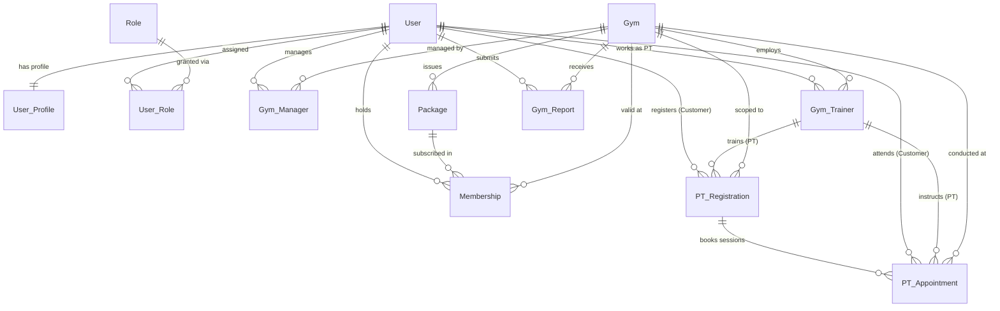

# Multi-Gym Platform — Domain Rules

## 1. Mục Đích & Phạm Vi Tài Liệu

Tài liệu này xác lập các **Quy tắc Nghiệp vụ Miền (Domain Rules)** chính thức cho nền tảng **Multi-Gym**.

Mục tiêu của tài liệu:
- Mô tả chính xác 5 Actor và 12 Domain Entities cốt lõi của hệ thống.
- Định nghĩa các quan hệ (Relationships), quyền sở hữu (Ownership) và ranh giới phòng tập (**Gym Scope**).
- Xác lập các bất biến nghiệp vụ (**Business Invariants**) và vòng đời trạng thái (**Lifecycle & Status**).
- Phân định các hành vi nghiệp vụ của từng Actor đối với từng Entity.
- Làm nguồn tham chiếu duy nhất về mặt nghiệp vụ (**Business Source of Truth**) cho các giai đoạn tiếp theo: Database Specification, API Contract, Feature Specification, Test Strategy, và Implementation.

> [!IMPORTANT]
> - Tài liệu này tập trung hoàn toàn vào **NGHIỆP VỤ LÀ GÌ (WHAT)**, không mô tả chi tiết kỹ thuật mã nguồn hay bảo mật tầng mạng (HOW TO CODE IT).
> - Tuân thủ nghiêm ngặt [`docs/ARCHITECTURE_DECISIONS.md`](file:///srv/gym/docs/ARCHITECTURE_DECISIONS.md) và [`docs/PROJECT_RULES.md`](file:///srv/gym/docs/PROJECT_RULES.md).
> - **Payment hiện tại là: OUT OF SCOPE — CURRENT PHASE**. Tuyệt đối không đưa bất kỳ Payment entity hoặc Payment workflow nào vào tài liệu này.

---

## 2. Các Actor Trong Hệ Thống

Hệ thống ghi nhận 5 Actor đại diện cho các đối tượng tương tác thực tế.

> [!NOTE]
> **Phân biệt Actor $\neq$ Persisted Role:**
> - **Actor:** Vai trò của người dùng khi tham gia vào một ngữ cảnh nghiệp vụ cụ thể.
> - **Persisted Role:** Bản ghi quyền hạn được lưu trữ trong cơ sở dữ liệu (`Role` & `User_Role`).
> - **Đặc biệt:** `Guest` là Actor **chưa xác thực** (Unauthenticated), **không phải** là một bản ghi được lưu trữ trong bảng `User_Role`.

### 2.1. Guest (Khách vãng lai)
- **Định danh:** Người dùng chưa đăng nhập hệ thống. Không có tài khoản hoặc chưa xác thực danh tính.
- **Phạm vi dữ liệu:** Toàn hệ thống ở chế độ công khai (Public Scope).
- **Hành vi nghiệp vụ:** Xem danh sách các cơ sở phòng Gym, duyệt các gói tập (`Package`) công khai của từng Gym, xem danh sách huấn luyện viên (`PT`) công khai, đăng ký tài khoản mới (`Register`), đăng nhập (`Login`).

### 2.2. Customer (Hội viên / Khách hàng)
- **Định danh:** Người dùng đã đăng ký tài khoản và được xác thực (`User`). Có hồ sơ cá nhân (`User_Profile`).
- **Phạm vi dữ liệu:** Cá nhân và các phòng Gym mà Customer có hợp đồng hội viên (`Membership`) hoặc lịch tập (`PT_Appointment`).
- **Hành vi nghiệp vụ:** Đăng ký gói tập (`Package`) để trở thành hội viên (`Membership`) của một Gym cụ thể; đăng ký dịch vụ huấn luyện viên (`PT_Registration`); đặt, xem và hủy lịch hẹn ca tập (`PT_Appointment`); gửi báo cáo phản ánh sự cố (`Gym_Report`) tới phòng Gym mình đang sinh hoạt.

### 2.3. PT (Personal Trainer - Huấn luyện viên cá nhân)
- **Định danh:** Người dùng có tài khoản hệ thống (`User`) được ban quản lý một phòng Gym cụ thể ký hợp đồng và bổ nhiệm thông qua quan hệ `Gym_Trainer`.
- **Phạm vi dữ liệu:** Giới hạn nghiêm ngặt trong phòng Gym mà mình trực thuộc (`Gym_Trainer.gym_id`).
- **Hành vi nghiệp vụ:** Xem lịch dạy ca, xác nhận hoặc hủy lịch hẹn buổi tập (`PT_Appointment`) của học viên thuộc cơ sở mình giảng dạy; theo dõi tiến độ buổi tập của các học viên được phân công (`PT_Registration`).
- **Ranh giới:** PT không có quyền truy cập dữ liệu học viên hoặc lịch hẹn tại phòng Gym khác.

### 2.4. Manager (Quản lý điều hành cơ sở)
- **Định danh:** Người dùng có tài khoản hệ thống (`User`) được Admin bổ nhiệm làm quản lý điều hành duy nhất của một Gym cụ thể thông qua quan hệ `Gym_Manager`.
- **Phạm vi dữ liệu:** Giới hạn nghiêm ngặt trong phạm vi phòng Gym được phân công (`Gym_Manager.gym_id`).
- **Hành vi nghiệp vụ:** Quản lý thông tin chi nhánh Gym; tạo, chỉnh sửa và đóng gói tập (`Package`) của Gym; chỉ định hoặc ngừng hợp tác với huấn luyện viên (`Gym_Trainer`); quản lý danh sách hội viên (`Membership`); tiếp nhận, xử lý và đóng báo cáo sự cố (`Gym_Report`) của khách hàng gửi về cơ sở.
- **Ranh giới bất biến:** Manager của Gym A **tuyệt đối không có quyền** xem, sửa hoặc quản trị dữ liệu của Gym B.

### 2.5. Admin (Quản trị viên toàn sàn)
- **Định danh:** Người dùng nắm quyền quản trị tối cao trên toàn bộ nền tảng Multi-Gym Platform.
- **Phạm vi dữ liệu:** Toàn hệ thống (Global Scope).
- **Hành vi nghiệp vụ:** Tạo mới và cấu hình phòng Gym (`Gym`); bổ nhiệm hoặc bãi nhiệm Quản lý phòng tập (`Gym_Manager`); quản lý danh mục vai trò (`Role`) và tài khoản toàn hệ thống; giám sát toàn bộ hoạt động của nền tảng theo quy chế vận hành.

---

## 3. Đặc Tả 12 Domain Entities Chính Thức

Hệ thống được chuẩn hóa chính xác trên **12 thực thể nghiệp vụ cốt lõi**. Cấm tự ý bổ sung thực thể thứ 13.

---

### Entity 1: User

- **Purpose:** Đại diện cho danh tính xác thực và tài khoản đăng nhập của một cá nhân trên toàn bộ nền tảng.
- **Identity:** `id` (Khóa định danh toàn cục, UUID/CUID). Định danh đăng nhập tự nhiên: `email` (Duy nhất trên toàn sàn).
- **Ownership / Scope:** **System-scoped**. Tài khoản User thuộc về toàn bộ nền tảng, không bị trói buộc cứng vào một phòng Gym duy nhất.
- **Relationships:**
  - $1 - 1$ với `User_Profile` (Một User có đúng một Profile cá nhân).
  - $1 - N$ với `User_Role` (Một User có thể có một hoặc nhiều quyền trên hệ thống).
  - $1 - N$ với `Gym_Manager` (Quan hệ bổ nhiệm làm quản lý phòng gym).
  - $1 - N$ với `Gym_Trainer` (Quan hệ chỉ định làm PT tại phòng gym).
  - $1 - N$ với `Membership` (Hội viên sở hữu các hợp đồng tập).
  - $1 - N$ với `Gym_Report` (Người tạo các báo cáo sự cố).
- **Business Rules:**
  - Email phải là duy nhất trên toàn hệ thống và đúng định dạng.
  - User phải có mật khẩu đã được mã hóa an toàn (Argon2id).
  - Trạng thái tài khoản phải hợp lệ mới được đăng nhập.
- **Lifecycle / Status:**
  - `ACTIVE`: Tài khoản đang hoạt động bình thường.
  - `SUSPENDED`: Tài khoản bị tạm khóa do vi phạm hoặc có yêu cầu từ quản trị viên.
  - `DEACTIVATED`: Tài khoản đã hủy hoạt động.
- **Access Context:** Admin quản lý trạng thái; User tự quản lý thông tin đăng nhập cá nhân.
- **Constraints:** `email` NOT NULL & UNIQUE; `password_hash` NOT NULL; `status` NOT NULL.

---

### Entity 2: User_Profile

- **Purpose:** Lưu trữ thông tin nhân thân và hồ sơ cá nhân mở rộng của người dùng.
- **Identity:** `id` (Khóa định danh UUID) hoặc sử dụng chung `user_id` làm khóa chính.
- **Ownership / Scope:** **System-scoped** (Gắn liền với vòng đời của `User`).
- **Relationships:**
  - $N - 1$ (thực tế là $1 - 1$) với `User` (Bắt buộc thuộc về một User tồn tại).
- **Business Rules:**
  - Tách bạch thông tin định danh xác thực (`User`) với thông tin cá nhân hiển thị (`User_Profile`).
  - Đăng ký ban đầu chỉ cần thông tin cơ bản; Profile có thể được hoàn thiện sau khi đăng nhập.
- **Lifecycle / Status:** Không có vòng đời độc lập; đồng bộ theo vòng đời của `User`.
- **Access Context:** Chính chủ User có quyền xem/sửa hồ sơ của mình; Manager/Admin có quyền xem thông tin cần thiết phục vụ vận hành.
- **Constraints:** `user_id` NOT NULL & UNIQUE & FK to `User`. `full_name` NOT NULL.

---

### Entity 3: Role

- **Purpose:** Định nghĩa danh mục các vai trò/nhóm quyền được công nhận trong hệ sinh thái Multi-Gym.
- **Identity:** `id` (UUID) hoặc `code` (Mã vai trò viết hoa duy nhất: `CUSTOMER`, `PT`, `MANAGER`, `ADMIN`).
- **Ownership / Scope:** **System-scoped** (Danh mục toàn hệ thống do Admin quản lý).
- **Relationships:**
  - $1 - N$ với `User_Role`.
- **Business Rules:**
  - Danh mục vai trò là cố định và hữu hạn.
  - Không tự ý thêm các role mới ngoài 4 persisted roles: `CUSTOMER`, `PT`, `MANAGER`, `ADMIN` (Nhắc lại: `Guest` không lưu trong bảng này).
- **Lifecycle / Status:** Thực thể danh mục (Lookup/Master data), không có lifecycle động.
- **Access Context:** Chỉ Admin có quyền quản lý danh mục Role.
- **Constraints:** `code` NOT NULL & UNIQUE; `name` NOT NULL.

---

### Entity 4: User_Role

- **Purpose:** Bảng quan hệ liên kết thể hiện việc gán một vai trò (`Role`) cho một người dùng (`User`).
- **Identity:** `id` (UUID) hoặc khóa kết hợp (`user_id`, `role_id`).
- **Ownership / Scope:** **System-scoped** (Liên kết phân quyền cấp hệ thống).
- **Relationships:**
  - $N - 1$ với `User`.
  - $N - 1$ với `Role`.
- **Business Rules:**
  - Một User không thể được gán cùng một Role nhiều lần (Cặp `user_id` + `role_id` là duy nhất).
  - Xóa hoặc thu hồi Role sẽ tước quyền hạn tương ứng của User ngay lập tức.
- **Lifecycle / Status:** Được tạo khi cấp quyền, bị xóa khi thu hồi quyền.
- **Access Context:** Do Admin cấp quyền; hoặc tự động gán role `CUSTOMER` khi người dùng đăng ký tài khoản thành công.
- **Constraints:** `user_id` NOT NULL; `role_id` NOT NULL; UNIQUE(`user_id`, `role_id`).

---

### Entity 5: Gym

- **Purpose:** Đại diện cho một cơ sở phòng tập cụ thể (Tenant / Business Location) trong mạng lưới Multi-Gym Platform.
- **Identity:** `id` (UUID toàn cục).
- **Ownership / Scope:** **Root Entity của Gym Scope**. Là gốc rễ xác định ranh giới cách ly dữ liệu phòng tập.
- **Relationships:**
  - $1 - N$ với `Gym_Manager` (Một Gym có thể có quản lý được chỉ định).
  - $1 - N$ với `Gym_Trainer` (Một Gym có đội ngũ PT trực thuộc).
  - $1 - N$ với `Package` (Một Gym phát hành các gói tập của riêng mình).
  - $1 - N$ với `Membership` (Hợp đồng hội viên tại cơ sở này).
  - $1 - N$ với `Gym_Report` (Báo cáo phản ánh gửi về cơ sở này).
- **Business Rules:**
  - Mỗi phòng Gym là một đơn vị vận hành độc lập, có tên, địa chỉ, số điện thoại liên hệ riêng.
  - Khi một Gym ở trạng thái ngừng hoạt động, các gói tập mới không được phép phát hành.
- **Lifecycle / Status:**
  - `ACTIVE`: Cơ sở đang hoạt động bình thường.
  - `MAINTENANCE`: Cơ sở đang tạm dừng đón khách để bảo trì/nâng cấp.
  - `CLOSED`: Cơ sở đã đóng cửa/ngừng kinh doanh vĩnh viễn.
- **Access Context:** Admin có quyền tạo mới, cấu hình và đổi trạng thái Gym. Manager được phân công có quyền cập nhật thông tin vận hành cơ bản. Khách và hội viên có quyền xem thông tin công khai.
- **Constraints:** `name` NOT NULL; `address` NOT NULL; `status` NOT NULL.

---

### Entity 6: Gym_Manager

- **Purpose:** Biểu diễn quan hệ hợp đồng bổ nhiệm người dùng (`User`) nắm vai trò quản lý điều hành tại một phòng tập (`Gym`) cụ thể.
- **Identity:** `id` (UUID).
- **Ownership / Scope:** **Gym-scoped** (Xác định trực tiếp qua `gym_id`).
- **Relationships:**
  - $N - 1$ với `User` (Người dùng nắm vai trò quản lý).
  - $N - 1$ với `Gym` (Cơ sở phòng gym được giao quản lý).
- **Business Rules:**
  - Là căn cứ duy nhất để xác định quyền hạn Gym Scope của một Manager.
  - Khi người dùng đăng nhập với vai trò Manager, hệ thống đối chiếu bảng này để biết Manager được quyền quản lý cơ sở `gym_id` nào.
- **Lifecycle / Status:**
  - `ACTIVE`: Đang đương nhiệm quản lý cơ sở.
  - `REVOKED`: Đã miễn nhiệm hoặc kết thúc bàn giao.
- **Access Context:** Chỉ có Admin mới có thẩm quyền bổ nhiệm, thay đổi hoặc bãi nhiệm `Gym_Manager`.
- **Constraints:** `user_id` NOT NULL; `gym_id` NOT NULL; `status` NOT NULL.

---

### Entity 7: Gym_Trainer

- **Purpose:** Biểu diễn sự phân công/hợp đồng của một Huấn luyện viên (`User` có vai trò PT) làm việc tại một phòng tập (`Gym`) cụ thể.
- **Identity:** `id` (UUID).
- **Ownership / Scope:** **Gym-scoped** (Xác định trực tiếp qua `gym_id`).
- **Relationships:**
  - $N - 1$ với `User` (Tài khoản của huấn luyện viên).
  - $N - 1$ với `Gym` (Cơ sở phòng tập nơi PT làm việc).
  - $1 - N$ với `PT_Registration` (Các hợp đồng tập luyện được gán cho PT này).
  - $1 - N$ với `PT_Appointment` (Các ca tập do PT này hướng dẫn).
- **Business Rules:**
  - Huấn luyện viên không phải thực thể tự do toàn cầu. PT bắt buộc phải trực thuộc một Gym cụ thể.
  - PT chỉ được nhận học viên và mở lịch hẹn tại đúng cơ sở `gym_id` mà mình đã được gán hợp đồng.
- **Lifecycle / Status:**
  - `ACTIVE`: Đang giảng dạy tại phòng tập.
  - `ON_LEAVE`: Tạm nghỉ phép (không nhận lịch hẹn mới).
  - `TERMINATED`: Đã chấm dứt hợp đồng với phòng tập.
- **Access Context:** Manager của Gym đó có quyền tuyển dụng/chỉ định hoặc chấm dứt hợp đồng của PT. Admin có quyền giám sát.
- **Constraints:** `user_id` NOT NULL; `gym_id` NOT NULL; `status` NOT NULL.

---

### Entity 8: Package

- **Purpose:** Đại diện cho sản phẩm dịch vụ tập luyện / gói thẻ hội viên do một Gym cụ thể thiết kế và phát hành ra thị trường.
- **Identity:** `id` (UUID).
- **Ownership / Scope:** **Gym-scoped** (Xác định trực tiếp qua `gym_id`).
- **Relationships:**
  - $N - 1$ với `Gym` (Bắt buộc thuộc về một Gym duy nhất).
  - $1 - N$ với `Membership` (Một gói tập có thể được nhiều khách hàng đăng ký sử dụng).
- **Business Rules:**
  - **Phân biệt rạch ròi Package $\neq$ Membership:** `Package` là định nghĩa sản phẩm/gói dịch vụ; `Membership` là hợp đồng sử dụng gói đó của một khách hàng cụ thể.
  - Package bắt buộc phải gắn với một Gym cụ thể. Không có khái niệm "gói tập toàn cầu" dùng chung mọi gym nếu không có quy định liên minh rõ ràng.
  - Package quy định thời lượng (số ngày/tháng có hiệu lực) và số buổi tập kèm PT (nếu là gói có huấn luyện viên).
- **Lifecycle / Status:**
  - `ACTIVE`: Gói đang mở bán công khai cho hội viên đăng ký.
  - `INACTIVE`: Gói tạm ngừng mở bán (những hội viên cũ đã mua vẫn tiếp tục sử dụng đến khi hết hạn).
- **Access Context:** Manager của Gym có quyền tạo, sửa, đóng gói tập của cơ sở mình. Khách vãng lai và hội viên có quyền xem các gói `ACTIVE`.
- **Constraints:** `gym_id` NOT NULL; `name` NOT NULL; `price` NOT NULL ($\ge 0$); `duration_days` NOT NULL ($> 0$).

---

### Entity 9: Membership

- **Purpose:** Đại diện cho hợp đồng hội viên thực tế của một Customer, hình thành khi Customer đăng ký một gói tập (`Package`) tại một phòng Gym cụ thể.
- **Identity:** `id` (UUID).
- **Ownership / Scope:** **Gym-scoped** (Xác định thông qua `gym_id` của cơ sở phát hành hoặc quan hệ gián tiếp qua `Package.gym_id`).
- **Relationships:**
  - $N - 1$ với `User` (Customer sở hữu thẻ hội viên).
  - $N - 1$ với `Package` (Gói tập đã chọn mua).
  - $N - 1$ với `Gym` (Cơ sở phòng tập nơi hợp đồng có hiệu lực).
  - $1 - N$ với `PT_Registration` (Nếu gói hội viên có quyền lợi tập cùng PT).
- **Business Rules:**
  - Membership phải có thời gian bắt đầu (`start_date`) và thời gian kết thúc (`end_date`).
  - Ngày kết thúc được tính toán dựa trên ngày kích hoạt cộng thêm thời hạn của Package (`duration_days`).
  - Customer chỉ có quyền vào tập tại Gym khi Membership đang ở trạng thái `ACTIVE` và trong thời hạn hiệu lực.
  - **Lưu ý về Payment:** Không có quan hệ với bảng Payment nào trong giai đoạn hiện tại. Trạng thái kích hoạt được ghi nhận trực tiếp ở tầng nghiệp vụ.
- **Lifecycle / Status:**
  - `PENDING_ACTIVATION`: Đã đăng ký thành công, đang chờ ngày bắt đầu hoặc chờ kích hoạt lần đầu tại quầy.
  - `ACTIVE`: Đang có hiệu lực, hội viên được phép check-in tập luyện.
  - `EXPIRED`: Đã hết thời hạn hiệu lực.
  - `SUSPENDED`: Đang bị bảo lưu hoặc tạm ngưng hợp đồng theo yêu cầu.
  - `TERMINATED`: Đã bị hủy trước hạn do vi phạm nội quy phòng tập.
- **Access Context:** Customer xem hợp đồng cá nhân; Manager của phòng Gym quản lý danh sách và gia hạn/bảo lưu hợp đồng hội viên tại cơ sở mình.
- **Constraints:** `user_id` NOT NULL; `package_id` NOT NULL; `gym_id` NOT NULL; `start_date` NOT NULL; `end_date` NOT NULL; `status` NOT NULL.

---

### Entity 10: PT_Registration

- **Purpose:** Đại diện cho việc một Customer đăng ký gói dịch vụ huấn luyện viên cá nhân tại một phòng Gym, quy định số buổi tập và PT phụ trách.
- **Identity:** `id` (UUID).
- **Ownership / Scope:** **Gym-scoped** (Xác định trực tiếp qua `gym_id`).
- **Relationships:**
  - $N - 1$ với `User` (Customer sử dụng dịch vụ).
  - $N - 1$ với `Gym_Trainer` (PT được phân công giảng dạy).
  - $N - 1$ với `Gym` (Cơ sở phòng tập diễn ra dịch vụ).
  - $1 - N$ với `PT_Appointment` (Các buổi tập thực tế được lên lịch).
- **Business Rules:**
  - Phải phân biệt rõ: `PT_Registration` (Hợp đồng/Hạn mức dịch vụ PT) $\neq$ `PT_Appointment` (Từng buổi tập/lịch hẹn cụ thể).
  - Customer, PT và Gym phải nằm trong cùng một phạm vi phòng gym hợp lệ.
  - Quản lý số buổi tập: `total_sessions` (Tổng số buổi được quyền tập) và `completed_sessions` (Số buổi đã hoàn thành). Khi số buổi hoàn thành đạt mức tối đa, đăng ký chuyển trạng thái hoàn tất.
- **Lifecycle / Status:**
  - `ASSIGNED`: Đã đăng ký và đã được phân công PT phụ trách.
  - `IN_PROGRESS`: Đang trong tiến trình tập luyện (đã hoàn thành ít nhất 1 buổi).
  - `COMPLETED`: Đã hoàn thành toàn bộ số buổi tập theo đăng ký.
  - `CANCELLED`: Đã hủy dịch vụ.
- **Access Context:** Customer theo dõi tiến độ; PT theo dõi danh sách học viên phụ trách; Manager quản lý việc gán/đổi PT cho hội viên.
- **Constraints:** `customer_id` NOT NULL; `trainer_id` NOT NULL; `gym_id` NOT NULL; `total_sessions` $> 0$; `completed_sessions` $\ge 0$.

---

### Entity 11: PT_Appointment

- **Purpose:** Đại diện cho một lịch hẹn ca tập luyện cụ thể trong một khung giờ xác định giữa Customer và PT tại phòng Gym.
- **Identity:** `id` (UUID).
- **Ownership / Scope:** **Gym-scoped** (Xác định qua `gym_id`).
- **Relationships:**
  - $N - 1$ với `PT_Registration` (Buổi hẹn này trừ vào gói đăng ký PT nào).
  - $N - 1$ với `User` (Customer tham gia buổi tập).
  - $N - 1$ với `Gym_Trainer` (PT trực tiếp hướng dẫn ca tập).
  - $N - 1$ với `Gym` (Địa điểm phòng tập diễn ra buổi hẹn).
- **Business Rules:**
  - Lịch hẹn phải có thời gian bắt đầu (`start_time`) và thời gian kết thúc (`end_time`), với `end_time > start_time`.
  - Không được phép trùng lịch: Một PT không thể có 2 ca tập trùng giờ tại cùng cơ sở; một Customer không thể đặt 2 ca tập trùng giờ.
  - Buổi tập chỉ được chuyển trạng thái `COMPLETED` khi ca tập đã thực sự diễn ra.
- **Lifecycle / Status:**
  - `SCHEDULED`: Đã đặt lịch thành công, đang chờ tới giờ tập.
  - `COMPLETED`: Buổi tập đã hoàn thành thành công (hệ thống cộng 1 vào `completed_sessions` của `PT_Registration`).
  - `CANCELLED`: Buổi tập bị hủy (bởi học viên hoặc huấn luyện viên trước giờ quy định).
  - `NO_SHOW`: Học viên không đến tập mà không báo trước.
- **Access Context:** Customer đặt lịch/hủy lịch; PT xác nhận/hoàn thành ca tập; Manager giám sát lịch vận hành.
- **Constraints:** `registration_id` NOT NULL; `customer_id` NOT NULL; `trainer_id` NOT NULL; `gym_id` NOT NULL; `start_time` NOT NULL; `end_time` NOT NULL.

---

### Entity 12: Gym_Report

- **Purpose:** Báo cáo phản ánh sự cố kỹ thuật, vệ sinh hoặc chất lượng dịch vụ do Customer gửi trực tiếp tới Ban Quản Lý phòng Gym.
- **Identity:** `id` (UUID).
- **Ownership / Scope:** **Gym-scoped** (Gửi đích danh tới một phòng Gym cụ thể qua `gym_id`).
- **Relationships:**
  - $N - 1$ với `User` (Customer gửi phản ánh).
  - $N - 1$ với `Gym` (Cơ sở phòng tập tiếp nhận phản ánh).
- **Business Rules:**
  - Giới hạn nội dung: Tối đa 1 hình ảnh minh chứng (`image_url`), nội dung phản ánh dạng văn bản (`description`), thời điểm gửi và trạng thái xử lý.
  - Tuyệt đối **không** tạo thêm các thực thể phụ như `Report_Attachment`, `Report_Category` hay `Report_Comment`.
  - Customer chỉ gửi báo cáo tới Gym mà mình là hội viên hoặc đã từng sử dụng dịch vụ.
  - Manager của Gym tiếp nhận và có trách nhiệm phản hồi, đổi trạng thái báo cáo.
- **Lifecycle / Status:**
  - `SUBMITTED`: Báo cáo mới gửi, đang chờ quản lý tiếp nhận.
  - `INVESTIGATING`: Quản lý đã tiếp nhận và đang xác minh/khắc phục sự cố.
  - `RESOLVED`: Sự cố đã được xử lý thỏa đáng.
  - `REJECTED`: Báo cáo không hợp lệ hoặc sai sự thật.
- **Access Context:** Customer tạo và xem tiến độ báo cáo của mình; Manager tiếp nhận và xử lý báo cáo gửi về Gym mình phụ trách.
- **Constraints:** `gym_id` NOT NULL; `user_id` NOT NULL; `title` NOT NULL; `description` NOT NULL; `status` NOT NULL.

---

## 4. Bảng Ma Trận Gym Scope (Gym Scope Matrix)

Bảng phân loại phạm vi và cách thức xác định Gym Scope cho toàn bộ 12 entities:

| Entity | Phạm vi (Scope) | Cơ chế xác định Gym Scope | Cho phép truy cập Cross-Gym? |
| :--- | :--- | :--- | :--- |
| **1. User** | **System-scoped** | Không có `gym_id` trực tiếp. Xác định quyền liên kết Gym thông qua các bảng quan hệ (`Gym_Manager`, `Gym_Trainer`, `Membership`). | Có (User tài khoản toàn sàn). |
| **2. User_Profile** | **System-scoped** | Gắn liền trực tiếp $1-1$ với `User`. | Có (Theo quyền User). |
| **3. Role** | **System-scoped** | Danh mục toàn hệ thống, không phụ thuộc phòng gym. | Không áp dụng. |
| **4. User_Role** | **System-scoped** | Gán vai trò cấp hệ thống cho User. | Không áp dụng. |
| **5. Gym** | **Root Gym Scope** | Là thực thể gốc (`Gym.id`), tự định danh chính mình. | **CẤM** (Manager Gym này không thể quản trị Gym khác). |
| **6. Gym_Manager** | **Gym-scoped** | Trực tiếp qua trường `Gym_Manager.gym_id`. | **CẤM TUYỆT ĐỐI**. |
| **7. Gym_Trainer** | **Gym-scoped** | Trực tiếp qua trường `Gym_Trainer.gym_id`. | **CẤM TUYỆT ĐỐI**. |
| **8. Package** | **Gym-scoped** | Trực tiếp qua trường `Package.gym_id`. | Được xem công khai; **CẤM** sửa chéo. |
| **9. Membership** | **Gym-scoped** | Trực tiếp qua trường `Membership.gym_id` (hoặc gián tiếp qua `Package.gym_id`). | **CẤM** (Manager chỉ quản lý hội viên của Gym mình). |
| **10. PT_Registration** | **Gym-scoped** | Trực tiếp qua trường `PT_Registration.gym_id`. | **CẤM TUYỆT ĐỐI**. |
| **11. PT_Appointment** | **Gym-scoped** | Trực tiếp qua trường `PT_Appointment.gym_id`. | **CẤM TUYỆT ĐỐI**. |
| **12. Gym_Report** | **Gym-scoped** | Trực tiếp qua trường `Gym_Report.gym_id`. | **CẤM** (Manager chỉ xem/xử lý báo cáo của Gym mình). |

---

## 5. Sơ Đồ & Quy Tắc Quan Hệ Giữa Các Thực Thể (Relationship Rules)



### Các quy tắc quan hệ cốt lõi:
1. **User $\longleftrightarrow$ User_Profile:** Mỗi `User` chỉ có tối đa 1 bản ghi `User_Profile`. Xóa User sẽ xóa Profile tương ứng.
2. **User $\longleftrightarrow$ Role (thông qua `User_Role`):** Quan hệ nhiều - nhiều ($N-N$). Một User có thể có nhiều quyền, một Role có thể áp dụng cho nhiều User.
3. **Manager $\longleftrightarrow$ Gym (thông qua `Gym_Manager`):** Quan hệ phân công điều hành. Phải kiểm tra tồn tại bản ghi `Gym_Manager` có `status = 'ACTIVE'` thì User mới được coi là Manager hợp lệ của Gym đó.
4. **PT $\longleftrightarrow$ Gym (thông qua `Gym_Trainer`):** Quan hệ phân công huấn luyện. PT muốn mở lịch hoặc nhận học viên tại Gym nào bắt buộc phải có bản ghi `Gym_Trainer` hợp lệ tại Gym đó.
5. **Gym $\longleftrightarrow$ Package:** Mỗi `Package` thuộc sở hữu của duy nhất một `Gym`.
6. **Customer $\longleftrightarrow$ Package $\longleftrightarrow$ Membership:** Một `Membership` đại diện cho việc một `User` mua quyền sử dụng một `Package` tại một `Gym`.
7. **Customer $\longleftrightarrow$ PT $\longleftrightarrow$ PT_Registration:** Đăng ký dịch vụ huấn luyện cá nhân, kết nối Customer với PT cụ thể tại Gym.
8. **PT_Registration $\longleftrightarrow$ PT_Appointment:** Từng buổi tập thực tế được trừ dần vào hạn mức của bản đăng ký PT.
9. **User $\longleftrightarrow$ Gym $\longleftrightarrow$ Gym_Report:** Báo cáo phản ánh do một User tạo và gửi đích danh tới một phòng Gym cụ thể.

---

## 6. Các Bất Biến Nghiệp Vụ Bắt Buộc (Domain Invariants)

Mọi dòng code ở tầng Backend, Database Schema và Validation đều phải bảo toàn các bất biến sau:

- **INV-001 (Package Belongs to Single Gym):** Một Package bắt buộc phải thuộc về đúng một phòng Gym xác định. Không thể có Package mồ côi (`gym_id IS NULL`).
- **INV-002 (Membership Requires Gym Context):** Không thể tạo hoặc kích hoạt một Membership nếu không xác định được phòng Gym nơi gói hội viên có hiệu lực.
- **INV-003 (Strict Cross-Gym Isolation):** Một Actor không bao giờ được phép đọc, sửa, xóa, hoặc duyệt tài nguyên thuộc quyền quản lý của một Gym khác.
- **INV-004 (PT Assignment Consistency):** Khách hàng chỉ có thể đăng ký PT (`PT_Registration`) và đặt lịch hẹn (`PT_Appointment`) với một huấn luyện viên nếu huấn luyện viên đó đang có trạng thái `ACTIVE` tại chính phòng Gym đó.
- **INV-005 (Appointment Time Validity):** Trong `PT_Appointment`, thời gian kết thúc bắt buộc phải lớn hơn thời gian bắt đầu (`end_time > start_time`). Không thể đặt lịch trong quá khứ.
- **INV-006 (No Appointment Schedule Overlap):** Một PT không thể có hai lịch hẹn trùng hoặc giao nhau về mặt thời gian tại cùng một phòng Gym.
- **INV-007 (Session Quota Boundary):** Số buổi tập đã hoàn thành (`completed_sessions`) trong `PT_Registration` không bao giờ được vượt quá tổng số buổi đăng ký ban đầu (`total_sessions`).
- **INV-008 (Report Single Image Restriction):** Một `Gym_Report` chỉ được chứa tối đa 1 hình ảnh bằng chứng đính kèm. Không phát sinh thực thể bảng con để lưu trữ nhiều ảnh.
- **INV-009 (Role & Scope Separation):** Kiểm tra vai trò (`role`) không bao giờ được thay thế việc kiểm tra phạm vi phòng gym (`gym_id`).

---

## 7. Vòng Đời & Trạng Thái Của Thực Thể (Lifecycle & Status Transitions)

### 7.1. Membership Lifecycle
```text
[ Đăng ký gói ] 
      │
      ▼
PENDING_ACTIVATION ──( Kích hoạt lần đầu )──► ACTIVE ──( Hết hạn ngày )──► EXPIRED
      │                                          │
      │                                          ├──( Bảo lưu )──► SUSPENDED ──( Mở lại )──► ACTIVE
      │                                          │
      └──────────────────────────────────────────┴──( Hủy do vi phạm )──► TERMINATED
```

### 7.2. PT_Registration Lifecycle
```text
[ Gán PT cho học viên ] 
      │
      ▼
   ASSIGNED ──( Hoàn thành buổi đầu tiên )──► IN_PROGRESS
      │                                              │
      │                                              ├──( Hoàn thành đủ số buổi )──► COMPLETED
      │                                              │
      └──────────────────────────────────────────────┴──( Hủy hợp đồng )─────────────► CANCELLED
```

### 7.3. PT_Appointment Lifecycle
```text
[ Customer / PT đặt lịch ]
      │
      ▼
  SCHEDULED ──( Diễn ra và kết thúc ca tập )──► COMPLETED
      │
      ├──( Hủy trước giờ tập quy định )────────► CANCELLED
      │
      └──( Học viên không tới tập )───────────► NO_SHOW
```

### 7.4. Gym_Report Lifecycle
```text
[ Customer gửi phản ánh ]
      │
      ▼
  SUBMITTED ──( Quản lý mở xem và xử lý )──► INVESTIGATING ──( Khắc phục xong )──► RESOLVED
      │                                             │
      └─────────────────────────────────────────────┴──( Báo cáo sai/spam )──────► REJECTED
```

---

## 8. Ma Trận Quyền Hành Động Nghiệp Vụ (Actor × Domain Action)

Bảng đặc tả quyền hạn ở cấp độ nghiệp vụ miền (**Domain Level**), độc lập với các URL hay controller cụ thể:

| Actor | Entity | Domain Action | Phạm vi thao tác (Scope) |
| :--- | :--- | :--- | :--- |
| **Guest** | `Gym` | View (Xem thông tin cơ sở) | Public |
| **Guest** | `Package` | View (Xem các gói tập công khai) | Public |
| **Guest** | `Gym_Trainer` | View (Xem danh sách PT công khai) | Public |
| **Guest** | `User` | Register (Đăng ký tài khoản) | Self |
| **Customer** | `User_Profile` | View, Update (Cập nhật hồ sơ) | Self |
| **Customer** | `Membership` | View, Register (Đăng ký gói tập) | Self / Gym liên kết |
| **Customer** | `PT_Registration` | View, Register (Đăng ký tập với PT) | Self / Gym liên kết |
| **Customer** | `PT_Appointment` | View, Book, Cancel (Đặt/Hủy lịch hẹn) | Self / Gym liên kết |
| **Customer** | `Gym_Report` | View, Create (Tạo và theo dõi phản ánh) | Self / Gym liên kết |
| **PT** | `Gym_Trainer` | View (Xem thông tin phân công của mình) | Self / Assigned Gym |
| **PT** | `PT_Registration` | View (Xem danh sách học viên phụ trách) | Assigned Gym |
| **PT** | `PT_Appointment` | View, Confirm, Complete, Cancel (Quản lý ca tập) | Assigned Gym |
| **Manager** | `Gym` | View, Update (Chỉnh sửa thông tin cơ sở) | Managed Gym Only |
| **Manager** | `Gym_Trainer` | View, Assign, Terminate (Quản lý đội ngũ PT) | Managed Gym Only |
| **Manager** | `Package` | View, Create, Update, Deactivate (Quản lý gói tập) | Managed Gym Only |
| **Manager** | `Membership` | View, Suspend, Terminate (Quản trị hội viên) | Managed Gym Only |
| **Manager** | `Gym_Report` | View, Investigate, Resolve, Reject (Xử lý sự cố) | Managed Gym Only |
| **Admin** | `Gym` | View, Create, Update, Close (Quản lý cơ sở) | Global Scope |
| **Admin** | `Gym_Manager` | View, Assign, Revoke (Bổ nhiệm/Bãi nhiệm Quản lý) | Global Scope |
| **Admin** | `Role` / `User_Role` | View, Assign, Revoke (Phân quyền hệ thống) | Global Scope |
| **Admin** | `User` | View, Suspend (Khóa/Mở tài khoản vi phạm) | Global Scope |

---

## 9. Câu Hỏi Nghiệp Vụ Chưa Xác Định (Open Domain Questions)

Các câu hỏi nghiệp vụ sau đây **chưa có quyết định chính thức** từ tài liệu kiến trúc. Cần được làm rõ trước khi thiết kế Database Schema và API Contract chi tiết:

1. **Quan hệ Đa Chi Nhánh của Hội viên (Cross-Gym Customer Memberships):**
   * *Câu hỏi:* Một Customer có thể đồng thời sở hữu nhiều Membership đang hoạt động tại các Gym khác nhau hay không? (Ví dụ: Mua gói Gym A và mua thêm gói Gym B).
   * *Trạng thái:* `UNKNOWN` (Hiện tại mô hình dữ liệu hỗ trợ $1-N$, nhưng nghiệp vụ có cho phép check-in song song hay không cần chốt).
2. **Quan hệ Đa Cơ Sở của Huấn Luyện Viên (Cross-Gym PT Assignment):**
   * *Câu hỏi:* Một Huấn luyện viên (`User` có vai trò PT) có được phép ký hợp đồng làm việc tại 2 phòng Gym khác nhau trong cùng một hệ thống hay không?
   * *Trạng thái:* `UNKNOWN` (Nếu có, PT phải phân bổ lịch hẹn không bị trùng giờ giữa 2 cơ sở).
3. **Quan hệ Đa Cơ Sở của Quản Lý (Cross-Gym Manager Assignment):**
   * *Câu hỏi:* Một Manager có thể được Admin chỉ định quản lý đồng thời từ 2 Gym trở lên hay không, hay bắt buộc $1-1$ (mỗi Manager chỉ quản trị duy nhất 1 Gym)?
   * *Trạng thái:* `UNKNOWN`.
4. **Quy tắc Hủy Lịch Buổi Tập PT (Cancellation Policy):**
   * *Câu hỏi:* Học viên được phép hủy lịch hẹn (`PT_Appointment`) trước bao nhiêu tiếng thì không bị tính là buổi tập đã mất (`NO_SHOW`)?
   * *Trạng thái:* `To be defined in Feature Specification`.
5. **Cơ chế Chuyển Nhượng / Nâng Cấp Gói Hội Viên:**
   * *Câu hỏi:* Khách hàng có được phép chuyển nhượng thẻ hội viên sang người khác hoặc nâng cấp gói tập khi chưa hết hạn không?
   * *Trạng thái:* `To be defined in Feature Specification`.

---

## 10. Bảng Kiểm Tra Tính Nhất Quán (Consistency Check)

- [x] **Đúng 12 thực thể:** Chính xác 12 entities đã duyệt, không thừa không thiếu.
- [x] **Không có Payment entity:** Không có bảng Payment, Invoice, Transaction, hay Webhook nào.
- [x] **Guest phân biệt rõ:** Guest được định nghĩa là unauthenticated Actor, không bị lưu vào bảng `User_Role`.
- [x] **Gym Scope tường minh:** Cả 12 thực thể đều có cách xác định Gym Scope rõ ràng.
- [x] **Không mặc định mọi bảng đều có gym_id:** `User`, `User_Profile`, `Role`, `User_Role` là system-scoped không chứa `gym_id`.
- [x] **Package $\neq$ Membership:** Phân biệt rõ ràng giữa sản phẩm gói tập và hợp đồng sử dụng gói tập.
- [x] **PT_Registration $\neq$ PT_Appointment:** Phân biệt rõ giữa hợp đồng thuê PT và từng buổi hẹn lịch tập cụ thể.
- [x] **Gym_Manager $\neq$ Gym_Trainer:** Hai thực thể quan hệ phân công trách nhiệm độc lập.
- [x] **User $\neq$ User_Profile:** Phân tách tài khoản đăng nhập và hồ sơ cá nhân.
- [x] **Role $\neq$ User_Role:** Phân tách danh mục quyền và bảng gán quyền.
- [x] **Không có entity phụ ngoài 12 entity:** Không tạo `Report_Attachment`, `Report_Category`, v.v.
- [x] **Không đưa implementation detail vào domain:** Tập trung 100% vào luật nghiệp vụ (WHAT), không đưa code Express/Drizzle/SQL vào.
