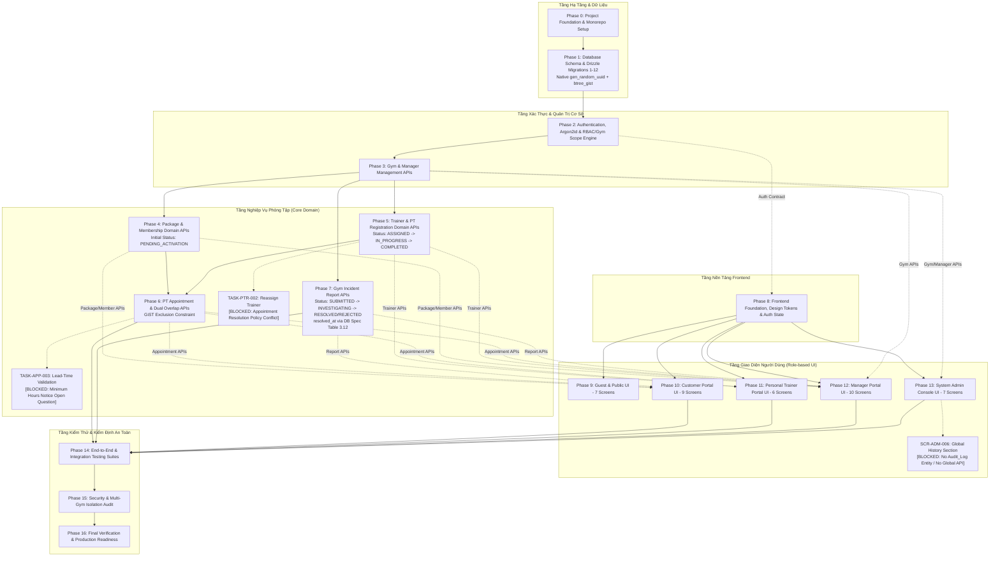

# Multi-Gym Platform — Master Implementation Plan

> **Mục tiêu:** Chuyển đổi toàn bộ Đặc tả Hệ thống (Architecture, Domain, Database, API, Feature, UI/UX, Project Rules) thành Kế hoạch Triển khai (Implementation Roadmap) có cấu trúc thứ tự tuần tự, tường minh về quan hệ phụ thuộc (Dependencies), ma trận kiểm thử (Testing Strategy), phân rã nhiệm vụ (Granular Tasks) và tiêu chuẩn hoàn thành (Definition of Done) để đội ngũ kỹ sư và AI Coding Agent có thể triển khai độc lập, an toàn và chính xác tuyệt đối.
>
> **Ràng buộc cốt lõi:** Kế hoạch triển khai **tuyệt đối KHÔNG tự tạo hoặc chốt các nghiệp vụ chưa được Source of Truth phê duyệt**. Mọi điểm mâu thuẫn hoặc chưa xác định từ các tài liệu đặc tả bắt buộc phải trở thành **Blocker / Open Question** và chặn (Block) các task liên quan, không được tự ý quyết định thay hệ thống.

---

## 1. Nguồn Chân Lý & Thứ Bậc Tuân Thủ (Source of Truth Hierarchy)

Mọi quyết định kỹ thuật trong quá trình thực thi bắt buộc phải tuân theo thứ tự ưu tiên tuyệt đối từ cao xuống thấp (theo `docs/PROJECT_RULES.md` & `.agents/rules/multi-gym.md`):

```text
1. Explicit user requirement của task hiện tại
   ↓
2. Architecture Decisions (docs/ARCHITECTURE_DECISIONS.md)
   ↓
3. Project Rules (docs/PROJECT_RULES.md & .agents/rules/multi-gym.md)
   ↓
4. Domain Rules (docs/DOMAIN_RULES.md)
   ↓
5. Feature Specifications (docs/FEATURE_SPEC.md)
   ↓
6. Database Specification (docs/DATABASE_SPEC.md) & API Contract (docs/API_SPEC.md)
   ↓
7. UI/UX Specification (docs/UI_UX_SPEC.md) & Taste Skill (.taste-skill/skills/taste-skill/SKILL.md)
   ↓
8. Existing Implementation (Mã nguồn hiện có trong repo)
   ↓
9. AI Assumptions (Giả định của AI - LUÔN CÓ ĐỘ ƯU TIÊN THẤP NHẤT)
```

### Nguyên tắc xử lý xung đột (Conflict Resolution Protocol)
1. **Không tự ý lựa chọn hoặc thỏa hiệp:** Nếu phát hiện mâu thuẫn giữa các tài liệu (ví dụ giữa Feature Spec và API Spec), AI Coding Agent **tuyệt đối không tự ý chọn một phương án hoặc tự chốt nghiệp vụ**.
2. **Không âm thầm thay đổi đặc tả:** Kế hoạch triển khai này không được dùng làm phương tiện để thay đổi quy tắc nghiệp vụ (Domain Rules), hợp đồng API (API Spec) hay cấu trúc dữ liệu (Database Spec).
3. **Chuyển thành Blocker thực tế:** Mọi câu hỏi mở (Open Questions) chưa được giải quyết dứt điểm trong Source of Truth bắt buộc phải được định danh thành **Implementation Blocker**, gán cờ `BLOCKED` cho các task phụ thuộc và dừng triển khai logic chưa thống nhất cho đến khi có quyết định chính thức từ Technical Lead / Product Owner.

---

## 2. Nguyên Tắc Triển Khai Bất Biến (Implementation Principles)

1. **Backend First:** Hạ tầng Database, Data Model, Application Services và REST API phải được xây dựng, kiểm thử và verify thành công trước khi phát triển Frontend tương ứng.
2. **Database Integrity First:** Schema PostgreSQL 17, khóa chính (UUIDv4 sinh tự động bằng hàm native `gen_random_uuid()`), khóa ngoại (FK), chỉ mục (Indexes), ràng buộc kiểm tra (`CHECK`), ràng buộc duy nhất (`UNIQUE`), và ràng buộc loại trừ (`EXCLUSION USING gist` qua extension `btree_gist`) phải được tạo lập qua Drizzle Migration trước khi viết Repositories/Services.
3. **Tuân thủ tuyệt đối API Contract:** Mọi request payload, query params, HTTP status codes (`200`, `201`, `204`, `400`, `401`, `403`, `404`, `409`, `422`, `500`) và Response Envelopes (`{ success: true, data }` / `{ success: false, error: { code, message } }`) phải khớp 100% với `docs/API_SPEC.md`.
4. **Phân tầng trách nhiệm nghiêm ngặt (Separation of Concerns):**
   $$\text{Route} \longrightarrow \text{Middleware (Auth/RBAC/Scope/Zod)} \longrightarrow \text{Controller} \longrightarrow \text{Service} \longrightarrow \text{Drizzle ORM} \longrightarrow \text{PostgreSQL 17}$$
   - Controller chỉ tiếp nhận, validate, gọi Service và trả response. Cấm nhồi nhét business logic hoặc query DB trong Controller.
   - Toàn bộ business logic, state lifecycle và scoping rules phải nằm tại tầng Service.
5. **Multi-Gym Isolation là Yêu Cầu An Toàn Cốt Lõi:**
   - Hệ thống vận hành dưới mô hình Shared-Database, Shared-Schema với Application-Level Multi-Gym Isolation.
   - Mọi thực thể Gym-scoped (`gym_managers`, `gym_trainers`, `packages`, `memberships`, `pt_registrations`, `pt_appointments`, `gym_reports`) bắt buộc phải có `gym_id UUID NOT NULL`.
   - Cấm mọi truy vấn Drizzle ORM thiếu điều kiện lọc `where(eq(table.gymId, currentGymId))`.
   - Manager của Gym A tuyệt đối không được đọc/sửa/xóa tài nguyên của Gym B.
6. **Xác thực & Phân quyền Hai Lớp (Two-Tier Enforcement):**
   - Xác thực: JWT mang claims (`sub`, `email`, `roles`) vận chuyển độc quyền qua **HttpOnly, Secure, SameSite=Lax Cookie**. Tuyệt đối **không** dùng `localStorage` hay `sessionStorage`.
   - Mật khẩu: Băm bằng **Argon2id** (m: 64MB, t: 3, p: 4). Không bao giờ log hay trả về `password_hash`.
   - Phân quyền: Luôn thẩm định 2 bước: Bước 1 (Role RBAC: `Guest`, `Customer`, `PT`, `Manager`, `Admin`) $\rightarrow$ Bước 2 (Gym Scope / Resource Ownership).
7. **Phạm vi 12 Thực Thể Cốt Lõi (Strict Domain Scope):**
   - Đúng chính xác 12 entities: `User`, `User_Profile`, `Role`, `User_Role`, `Gym`, `Gym_Manager`, `Gym_Trainer`, `Package`, `Membership`, `PT_Registration`, `PT_Appointment`, `Gym_Report`.
   - Tuyệt đối cấm tạo entity thứ 13 (Không tạo `Audit_Log`, `Payment`, `Invoice`, `Transaction`, `Report_Attachment`, v.v.).
8. **Thanh toán (Payment) là STRICT OUT OF SCOPE:**
   - Không tạo bảng thanh toán, không tạo endpoint thanh toán, không tích hợp cổng thanh toán, không tạo form thanh toán trên UI. Trạng thái kích hoạt hợp đồng hội viên được xử lý thông qua luồng kích hoạt thẻ tại quầy của Manager (`PENDING_ACTIVATION` $\rightarrow$ `ACTIVE`).
9. **Chuẩn mực UI/UX & Taste Skill:**
   - Mọi task giao diện phải tuân thủ `docs/UI_UX_SPEC.md` và tự động áp dụng Taste Skill (`.taste-skill/skills/taste-skill/SKILL.md`).
   - Phong cách: **Minimalist — Modern — Clean — Professional**. Bảng màu: Dark Navy (`#0F172A`), Red Accent (`#E11D48`), White (`#FFFFFF`), Slate Gray (`#F1F5F9`).
   - Cấm thiết kế lại ngoài spec. Cấm hardcode business rules ở UI. Cấm tạo mock/fake data để hoàn thành task khi backend contract chưa hỗ trợ.

---

## 3. Sơ Đồ Luồng Phụ Thuộc Triển Khai (Dependency Graph)



---

## 4. Thứ Tự Triển Khai Cơ Sở Dữ Liệu (Database Migration Order)

Theo ràng buộc khóa ngoại (FK Dependencies) được định nghĩa trong `docs/DATABASE_SPEC.md`, thứ tự migration vật lý bắt buộc phải tuân theo 12 bước tuyến tính:

```text
[1. users] ──────────► [2. user_profiles]
   │
   ├──────────────────► [4. user_roles] ◄────────── [3. roles]
   │
   ├──────────┬───────► [6. gym_managers] ◄─────────┐
   │          │                                      │
   │          └───────► [7. gym_trainers] ◄──────┐   │
   │                         ▲                   │   │
   │                         │ (Composite FK)    │   │
   │                         │                   │   │
   ├──────────────────► [10. pt_registrations] ──┼───┼────── [5. gyms]
   │                         ▲                   │   │          │
   │                         │ (Composite FK)    │   │          │
   │                         │                   │   │          ├─────► [8. packages]
   ├──────────────────► [11. pt_appointments]    │   │          │          │
   │                                             │   │          │          │ (Composite FK)
   ├─────────────────────────────────────────────┼───┼──────────┼─────► [9. memberships]
   │                                             │   │          │
   └─────────────────────────────────────────────┴───┴──────────┴─────► [12. gym_reports]
```

### Bảng Đặc Tả Kỹ Thuật 12 Bảng Dữ Liệu

| Thứ tự | Bảng (Table) | Phạm vi Scope | Khóa chính | Ràng buộc chính & Chỉ mục trọng yếu | Khóa ngoại (Parent Tables) |
| :---: | :--- | :--- | :--- | :--- | :--- |
| **0** | *Extension Setup* | Infrastructure | N/A | `CREATE EXTENSION IF NOT EXISTS "btree_gist";`<br>*(Lưu ý: PostgreSQL 17 hỗ trợ native `gen_random_uuid()` không cần cài `uuid-ossp`. Chỉ cài extension `btree_gist` để phục vụ Exclusion Constraint chống trùng lịch).* | Chuẩn bị GiST Index cho Overlap |
| **1** | `users` | System | `id UUID` | - Sinh tự động bằng `gen_random_uuid()`<br>- `uq_users_email_lower`: `UNIQUE (lower(email))`<br>- `chk_users_status`: `CHECK (status IN ('ACTIVE','SUSPENDED','DEACTIVATED'))`<br>- `chk_users_email_format`: Regex format check | None |
| **2** | `user_profiles` | System | `id UUID` | - `uq_user_profiles_user_id`: `UNIQUE (user_id)` (Quan hệ 1-1)<br>- `chk_user_profiles_gender`: `CHECK (gender IS NULL OR gender IN ('MALE','FEMALE','OTHER'))` | `users(id)` ON DELETE CASCADE |
| **3** | `roles` | System | `id UUID` | - `uq_roles_code`: `UNIQUE (code)`<br>- `chk_roles_code`: `CHECK (code IN ('CUSTOMER','PT','MANAGER','ADMIN'))` | Master Data (Seed) |
| **4** | `user_roles` | System | `id UUID` | - `uq_user_roles_user_role`: `UNIQUE (user_id, role_id)` | `users(id)` ON DELETE CASCADE<br>`roles(id)` ON DELETE RESTRICT |
| **5** | `gyms` | Root Tenant | `id UUID` | - `chk_gyms_status`: `CHECK (status IN ('ACTIVE','MAINTENANCE','CLOSED'))`<br>- Index trên `status` | None |
| **6** | `gym_managers` | Gym-scoped | `id UUID` | - `uq_gym_managers_active_per_gym`: Partial Unique `(gym_id) WHERE status = 'ACTIVE'`<br>- `uq_gym_managers_active_per_user`: Partial Unique `(user_id) WHERE status = 'ACTIVE'`<br>- `chk_gym_managers_status`: `CHECK (status IN ('ACTIVE','REVOKED'))` | `users(id)` ON DELETE CASCADE<br>`gyms(id)` ON DELETE RESTRICT |
| **7** | `gym_trainers` | Gym-scoped | `id UUID` | - `uq_gym_trainers_user_gym`: `UNIQUE (user_id, gym_id)`<br>- `chk_gym_trainers_status`: `CHECK (status IN ('ACTIVE','ON_LEAVE','TERMINATED'))`<br>- Composite Index: `(id, gym_id)` (làm parent cho Composite FK) | `users(id)` ON DELETE CASCADE<br>`gyms(id)` ON DELETE RESTRICT |
| **8** | `packages` | Gym-scoped | `id UUID` | - `chk_packages_price`: `CHECK (price >= 0)`<br>- `chk_packages_duration`: `CHECK (duration_days > 0)`<br>- `chk_packages_pt_count`: `CHECK (pt_session_count >= 0)`<br>- Composite Unique: `UNIQUE (id, gym_id)` (làm parent cho Composite FK) | `gyms(id)` ON DELETE RESTRICT |
| **9** | `memberships` | Gym-scoped | `id UUID` | - **Composite FK:** `FOREIGN KEY (package_id, gym_id) REFERENCES packages(id, gym_id)` ON DELETE RESTRICT<br>- `chk_memberships_dates`: `CHECK (end_date >= start_date)`<br>- `chk_memberships_status`: `CHECK (status IN ('PENDING_ACTIVATION','ACTIVE','SUSPENDED','EXPIRED','TERMINATED'))` | `users(id)` ON DELETE RESTRICT<br>`gyms(id)` ON DELETE RESTRICT<br>`packages(id, gym_id)` ON DELETE RESTRICT |
| **10** | `pt_registrations` | Gym-scoped | `id UUID` | - **Composite FK:** `FOREIGN KEY (trainer_id, gym_id) REFERENCES gym_trainers(id, gym_id)` ON DELETE RESTRICT<br>- `chk_pt_registrations_status`: `CHECK (status IN ('ASSIGNED', 'IN_PROGRESS', 'COMPLETED', 'CANCELLED'))`<br>- `chk_pt_reg_sessions`: `CHECK (total_sessions > 0 AND completed_sessions >= 0 AND completed_sessions <= total_sessions)`<br>- Composite Unique: `UNIQUE (id, customer_id, trainer_id, gym_id)` (làm parent cho Composite FK) | `users(customer_id)` ON DELETE RESTRICT<br>`gyms(id)` ON DELETE RESTRICT<br>`gym_trainers(id, gym_id)` ON DELETE RESTRICT |
| **11** | `pt_appointments` | Gym-scoped | `id UUID` | - **Composite FK:** `FOREIGN KEY (registration_id, customer_id, trainer_id, gym_id) REFERENCES pt_registrations(id, customer_id, trainer_id, gym_id)` ON DELETE RESTRICT<br>- `chk_pt_appointments_status`: `CHECK (status IN ('SCHEDULED', 'COMPLETED', 'CANCELLED', 'NO_SHOW'))`<br>- `chk_pt_app_time`: `CHECK (end_time > start_time)`<br>- **Exclusion Constraint 1 (Trainer Anti-Overlap):** `EXCLUDE USING gist (trainer_id WITH =, tstzrange(start_time, end_time) WITH &&) WHERE (status = 'SCHEDULED')`<br>- **Exclusion Constraint 2 (Customer Anti-Overlap):** `EXCLUDE USING gist (customer_id WITH =, tstzrange(start_time, end_time) WITH &&) WHERE (status = 'SCHEDULED')` | `pt_registrations(id, customer_id, trainer_id, gym_id)` ON DELETE RESTRICT |
| **12** | `gym_reports` | Gym-scoped | `id UUID` | - `resolved_at TIMESTAMPTZ NULL` (Được bảo vệ theo `DATABASE_SPEC.md` Table 3.12, Line 529; cấm tự thêm trường ngoài DB Spec)<br>- `chk_gym_reports_status`: `CHECK (status IN ('SUBMITTED', 'INVESTIGATING', 'RESOLVED', 'REJECTED'))`<br>- Composite Index: `(gym_id, status, created_at)` | `gyms(id)` ON DELETE RESTRICT<br>`users(id)` ON DELETE RESTRICT |

---

## 5. Chi Tiết Các Giai Đoạn Triển Khai (Phase Breakdown)

---

### Phase 0 — Khởi Tạo Nền Tảng Dự Án (Project Foundation & Monorepo Setup)

- **Phase ID:** `PHASE-0`
- **Mục tiêu:** Cấu hình chuẩn hóa Monorepo, môi trường Docker Compose đa dịch vụ, TypeScript path aliases, ESLint, Prettier, và cấu trúc thư viện dùng chung `packages/shared`.
- **Dependencies:** Không có.
- **Deliverables:** Monorepo sẵn sàng chạy, `docker-compose.yml` pass config, workspace builds pass.

#### Tasks:
1. **`TASK-FND-001`**: Chuẩn hóa cấu hình Root Monorepo (`package.json`, pnpm/npm workspaces, `tsconfig.base.json`).
   - *Layer:* Infrastructure / Tooling
   - *Files:* `package.json`, `tsconfig.base.json`, `.gitignore`, `.env.example`
   - *Criteria:* Cài đặt dependencies gốc; các workspace `apps/api`, `apps/web`, `packages/shared` liên kết thông suốt.
2. **`TASK-FND-002`**: Thiết lập `packages/shared` cho Types, Constants & Zod Schemas chung.
   - *Layer:* Shared Library
   - *Files:* `packages/shared/src/index.ts`, `packages/shared/src/types/`, `packages/shared/src/constants/`, `packages/shared/src/schemas/`
   - *Criteria:* Build thành công CJS/ESM; định nghĩa 4 persistent roles (`CUSTOMER`, `PT`, `MANAGER`, `ADMIN`), các mã lỗi HTTP chuẩn, envelope types.
3. **`TASK-FND-003`**: Chuẩn hóa Docker Compose Dev Environment.
   - *Layer:* DevOps / Docker
   - *Files:* `docker-compose.yml`, `Dockerfile`, `Dockerfile.web`
   - *Criteria:* Chạy `docker compose config` hợp lệ; PostgreSQL 17 cấu hình đúng healthcheck, persistent volume `multi_gym_postgres_data`, network `multi_gym_network`.

---

### Phase 1 — Hạ Tầng Dữ Liệu & Drizzle Migrations (Database & Infrastructure)

- **Phase ID:** `PHASE-1`
- **Mục tiêu:** Thiết lập kết nối Drizzle ORM tới PostgreSQL 17, sinh schema và migration tuần tự cho 12 bảng, thiết lập toàn bộ Constraints (Composite FK, Functional Index, Exclusion Constraints) và tạo Seed Script.
- **Dependencies:** `PHASE-0`.
- **Deliverables:** 12 bảng PostgreSQL được tạo chính xác qua migration; seed data 4 roles chuẩn và tài khoản Admin mặc định.

#### Tasks:
1. **`TASK-DB-001`**: Thiết lập Drizzle ORM connection pool & Drizzle Kit configuration.
   - *Layer:* Database
   - *Files:* `apps/api/src/db/connection.ts`, `apps/api/drizzle.config.ts`
   - *Criteria:* Kết nối tới DB `multi_gym_db` thành công; hỗ trợ pooling và migration runner.
2. **`TASK-DB-002`**: Tạo migration khởi tạo extension `btree_gist`.
   - *Layer:* Database Migration
   - *Files:* `apps/api/src/db/migrations/0000_init_extensions.sql`
   - *Criteria:* Kích hoạt extension `btree_gist` để phục vụ Exclusion Constraint chống trùng lịch theo đúng `DATABASE_SPEC.md` Section 8.5. Sử dụng hàm native `gen_random_uuid()` của PostgreSQL 17, TUYỆT ĐỐI KHÔNG cài extension `uuid-ossp`.
3. **`TASK-DB-003`**: Định nghĩa Drizzle schema & migration cho `users` và `user_profiles`.
   - *Layer:* Database Schema
   - *Files:* `apps/api/src/db/schema/users.ts`, `apps/api/src/db/schema/user_profiles.ts`
   - *Criteria:* Khóa chính UUID bằng `gen_random_uuid()`; unique functional index `lower(email)`, check status (`ACTIVE`, `SUSPENDED`, `DEACTIVATED`), check email regex format, quan hệ 1-1 profile.
4. **`TASK-DB-004`**: Định nghĩa Drizzle schema & migration cho `roles` và `user_roles`.
   - *Layer:* Database Schema
   - *Files:* `apps/api/src/db/schema/roles.ts`, `apps/api/src/db/schema/user_roles.ts`
   - *Criteria:* Check role codes (`CUSTOMER`, `PT`, `MANAGER`, `ADMIN`), Unique code, Unique `(user_id, role_id)`.
5. **`TASK-DB-005`**: Định nghĩa Drizzle schema & migration cho `gyms` và `gym_managers`.
   - *Layer:* Database Schema
   - *Files:* `apps/api/src/db/schema/gyms.ts`, `apps/api/src/db/schema/gym_managers.ts`
   - *Criteria:* Partial Unique Index: 1 Manager ACTIVE / Gym; 1 User làm Manager ACTIVE tại 1 Gym duy nhất. Check status `gym_managers` in (`ACTIVE`, `REVOKED`).
6. **`TASK-DB-006`**: Định nghĩa Drizzle schema & migration cho `gym_trainers` và `packages`.
   - *Layer:* Database Schema
   - *Files:* `apps/api/src/db/schema/gym_trainers.ts`, `apps/api/src/db/schema/packages.ts`
   - *Criteria:* Check trainer status (`ACTIVE`, `ON_LEAVE`, `TERMINATED`). Composite Unique trên `packages(id, gym_id)` và `gym_trainers(id, gym_id)` phục vụ Composite FKs.
7. **`TASK-DB-007`**: Định nghĩa Drizzle schema & migration cho `memberships`.
   - *Layer:* Database Schema
   - *Files:* `apps/api/src/db/schema/memberships.ts`
   - *Criteria:* Composite Foreign Key `(package_id, gym_id) REFERENCES packages(id, gym_id)`. Check status (`PENDING_ACTIVATION`, `ACTIVE`, `SUSPENDED`, `EXPIRED`, `TERMINATED`).
8. **`TASK-DB-008`**: Định nghĩa Drizzle schema & migration cho `pt_registrations`.
   - *Layer:* Database Schema
   - *Files:* `apps/api/src/db/schema/pt_registrations.ts`
   - *Criteria:* Composite Foreign Key `(trainer_id, gym_id) REFERENCES gym_trainers(id, gym_id)`. Check status bắt buộc in (`ASSIGNED`, `IN_PROGRESS`, `COMPLETED`, `CANCELLED`). Composite Unique `(id, customer_id, trainer_id, gym_id)`.
9. **`TASK-DB-009`**: Định nghĩa Drizzle schema & migration cho `pt_appointments`.
   - *Layer:* Database Schema
   - *Files:* `apps/api/src/db/schema/pt_appointments.ts`
   - *Criteria:* Composite FK trỏ về `pt_registrations`; check status (`SCHEDULED`, `COMPLETED`, `CANCELLED`, `NO_SHOW`); 2 PostgreSQL GiST Exclusion Constraints chống trùng lịch cho PT và Customer khi status = `SCHEDULED`.
10. **`TASK-DB-010`**: Định nghĩa Drizzle schema & migration cho `gym_reports`.
    - *Layer:* Database Schema
    - *Files:* `apps/api/src/db/schema/gym_reports.ts`
    - *Criteria:* Khóa ngoại `gym_id`, `user_id`; cột `resolved_at TIMESTAMPTZ NULL` theo đúng `DATABASE_SPEC.md` Table 3.12 (dòng 529 & 811); check status in (`SUBMITTED`, `INVESTIGATING`, `RESOLVED`, `REJECTED`); Composite Index `(gym_id, status, created_at)`. Tuyệt đối không thêm cột ngoài spec.
11. **`TASK-DB-011`**: Viết Database Seed script chuẩn.
    - *Layer:* Database Seeding
    - *Files:* `apps/api/src/db/seed.ts`
    - *Criteria:* Nạp 4 roles chuẩn; tạo tài khoản System Admin mặc định với mật khẩu băm Argon2id; tạo 2 phòng gym mẫu, 2 manager mẫu, packages mẫu để test cross-gym.

---

### Phase 2 — Xác Thực & Phân Quyền Hai Lớp (Authentication & Authorization Engine)

- **Phase ID:** `PHASE-2`
- **Mục tiêu:** Xây dựng toàn bộ pipeline xác thực JWT HttpOnly Cookie, băm mật khẩu Argon2id, middleware RBAC và middleware thẩm định Gym Scope.
- **Dependencies:** `PHASE-1`.
- **Deliverables:** Bộ middleware bảo mật cốt lõi, module Auth hoàn chỉnh, bộ unit & integration test cho Auth/Scope.

#### Tasks:
1. **`TASK-AUTH-001`**: Triển khai Password Hashing Service với Argon2id.
   - *Layer:* Backend Service
   - *Files:* `apps/api/src/services/password.service.ts`
   - *Criteria:* Băm và kiểm tra mật khẩu bằng Argon2id (m: 64MB, t: 3, p: 4); không bao giờ log mật khẩu gốc.
2. **`TASK-AUTH-002`**: Triển khai Token Management Service (JWT Sign & Verify).
   - *Layer:* Backend Service
   - *Files:* `apps/api/src/services/token.service.ts`
   - *Criteria:* Ký JWT với payload `{ sub, email, roles }`, thời hạn 7 ngày; giải mã và kiểm tra tính toàn vẹn chữ ký.
3. **`TASK-AUTH-003`**: Xây dựng Cookie Management Helper.
   - *Layer:* Backend Helper
   - *Files:* `apps/api/src/utils/cookie.helper.ts`
   - *Criteria:* Đính kèm cookie với cờ `HttpOnly`, `Secure` (theo môi trường), `SameSite=Lax`, `Path=/api/v1`, `Max-Age=604800`; hàm xóa cookie khi logout.
4. **`TASK-AUTH-004`**: Xây dựng Zod Validation Middleware & Envelope Response Handlers.
   - *Layer:* Backend Middleware
   - *Files:* `apps/api/src/middlewares/validate.middleware.ts`, `apps/api/src/utils/response.helper.ts`
   - *Criteria:* Tự động bắt lỗi Zod và trả format `{ success: false, error: { code: 'VALIDATION_ERROR', details: [...] } }`.
5. **`TASK-AUTH-005`**: Xây dựng Authentication Middleware (`authenticateToken`).
   - *Layer:* Backend Middleware
   - *Files:* `apps/api/src/middlewares/auth.middleware.ts`
   - *Criteria:* Trích xuất token từ cookie `access_token`; trả `401 AUTH_UNAUTHORIZED` nếu thiếu hoặc token không hợp lệ; gán `req.user` vào context.
6. **`TASK-AUTH-006`**: Xây dựng RBAC Middleware (`requireRoles`).
   - *Layer:* Backend Middleware
   - *Files:* `apps/api/src/middlewares/rbac.middleware.ts`
   - *Criteria:* Kiểm tra `req.user.roles`; trả `403 INSUFFICIENT_ROLE` nếu không có vai trò hợp lệ.
7. **`TASK-AUTH-007`**: Xây dựng Gym Scope Middleware (`enforceGymScope`).
   - *Layer:* Backend Middleware
   - *Files:* `apps/api/src/middlewares/scope.middleware.ts`
   - *Criteria:* Với Manager: kiểm tra user có bản ghi `gym_managers` ở trạng thái `ACTIVE` tại `:gymId` không. Trả `403 GYM_SCOPE_FORBIDDEN` nếu không khớp. Admin được bypass.
8. **`TASK-AUTH-008`**: Triển khai User Registration API (`POST /api/v1/auth/register`).
   - *Layer:* Backend API
   - *Files:* `apps/api/src/controllers/auth.controller.ts`, `apps/api/src/services/auth.service.ts`, `apps/api/src/routes/auth.routes.ts`
   - *Criteria:* Normalize email `trim().toLowerCase()`; kiểm tra trùng lặp email trả `409 EMAIL_ALREADY_EXISTS`; băm mật khẩu Argon2id; tạo bản ghi `users`, `user_profiles`, gán role `CUSTOMER` trong 1 Database Transaction; set cookie; trả `201 Created`.
9. **`TASK-AUTH-009`**: Triển khai User Login & Logout API (`POST /api/v1/auth/login`, `POST /api/v1/auth/logout`).
   - *Layer:* Backend API
   - *Files:* `apps/api/src/controllers/auth.controller.ts`, `apps/api/src/services/auth.service.ts`
   - *Criteria:* Kiểm tra email/password; nếu tài khoản `SUSPENDED` trả `403 ACCOUNT_SUSPENDED`; set cookie; logout xóa cookie trả `204 No Content`.
10. **`TASK-AUTH-010`**: Triển khai Current User & Profile APIs (`GET /auth/me`, `GET /users/me/profile`, `PATCH /users/me/profile`, `POST /auth/change-password`).
    - *Layer:* Backend API
    - *Files:* `apps/api/src/controllers/user.controller.ts`, `apps/api/src/services/user.service.ts`
    - *Criteria:* Lấy thông tin user hiện tại kèm roles; cập nhật profile cá nhân; đổi mật khẩu an toàn; tuyệt đối không trả `password_hash`.
11. **`TASK-AUTH-011`**: Viết Security & Authentication Integration Test Suite.
    - *Layer:* Testing
    - *Files:* `apps/api/src/__tests__/auth.test.ts`
    - *Criteria:* Kiểm tra đầy đủ: Case-insensitive email, wrong password, suspended account, HttpOnly cookie set/cleared, protected route 401.

---

### Phase 3 — Quản Lý Phòng Gym & Bổ Nhiệm Quản Lý (Gym & Manager Management)

- **Phase ID:** `PHASE-3`
- **Mục tiêu:** Triển khai các API quản lý cơ sở phòng gym, phân công/bãi nhiệm Manager, đảm bảo bất biến mỗi Gym chỉ có 1 Manager ACTIVE và Manager chỉ quản lý 1 Gym.
- **Dependencies:** `PHASE-2`.
- **Deliverables:** Toàn bộ API Gyms & Managers; integration test kiểm thử cô lập phòng gym.

#### Tasks:
1. **`TASK-GYM-001`**: Triển khai Public Gym Directory APIs (`GET /api/v1/gyms`, `GET /api/v1/gyms/:gymId`).
   - *Layer:* Backend API
   - *Files:* `apps/api/src/controllers/gym.controller.ts`, `apps/api/src/services/gym.service.ts`, `apps/api/src/routes/gym.routes.ts`
   - *Criteria:* Phân trang chuẩn; chỉ hiển thị phòng gym `ACTIVE` cho Guest; hỗ trợ lọc theo tên/địa chỉ; trả `404` nếu không tìm thấy.
2. **`TASK-GYM-002`**: Triển khai Admin Create & Manage Gym APIs (`POST /api/v1/gyms`, `PATCH /api/v1/gyms/:gymId`, `PATCH /api/v1/gyms/:gymId/status`).
   - *Layer:* Backend API
   - *Files:* `apps/api/src/controllers/gym.controller.ts`, `apps/api/src/services/gym.service.ts`
   - *Criteria:* Admin tạo mới Gym; Manager/Admin cập nhật thông tin gym (Manager chỉ sửa được Gym mình quản lý qua `enforceGymScope`); Admin chuyển trạng thái Gym (`ACTIVE`, `MAINTENANCE`, `CLOSED`).
3. **`TASK-GYM-003`**: Triển khai Admin Provision Manager API (`POST /api/v1/admin/managers/provision`).
   - *Layer:* Backend API
   - *Files:* `apps/api/src/controllers/admin.controller.ts`, `apps/api/src/services/admin.service.ts`, `apps/api/src/routes/admin.routes.ts`
   - *Criteria:* Admin tạo tài khoản User, Profile, gán role `MANAGER` và bổ nhiệm vào Gym chỉ định trong cùng 1 Transaction; thu hồi Manager cũ (`status = 'REVOKED'`) nếu Gym đã có Manager ACTIVE.
4. **`TASK-GYM-004`**: Triển khai Manager Assignment & Revocation APIs (`GET /gyms/:gymId/managers`, `POST /gyms/:gymId/managers/assign`, `POST /gyms/:gymId/managers/:managerId/revoke`).
   - *Layer:* Backend API
   - *Files:* `apps/api/src/controllers/manager.controller.ts`, `apps/api/src/services/manager.service.ts`
   - *Criteria:* Bổ nhiệm Manager mới tự động thu hồi Manager hiện tại (`REVOKED`); kiểm tra bất biến User chưa làm Manager ACTIVE ở gym khác; chỉ Admin mới có quyền gán/bãi nhiệm. Dữ liệu lịch sử quản lý tại phòng gym được đọc trực tiếp từ bảng `gym_managers` (gồm các bản ghi `REVOKED`), TUYỆT ĐỐI KHÔNG tạo bảng `Audit_Log` hay entity thứ 13.
5. **`TASK-GYM-005`**: Triển khai Admin System User Directory APIs (`GET /admin/users`, `PATCH /admin/users/:userId/status`).
   - *Layer:* Backend API
   - *Files:* `apps/api/src/controllers/admin.controller.ts`, `apps/api/src/services/admin.service.ts`
   - *Criteria:* Lọc tài khoản theo role/status; Admin khóa tài khoản (`SUSPENDED`) hoặc kích hoạt lại; cấm Admin tự khóa chính mình.
6. **`TASK-GYM-006`**: Viết Integration Test Suite cho Gym & Manager Scoping.
   - *Layer:* Testing
   - *Files:* `apps/api/src/__tests__/gym_manager.test.ts`
   - *Criteria:* Kiểm thử: Manager Gym A không thể sửa thông tin Gym B (nhận `403 GYM_SCOPE_FORBIDDEN`); Admin có quyền toàn cục; Partial Unique Index hoạt động chuẩn.

---

### Phase 4 — Gói Tập & Hợp Đồng Hội Viên (Package & Membership Domain)

- **Phase ID:** `PHASE-4`
- **Mục tiêu:** Xây dựng quản lý gói tập (`Package`) và vòng đời hợp đồng hội viên (`Membership`), bảo đảm tính toàn vẹn Composite FK giữa Membership, Package và Gym.
- **Dependencies:** `PHASE-3`.
- **Deliverables:** Các API Package và Membership; xử lý trạng thái kích hoạt tại quầy, bảo lưu, chấm dứt; test case chống mua gói chéo gym.

#### Tasks:
1. **`TASK-PKG-001`**: Triển khai Package Management APIs (`GET /gyms/:gymId/packages`, `GET /gyms/:gymId/packages/:packageId`, `POST /gyms/:gymId/packages`, `PATCH /gyms/:gymId/packages/:packageId`, `PATCH /gyms/:gymId/packages/:packageId/activate`, `PATCH /gyms/:gymId/packages/:packageId/deactivate`).
   - *Layer:* Backend API
   - *Files:* `apps/api/src/controllers/package.controller.ts`, `apps/api/src/services/package.service.ts`, `apps/api/src/routes/package.routes.ts`
   - *Criteria:* Public đọc gói ACTIVE; Manager tạo/sửa gói thuộc gym mình phụ trách; ngừng bán chuyển sang `INACTIVE`; mở bán chuyển sang `ACTIVE`.
2. **`TASK-MEM-001`**: Triển khai Membership Registration API (`POST /api/v1/gyms/:gymId/memberships`).
   - *Layer:* Backend API
   - *Files:* `apps/api/src/controllers/membership.controller.ts`, `apps/api/src/services/membership.service.ts`, `apps/api/src/routes/membership.routes.ts`
   - *Criteria:* Nếu Customer gọi: `user_id` bắt buộc lấy từ `req.user.sub` (chặn tạo hộ người khác); Nếu Manager gọi: body bắt buộc có `customer_id`; kiểm tra Package thuộc đúng `gymId`; tính toán `end_date = start_date + duration_days`. **TUYỆT ĐỐI TUÂN THỦ LIFECYCLE CHUẨN:** Hợp đồng đăng ký luôn luôn khởi tạo ở trạng thái **`PENDING_ACTIVATION`** (cho cả Customer tự đăng ký lẫn Manager đăng ký hộ tại quầy, KHÔNG tự ý tạo nhánh trực tiếp sang `ACTIVE`).
3. **`TASK-MEM-002`**: Triển khai Membership Query APIs (`GET /memberships/me`, `GET /gyms/:gymId/memberships`, `GET /memberships/:membershipId`).
   - *Layer:* Backend API
   - *Files:* `apps/api/src/controllers/membership.controller.ts`, `apps/api/src/services/membership.service.ts`
   - *Criteria:* Customer chỉ xem hợp đồng của chính mình; Manager chỉ xem hợp đồng thuộc gym phụ trách; kiểm tra ownership khi xem chi tiết (Customer xem của mình, Manager xem của gym mình).
4. **`TASK-MEM-003`**: Triển khai Membership Lifecycle APIs (`PATCH /memberships/:id/activate`, `PATCH /memberships/:id/suspend`, `PATCH /memberships/:id/terminate`).
   - *Layer:* Backend API
   - *Files:* `apps/api/src/controllers/membership.controller.ts`, `apps/api/src/services/membership.service.ts`
   - *Criteria:* Kích hoạt thẻ tại quầy (`PENDING_ACTIVATION` $\rightarrow$ `ACTIVE`); bảo lưu thẻ (`ACTIVE` $\rightarrow$ `SUSPENDED`); chấm dứt thẻ (`TERMINATED`); kiểm tra status transitions hợp lệ, vi phạm trả `409 INVALID_STATUS_TRANSITION`.
5. **`TASK-MEM-004`**: Viết Integration Test cho Package & Membership Composite FK & Scope.
   - *Layer:* Testing
   - *Files:* `apps/api/src/__tests__/membership.test.ts`
   - *Criteria:* Đăng ký membership với package thuộc gym khác phải thất bại (PostgreSQL Composite FK rejection); Manager Gym A không được xem/duyệt thẻ của Gym B.

---

### Phase 5 — Huấn Luyện Viên & Đăng Ký PT (Trainer & PT Registration Domain)

- **Phase ID:** `PHASE-5`
- **Mục tiêu:** Xây dựng quản lý huấn luyện viên (`Gym_Trainer`) và hợp đồng đào tạo cá nhân (`PT_Registration`), bảo toàn Composite FK `(trainer_id, gym_id)`.
- **Dependencies:** `PHASE-4`.
- **Deliverables:** API danh mục PT, tiếp nhận hợp đồng PT, phân công học viên, quản lý hạn ngạch buổi tập.

#### Tasks:
1. **`TASK-TRN-001`**: Triển khai Gym Trainer Directory APIs (`GET /gyms/:gymId/trainers`, `GET /gyms/:gymId/trainers/:trainerId`).
   - *Layer:* Backend API
   - *Files:* `apps/api/src/controllers/trainer.controller.ts`, `apps/api/src/services/trainer.service.ts`, `apps/api/src/routes/trainer.routes.ts`
   - *Criteria:* Public xem danh sách PT đang `ACTIVE` của gym; xem chi tiết hồ sơ chuyên môn, bio.
2. **`TASK-TRN-002`**: Triển khai Manager Onboard Trainer & Lifecycle APIs (`POST /gyms/:gymId/trainers`, `PATCH /gyms/:gymId/trainers/:trainerId/status`).
   - *Layer:* Backend API
   - *Files:* `apps/api/src/controllers/trainer.controller.ts`, `apps/api/src/services/trainer.service.ts`
   - *Criteria:* Gán hợp đồng PT cho User có role PT vào Gym; chuyển trạng thái PT theo quy tắc `ACTIVE` $\leftrightarrow$ `ON_LEAVE` $\rightarrow$ `TERMINATED`; cấm phục hồi từ `TERMINATED` sang `ACTIVE`.
3. **`TASK-PTR-001`**: Triển khai PT Registration APIs (`POST /gyms/:gymId/pt-registrations`, `GET /pt-registrations/me`, `GET /gyms/:gymId/pt-registrations`).
   - *Layer:* Backend API
   - *Files:* `apps/api/src/controllers/pt_registration.controller.ts`, `apps/api/src/services/pt_registration.service.ts`, `apps/api/src/routes/pt_registration.routes.ts`
   - *Criteria:* Customer đăng ký cho chính mình hoặc Manager đăng ký tại quầy cho học viên; kiểm tra Trainer có trạng thái `ACTIVE` tại chính `gymId`; khởi tạo `completed_sessions = 0`. **TUYỆT ĐỐI TUÂN THỦ LIFECYCLE CHUẨN:** Trạng thái khởi tạo bắt buộc là **`ASSIGNED`** (TUYỆT ĐỐI KHÔNG DÙNG `ACTIVE`). Chuyển sang `IN_PROGRESS` khi có buổi tập được hoàn thành, chuyển sang `COMPLETED` khi `completed_sessions == total_sessions`, hoặc `CANCELLED` khi hủy hợp đồng.
4. **`TASK-PTR-002`**: Triển khai Reassign Trainer & Cancel Registration APIs (`PATCH /gyms/:gymId/pt-registrations/:id/assign`, `PATCH /gyms/:gymId/pt-registrations/:id/cancel`).
   - *Layer:* Backend API
   - *Status:* **`BLOCKED (Pending Resolution of Open Policy Conflict)`**
   - *Files:* `apps/api/src/controllers/pt_registration.controller.ts`, `apps/api/src/services/pt_registration.service.ts`
   - *Blocker Context:* `FEATURE_SPEC.md` Section 10 STT 6 ghi nhận mâu thuẫn chính sách: `API_SPEC.md` Endpoint 7.8.2 chỉ nhận `new_trainer_id` mà chưa định nghĩa cơ chế xử lý các ca tập `SCHEDULED` đang tồn tại (tự động hủy hay từ chối bằng `ACTIVE_APPOINTMENTS_EXIST` hay thêm cờ `auto_cancel_scheduled`).
   - *Resolution Required:* Task bị BLOCK cho đến khi Technical Lead/Product Owner chốt phương án chính thức và cập nhật hợp đồng API_SPEC. CẤM tự ý cài đặt `ACTIVE_APPOINTMENTS_EXIST` hay tự hủy lịch hẹn khi chưa có phê duyệt văn bản.
5. **`TASK-PTR-003`**: Viết Integration Test cho PT Registration & Composite FK.
   - *Layer:* Testing
   - *Files:* `apps/api/src/__tests__/pt_registration.test.ts`
   - *Criteria:* Không thể gán PT của Gym B vào hợp đồng đăng ký tại Gym A; test status transitions `ASSIGNED` $\rightarrow$ `IN_PROGRESS` $\rightarrow$ `COMPLETED`; test ownership xem danh sách của học viên và PT.

---

### Phase 6 — Lịch Hẹn Huấn Luyện Viên Cá Nhân (PT Appointment & Dual Overlap Prevention)

- **Phase ID:** `PHASE-6`
- **Mục tiêu:** Xây dựng quản lý lịch hẹn buổi tập (`PT_Appointment`) với cơ chế chống trùng lịch 2 chiều (Trainer & Customer Overlap Prevention) thông qua PostgreSQL GiST Exclusion Constraints và Database Transactions.
- **Dependencies:** `PHASE-5`.
- **Deliverables:** API đặt lịch, đổi giờ, hủy, xác nhận hoàn thành (cộng hạn ngạch), đánh dấu vắng mặt (No-Show).

#### Tasks:
1. **`TASK-APP-001`**: Triển khai Schedule PT Appointment API (`POST /api/v1/gyms/:gymId/pt-appointments`).
   - *Layer:* Backend API
   - *Files:* `apps/api/src/controllers/appointment.controller.ts`, `apps/api/src/services/appointment.service.ts`, `apps/api/src/routes/appointment.routes.ts`
   - *Criteria:* Kiểm tra registration hợp lệ, còn số buổi (`completed_sessions < total_sessions`), status registration thuộc (`ASSIGNED`, `IN_PROGRESS`); kiểm tra thời gian bắt đầu trong tương lai (`start_time > now()`); lưu bản ghi trong Transaction; bắt lỗi vi phạm PostgreSQL Exclusion Constraint:
     - Trùng PT $\rightarrow$ trả `409 APPOINTMENT_TRAINER_SLOT_CONFLICT`
     - Trùng Customer $\rightarrow$ trả `409 APPOINTMENT_CUSTOMER_SLOT_CONFLICT`
   - *Blocker Note on Lead-Time:* Quy định đặt trước tối thiểu bao nhiêu tiếng đang là Open Question (`FEATURE_SPEC.md` STT 5). Không hardcode cố định "2 tiếng" làm business invariant bất biến; logic kiểm tra khoảng thời gian tối thiểu tạm thời tách thành tham số cấu hình chờ chốt.
2. **`TASK-APP-002`**: Triển khai Query Appointment APIs (`GET /pt-appointments/me`, `GET /gyms/:gymId/pt-appointments`).
   - *Layer:* Backend API
   - *Files:* `apps/api/src/controllers/appointment.controller.ts`, `apps/api/src/services/appointment.service.ts`
   - *Criteria:* Customer/PT xem lịch hẹn cá nhân; Manager xem toàn bộ lịch vận hành tại gym phụ trách; hỗ trợ lọc theo ngày/tuần và trạng thái (`SCHEDULED`, `COMPLETED`, `CANCELLED`, `NO_SHOW`).
3. **`TASK-APP-003`**: Triển khai Reschedule & Cancel Appointment APIs (`PATCH /gyms/:gymId/pt-appointments/:id/reschedule`, `PATCH /gyms/:gymId/pt-appointments/:id/cancel`).
   - *Layer:* Backend API
   - *Files:* `apps/api/src/controllers/appointment.controller.ts`, `apps/api/src/services/appointment.service.ts`
   - *Status on Cancellation Policy:* **`PARTIALLY BLOCKED (Pending Cancellation Lead-Time Decision)`**
   - *Criteria:* Cập nhật giờ mới có kiểm tra Dual Anti-Overlap; hủy ca tập chuyển sang `CANCELLED`.
   - *Blocker Context:* `DOMAIN_RULES.md` Open Question 4 và `FEATURE_SPEC.md` STT 5 ghi nhận chính sách thời hạn hủy/dời lịch tối thiểu (cắt bao nhiêu tiếng trước ca tập thì không bị tính mất buổi) chưa được phê duyệt chính thức. Tầng code KHÔNG hardcode cứng "2 tiếng" mà phải chờ quyết định cấu hình policy.
4. **`TASK-APP-004`**: Triển khai Complete & No-Show Appointment APIs (`PATCH /gyms/:gymId/pt-appointments/:id/complete`, `PATCH /gyms/:gymId/pt-appointments/:id/no-show`).
   - *Layer:* Backend API
   - *Files:* `apps/api/src/controllers/appointment.controller.ts`, `apps/api/src/services/appointment.service.ts`
   - *Criteria:* Chỉ PT phụ trách hoặc Manager mới có quyền xác nhận; khi `complete`: chuyển status ca tập thành `COMPLETED`, tự động tăng `completed_sessions` lên 1 trong `pt_registrations`; nếu là buổi đầu tiên chuyển registration từ `ASSIGNED` sang `IN_PROGRESS`; nếu `completed_sessions == total_sessions` tự động cập nhật status registration thành `COMPLETED`. Khi `no-show`: đánh dấu vắng mặt.
5. **`TASK-APP-005`**: Viết Race Condition & Concurrency Test Suite cho Appointment Overlap.
   - *Layer:* Testing
   - *Files:* `apps/api/src/__tests__/appointment_concurrency.test.ts`
   - *Criteria:* Gửi đồng thời 5 requests đặt cùng 1 khung giờ cho cùng 1 PT $\rightarrow$ đúng 1 request thành công `201`, 4 requests còn lại nhận `409 Conflict`.

---

### Phase 7 — Báo Cáo Phản Ánh Sự Cố Phòng Gym (Gym Report Domain)

- **Phase ID:** `PHASE-7`
- **Mục tiêu:** Xây dựng luồng gửi và xử lý phản ánh sự cố cơ sở vật chất từ Customer tới Quản lý Gym, tuân thủ nghiêm ngặt giới hạn tối đa 01 ảnh (`image_url`), schema 12 bảng PostgreSQL không có bảng phụ.
- **Dependencies:** `PHASE-3`.
- **Deliverables:** API gửi phản ánh sự cố, danh sách sự cố tại gym, xử lý tiếp nhận, giải quyết (`RESOLVED`), từ chối (`REJECTED`).

#### Tasks:
1. **`TASK-REP-001`**: Triển khai Submit Incident Report API (`POST /api/v1/gyms/:gymId/reports`).
   - *Layer:* Backend API
   - *Files:* `apps/api/src/controllers/report.controller.ts`, `apps/api/src/services/report.service.ts`, `apps/api/src/routes/report.routes.ts`
   - *Criteria:* Customer gửi tiêu đề, mô tả và tối đa 1 ảnh `image_url` (chuỗi URL hợp lệ hoặc null); `user_id` gán từ token; **trạng thái khởi tạo bắt buộc là `SUBMITTED`** (theo đúng `DOMAIN_RULES.md` Entity 12 và `DATABASE_SPEC.md` Table 3.12; TUYỆT ĐỐI KHÔNG DÙNG `PENDING`).
2. **`TASK-REP-002`**: Triển khai Query Reports APIs (`GET /reports/me`, `GET /gyms/:gymId/reports`).
   - *Layer:* Backend API
   - *Files:* `apps/api/src/controllers/report.controller.ts`, `apps/api/src/services/report.service.ts`
   - *Criteria:* Customer xem lịch sử phản ánh của mình; Manager xem danh sách sự cố thuộc gym mình phụ trách; hỗ trợ lọc theo đúng bộ status chính thức: **`SUBMITTED`**, **`INVESTIGATING`**, **`RESOLVED`**, **`REJECTED`**.
3. **`TASK-REP-003`**: Triển khai Report Resolution Lifecycle APIs (`PATCH /gyms/:gymId/reports/:id/investigate`, `PATCH /gyms/:gymId/reports/:id/resolve`, `PATCH /gyms/:gymId/reports/:id/reject`).
   - *Layer:* Backend API
   - *Files:* `apps/api/src/controllers/report.controller.ts`, `apps/api/src/services/report.service.ts`
   - *Criteria:* Manager chuyển sang `INVESTIGATING`; khi `resolve`: chuyển sang `RESOLVED` và tự động cập nhật trường `resolved_at = now()` (theo đúng `DATABASE_SPEC.md` Table 3.12, Line 529); khi `reject`: chuyển sang `REJECTED`. **RÀNG BUỘC TUYỆT ĐỐI:** CẤM tự ý thêm bất kỳ trường nào ngoài Database Spec (không thêm `admin_notes`, `resolved_by`), CẤM tạo thêm bảng phụ hay entity thứ 13.
4. **`TASK-REP-004`**: Viết Integration Test cho Gym Report.
   - *Layer:* Testing
   - *Files:* `apps/api/src/__tests__/report.test.ts`
   - *Criteria:* Khách hàng không xem được report của người khác; Manager Gym A không xem/sửa được report của Gym B; kiểm tra status transitions chuẩn `SUBMITTED` $\rightarrow$ `INVESTIGATING` $\rightarrow$ `RESOLVED` và cập nhật `resolved_at`.

---

### Phase 8 — Nền Tảng Frontend & Hệ Thống Thiết Kế (Frontend Foundation & Design System)

- **Phase ID:** `PHASE-8`
- **Mục tiêu:** Cấu hình ứng dụng React 18 + Vite, Tailwind CSS với design tokens chính thức, TanStack Query, React Router v6 với 5 Layouts phân quyền, Axios/Fetch API client với Cookie credentials, và tích hợp Taste Skill.
- **Dependencies:** `PHASE-2` (Auth contract sẵn sàng).
- **Deliverables:** Bộ khung ứng dụng Frontend hoàn chỉnh, design tokens, route guards, reusable UI components.

#### Tasks:
1. **`TASK-UI-FND-001`**: Thiết lập Tailwind CSS Design Tokens & Typography.
   - *Layer:* Frontend Styling
   - *Files:* `apps/web/tailwind.config.js`, `apps/web/src/index.css`
   - *Criteria:* Cấu hình bảng màu chuẩn: Dark Navy (`#0F172A`), Red Accent (`#E11D48`), White (`#FFFFFF`), Light Gray (`#F1F5F9`); font hệ thống Inter/Roboto; bo góc `rounded-md` / `rounded-lg`; viền mảnh `border-slate-200`.
2. **`TASK-UI-FND-002`**: Xây dựng API Client tập trung với TanStack Query.
   - *Layer:* Frontend Data Layer
   - *Files:* `apps/web/src/services/api.client.ts`, `apps/web/src/providers/QueryProvider.tsx`
   - *Criteria:* Cấu hình `credentials: 'include'` (tự động mang HttpOnly Cookie); interceptor bắt lỗi `401` để reset state; xử lý envelope format chuẩn `{ success, data, error }`.
3. **`TASK-UI-FND-003`**: Xây dựng Auth Context & State Management.
   - *Layer:* Frontend State
   - *Files:* `apps/web/src/context/AuthContext.tsx`, `apps/web/src/hooks/useAuth.ts`
   - *Criteria:* Tự động gọi `GET /api/v1/auth/me` khi khởi động; không lưu token trong `localStorage`; cung cấp trạng thái `user`, `roles`, `isAuthenticated`, `isLoading`.
4. **`TASK-UI-FND-004`**: Xây dựng Route Guards & 5 Layouts Phân Quyền.
   - *Layer:* Frontend Routing
   - *Files:* `apps/web/src/routes/guards/`, `apps/web/src/layouts/`
   - *Criteria:* 5 layouts: `PublicLayout`, `CustomerLayout`, `PTLayout`, `ManagerLayout`, `AdminLayout`; route guards `RequireAuth`, `RequireRole(['MANAGER'])`, `GymScopeGuard`.
5. **`TASK-UI-FND-005`**: Xây dựng Thư Viện Reusable UI Components (Áp dụng Taste Skill).
   - *Layer:* Frontend Components
   - *Files:* `apps/web/src/components/ui/` (`Button`, `Input`, `Select`, `Card`, `Badge`, `Modal`, `Table`, `Alert`, `Spinner`, `EmptyState`)
   - *Criteria:* Tuân thủ Taste Skill: thiết kế tinh tế, tối giản, tactile feedback dưới 300ms, hỗ trợ trạng thái disabled/loading, nhãn Label trên ô input, WCAG AA contrast.

---

### Phase 9 — Giao Diện Khách Vãng Lai & Công Khai (Guest & Public UI)

- **Phase ID:** `PHASE-9`
- **Mục tiêu:** Xây dựng toàn bộ 7 màn hình công khai dành cho khách vãng lai (Landing page, danh bạ phòng gym, chi tiết phòng gym, bảng giá gói tập, huấn luyện viên, đăng ký, đăng nhập).
- **Dependencies:** `PHASE-8`, `PHASE-3`, `PHASE-4`, `PHASE-5`.
- **Deliverables:** 7 màn hình công khai (`SCR-GST-001` đến `SCR-GST-007`) responsive 100%.

#### Tasks:
1. **`TASK-UI-GST-001`**: Triển khai `SCR-GST-001: Landing Page` & `SCR-GST-002: Public Gym Directory`.
   - *Layer:* Frontend UI
   - *Files:* `apps/web/src/pages/guest/LandingPage.tsx`, `apps/web/src/pages/guest/GymDirectoryPage.tsx`
   - *Criteria:* Bố cục Minimalist; hiển thị danh sách phòng gym kèm bộ lọc thành phố, thanh tìm kiếm; thẻ gym card hiển thị địa chỉ, hotline, số lượng PT.
2. **`TASK-UI-GST-002`**: Triển khai `SCR-GST-003: Public Gym Detail`, `SCR-GST-004: Packages`, `SCR-GST-005: Trainers`.
   - *Layer:* Frontend UI
   - *Files:* `apps/web/src/pages/guest/GymDetailPage.tsx`, `apps/web/src/pages/guest/GymPackagesPage.tsx`, `apps/web/src/pages/guest/GymTrainersPage.tsx`
   - *Criteria:* Tab điều hướng chuyển đổi giữa Thông tin cơ sở, Bảng giá gói tập đang mở bán (`ACTIVE`), và Đội ngũ PT kèm chuyên môn/bio; CTA Đăng ký tập dẫn sang màn đăng ký.
3. **`TASK-UI-GST-003`**: Triển khai `SCR-GST-006: Customer Register` & `SCR-GST-007: User Login`.
   - *Layer:* Frontend UI
   - *Files:* `apps/web/src/pages/guest/RegisterPage.tsx`, `apps/web/src/pages/guest/LoginPage.tsx`
   - *Criteria:* Form đăng ký với họ tên, email, mật khẩu; form đăng nhập với email/mật khẩu; validate Zod client-side; hiển thị thông báo lỗi từ backend thân thiện; điều hướng tự động về dashboard theo Role sau đăng nhập thành công.

---

### Phase 10 — Giao Diện Hội Viên / Khách Hàng (Customer Portal UI)

- **Phase ID:** `PHASE-10`
- **Mục tiêu:** Xây dựng toàn bộ 9 màn hình chức năng dành cho Customer (Dashboard, hồ sơ cá nhân, thẻ hội viên, hợp đồng PT, đặt lịch tập, báo cáo sự cố).
- **Dependencies:** `PHASE-8`, `PHASE-4`, `PHASE-5`, `PHASE-6`, `PHASE-7`.
- **Deliverables:** 9 màn hình Customer (`SCR-CUS-001` đến `SCR-CUS-009`).

#### Tasks:
1. **`TASK-UI-CUS-001`**: Triển khai `SCR-CUS-001: Customer Dashboard` & `SCR-CUS-002: Profile & Security`.
   - *Layer:* Frontend UI
   - *Files:* `apps/web/src/pages/customer/DashboardPage.tsx`, `apps/web/src/pages/customer/ProfilePage.tsx`
   - *Criteria:* Thống kê nhanh thẻ hội viên đang active, lịch tập sắp tới trong 48h; form chỉnh sửa họ tên, SĐT, ngày sinh, đổi mật khẩu.
2. **`TASK-UI-CUS-002`**: Triển khai `SCR-CUS-003: My Memberships List` & `SCR-CUS-004: Membership Detail Card`.
   - *Layer:* Frontend UI
   - *Files:* `apps/web/src/pages/customer/MembershipsPage.tsx`, `apps/web/src/pages/customer/MembershipDetailPage.tsx`
   - *Criteria:* Thẻ hiển thị trạng thái hợp đồng (`ACTIVE`, `PENDING_ACTIVATION`, `SUSPENDED`, `EXPIRED`, `TERMINATED`); thanh tiến trình ngày sử dụng; thông tin phòng gym và gói tập.
3. **`TASK-UI-CUS-003`**: Triển khai `SCR-CUS-005: My PT Registrations` & `SCR-CUS-006: Registration Detail`.
   - *Layer:* Frontend UI
   - *Files:* `apps/web/src/pages/customer/PtRegistrationsPage.tsx`, `apps/web/src/pages/customer/PtRegistrationDetailPage.tsx`
   - *Criteria:* Danh sách hợp đồng PT; hiển thị trạng thái chuẩn: **`ASSIGNED`**, **`IN_PROGRESS`**, **`COMPLETED`**, **`CANCELLED`**; thanh tỷ lệ số buổi đã tập (`completed_sessions / total_sessions`); nút đặt lịch tập nhanh.
4. **`TASK-UI-CUS-004`**: Triển khai `SCR-CUS-007: PT Appointments & Booking Modal`.
   - *Layer:* Frontend UI
   - *Files:* `apps/web/src/pages/customer/AppointmentsPage.tsx`, `apps/web/src/components/appointments/BookingModal.tsx`
   - *Criteria:* Lịch xem ca tập; modal đặt lịch chọn ngày/giờ với PT; xử lý hiển thị lỗi trùng lịch `409` rõ ràng; nút hủy lịch thực thi theo trạng thái ca tập.
5. **`TASK-UI-CUS-005`**: Triển khai `SCR-CUS-008: My Submitted Reports` & `SCR-CUS-009: Submit Report Form`.
   - *Layer:* Frontend UI
   - *Files:* `apps/web/src/pages/customer/ReportsPage.tsx`, `apps/web/src/pages/customer/SubmitReportPage.tsx`
   - *Criteria:* Form gửi phản ánh sự cố gồm tiêu đề, mô tả, chọn phòng gym và 1 ảnh; danh sách lịch sử phản ánh kèm nhãn badge trạng thái chuẩn: **`SUBMITTED`**, **`INVESTIGATING`**, **`RESOLVED`**, **`REJECTED`**.

---

### Phase 11 — Giao Diện Huấn Luyện Viên (Personal Trainer Portal UI)

- **Phase ID:** `PHASE-11`
- **Mục tiêu:** Xây dựng 6 màn hình chuyên biệt dành cho Huấn luyện viên cá nhân (Dashboard, hồ sơ năng lực, danh sách học viên, quản lý ca tập, xác nhận hoàn thành buổi tập, lịch biểu tuần).
- **Dependencies:** `PHASE-8`, `PHASE-5`, `PHASE-6`.
- **Deliverables:** 6 màn hình PT (`SCR-TRN-001` đến `SCR-TRN-006`).

#### Tasks:
1. **`TASK-UI-TRN-001`**: Triển khai `SCR-TRN-001: PT Dashboard` & `SCR-TRN-002: PT Profile View`.
   - *Layer:* Frontend UI
   - *Files:* `apps/web/src/pages/trainer/DashboardPage.tsx`, `apps/web/src/pages/trainer/ProfilePage.tsx`
   - *Criteria:* Tổng quan ca tập trong ngày, số học viên đang phụ trách; xem thông tin hợp đồng giảng dạy tại phòng gym.
2. **`TASK-UI-TRN-002`**: Triển khai `SCR-TRN-003: Assigned Trainees & Registrations`.
   - *Layer:* Frontend UI
   - *Files:* `apps/web/src/pages/trainer/TraineesPage.tsx`
   - *Criteria:* Danh sách học viên đang hướng dẫn; tiến độ hoàn thành gói tập; hiển thị đúng trạng thái hợp đồng PT (`ASSIGNED`, `IN_PROGRESS`, `COMPLETED`).
3. **`TASK-UI-TRN-003`**: Triển khai `SCR-TRN-004: Appointments Management` & `SCR-TRN-005: Execution Detail Modal`.
   - *Layer:* Frontend UI
   - *Files:* `apps/web/src/pages/trainer/AppointmentsPage.tsx`, `apps/web/src/components/trainer/ExecutionModal.tsx`
   - *Criteria:* Danh sách ca tập; thao tác một chạm: "Xác nhận hoàn thành" (`complete`) tự động tăng buổi tập của học viên, "Báo vắng mặt" (`no-show`); modal xem ghi chú buổi tập.
4. **`TASK-UI-TRN-004`**: Triển khai `SCR-TRN-006: PT Weekly Schedule Calendar`.
   - *Layer:* Frontend UI
   - *Files:* `apps/web/src/pages/trainer/WeeklySchedulePage.tsx`
   - *Criteria:* Lưới lịch biểu 7 ngày trong tuần; đánh dấu các slot đã có lịch hẹn (`SCHEDULED`), slot hoàn thành (`COMPLETED`); hỗ trợ lọc nhanh theo học viên.

---

### Phase 12 — Giao Diện Quản Lý Cơ Sở Phòng Gym (Gym Manager Portal UI)

- **Phase ID:** `PHASE-12`
- **Mục tiêu:** Xây dựng 10 màn hình điều hành toàn diện dành cho Quản lý phòng Gym (Dashboard chỉ số, thông tin cơ sở, đội ngũ PT, gói tập, hội viên, đăng ký PT, lịch tập tổng, giải quyết sự cố).
- **Dependencies:** `PHASE-8`, `PHASE-3`, `PHASE-4`, `PHASE-5`, `PHASE-6`, `PHASE-7`.
- **Deliverables:** 10 màn hình Manager (`SCR-MGR-001` đến `SCR-MGR-010`).

#### Tasks:
1. **`TASK-UI-MGR-001`**: Triển khai `SCR-MGR-001: Manager Dashboard` & `SCR-MGR-002: Gym Information Edit`.
   - *Layer:* Frontend UI
   - *Files:* `apps/web/src/pages/manager/DashboardPage.tsx`, `apps/web/src/pages/manager/GymProfilePage.tsx`
   - *Criteria:* Thống kê cơ sở: Hội viên active, PT active, ca tập hôm nay, phản ánh chưa xử lý; form chỉnh sửa thông tin phòng gym phụ trách.
2. **`TASK-UI-MGR-002`**: Triển khai `SCR-MGR-004: Gym Trainers Roster` & `SCR-MGR-005: Onboard Trainer Form`.
   - *Layer:* Frontend UI
   - *Files:* `apps/web/src/pages/manager/TrainersPage.tsx`, `apps/web/src/pages/manager/OnboardTrainerModal.tsx`
   - *Criteria:* Danh sách PT thuộc gym; đổi trạng thái PT (`ACTIVE`, `ON_LEAVE`, `TERMINATED`); modal tiếp nhận PT mới vào cơ sở.
3. **`TASK-UI-MGR-003`**: Triển khai `SCR-MGR-006: Gym Packages Catalog Management`.
   - *Layer:* Frontend UI
   - *Files:* `apps/web/src/pages/manager/PackagesPage.tsx`, `apps/web/src/components/manager/PackageModal.tsx`
   - *Criteria:* Bảng quản trị gói tập; tạo mới gói; chỉnh sửa; kích hoạt/ngừng bán (`ACTIVE` / `INACTIVE`).
4. **`TASK-UI-MGR-004`**: Triển khai `SCR-MGR-007: Gym Memberships Operations`.
   - *Layer:* Frontend UI
   - *Files:* `apps/web/src/pages/manager/MembershipsPage.tsx`, `apps/web/src/components/manager/NewMembershipModal.tsx`
   - *Criteria:* Bảng danh sách hội viên tại quầy; tạo hợp đồng cho khách hàng (luôn khởi tạo `PENDING_ACTIVATION`); nút kích hoạt hợp đồng (`activate`), bảo lưu (`suspend`), chấm dứt (`terminate`).
5. **`TASK-UI-MGR-005`**: Triển khai `SCR-MGR-008: PT Registrations & Trainer Reassignment`.
   - *Layer:* Frontend UI
   - *Files:* `apps/web/src/pages/manager/PtRegistrationsPage.tsx`, `apps/web/src/components/manager/ReassignModal.tsx`
   - *Criteria:* Quản lý hợp đồng PT theo các trạng thái `ASSIGNED`, `IN_PROGRESS`, `COMPLETED`, `CANCELLED`. Chức năng reassign trainer được đánh dấu chờ policy resolution theo `TASK-PTR-002`.
6. **`TASK-UI-MGR-006`**: Triển khai `SCR-MGR-009: Gym PT Master Appointments Calendar`.
   - *Layer:* Frontend UI
   - *Files:* `apps/web/src/pages/manager/MasterSchedulePage.tsx`
   - *Criteria:* Lịch tổng thể ca tập của toàn bộ PT tại phòng gym theo ngày/tuần; hỗ trợ Manager can thiệp đổi giờ hoặc hủy ca khẩn cấp.
7. **`TASK-UI-MGR-007`**: Triển khai `SCR-MGR-010: Gym Incident Reports Resolution Queue`.
   - *Layer:* Frontend UI
   - *Files:* `apps/web/src/pages/manager/ReportsPage.tsx`, `apps/web/src/components/manager/ReportDetailModal.tsx`
   - *Criteria:* Hàng đợi phản ánh sự cố lọc theo `SUBMITTED`, `INVESTIGATING`, `RESOLVED`, `REJECTED`; modal xem ảnh chi tiết; nút chuyển tiếp trạng thái `INVESTIGATING` $\rightarrow$ `RESOLVED` / `REJECTED`. CẤM tạo form nhập `admin_notes` vì database schema không có trường này.

---

### Phase 13 — Giao Diện Quản Trị Hệ Thống Toàn Sàn (System Admin Console UI)

- **Phase ID:** `PHASE-13`
- **Mục tiêu:** Xây dựng 7 màn hình quản trị cấp cao dành cho System Admin (Dashboard toàn sàn, danh bạ tài khoản, xem quyền hệ thống, quản lý cơ sở phòng gym, tạo/khóa gym, console bổ nhiệm Manager, giám sát sự cố toàn hệ thống).
- **Dependencies:** `PHASE-8`, `PHASE-3`.
- **Deliverables:** 7 màn hình Admin (`SCR-ADM-001` đến `SCR-ADM-007`).

#### Tasks:
1. **`TASK-UI-ADM-001`**: Triển khai `SCR-ADM-001: Platform Admin Dashboard` & `SCR-ADM-003: Roles & Permissions Viewer`.
   - *Layer:* Frontend UI
   - *Files:* `apps/web/src/pages/admin/DashboardPage.tsx`, `apps/web/src/pages/admin/RolesPage.tsx`
   - *Criteria:* Chỉ số toàn hệ thống: Tổng số cơ sở, tổng user, tổng hội viên, phân bổ role; bảng hiển thị danh mục quyền của 4 roles chuẩn.
2. **`TASK-UI-ADM-002`**: Triển khai `SCR-ADM-002: Platform Users & Accounts Directory`.
   - *Layer:* Frontend UI
   - *Files:* `apps/web/src/pages/admin/UsersPage.tsx`
   - *Criteria:* Danh bạ toàn bộ tài khoản; lọc theo role/status; thao tác khóa tài khoản vi phạm (`SUSPENDED`) hoặc mở lại.
3. **`TASK-UI-ADM-003`**: Triển khai `SCR-ADM-004: Platform Gyms Management` & `SCR-ADM-005: Facility Creation & Status Control`.
   - *Layer:* Frontend UI
   - *Files:* `apps/web/src/pages/admin/GymsPage.tsx`, `apps/web/src/components/admin/CreateGymModal.tsx`
   - *Criteria:* Danh sách tất cả các phòng gym trên nền tảng; tạo mới phòng gym; đổi trạng thái hoạt động (`ACTIVE`, `MAINTENANCE`, `CLOSED`).
4. **`TASK-UI-ADM-004`**: Triển khai `SCR-ADM-006: Manager Provisioning & Assignment Console`.
   - *Layer:* Frontend UI
   - *Files:* `apps/web/src/pages/admin/ManagersConsolePage.tsx`
   - *Criteria:* Form provision tài khoản Manager mới gán trực tiếp vào Gym chỉ định (`POST /api/v1/admin/managers/provision`). Hiển thị danh sách các Manager của phòng gym thông qua `GET /api/v1/gyms/:gymId/managers` (đọc từ bảng `gym_managers`).
   - *Scope & Integrity Rule:* **TUYỆT ĐỐI KHÔNG TẠO ENTITY THỨ 13 HOẶC BẢNG `Audit_Log`**. Nếu UIUX Spec yêu cầu bảng "Lịch sử kiểm toán toàn sàn" mà API/DB chưa có nguồn dữ liệu, thành phần đó bị đánh dấu **`BLOCKED (Conflict / Unapproved Data Source)`**. CẤM tạo mock data hay fake history để lừa pass task.
5. **`TASK-UI-ADM-005`**: Triển khai `SCR-ADM-007: System-wide Incident Reports Monitor`.
   - *Layer:* Frontend UI
   - *Files:* `apps/web/src/pages/admin/SystemReportsPage.tsx`
   - *Criteria:* Bảng giám sát sự cố trên các chi nhánh; hiển thị trạng thái chuẩn (`SUBMITTED`, `INVESTIGATING`, `RESOLVED`, `REJECTED`).

---

### Phase 14 — Kiểm Thử Tích Hợp & Kiểm Thử Đầu Cuối (Integration Testing & E2E)

- **Phase ID:** `PHASE-14`
- **Mục tiêu:** Xây dựng bộ kiểm thử tích hợp (Supertest) và kiểm thử đầu cuối (Playwright) bao phủ toàn bộ luồng người dùng của cả 5 Actor, đặc biệt là kiểm thử ranh giới Multi-Gym.
- **Dependencies:** Hoàn thành các tasks unblocked của `PHASE-1` đến `PHASE-13`.
- **Deliverables:** Toàn bộ test suites pass 100%.

#### Tasks:
1. **`TASK-TEST-001`**: Xây dựng Supertest API End-to-End Test Suite.
   - *Layer:* Testing
   - *Files:* `apps/api/src/__tests__/e2e_api_workflow.test.ts`
   - *Criteria:* Kịch bản hoàn chỉnh: Register Customer $\rightarrow$ Mua Package (`PENDING_ACTIVATION`) $\rightarrow$ Kích hoạt thẻ tại quầy (`ACTIVE`) $\rightarrow$ Đăng ký PT (`ASSIGNED`) $\rightarrow$ Đặt lịch hẹn $\rightarrow$ PT xác nhận hoàn thành $\rightarrow$ Registration chuyển `IN_PROGRESS` $\rightarrow$ Hạn ngạch tự động tăng chính xác.
2. **`TASK-TEST-002`**: Xây dựng Playwright Browser E2E Test Suite cho Guest & Customer.
   - *Layer:* Testing
   - *Files:* `apps/web/e2e/guest_customer.spec.ts`
   - *Criteria:* Tự động hóa trình duyệt: Khách xem danh bạ gym $\rightarrow$ Đăng ký tài khoản $\rightarrow$ Đăng nhập $\rightarrow$ Xem thẻ hội viên $\rightarrow$ Đặt lịch tập với PT.
3. **`TASK-TEST-003`**: Xây dựng Playwright Browser E2E Test Suite cho Manager & PT.
   - *Layer:* Testing
   - *Files:* `apps/web/e2e/manager_pt.spec.ts`
   - *Criteria:* Manager đăng nhập quản lý cơ sở $\rightarrow$ Tạo gói tập $\rightarrow$ Duyệt thẻ tại quầy $\rightarrow$ PT đăng nhập xác nhận hoàn thành buổi tập.
4. **`TASK-TEST-004`**: Xây dựng Playwright Browser E2E Test Suite cho Admin.
   - *Layer:* Testing
   - *Files:* `apps/web/e2e/admin.spec.ts`
   - *Criteria:* Admin tạo phòng gym mới $\rightarrow$ Provision tài khoản Manager $\rightarrow$ Giám sát tài khoản toàn sàn.

---

### Phase 15 — Kiểm Định Bảo Mật & Độc Lập Multi-Gym (Security & Multi-Gym Audit)

- **Phase ID:** `PHASE-15`
- **Mục tiêu:** Rà soát toàn diện các lỗ hổng bảo mật, kiểm tra triệt để nguy cơ rò rỉ dữ liệu chéo giữa các cơ sở (Cross-Gym Data Leakage), kiểm tra IDOR, session fixation và brute-force.
- **Dependencies:** `PHASE-14`.
- **Deliverables:** Báo cáo kiểm định an toàn bảo mật, các bản vá bảo mật (nếu có).

#### Tasks:
1. **`TASK-SEC-001`**: Kiểm định Độc Lập Multi-Gym (Cross-Gym Data Leakage Audit).
   - *Layer:* Security Audit
   - *Files:* `apps/api/src/__tests__/security_cross_gym.test.ts`
   - *Criteria:* Thử nghiệm tự động: Manager Gym A gửi request đọc/sửa/xóa Memberships, Packages, PT Registrations, Appointments, Reports của Gym B $\rightarrow$ 100% request bị chặn đứng với mã `403 GYM_SCOPE_FORBIDDEN`.
2. **`TASK-SEC-002`**: Kiểm định Chống Tấn Công IDOR & Phân Quyền Sở Hữu (Ownership Audit).
   - *Layer:* Security Audit
   - *Files:* `apps/api/src/__tests__/security_ownership.test.ts`
   - *Criteria:* Customer A không thể xem/hủy lịch hẹn của Customer B; Customer A không thể xem phản ánh sự cố của Customer B.
3. **`TASK-SEC-003`**: Kiểm định An Toàn Phiên & Lưu Trữ Token (Cookie & Storage Audit).
   - *Layer:* Security Audit
   - *Files:* `apps/web/src/**`, `apps/api/src/**`
   - *Criteria:* Rà soát mã nguồn Frontend đảm bảo không có bất kỳ lệnh `localStorage.setItem` hoặc `sessionStorage.setItem` nào chứa token; kiểm tra cờ cookie `HttpOnly`, `Secure`, `SameSite` trên mọi response xác thực.
4. **`TASK-SEC-004`**: Rà Soát Nhạy Cảm & Dữ Liệu Rò Rỉ (Sensitive Data Leakage Audit).
   - *Layer:* Security Audit
   - *Files:* `apps/api/src/**`
   - *Criteria:* Kiểm tra toàn bộ loggers và JSON responses đảm bảo không có `password_hash`, secret keys hoặc stack traces nào bị lộ ra ngoài.

---

### Phase 16 — Nghiệm Thu Cuối Cùng & Sẵn Sàng Vận Hành (Final Verification & Production Readiness)

- **Phase ID:** `PHASE-16`
- **Mục tiêu:** Xác minh 100% tiêu chuẩn Definition of Done, kiểm tra tính nhất quán giữa tài liệu và mã nguồn, build production bundle và hoàn thiện tài liệu hướng dẫn bàn giao.
- **Dependencies:** `PHASE-15`.
- **Deliverables:** Ứng dụng sẵn sàng vận hành thực tế; production build pass; tài liệu bàn giao.

#### Tasks:
1. **`TASK-VER-001`**: Kiểm tra Typecheck & Linting Toàn Bộ Monorepo.
   - *Layer:* Quality Assurance
   - *Criteria:* Chạy `npm run lint` và `npm run typecheck` trên toàn bộ workspace; không có bất kỳ lỗi TypeScript nào hoặc cấm dùng `any`.
2. **`TASK-VER-002`**: Kiểm tra Build Production Bundle.
   - *Layer:* Build & Release
   - *Criteria:* Chạy `npm run build` cho `apps/api`, `apps/web`, `packages/shared`; tất cả bundle tạo thành công không có warning nghiêm trọng.
3. **`TASK-VER-003`**: Bảng Kiểm Tra Nhất Quán Cuối Cùng (Final Consistency Checklist Review).
   - *Layer:* Quality Assurance
   - *Criteria:* Rà soát 13 điểm kiểm định nhất quán kỹ thuật; xác nhận không có bất kỳ entity nào ngoài 12 entity đã duyệt; xác nhận Payment hoàn toàn out of scope; xác nhận không có task nào tự tiện chốt nghiệp vụ chưa duyệt.

---

## 6. Ma Trận Triển Khai Tính Năng (Feature Implementation Matrix)

Bảng đối chiếu toàn bộ 34 Features từ `docs/FEATURE_SPEC.md` sang các Tasks triển khai và kịch bản kiểm thử tương ứng:

| Feature ID | Feature Name | Backend Tasks | Frontend Tasks | Test Tasks | Dependencies / Notes |
| :--- | :--- | :--- | :--- | :--- | :--- |
| **FEAT-AUTH-001** | Register Customer Account | `TASK-AUTH-008` | `TASK-UI-GST-003` | `TASK-AUTH-011`, `TASK-TEST-002` | `TASK-DB-003`, `TASK-DB-004` |
| **FEAT-AUTH-002** | Login User | `TASK-AUTH-009` | `TASK-UI-GST-003` | `TASK-AUTH-011`, `TASK-TEST-002` | `TASK-AUTH-001`, `TASK-AUTH-003` |
| **FEAT-AUTH-003** | Logout User | `TASK-AUTH-009` | `TASK-UI-FND-003` | `TASK-AUTH-011` | `TASK-AUTH-003` |
| **FEAT-AUTH-004** | View Current User & Profile | `TASK-AUTH-010` | `TASK-UI-FND-003` | `TASK-AUTH-011` | `TASK-AUTH-005` |
| **FEAT-AUTH-005** | Update Personal Profile | `TASK-AUTH-010` | `TASK-UI-CUS-001` | `TASK-AUTH-011` | `TASK-AUTH-005` |
| **FEAT-AUTH-006** | Change Password | `TASK-AUTH-010` | `TASK-UI-CUS-001` | `TASK-AUTH-011` | `TASK-AUTH-001` |
| **FEAT-GYM-001** | View Public Gyms Directory | `TASK-GYM-001` | `TASK-UI-GST-001` | `TASK-GYM-006` | `TASK-DB-005` |
| **FEAT-GYM-002** | View Gym Detail | `TASK-GYM-001` | `TASK-UI-GST-002` | `TASK-GYM-006` | `TASK-DB-005` |
| **FEAT-GYM-003** | Create New Gym (Admin) | `TASK-GYM-002` | `TASK-UI-ADM-003` | `TASK-GYM-006`, `TASK-TEST-004` | `TASK-AUTH-006`, `TASK-DB-005` |
| **FEAT-GYM-004** | Update Gym Information | `TASK-GYM-002` | `TASK-UI-MGR-001` | `TASK-GYM-006` | `TASK-AUTH-007` |
| **FEAT-GYM-005** | Update Gym Operational Status | `TASK-GYM-002` | `TASK-UI-ADM-003` | `TASK-GYM-006` | `TASK-AUTH-006` |
| **FEAT-MGR-001** | Admin Provision Manager Account | `TASK-GYM-003` | `TASK-UI-ADM-004` | `TASK-GYM-006`, `TASK-TEST-004` | `TASK-AUTH-001`, `TASK-DB-005` |
| **FEAT-MGR-002** | View Gym Managers History | `TASK-GYM-004` | `TASK-UI-ADM-004` | `TASK-GYM-006` | Đọc `gym_managers` (status `REVOKED`) |
| **FEAT-MGR-003** | Assign Manager to Gym | `TASK-GYM-004` | `TASK-UI-ADM-004` | `TASK-GYM-006` | `TASK-DB-005` (Partial UK) |
| **FEAT-MGR-004** | Revoke Gym Manager | `TASK-GYM-004` | `TASK-UI-ADM-004` | `TASK-GYM-006` | `TASK-DB-005` |
| **FEAT-TRN-001** | View Gym Trainers Directory | `TASK-TRN-001` | `TASK-UI-GST-002` | `TASK-PTR-003` | `TASK-DB-006` |
| **FEAT-TRN-002** | View Trainer Detail | `TASK-TRN-001` | `TASK-UI-GST-002` | `TASK-PTR-003` | `TASK-DB-006` |
| **FEAT-TRN-003** | Assign/Hire Trainer to Gym | `TASK-TRN-002` | `TASK-UI-MGR-002` | `TASK-PTR-003` | `TASK-AUTH-007` |
| **FEAT-TRN-004** | Update Trainer Status & Lifecycle | `TASK-TRN-002` | `TASK-UI-MGR-002` | `TASK-PTR-003` | `TASK-AUTH-007` |
| **FEAT-PKG-001** | View Gym Packages | `TASK-PKG-001` | `TASK-UI-GST-002` | `TASK-MEM-004` | `TASK-DB-006` |
| **FEAT-PKG-002** | View Package Detail | `TASK-PKG-001` | `TASK-UI-GST-002` | `TASK-MEM-004` | `TASK-DB-006` |
| **FEAT-PKG-003** | Create Gym Package | `TASK-PKG-001` | `TASK-UI-MGR-003` | `TASK-MEM-004` | `TASK-AUTH-007` |
| **FEAT-PKG-004** | Update Package Details | `TASK-PKG-001` | `TASK-UI-MGR-003` | `TASK-MEM-004` | `TASK-AUTH-007` |
| **FEAT-PKG-005** | Deactivate Package | `TASK-PKG-001` | `TASK-UI-MGR-003` | `TASK-MEM-004` | `TASK-AUTH-007` |
| **FEAT-PKG-006** | Activate Package | `TASK-PKG-001` | `TASK-UI-MGR-003` | `TASK-MEM-004` | `TASK-AUTH-007` |
| **FEAT-MEM-001** | Register Membership | `TASK-MEM-001` | `TASK-UI-MGR-004` | `TASK-MEM-004`, `TASK-TEST-001` | `TASK-DB-007` (Luôn `PENDING_ACTIVATION`) |
| **FEAT-MEM-002** | View Personal Memberships | `TASK-MEM-002` | `TASK-UI-CUS-002` | `TASK-MEM-004` | `TASK-AUTH-005` |
| **FEAT-MEM-003** | View Gym Memberships List | `TASK-MEM-002` | `TASK-UI-MGR-004` | `TASK-MEM-004` | `TASK-AUTH-007` |
| **FEAT-MEM-004** | View Membership Detail | `TASK-MEM-002` | `TASK-UI-CUS-002` | `TASK-MEM-004` | `TASK-AUTH-005` |
| **FEAT-MEM-005** | Activate Membership at Counter | `TASK-MEM-003` | `TASK-UI-MGR-004` | `TASK-MEM-004` | `TASK-AUTH-007` |
| **FEAT-MEM-006** | Suspend Membership | `TASK-MEM-003` | `TASK-UI-MGR-004` | `TASK-MEM-004` | `TASK-AUTH-007` |
| **FEAT-MEM-007** | Terminate Membership | `TASK-MEM-003` | `TASK-UI-MGR-004` | `TASK-MEM-004` | `TASK-AUTH-007` |
| **FEAT-PTR-001** | Register PT Service | `TASK-PTR-001` | `TASK-UI-CUS-003` | `TASK-PTR-003`, `TASK-TEST-001` | `TASK-DB-008` (Luôn khởi tạo `ASSIGNED`) |
| **FEAT-PTR-002** | View Personal / PT Registrations | `TASK-PTR-001` | `TASK-UI-CUS-003`, `TASK-UI-TRN-002` | `TASK-PTR-003` | `TASK-AUTH-005` |
| **FEAT-PTR-003** | View Gym PT Registrations List | `TASK-PTR-001` | `TASK-UI-MGR-005` | `TASK-PTR-003` | `TASK-AUTH-007` |
| **FEAT-PTR-004** | Reassign Trainer for Registration | `TASK-PTR-002` | `TASK-UI-MGR-005` | `TASK-PTR-003` | **BLOCKED:** Chờ chốt xử lý appointment |
| **FEAT-PTR-005** | Cancel PT Registration | `TASK-PTR-002` | `TASK-UI-MGR-005` | `TASK-PTR-003` | `TASK-AUTH-007` |
| **FEAT-APP-001** | Schedule PT Appointment | `TASK-APP-001` | `TASK-UI-CUS-004` | `TASK-APP-005`, `TASK-TEST-001` | `TASK-DB-009` (GiST Overlap; Notice hours BLOCKED) |
| **FEAT-APP-002** | View Personal Appointments | `TASK-APP-002` | `TASK-UI-CUS-004`, `TASK-UI-TRN-003` | `TASK-APP-005` | `TASK-AUTH-005` |
| **FEAT-APP-003** | View Gym Appointments Operational Board | `TASK-APP-002` | `TASK-UI-MGR-006` | `TASK-APP-005` | `TASK-AUTH-007` |
| **FEAT-APP-004** | Reschedule PT Appointment | `TASK-APP-003` | `TASK-UI-CUS-004` | `TASK-APP-005` | `TASK-DB-009` (Notice hours BLOCKED) |
| **FEAT-APP-005** | Cancel PT Appointment | `TASK-APP-003` | `TASK-UI-CUS-004` | `TASK-APP-005` | `TASK-AUTH-005` (Notice hours BLOCKED) |
| **FEAT-APP-006** | Complete PT Appointment | `TASK-APP-004` | `TASK-UI-TRN-003` | `TASK-APP-005`, `TASK-TEST-001` | `TASK-AUTH-006` (Tự động tăng số buổi tập) |
| **FEAT-APP-007** | Mark Appointment No-Show | `TASK-APP-004` | `TASK-UI-TRN-003` | `TASK-APP-005` | `TASK-AUTH-006` |
| **FEAT-REP-001** | Submit Gym Report | `TASK-REP-001` | `TASK-UI-CUS-005` | `TASK-REP-004` | `TASK-DB-010` (Khởi tạo `SUBMITTED`, Max 1 Image) |
| **FEAT-REP-002** | View Personal Reports | `TASK-REP-002` | `TASK-UI-CUS-005` | `TASK-REP-004` | `TASK-AUTH-005` |
| **FEAT-REP-003** | View Gym Reports Queue | `TASK-REP-002` | `TASK-UI-MGR-007` | `TASK-REP-004` | `TASK-AUTH-007` |
| **FEAT-REP-004** | Investigate Report | `TASK-REP-003` | `TASK-UI-MGR-007` | `TASK-REP-004` | `TASK-AUTH-007` (`INVESTIGATING`) |
| **FEAT-REP-005** | Resolve Report | `TASK-REP-003` | `TASK-UI-MGR-007` | `TASK-REP-004` | `TASK-AUTH-007` (`RESOLVED` + `resolved_at`) |
| **FEAT-REP-006** | Reject Report | `TASK-REP-003` | `TASK-UI-MGR-007` | `TASK-REP-004` | `TASK-AUTH-007` (`REJECTED`) |
| **FEAT-ADM-001** | View System Users Directory | `TASK-GYM-005` | `TASK-UI-ADM-002` | `TASK-TEST-004` | `TASK-AUTH-006` |
| **FEAT-ADM-002** | Update User Account Status | `TASK-GYM-005` | `TASK-UI-ADM-002` | `TASK-TEST-004` | `TASK-AUTH-006` |

---

## 7. Ma Trận Triển Khai API (API Implementation Matrix)

Bảng đối chiếu toàn bộ 40 Endpoints từ `docs/API_SPEC.md` sang nhiệm vụ Backend, Validation, Quyền hạn, Scope và Bộ kiểm thử:

| API Endpoint | Method | Backend Task | Zod Validation Schema | Role Authorization | Gym Scope Level | Test Reference |
| :--- | :---: | :--- | :--- | :--- | :--- | :--- |
| `/api/v1/auth/register` | `POST` | `TASK-AUTH-008` | `registerSchema` | Public (Guest) | None | `auth.test.ts` |
| `/api/v1/auth/login` | `POST` | `TASK-AUTH-009` | `loginSchema` | Public (Guest) | None | `auth.test.ts` |
| `/api/v1/auth/logout` | `POST` | `TASK-AUTH-009` | None | All Authenticated | None | `auth.test.ts` |
| `/api/v1/auth/me` | `GET` | `TASK-AUTH-010` | None | All Authenticated | Personal | `auth.test.ts` |
| `/api/v1/auth/change-password` | `POST` | `TASK-AUTH-010` | `changePasswordSchema` | All Authenticated | Personal | `auth.test.ts` |
| `/api/v1/users/me/profile` | `GET` | `TASK-AUTH-010` | None | All Authenticated | Personal | `auth.test.ts` |
| `/api/v1/users/me/profile` | `PATCH` | `TASK-AUTH-010` | `updateProfileSchema` | All Authenticated | Personal | `auth.test.ts` |
| `/api/v1/gyms` | `GET` | `TASK-GYM-001` | `queryGymsSchema` | Public (All) | Public Directory | `gym_manager.test.ts` |
| `/api/v1/gyms/:gymId` | `GET` | `TASK-GYM-001` | `gymIdParamSchema` | Public (All) | Public Item | `gym_manager.test.ts` |
| `/api/v1/gyms` | `POST` | `TASK-GYM-002` | `createGymSchema` | `ADMIN` | System Scope | `gym_manager.test.ts` |
| `/api/v1/gyms/:gymId` | `PATCH` | `TASK-GYM-002` | `updateGymSchema` | `ADMIN`, `MANAGER` | Gym Scope (Active Mgr) | `gym_manager.test.ts` |
| `/api/v1/gyms/:gymId/status` | `PATCH` | `TASK-GYM-002` | `updateGymStatusSchema` | `ADMIN` | System Scope | `gym_manager.test.ts` |
| `/api/v1/gyms/:gymId/managers` | `GET` | `TASK-GYM-004` | `gymIdParamSchema` | `ADMIN`, `MANAGER` | Gym Scope (Active Mgr) | `gym_manager.test.ts` |
| `/api/v1/gyms/:gymId/managers/assign` | `POST` | `TASK-GYM-004` | `assignManagerSchema` | `ADMIN` | System Scope | `gym_manager.test.ts` |
| `/api/v1/gyms/:gymId/managers/:managerId/revoke` | `POST` | `TASK-GYM-004` | `revokeManagerSchema` | `ADMIN` | System Scope | `gym_manager.test.ts` |
| `/api/v1/gyms/:gymId/trainers` | `GET` | `TASK-TRN-001` | `queryTrainersSchema` | Public (All) | Public Resource Scope | `pt_registration.test.ts` |
| `/api/v1/gyms/:gymId/trainers/:trainerId` | `GET` | `TASK-TRN-001` | `trainerParamSchema` | Public (All) | Public Resource Scope | `pt_registration.test.ts` |
| `/api/v1/gyms/:gymId/trainers` | `POST` | `TASK-TRN-002` | `assignTrainerSchema` | `ADMIN`, `MANAGER` | Gym Scope (Active Mgr) | `pt_registration.test.ts` |
| `/api/v1/gyms/:gymId/trainers/:trainerId/status` | `PATCH` | `TASK-TRN-002` | `trainerStatusSchema` | `ADMIN`, `MANAGER` | Gym Scope (Active Mgr) | `pt_registration.test.ts` |
| `/api/v1/gyms/:gymId/packages` | `GET` | `TASK-PKG-001` | `queryPackagesSchema` | Public (All) | Public Resource Scope | `membership.test.ts` |
| `/api/v1/gyms/:gymId/packages/:packageId` | `GET` | `TASK-PKG-001` | `packageParamSchema` | Public (All) | Public Resource Scope | `membership.test.ts` |
| `/api/v1/gyms/:gymId/packages` | `POST` | `TASK-PKG-001` | `createPackageSchema` | `ADMIN`, `MANAGER` | Gym Scope (Active Mgr) | `membership.test.ts` |
| `/api/v1/gyms/:gymId/packages/:packageId` | `PATCH` | `TASK-PKG-001` | `updatePackageSchema` | `ADMIN`, `MANAGER` | Gym Scope (Active Mgr) | `membership.test.ts` |
| `/api/v1/gyms/:gymId/packages/:packageId/activate` | `PATCH` | `TASK-PKG-001` | `packageParamSchema` | `ADMIN`, `MANAGER` | Gym Scope (Active Mgr) | `membership.test.ts` |
| `/api/v1/gyms/:gymId/packages/:packageId/deactivate` | `PATCH` | `TASK-PKG-001` | `packageParamSchema` | `ADMIN`, `MANAGER` | Gym Scope (Active Mgr) | `membership.test.ts` |
| `/api/v1/gyms/:gymId/memberships` | `GET` | `TASK-MEM-002` | `queryMembershipsSchema` | `ADMIN`, `MANAGER` | Gym Scope (Active Mgr) | `membership.test.ts` |
| `/api/v1/memberships/me` | `GET` | `TASK-MEM-002` | `paginationQuerySchema` | `CUSTOMER` | Personal Scope | `membership.test.ts` |
| `/api/v1/memberships/:membershipId` | `GET` | `TASK-MEM-002` | `membershipParamSchema` | `ADMIN`, `MANAGER`, `CUSTOMER` | Ownership / Gym Scope | `membership.test.ts` |
| `/api/v1/gyms/:gymId/memberships` | `POST` | `TASK-MEM-001` | `registerMembershipSchema` | `CUSTOMER`, `MANAGER` | Context Ownership / Scope | `membership.test.ts` |
| `/api/v1/memberships/:membershipId/activate` | `PATCH` | `TASK-MEM-003` | `membershipParamSchema` | `ADMIN`, `MANAGER` | Gym Scope (Active Mgr) | `membership.test.ts` |
| `/api/v1/memberships/:membershipId/suspend` | `PATCH` | `TASK-MEM-003` | `membershipParamSchema` | `ADMIN`, `MANAGER` | Gym Scope (Active Mgr) | `membership.test.ts` |
| `/api/v1/memberships/:membershipId/terminate` | `PATCH` | `TASK-MEM-003` | `membershipParamSchema` | `ADMIN`, `MANAGER` | Gym Scope (Active Mgr) | `membership.test.ts` |
| `/api/v1/gyms/:gymId/pt-registrations` | `GET` | `TASK-PTR-001` | `queryPtRegSchema` | `ADMIN`, `MANAGER` | Gym Scope (Active Mgr) | `pt_registration.test.ts` |
| `/api/v1/pt-registrations/me` | `GET` | `TASK-PTR-001` | `paginationQuerySchema` | `CUSTOMER`, `PT` | Personal / Trainer Scope | `pt_registration.test.ts` |
| `/api/v1/gyms/:gymId/pt-registrations` | `POST` | `TASK-PTR-001` | `createPtRegSchema` | `CUSTOMER`, `MANAGER` | Context Ownership / Scope | `pt_registration.test.ts` |
| `/api/v1/gyms/:gymId/pt-registrations/:id/assign` | `PATCH` | `TASK-PTR-002` | `reassignTrainerSchema` | `ADMIN`, `MANAGER` | Gym Scope (Active Mgr) | **BLOCKED (Policy Conflict)** |
| `/api/v1/gyms/:gymId/pt-registrations/:id/cancel` | `PATCH` | `TASK-PTR-002` | `ptRegParamSchema` | `ADMIN`, `MANAGER` | Gym Scope (Active Mgr) | `pt_registration.test.ts` |
| `/api/v1/gyms/:gymId/pt-appointments` | `GET` | `TASK-APP-002` | `queryAppointmentsSchema` | `ADMIN`, `MANAGER` | Gym Scope (Active Mgr) | `appointment_concurrency.test.ts` |
| `/api/v1/pt-appointments/me` | `GET` | `TASK-APP-002` | `queryMyAppointmentsSchema` | `CUSTOMER`, `PT` | Personal / Trainer Scope | `appointment_concurrency.test.ts` |
| `/api/v1/gyms/:gymId/pt-appointments` | `POST` | `TASK-APP-001` | `scheduleAppointmentSchema` | `CUSTOMER`, `PT`, `MANAGER` | Scope & Dual Anti-Overlap | `appointment_concurrency.test.ts` |
| `/api/v1/gyms/:gymId/pt-appointments/:id/reschedule` | `PATCH` | `TASK-APP-003` | `rescheduleSchema` | `CUSTOMER`, `PT`, `MANAGER` | Scope & Dual Anti-Overlap | `appointment_concurrency.test.ts` |
| `/api/v1/gyms/:gymId/pt-appointments/:id/cancel` | `PATCH` | `TASK-APP-003` | `appointmentParamSchema` | `CUSTOMER`, `PT`, `MANAGER` | Ownership / Gym Scope | `appointment_concurrency.test.ts` |
| `/api/v1/gyms/:gymId/pt-appointments/:id/complete` | `PATCH` | `TASK-APP-004` | `appointmentParamSchema` | `PT`, `MANAGER` | PT / Gym Scope | `appointment_concurrency.test.ts` |
| `/api/v1/gyms/:gymId/pt-appointments/:id/no-show` | `PATCH` | `TASK-APP-004` | `appointmentParamSchema` | `PT`, `MANAGER` | PT / Gym Scope | `appointment_concurrency.test.ts` |
| `/api/v1/gyms/:gymId/reports` | `POST` | `TASK-REP-001` | `createReportSchema` | `CUSTOMER` | Personal / Public Gym | `report.test.ts` |
| `/api/v1/gyms/:gymId/reports` | `GET` | `TASK-REP-002` | `queryReportsSchema` | `ADMIN`, `MANAGER` | Gym Scope (Active Mgr) | `report.test.ts` |
| `/api/v1/reports/me` | `GET` | `TASK-REP-002` | `paginationQuerySchema` | `CUSTOMER` | Personal Scope | `report.test.ts` |
| `/api/v1/gyms/:gymId/reports/:reportId/investigate` | `PATCH` | `TASK-REP-003` | `reportParamSchema` | `ADMIN`, `MANAGER` | Gym Scope (Active Mgr) | `report.test.ts` |
| `/api/v1/gyms/:gymId/reports/:reportId/resolve` | `PATCH` | `TASK-REP-003` | `reportParamSchema` | `ADMIN`, `MANAGER` | Gym Scope (Active Mgr) | `report.test.ts` |
| `/api/v1/gyms/:gymId/reports/:reportId/reject` | `PATCH` | `TASK-REP-003` | `reportParamSchema` | `ADMIN`, `MANAGER` | Gym Scope (Active Mgr) | `report.test.ts` |
| `/api/v1/admin/managers/provision` | `POST` | `TASK-GYM-003` | `provisionManagerSchema` | `ADMIN` | System Scope | `gym_manager.test.ts` |
| `/api/v1/admin/users` | `GET` | `TASK-GYM-005` | `queryUsersSchema` | `ADMIN` | System Scope | `gym_manager.test.ts` |
| `/api/v1/admin/users/:userId/status` | `PATCH` | `TASK-GYM-005` | `updateUserStatusSchema` | `ADMIN` | System Scope | `gym_manager.test.ts` |

---

## 8. Ma Trận Triển Khai Giao Diện Người Dùng (UI Implementation Matrix)

Bảng đối chiếu toàn bộ 39 Màn hình từ `docs/UI_UX_SPEC.md` sang Route, Vai trò, API phụ thuộc, UI Task và E2E Test:

| Screen ID | Tên Màn Hình (Screen Name) | Vai Trò (Role) | Đường Dẫn (Route) | Phụ Thuộc API | UI Task | E2E Test Suite |
| :--- | :--- | :--- | :--- | :--- | :--- | :--- |
| **SCR-GST-001** | Landing Page (Home) | Guest / Public | `/` | `GET /gyms` | `TASK-UI-GST-001` | `guest_customer.spec.ts` |
| **SCR-GST-002** | Public Gym Directory | Guest / Public | `/gyms` | `GET /gyms` | `TASK-UI-GST-001` | `guest_customer.spec.ts` |
| **SCR-GST-003** | Public Gym Detail | Guest / Public | `/gyms/:gymId` | `GET /gyms/:gymId` | `TASK-UI-GST-002` | `guest_customer.spec.ts` |
| **SCR-GST-004** | Public Gym Packages | Guest / Public | `/gyms/:gymId/packages` | `GET /gyms/:gymId/packages` | `TASK-UI-GST-002` | `guest_customer.spec.ts` |
| **SCR-GST-005** | Public Gym Trainers | Guest / Public | `/gyms/:gymId/trainers` | `GET /gyms/:gymId/trainers` | `TASK-UI-GST-002` | `guest_customer.spec.ts` |
| **SCR-GST-006** | Customer Register | Guest | `/register` | `POST /auth/register` | `TASK-UI-GST-003` | `guest_customer.spec.ts` |
| **SCR-GST-007** | User Login | Guest | `/login` | `POST /auth/login` | `TASK-UI-GST-003` | `guest_customer.spec.ts` |
| **SCR-CUS-001** | Customer Dashboard | Customer | `/customer/dashboard` | `GET /auth/me`, `GET /memberships/me`, `GET /pt-appointments/me` | `TASK-UI-CUS-001` | `guest_customer.spec.ts` |
| **SCR-CUS-002** | Profile & Security | Customer | `/customer/profile` | `GET /users/me/profile`, `PATCH /users/me/profile`, `POST /auth/change-password` | `TASK-UI-CUS-001` | `guest_customer.spec.ts` |
| **SCR-CUS-003** | My Memberships List | Customer | `/customer/memberships` | `GET /memberships/me` | `TASK-UI-CUS-002` | `guest_customer.spec.ts` |
| **SCR-CUS-004** | Membership Detail Card | Customer | `/customer/memberships/:id` | `GET /memberships/:id` | `TASK-UI-CUS-002` | `guest_customer.spec.ts` |
| **SCR-CUS-005** | My PT Registrations | Customer | `/customer/pt-registrations` | `GET /pt-registrations/me` | `TASK-UI-CUS-003` | `guest_customer.spec.ts` |
| **SCR-CUS-006** | PT Registration Detail | Customer | `/customer/pt-registrations/:id` | `GET /pt-registrations/me` | `TASK-UI-CUS-003` | `guest_customer.spec.ts` |
| **SCR-CUS-007** | PT Appointments & Booking | Customer | `/customer/appointments` | `GET /pt-appointments/me`, `POST /gyms/:gymId/pt-appointments`, `PATCH .../cancel` | `TASK-UI-CUS-004` | `guest_customer.spec.ts` |
| **SCR-CUS-008** | My Submitted Reports | Customer | `/customer/reports` | `GET /reports/me` | `TASK-UI-CUS-005` | `guest_customer.spec.ts` |
| **SCR-CUS-009** | Submit Gym Report Form | Customer | `/customer/reports/new` | `POST /gyms/:gymId/reports` | `TASK-UI-CUS-005` | `guest_customer.spec.ts` |
| **SCR-TRN-001** | PT Dashboard | PT | `/trainer/dashboard` | `GET /pt-appointments/me`, `GET /pt-registrations/me` | `TASK-UI-TRN-001` | `manager_pt.spec.ts` |
| **SCR-TRN-002** | PT Profile View | PT | `/trainer/profile` | `GET /users/me/profile`, `GET /gyms/:gymId/trainers/:id` | `TASK-UI-TRN-001` | `manager_pt.spec.ts` |
| **SCR-TRN-003** | Assigned Trainees Roster | PT | `/trainer/trainees` | `GET /pt-registrations/me` | `TASK-UI-TRN-002` | `manager_pt.spec.ts` |
| **SCR-TRN-004** | PT Appointments Management | PT | `/trainer/appointments` | `GET /pt-appointments/me` | `TASK-UI-TRN-003` | `manager_pt.spec.ts` |
| **SCR-TRN-005** | Appointment Execution Detail | PT | `/trainer/appointments/:id` | `PATCH .../complete`, `PATCH .../no-show` | `TASK-UI-TRN-003` | `manager_pt.spec.ts` |
| **SCR-TRN-006** | PT Weekly Schedule Calendar | PT | `/trainer/schedule` | `GET /pt-appointments/me` | `TASK-UI-TRN-004` | `manager_pt.spec.ts` |
| **SCR-MGR-001** | Manager Dashboard | Manager | `/manager/dashboard` | `GET /gyms/:gymId`, `GET /gyms/:gymId/memberships`, `GET /reports` | `TASK-UI-MGR-001` | `manager_pt.spec.ts` |
| **SCR-MGR-002** | Gym Info & Profile Edit | Manager | `/manager/gym-profile` | `GET /gyms/:gymId`, `PATCH /gyms/:gymId` | `TASK-UI-MGR-001` | `manager_pt.spec.ts` |
| **SCR-MGR-003** | Manager Profile View | Manager | `/manager/profile` | `GET /users/me/profile` | `TASK-UI-MGR-001` | `manager_pt.spec.ts` |
| **SCR-MGR-004** | Gym Trainers Roster | Manager | `/manager/trainers` | `GET /gyms/:gymId/trainers`, `PATCH .../status` | `TASK-UI-MGR-002` | `manager_pt.spec.ts` |
| **SCR-MGR-005** | Onboard Trainer to Gym | Manager | `/manager/trainers/new` | `POST /gyms/:gymId/trainers` | `TASK-UI-MGR-002` | `manager_pt.spec.ts` |
| **SCR-MGR-006** | Packages Catalog Management | Manager | `/manager/packages` | `GET /gyms/:gymId/packages`, `POST /packages`, `PATCH .../activate` | `TASK-UI-MGR-003` | `manager_pt.spec.ts` |
| **SCR-MGR-007** | Memberships Operations | Manager | `/manager/memberships` | `GET /gyms/:gymId/memberships`, `POST .../memberships`, `PATCH .../activate` | `TASK-UI-MGR-004` | `manager_pt.spec.ts` |
| **SCR-MGR-008** | PT Registrations & Reassign | Manager | `/manager/pt-registrations` | `GET /gyms/:gymId/pt-registrations`, `PATCH .../assign` (BLOCKED), `PATCH .../cancel` | `TASK-UI-MGR-005` | `manager_pt.spec.ts` |
| **SCR-MGR-009** | Gym Master Appointments Board | Manager | `/manager/schedule` | `GET /gyms/:gymId/pt-appointments`, `PATCH .../reschedule` | `TASK-UI-MGR-006` | `manager_pt.spec.ts` |
| **SCR-MGR-010** | Incident Reports Resolution | Manager | `/manager/reports` | `GET /gyms/:gymId/reports`, `PATCH .../investigate`, `PATCH .../resolve` | `TASK-UI-MGR-007` | `manager_pt.spec.ts` |
| **SCR-ADM-001** | Platform Admin Dashboard | Admin | `/admin/dashboard` | `GET /gyms`, `GET /admin/users` | `TASK-UI-ADM-001` | `admin.spec.ts` |
| **SCR-ADM-002** | Users & Accounts Directory | Admin | `/admin/users` | `GET /admin/users`, `PATCH /admin/users/:id/status` | `TASK-UI-ADM-002` | `admin.spec.ts` |
| **SCR-ADM-003** | System Roles Viewer | Admin | `/admin/roles` | Static / `GET /auth/me` | `TASK-UI-ADM-001` | `admin.spec.ts` |
| **SCR-ADM-004** | Platform Gyms Management | Admin | `/admin/gyms` | `GET /gyms` | `TASK-UI-ADM-003` | `admin.spec.ts` |
| **SCR-ADM-005** | Facility Creation & Control | Admin | `/admin/gyms/new` | `POST /gyms`, `PATCH /gyms/:gymId/status` | `TASK-UI-ADM-003` | `admin.spec.ts` |
| **SCR-ADM-006** | Manager Provisioning Console | Admin | `/admin/managers` | `POST /admin/managers/provision`, `GET /gyms/:gymId/managers` (Global Audit BLOCKED) | `TASK-UI-ADM-004` | `admin.spec.ts` |
| **SCR-ADM-007** | System-wide Reports Monitor | Admin | `/admin/reports` | `GET /gyms/:gymId/reports` (Aggregated) | `TASK-UI-ADM-005` | `admin.spec.ts` |

---

## 9. Chiến Lược Kiểm Thử Toàn Diện (Testing Strategy)

Hệ thống áp dụng mô hình Kim Tự Tháp Kiểm Thử (Testing Pyramid) phân định 4 cấp độ:

```text
       ▲
      / \        Playwright Browser E2E Tests (Luồng người dùng qua 5 Role)
     /───\       
    /     \      Supertest API Integration Tests (Auth, RBAC, Gym Scope, Dual Overlap)
   /───────\     
  /         \    Database Integrity & Constraint Tests (PostgreSQL GiST, Composite FKs)
 /───────────\   
/             \  Vitest Unit Tests (Zod Schemas, Password Hashing, Pure Business Logic)
───────────────
```

### 9.1. Ma trận kiểm thử Xác thực (Authentication Test Matrix)
- [ ] **Register Happy Path:** Email hợp lệ, băm Argon2id, tạo profile, gán role `CUSTOMER`, set cookie.
- [ ] **Case-Insensitive Email:** Đăng ký `Son@gym.vn`, sau đó đăng ký `son@gym.vn` $\rightarrow$ Thất bại với `409 EMAIL_ALREADY_EXISTS`.
- [ ] **Login Success:** Trả về HttpOnly Cookie chứa JWT chữ ký hợp lệ.
- [ ] **Wrong Password:** Trả về `401 AUTH_INVALID_CREDENTIALS` (không lộ mật khẩu hay tài khoản tồn tại).
- [ ] **Suspended Account:** Tài khoản trạng thái `SUSPENDED` đăng nhập $\rightarrow$ Trả về `403 ACCOUNT_SUSPENDED`.
- [ ] **Protected Endpoint No Cookie:** Gọi `/api/v1/auth/me` không có cookie $\rightarrow$ Trả về `401 AUTH_UNAUTHORIZED`.
- [ ] **Logout:** Xóa hoàn toàn cookie phiên làm việc trên browser.

### 9.2. Ma trận kiểm thử Phân quyền (Authorization & RBAC Test Matrix)
- [ ] **Guest:** Chỉ truy cập được các endpoint Public (`/gyms`, `/packages`, `/trainers`, `/register`, `/login`). Gọi `/admin/users` $\rightarrow$ `401 Unauthorized`.
- [ ] **Customer:** Truy cập được các route cá nhân (`/memberships/me`, `/pt-appointments/me`). Gọi API Manager `/gyms/:id/packages` (POST) $\rightarrow$ `403 INSUFFICIENT_ROLE`.
- [ ] **PT:** Truy cập được danh sách học viên và ca tập phân công. Không gọi được API duyệt hợp đồng hội viên $\rightarrow$ `403 INSUFFICIENT_ROLE`.
- [ ] **Manager:** Quản lý cơ sở phòng gym của mình. Không gọi được API tạo Gym mới của Admin $\rightarrow$ `403 INSUFFICIENT_ROLE`.
- [ ] **Admin:** Thẩm quyền toàn hệ thống.

### 9.3. Ma trận kiểm thử Cách ly Phòng Gym (Multi-Gym Isolation Test Matrix — CRITICAL)
- [ ] **Manager Cross-Gym Read:** Manager của Gym A gọi `GET /api/v1/gyms/:gymB/memberships` $\rightarrow$ `403 GYM_SCOPE_FORBIDDEN`.
- [ ] **Manager Cross-Gym Mutation:** Manager của Gym A gọi `POST /api/v1/gyms/:gymB/packages` $\rightarrow$ `403 GYM_SCOPE_FORBIDDEN`.
- [ ] **Trainer Cross-Gym Access:** PT thuộc Gym A cố tình nhận lịch hẹn hoặc đọc báo cáo của Gym B $\rightarrow$ `403 GYM_SCOPE_FORBIDDEN`.
- [ ] **Customer IDOR:** Customer A gọi `GET /api/v1/memberships/:membershipIdB` (của Customer B) $\rightarrow$ `403 RESOURCE_OWNERSHIP_FORBIDDEN`.
- [ ] **Cross-Gym Foreign Key Tampering:** Tạo `Membership` tại Gym B nhưng truyền `package_id` thuộc Gym A $\rightarrow$ PostgreSQL Composite FK `(package_id, gym_id)` từ chối ở tầng Database.
- [ ] **Cross-Gym PT Assignment Tampering:** Đăng ký PT tại Gym B nhưng chọn `trainer_id` thuộc Gym A $\rightarrow$ PostgreSQL Composite FK `(trainer_id, gym_id)` từ chối ở tầng Database.

### 9.4. Ma trận kiểm thử Lịch hẹn Huấn Luyện Viên (Appointment Test Matrix)
- [ ] **Valid Booking:** Học viên đặt lịch trong tương lai, registration hợp lệ (`ASSIGNED` hoặc `IN_PROGRESS`), còn buổi tập trong hợp đồng $\rightarrow$ Tạo ca tập `201 Created`.
- [ ] **Past Appointment:** Đặt lịch với giờ bắt đầu trong quá khứ $\rightarrow$ Trả về `400 Bad Request`.
- [ ] **Trainer Overlap Prevention:** Đặt lịch trùng giờ với ca tập `SCHEDULED` khác của Huấn luyện viên $\rightarrow$ PostgreSQL GiST Exclusion Constraint chặn đứng, trả về `409 APPOINTMENT_TRAINER_SLOT_CONFLICT`.
- [ ] **Customer Overlap Prevention:** Học viên đặt 2 ca tập trùng giờ tại cùng phòng gym $\rightarrow$ PostgreSQL GiST Exclusion Constraint chặn đứng, trả về `409 APPOINTMENT_CUSTOMER_SLOT_CONFLICT`.
- [ ] **Exhausted Sessions:** Đặt lịch khi `completed_sessions == total_sessions` $\rightarrow$ Trả về `400 / 422 APPOINTMENT_SESSIONS_EXHAUSTED`.
- [ ] **Concurrent Race Condition:** 5 requests đặt cùng 1 ca tập gửi đến cùng 1 mili-giây $\rightarrow$ Đúng 1 request thành công, 4 requests bị conflict `409`.

---

## 10. Danh Mục Kiểm Định An Toàn Bảo Mật (Security Checklist)

Trước khi bàn giao hệ thống, bắt buộc phải đối chiếu 18 tiêu chí an ninh mạng:

- [ ] **1. Password Hashing:** Sử dụng Argon2id với tham số an toàn (m=65536, t=3, p=4); không bao giờ lưu hay log plain-text password.
- [ ] **2. Token Storage:** JWT vận chuyển qua HttpOnly Cookie. Tuyệt đối không lưu token trong `localStorage` hay `sessionStorage`.
- [ ] **3. Cookie Security Flags:** `HttpOnly = true`, `SameSite = Lax` (hoặc `Strict`), `Secure = true` (ở production), `Path = /api/v1`.
- [ ] **4. CSRF Defense:** Cookie cấu hình `SameSite=Lax` kết hợp kiểm tra `Origin`/`Referer` header trên các mutations.
- [ ] **5. Authentication Bypass Defense:** Mọi private route đều phải qua `authenticateToken`; không tin cậy `req.headers['x-user-id']` từ client.
- [ ] **6. Role Escalation Defense:** Client không thể tự gửi role để nâng quyền; role luôn được đọc từ cơ sở dữ liệu và mã hóa trong token server-signed.
- [ ] **7. Multi-Gym Scope Defense:** Mọi route tác động đến dữ liệu Gym-scoped đều qua `enforceGymScope` kiểm tra hợp đồng `ACTIVE` của Manager/PT.
- [ ] **8. IDOR Protection:** Mọi thao tác trên tài nguyên cá nhân (`Profile`, `Membership`, `Appointment`, `Report`) đều kiểm tra ownership (`resource.user_id === req.user.sub`).
- [ ] **9. Input Validation:** 100% dữ liệu đầu vào (`body`, `query`, `params`) được thẩm định cú pháp qua Zod schemas.
- [ ] **10. SQL Injection Protection:** Sử dụng 100% type-safe queries thông qua Drizzle ORM với parameterized queries. Tuyệt đối không ghép chuỗi raw SQL.
- [ ] **11. Information Leakage Protection:** Response production ẩn toàn bộ stack traces, chi tiết database errors; cấu trúc lỗi trả về dạng `{ success: false, error: { code, message } }`.
- [ ] **12. Rate Limiting:** Thiết lập rate limit trên các route nhạy cảm (`POST /auth/login`, `POST /auth/register`) để chống brute-force.
- [ ] **13. CORS Policy:** Cấu hình CORS chặt chẽ, chỉ cho phép Origin của Frontend (`http://localhost:3000` hoặc production domain), hỗ trợ `credentials: true`.
- [ ] **14. Environment Secrets:** File `.env` nằm trong `.gitignore`; các bí mật (`JWT_SECRET`, DB passwords) nạp qua biến môi trường.
- [ ] **15. Image Upload Limits:** Chỉ nhận tối đa 1 ảnh (`image_url`) cho phản ánh sự cố; kiểm tra URL hợp lệ; không mở endpoint upload tùy tiện.
- [ ] **16. Safe Object Deletion (RESTRICT):** Khóa ngoại trên các bảng hợp đồng (`memberships`, `packages`, `gyms`) sử dụng `ON DELETE RESTRICT` để chống xóa nhầm lịch sử vận hành.
- [ ] **17. Least Privilege Principle:** Không cấp quyền thừa; Manager chỉ quản lý phòng gym của mình; PT chỉ xem học viên được phân công.
- [ ] **18. Payment Lockdown:** Xác nhận không có bất kỳ logic thanh toán, webhook, hoặc lỗ hổng bypass trạng thái thanh toán nào tồn tại trong code.

---

## 11. Quy Trình Làm Việc Chuẩn Cho AI Coding Agent (AI Coding Workflow)

Mỗi AI Coding Agent khi nhận bất kỳ task nào phải thực hiện nghiêm ngặt theo **Quy Trình 10 Bước**:

```text
[1. Đọc Specification] ────────► [2. Đọc Mã Nguồn Hiện Tại]
           │                                 │
           ▼                                 ▼
[3. Xác Định Dependencies] ─────► [4. Triển Khai Task Nhỏ Nhất]
                                             │
                                             ▼
[6. Chạy Lint & Typecheck] ◄───── [5. Chạy Kiểm Thử (Tests)]
           │
           ▼
[7. Đối Chiếu Specification] ───► [8. Đánh Giá Bảo Mật & Multi-Gym Scope]
                                             │
                                             ▼
[10. Chuyển Sang Task Tiếp] ◄──── [9. Báo Cáo Hoàn Thành Theo Mẫu]
```

### 10 Bước Thực Thi Cụ Thể:
1. **Đọc Specification liên quan:** Đọc các file spec tương ứng (`ARCHITECTURE_DECISIONS.md`, `DOMAIN_RULES.md`, `DATABASE_SPEC.md`, `API_SPEC.md`, `FEATURE_SPEC.md`, `UI_UX_SPEC.md`).
2. **Đọc mã nguồn hiện tại:** Nắm vững cấu trúc, conventions, patterns hiện có trong monorepo.
3. **Xác định Dependencies & Blockers:** Đảm bảo task không bị gán nhãn `BLOCKED` và các task phụ thuộc đã hoàn thành và verified trước khi bắt đầu.
4. **Triển khai Task nhỏ nhất:** Chỉ viết code cho đúng phạm vi của Task ID đang thực hiện.
5. **Chạy Unit/Integration Tests:** Viết test bổ sung và chạy test suite liên quan.
6. **Chạy Lint & Typecheck:** Đảm bảo không có lỗi TypeScript (`tsc --noEmit`) và cấm dùng `any`.
7. **Đối chiếu Specification:** Soát lại Zod schemas, HTTP status codes, envelope format, database constraints.
8. **Đánh giá ảnh hưởng Bảo Mật & Gym Scope:** Xác minh không có lỗ hổng rò rỉ dữ liệu chéo phòng gym hoặc bỏ quên middleware bảo vệ.
9. **Cập nhật Trạng Thái & Báo Cáo:** Báo cáo theo mẫu chuẩn (Changed, Why, Tests, Verification, Architecture Impact).
10. **Chuyển sang Task kế tiếp:** Chỉ bắt đầu task mới khi task hiện tại đã thỏa mãn 100% Definition of Done.

### Những Điều AI Tuyệt Đối KHÔNG Được Làm (Strict AI Guardrails):
- ❌ **KHÔNG** tự ý thay đổi kiến trúc hoặc đổi công nghệ (không tự cài Prisma, Redux, v.v.).
- ❌ **KHÔNG** tự thêm entity ngoài 12 entity đã duyệt (không tạo bảng thanh toán, audit log, v.v.).
- ❌ **KHÔNG** tự thêm endpoint API không có trong `docs/API_SPEC.md`.
- ❌ **KHÔNG** tự đổi model database hoặc xóa bỏ/thêm mới các cột/constraints không có trong `DATABASE_SPEC.md`.
- ❌ **KHÔNG** tự ý thay đổi, nới lỏng hoặc chốt trước các quy tắc nghiệp vụ đang là Open Question.
- ❌ **KHÔNG** xóa bỏ validation để làm test pass giả tạo.
- ❌ **KHÔNG** sửa đổi hoặc làm sai lệch test case hợp lệ để che giấu lỗi code.
- ❌ **KHÔNG** tạo mock implementation giả hoặc fake history data để đánh dấu hoàn thành task.

---

## 12. Tiêu Chuẩn Hoàn Thành (Definition of Done — DoD)

Một Task chỉ được đánh dấu là **`DONE`** khi và chỉ khi thỏa mãn đầy đủ danh sách kiểm tra sau:

- [ ] **1. Code Complete:** Mã nguồn được viết hoàn chỉnh, rõ ràng, không còn TODOs chưa xử lý, không có mã thừa hoặc dead code.
- [ ] **2. Type-Safe:** Vượt qua kiểm tra kiểu dữ liệu TypeScript (`npm run typecheck` pass 100%, tuyệt đối không sử dụng `any`).
- [ ] **3. Lint & Format:** Vượt qua bộ kiểm tra cú pháp (`npm run lint` pass, không có warning nghiêm trọng).
- [ ] **4. Tests Passing:** Toàn bộ Unit, Integration và E2E tests liên quan trực tiếp đến task đã chạy và pass 100%.
- [ ] **5. API Contract Compliance:** Payload, Query params, HTTP Headers, HTTP Status Codes và Response Envelopes khớp chính xác với `docs/API_SPEC.md`.
- [ ] **6. Domain Invariants Respected:** Toàn bộ các quy tắc nghiệp vụ và vòng đời trạng thái chính thức được tôn trọng tuyệt đối (không dùng status tự chế).
- [ ] **7. Authorization & RBAC Verified:** Endpoint hoặc UI Component được bảo vệ đúng vai trò được phép (`Guest`, `Customer`, `PT`, `Manager`, `Admin`).
- [ ] **8. Multi-Gym Scope Verified:** Dữ liệu Gym-scoped được kiểm tra ranh giới phòng gym độc lập ở Backend; không thể truy cập chéo giữa các Gym.
- [ ] **9. UI/UX & Taste Skill Compliance (Nếu là task UI):** Giao diện tuân thủ phong cách Minimalist Modern, đúng bảng màu chuẩn, responsive 3 breakpoints (Desktop, Tablet, Mobile), đạt chuẩn WCAG AA.
- [ ] **10. No Regressions:** Các tính năng và test suites đã hoàn thành trước đó không bị ảnh hưởng hoặc gãy vỡ.
- [ ] **11. No Scope Creep:** Không tự ý tạo entity ngoài 12 entities, không thêm tính năng Payment, không thêm thư viện ngoài spec, không tạo fake history.

---

## 13. Phân Công Công Việc Song Song (Parallel Work Execution Matrix)

Để tối ưu hóa tốc độ phát triển dự án, các luồng công việc được phân định khả năng thực thi song song dựa trên hợp đồng kỹ thuật (Contracts):

| Hạng mục công việc (Task Stream) | Có thể làm song song? | Phụ thuộc vào (Depends On) | Điều kiện & Lý do kỹ thuật |
| :--- | :---: | :--- | :--- |
| **Backend Core APIs (Phase 4, 5, 6, 7)** | **CÓ** (Từng phần) | `PHASE-2` (Auth & Scope Middleware) | Sau khi Middleware Auth & Scope hoàn tất, các domain độc lập (Packages, Reports) có thể code song song với Trainer. Riêng Appointment phải chờ cả Trainer và Registration. Task `TASK-PTR-002` bị tạm dừng do policy conflict. |
| **Frontend Design Tokens & UI Components (Phase 8)** | **CÓ** | `PHASE-0` (Monorepo Setup) | Có thể phát triển toàn bộ thư viện UI components cơ bản (`Button`, `Input`, `Card`, `Modal`, `Table`) ngay lập tức dựa trên Design Tokens mà không cần chờ Backend API. |
| **Public UI Screens (Phase 9)** | **CÓ** | `PHASE-8` & `API Contract` | Có thể xây dựng giao diện Landing, Danh bạ Gym, Chi tiết Gym dựa trên OpenAPI contract hoặc mock data của API_SPEC. |
| **Customer / PT / Manager UI (Phase 10, 11, 12)** | **CÓ** | `PHASE-8` & Từng Domain API tương ứng | Các màn hình UI của từng Actor có thể triển khai song song bởi các kỹ sư khác nhau ngay khi Backend API của domain đó đã Done. |
| **Chuẩn bị Test Suites & E2E Scenarios (Phase 14)** | **CÓ** | `API_SPEC.md`, `UI_UX_SPEC.md` | Có thể viết trước khung kịch bản kiểm thử (Test specs) trên Playwright và Supertest dựa trên contract trước khi code hoàn thành. |
| **Drizzle Schema & Database Migrations (Phase 1)** | **KHÔNG** | Tuyến tính từ 1 đến 12 | **BẮT BUỘC TUYẾN TÍNH.** Không được phân chia migration song song do ràng buộc khóa ngoại chặt chẽ giữa 12 bảng. |
| **Security & Isolation Audit (Phase 15)** | **KHÔNG** | Toàn bộ API và UI hoàn tất | Bắt buộc thực hiện tuần tự sau khi toàn bộ hệ thống đã tích hợp hoàn chỉnh để kiểm tra rò rỉ dữ liệu thực tế. |

---

## 14. Vấn Đề Chặn Kỹ Thuật & Câu Hỏi Mở Nghiệp Vụ (Blockers & Open Questions)

### 14.1. Vấn Đề Chặn Triển Khai Thực Tế (Implementation Blockers)

Dưới đây là các vấn đề kỹ thuật và xung đột nghiệp vụ hiện đang **CHẶN (BLOCK)** quá trình triển khai một số tasks cụ thể, bắt buộc phải có quyết định đóng từ Technical Lead / Product Owner trước khi code:

1. **BLOCKER-001 (Chặn `TASK-PTR-002`): Xung đột chính sách giải quyết ca tập `SCHEDULED` khi Reassign Trainer.**
   - *Nguồn xung đột:* `FEATURE_SPEC.md` Section 10 STT 6 vs `API_SPEC.md` Endpoint 7.8.2.
   - *Chi tiết:* `API_SPEC.md` chỉ nhận `new_trainer_id` trong payload. `FEATURE_SPEC.md` ghi nhận 2 phương án đối nghịch: từ chối reassign bằng lỗi `409 ACTIVE_APPOINTMENTS_EXIST` hay mở rộng cờ `auto_cancel_scheduled: boolean` để tự động hủy các ca tập của PT cũ.
   - *Tác động:* `TASK-PTR-002` bị **`BLOCKED`**. CẤM AI tự ý chọn một trong hai phương án để code.
2. **BLOCKER-002 (Chặn một phần `TASK-APP-001` & `TASK-APP-003`): Thời hạn tối thiểu cho phép đặt / dời / hủy lịch tập.**
   - *Nguồn chưa chốt:* `DOMAIN_RULES.md` Open Question 4, `FEATURE_SPEC.md` Section 10 STT 5, `API_SPEC.md` Open Question 3.
   - *Chi tiết:* Mức thời gian tối thiểu (lead-time threshold) trước ca tập đang tạm đề xuất là 2 giờ, nhưng chưa có quyết định chính thức là hằng số toàn sàn hay tham số động theo từng phòng Gym.
   - *Tác động:* Logic kiểm tra ngưỡng thời gian tối thiểu bị **`BLOCKED (Pending Policy Approval)`**. Các phần logic khác (chống trùng lịch GiST, kiểm tra ownership, chuyển status) vẫn được triển khai.
3. **BLOCKER-003 (Chặn một phần `TASK-UI-ADM-004`): Xung đột hiển thị lịch sử bổ nhiệm/bãi nhiệm Quản lý toàn sàn.**
   - *Nguồn xung đột:* `UI_UX_SPEC.md` `SCR-ADM-006` vs `DATABASE_SPEC.md` & `API_SPEC.md`.
   - *Chi tiết:* UIUX Spec yêu cầu console hiển thị lịch sử bổ nhiệm/bãi nhiệm. Tuy nhiên `DATABASE_SPEC.md` không có bảng `audit_logs` (tuân thủ giới hạn 12 entities), và `API_SPEC.md` chỉ có `GET /api/v1/gyms/:gymId/managers` đọc trạng thái `REVOKED` theo từng phòng gym cụ thể. Không có API/Entity lưu vết toàn sàn.
   - *Tác động:* Phần hiển thị lịch sử toàn sàn trên `SCR-ADM-006` bị **`BLOCKED`**. CẤM tự ý tạo bảng `audit_logs` (vi phạm quy tắc 12 entities), CẤM tạo mock/fake history data. Chỉ hiển thị danh sách từ `GET /api/v1/gyms/:gymId/managers`.

### 14.2. Danh Mục Câu Hỏi Mở Nghiệp Vụ (Open Domain Questions)
> [!IMPORTANT]
> Các câu hỏi dưới đây được trích xuất nguyên trạng từ `docs/DOMAIN_RULES.md`, `docs/FEATURE_SPEC.md` và `docs/API_SPEC.md`. AI Coding Agent **tuyệt đối không tự ý lựa chọn câu trả lời** mà phải tuân thủ nguyên tắc triển khai an toàn mặc định (Defensive Default) cho đến khi có quyết định chính thức:

1. **Khách hàng có được sở hữu Thẻ hội viên ACTIVE tại nhiều Gym khác nhau không?**
   - *Phân tích hiện trạng:* `DOMAIN_RULES.md` xác định User là System-scoped. `DATABASE_SPEC.md` không đặt unique constraint trên `(user_id, status='ACTIVE')`.
   - *Nguyên tắc triển khai an toàn:* Hỗ trợ dữ liệu bình thường (không chặn tại database), không tự ý hardcode giới hạn 1 thẻ active toàn sàn ở tầng application.
2. **Huấn luyện viên có được ký hợp đồng giảng dạy tại nhiều Gym khác nhau không?**
   - *Phân tích hiện trạng:* `DATABASE_SPEC.md` có Unique constraint `(user_id, gym_id)` trên `gym_trainers`. Điều này cho phép PT có thể có 2 dòng ở 2 `gym_id` khác nhau nếu Admin/Manager bổ nhiệm.
   - *Nguyên tắc triển khai an toàn:* Tuân thủ schema hiện tại; duy trì cơ chế chống trùng lịch (Anti-Overlap) độc lập.
3. **Phạm vi kiểm tra trùng lịch tập (Appointment Overlap Scope): Toàn hệ thống hay Per-Gym?**
   - *Phân tích hiện trạng:* `DATABASE_SPEC.md` đang cài đặt GiST Exclusion Constraint toàn cục trên bảng `pt_appointments` theo `trainer_id` và `customer_id` như giải pháp kỹ thuật phòng vệ cao nhất. `DOMAIN_RULES.md` quy định không trùng lịch tại cùng cơ sở.
   - *Nguyên tắc triển khai an toàn:* Giữ nguyên Exclusion Constraint hiện tại trong `DATABASE_SPEC.md` để đảm bảo zero race condition. Không tự ý sửa đổi constraint mà không có RFC.
4. **Cơ chế bù ngày khi mở lại Thẻ hội viên bảo lưu (`SUSPENDED`):**
   - *Phân tích hiện trạng:* Khi kích hoạt lại hợp đồng từ `SUSPENDED` $\rightarrow$ `ACTIVE`, ngày hết hạn (`end_date`) có được tự động kéo dài thêm đúng bằng số ngày đã bảo lưu hay không?
   - *Nguyên tắc triển khai an toàn:* Chưa tự ý triển khai thuật toán kéo dài ngày; giữ nguyên `end_date` ban đầu cho đến khi có công thức phê duyệt.
5. **Số buổi tập PT lấy từ Package hay nhập tự do khi tạo Registration?**
   - *Phân tích hiện trạng:* `Package` có cột `pt_session_count`, nhưng `PT_Registration` cũng có cột `total_sessions` nhận qua API.
   - *Nguyên tắc triển khai an toàn:* Tuân thủ `API_SPEC.md`: API `POST /gyms/:gymId/pt-registrations` nhận trường `total_sessions` tường minh từ payload của client, có kiểm tra biên dương.

---

## 15. Bảng Theo Dõi Trạng Thái Triển Khai (Implementation Status Tracker)

| Task ID | Tên Nhiệm Vụ (Task Name) | Layer | Trạng Thái | Phụ Thuộc (Dependency) | Tiêu Chí Kiểm Tra (Verification) |
| :--- | :--- | :--- | :---: | :--- | :--- |
| `TASK-FND-001` | Cấu hình Monorepo & Workspaces | Infra | **TODO** | None | Build root workspace pass |
| `TASK-FND-002` | Khởi tạo thư viện `packages/shared` | Shared | **TODO** | `TASK-FND-001` | Build CJS/ESM pass, xuất Types/Constants |
| `TASK-FND-003` | Cấu hình Docker Compose Dev Environment | DevOps | **TODO** | `TASK-FND-001` | `docker compose config` pass, DB healthy |
| `TASK-DB-001` | Thiết lập kết nối Drizzle ORM Pool | Database | **TODO** | `TASK-FND-003` | Kết nối PostgreSQL 17 thành công |
| `TASK-DB-002` | Migration kích hoạt `btree_gist` extension | Database | **TODO** | `TASK-DB-001` | Extension tạo thành công; không cài `uuid-ossp` |
| `TASK-DB-003` | Schema & Migration `users`, `user_profiles` | Database | **TODO** | `TASK-DB-002` | Native `gen_random_uuid()` & functional index `lower(email)` |
| `TASK-DB-004` | Schema & Migration `roles`, `user_roles` | Database | **TODO** | `TASK-DB-003` | 4 roles chuẩn tạo thành công |
| `TASK-DB-005` | Schema & Migration `gyms`, `gym_managers` | Database | **TODO** | `TASK-DB-004` | Partial Unique index active manager pass |
| `TASK-DB-006` | Schema & Migration `gym_trainers`, `packages` | Database | **TODO** | `TASK-DB-005` | Composite unique keys tạo thành công |
| `TASK-DB-007` | Schema & Migration `memberships` | Database | **TODO** | `TASK-DB-006` | Composite FK `(package_id, gym_id)` pass |
| `TASK-DB-008` | Schema & Migration `pt_registrations` | Database | **TODO** | `TASK-DB-007` | Check status in `('ASSIGNED','IN_PROGRESS','COMPLETED','CANCELLED')` |
| `TASK-DB-009` | Schema & Migration `pt_appointments` | Database | **TODO** | `TASK-DB-008` | 2 GiST Exclusion constraints pass |
| `TASK-DB-010` | Schema & Migration `gym_reports` | Database | **TODO** | `TASK-DB-009` | `resolved_at TIMESTAMPTZ NULL` theo DB Spec Table 3.12, check `SUBMITTED` |
| `TASK-DB-011` | Database Seeding Script | Database | **TODO** | `TASK-DB-010` | Seed nạp 4 roles, admin mặc định, 2 gym |
| `TASK-AUTH-001` | Password Hashing Service (Argon2id) | Backend | **TODO** | `TASK-DB-011` | Unit test băm & verify mật khẩu pass |
| `TASK-AUTH-002` | Token Service (JWT Sign & Verify) | Backend | **TODO** | `TASK-AUTH-001` | Unit test sign/verify claims pass |
| `TASK-AUTH-003` | Cookie Helper (HttpOnly, Secure, SameSite) | Backend | **TODO** | `TASK-AUTH-002` | Cookie set/clear headers đúng cờ |
| `TASK-AUTH-004` | Zod Validation Middleware & Response Helpers | Backend | **TODO** | `TASK-AUTH-003` | Response envelope `{success, data/error}` |
| `TASK-AUTH-005` | Authentication Middleware (`authenticateToken`) | Backend | **TODO** | `TASK-AUTH-004` | Trả 401 khi thiếu cookie / token sai |
| `TASK-AUTH-006` | RBAC Middleware (`requireRoles`) | Backend | **TODO** | `TASK-AUTH-005` | Trả 403 khi role không đủ quyền |
| `TASK-AUTH-007` | Gym Scope Middleware (`enforceGymScope`) | Backend | **TODO** | `TASK-AUTH-006` | Trả 403 khi Manager truy cập chéo Gym |
| `TASK-AUTH-008` | Register API (`POST /auth/register`) | Backend | **TODO** | `TASK-AUTH-007` | Chặn duplicate email, tạo user+profile |
| `TASK-AUTH-009` | Login & Logout APIs (`POST /auth/login, logout`) | Backend | **TODO** | `TASK-AUTH-008` | Set cookie khi login, xóa khi logout |
| `TASK-AUTH-010` | Profile & Password APIs (`/auth/me`, `/profile`) | Backend | **TODO** | `TASK-AUTH-009` | Cập nhật hồ sơ, đổi mật khẩu pass |
| `TASK-AUTH-011` | Auth Integration Test Suite | Testing | **TODO** | `TASK-AUTH-010` | 100% auth test scenarios pass |
| `TASK-GYM-001` | Public Gym Directory APIs | Backend | **TODO** | `TASK-AUTH-011` | Phân trang, tìm kiếm gym công khai |
| `TASK-GYM-002` | Admin Gym Management APIs | Backend | **TODO** | `TASK-GYM-001` | Tạo gym mới, đổi trạng thái gym pass |
| `TASK-GYM-003` | Admin Provision Manager API | Backend | **TODO** | `TASK-GYM-002` | Tạo tài khoản & gán manager trong 1 Tx |
| `TASK-GYM-004` | Manager Assign & Revoke APIs | Backend | **TODO** | `TASK-GYM-003` | Bổ nhiệm/thu hồi manager đúng bất biến (Không tạo `Audit_Log`) |
| `TASK-GYM-005` | Admin System Users APIs | Backend | **TODO** | `TASK-GYM-004` | Khóa/mở tài khoản toàn sàn pass |
| `TASK-GYM-006` | Gym & Manager Scoping Test Suite | Testing | **TODO** | `TASK-GYM-005` | Manager Gym A bị chặn ở Gym B |
| `TASK-PKG-001` | Package Management APIs | Backend | **TODO** | `TASK-GYM-006` | Tạo, sửa, activate/deactivate gói tập |
| `TASK-MEM-001` | Membership Registration API | Backend | **TODO** | `TASK-PKG-001` | Composite FK bảo vệ package đúng gym; luôn `PENDING_ACTIVATION` |
| `TASK-MEM-002` | Membership Query APIs | Backend | **TODO** | `TASK-MEM-001` | Phân quyền Customer / Manager xem thẻ |
| `TASK-MEM-003` | Membership Lifecycle APIs (Activate/Suspend) | Backend | **TODO** | `TASK-MEM-002` | Kích hoạt tại quầy, bảo lưu, chấm dứt |
| `TASK-MEM-004` | Membership Integration Test Suite | Testing | **TODO** | `TASK-MEM-003` | Composite FK rejection test pass |
| `TASK-TRN-001` | Public Trainer Directory APIs | Backend | **TODO** | `TASK-MEM-004` | Xem danh sách PT active của gym |
| `TASK-TRN-002` | Manager Onboard Trainer & Lifecycle APIs | Backend | **TODO** | `TASK-TRN-001` | Tiếp nhận PT, chuyển trạng thái đúng luật |
| `TASK-PTR-001` | PT Registration APIs | Backend | **TODO** | `TASK-TRN-002` | Khởi tạo trạng thái `ASSIGNED` (không dùng `ACTIVE`) |
| `TASK-PTR-002` | Reassign Trainer & Cancel Registration APIs | Backend | **BLOCKED** | BLOCKER-001 | Chờ chốt xử lý ca tập `SCHEDULED` khi reassign |
| `TASK-PTR-003` | PT Registration Test Suite | Testing | **TODO** | `TASK-PTR-001` | Chặn gán PT chéo gym pass; test lifecycle `ASSIGNED` |
| `TASK-APP-001` | Schedule PT Appointment API | Backend | **TODO** | `TASK-PTR-001` | Chống trùng lịch PT & Customer GiST; lead-time policy tách riêng |
| `TASK-APP-002` | Query Appointment APIs | Backend | **TODO** | `TASK-APP-001` | Xem lịch cá nhân / lịch tổng cơ sở |
| `TASK-APP-003` | Reschedule & Cancel Appointment APIs | Backend | **BLOCKED (Partial)** | BLOCKER-002 | Logic dời/hủy theo GiST pass; ngưỡng giờ tối thiểu chờ chốt policy |
| `TASK-APP-004` | Complete & No-Show Appointment APIs | Backend | **TODO** | `TASK-APP-002` | Xác nhận hoàn thành tự tăng số buổi, chuyển `IN_PROGRESS`/`COMPLETED` |
| `TASK-APP-005` | Appointment Concurrency Test Suite | Testing | **TODO** | `TASK-APP-004` | Test 5 requests đồng thời chỉ 1 pass |
| `TASK-REP-001` | Submit Incident Report API | Backend | **TODO** | `TASK-GYM-006` | Gửi báo cáo khởi tạo `SUBMITTED`, tối đa 1 ảnh pass |
| `TASK-REP-002` | Query Reports APIs | Backend | **TODO** | `TASK-REP-001` | Lọc theo `SUBMITTED`, `INVESTIGATING`, `RESOLVED`, `REJECTED` |
| `TASK-REP-003` | Report Lifecycle APIs (Investigate/Resolve) | Backend | **TODO** | `TASK-REP-002` | Cập nhật `resolved_at = now()` theo DB Spec Table 3.12 |
| `TASK-REP-004` | Gym Report Test Suite | Testing | **TODO** | `TASK-REP-003` | Cross-gym report access blocked pass |
| `TASK-UI-FND-001`| Tailwind Design Tokens & Typography | Frontend | **TODO** | `TASK-FND-001` | Tokens Dark Navy, Red, White, Slate pass |
| `TASK-UI-FND-002`| TanStack Query & API Client Setup | Frontend | **TODO** | `TASK-UI-FND-001`| `credentials: 'include'` mang cookie pass |
| `TASK-UI-FND-003`| Auth Context & Route Guards | Frontend | **TODO** | `TASK-UI-FND-002`| 5 Layouts phân quyền hoạt động chuẩn |
| `TASK-UI-FND-004`| Reusable UI Components (Taste Skill) | Frontend | **TODO** | `TASK-UI-FND-003`| Button, Input, Modal, Table chuẩn WCAG |
| `TASK-UI-GST-001`| Guest Landing & Gym Directory UI | Frontend | **TODO** | `TASK-UI-FND-004`| `SCR-GST-001`, `SCR-GST-002` responsive |
| `TASK-UI-GST-002`| Gym Detail, Packages, Trainers UI | Frontend | **TODO** | `TASK-UI-GST-001`| `SCR-GST-003`, `004`, `005` responsive |
| `TASK-UI-GST-003`| Register & Login UI | Frontend | **TODO** | `TASK-UI-GST-002`| `SCR-GST-006`, `SCR-GST-007` responsive |
| `TASK-UI-CUS-001`| Customer Dashboard & Profile UI | Frontend | **TODO** | `TASK-UI-GST-003`| `SCR-CUS-001`, `SCR-CUS-002` responsive |
| `TASK-UI-CUS-002`| Customer Memberships UI | Frontend | **TODO** | `TASK-UI-CUS-001`| `SCR-CUS-003`, `SCR-CUS-004` responsive |
| `TASK-UI-CUS-003`| Customer PT Registrations UI | Frontend | **TODO** | `TASK-UI-CUS-002`| `SCR-CUS-005`, `SCR-CUS-006` hiển thị `ASSIGNED`, `IN_PROGRESS` |
| `TASK-UI-CUS-004`| Customer Appointments Booking UI | Frontend | **TODO** | `TASK-UI-CUS-003`| `SCR-CUS-007` modal đặt lịch responsive |
| `TASK-UI-CUS-005`| Customer Reports Submission UI | Frontend | **TODO** | `TASK-UI-CUS-004`| `SCR-CUS-008`, `SCR-CUS-009` hiển thị `SUBMITTED`, `RESOLVED` |
| `TASK-UI-TRN-001`| PT Dashboard & Profile UI | Frontend | **TODO** | `TASK-UI-FND-004`| `SCR-TRN-001`, `SCR-TRN-002` responsive |
| `TASK-UI-TRN-002`| PT Trainees Roster UI | Frontend | **TODO** | `TASK-UI-TRN-001`| `SCR-TRN-003` danh sách học viên theo lifecycle chuẩn |
| `TASK-UI-TRN-003`| PT Appointments Management UI | Frontend | **TODO** | `TASK-UI-TRN-002`| `SCR-TRN-004`, `SCR-TRN-005` modal pass |
| `TASK-UI-TRN-004`| PT Weekly Schedule Calendar UI | Frontend | **TODO** | `TASK-UI-TRN-003`| `SCR-TRN-006` lưới lịch tuần responsive |
| `TASK-UI-MGR-001`| Manager Dashboard & Gym Edit UI | Frontend | **TODO** | `TASK-UI-FND-004`| `SCR-MGR-001`, `SCR-MGR-002`, `003` pass |
| `TASK-UI-MGR-002`| Manager Trainers Roster UI | Frontend | **TODO** | `TASK-UI-MGR-001`| `SCR-MGR-004`, `SCR-MGR-005` pass |
| `TASK-UI-MGR-003`| Manager Packages Catalog UI | Frontend | **TODO** | `TASK-UI-MGR-002`| `SCR-MGR-006` quản trị gói tập pass |
| `TASK-UI-MGR-004`| Manager Memberships Operations UI | Frontend | **TODO** | `TASK-UI-MGR-003`| `SCR-MGR-007` quầy hội viên (luôn khởi tạo `PENDING_ACTIVATION`) |
| `TASK-UI-MGR-005`| Manager PT Registrations UI | Frontend | **TODO** | `TASK-UI-MGR-004`| `SCR-MGR-008` (Chức năng reassign chờ `TASK-PTR-002`) |
| `TASK-UI-MGR-006`| Manager Master Schedule Board UI | Frontend | **TODO** | `TASK-UI-MGR-005`| `SCR-MGR-009` lịch tổng cơ sở pass |
| `TASK-UI-MGR-007`| Manager Incident Reports Resolution UI | Frontend | **TODO** | `TASK-UI-MGR-006`| `SCR-MGR-010` (Không có form `admin_notes`) |
| `TASK-UI-ADM-001`| Platform Admin Dashboard UI | Frontend | **TODO** | `TASK-UI-FND-004`| `SCR-ADM-001`, `SCR-ADM-003` pass |
| `TASK-UI-ADM-002`| Admin Users Directory UI | Frontend | **TODO** | `TASK-UI-ADM-001`| `SCR-ADM-002` quản lý tài khoản pass |
| `TASK-UI-ADM-003`| Admin Gyms Management UI | Frontend | **TODO** | `TASK-UI-ADM-002`| `SCR-ADM-004`, `SCR-ADM-005` pass |
| `TASK-UI-ADM-004`| Admin Manager Console UI | Frontend | **BLOCKED (Partial)** | BLOCKER-003 | Form provision pass; phần audit log toàn sàn bị BLOCK |
| `TASK-UI-ADM-005`| Admin System Reports Monitor UI | Frontend | **TODO** | `TASK-UI-ADM-004`| `SCR-ADM-007` giám sát toàn sàn (`SUBMITTED`, `RESOLVED`) |
| `TASK-TEST-001` | Supertest API End-to-End Test Suite | Testing | **TODO** | `TASK-REP-004` | Kịch bản mua gói $\rightarrow$ kích hoạt $\rightarrow$ đặt lịch $\rightarrow$ hoàn thành |
| `TASK-TEST-002` | Playwright E2E Guest & Customer | Testing | **TODO** | `TASK-UI-CUS-005`| Browser E2E luồng khách & hội viên pass |
| `TASK-TEST-003` | Playwright E2E Manager & PT | Testing | **TODO** | `TASK-UI-MGR-007`| Browser E2E luồng quản lý & PT pass |
| `TASK-TEST-004` | Playwright E2E Admin Console | Testing | **TODO** | `TASK-UI-ADM-005`| Browser E2E luồng admin toàn sàn pass |
| `TASK-SEC-001` | Multi-Gym Data Leakage Audit | Security | **TODO** | `TASK-TEST-004` | 100% cross-gym requests blocked (403) |
| `TASK-SEC-002` | IDOR & Ownership Audit | Security | **TODO** | `TASK-SEC-001` | 100% unauthorized ownership requests blocked |
| `TASK-SEC-003` | Cookie & Web Storage Audit | Security | **TODO** | `TASK-SEC-002` | Không lưu token trong localStorage |
| `TASK-SEC-004` | Sensitive Data Leakage Audit | Security | **TODO** | `TASK-SEC-003` | Không lộ password_hash, secret keys |
| `TASK-VER-001` | Typecheck & Lint Toàn Monorepo | QA | **TODO** | `TASK-SEC-004` | 0 lint errors, 0 type errors, no `any` |
| `TASK-VER-002` | Production Bundle Build Verification | DevOps | **TODO** | `TASK-VER-001` | `npm run build` thành công trên toàn workspace |
| `TASK-VER-003` | Bảng Kiểm Tra Nhất Quán Cuối Cùng | QA | **TODO** | `TASK-VER-002` | 13/13 tiêu chí nhất quán được xác nhận |

---

## 16. Bảng Kiểm Tra Tính Nhất Quán Cuối Cùng (Final Consistency Checklist)

Toàn bộ kế hoạch triển khai này đã được rà soát và xác nhận thỏa mãn 13 tiêu chí bắt buộc:

- [x] **1. Architecture Aligned:** Tuân thủ 100% kiến trúc phân lớp, Express + TypeScript, PostgreSQL 17 + Drizzle ORM, React 18 + Vite, TanStack Query, Tailwind CSS từ `docs/ARCHITECTURE_DECISIONS.md`.
- [x] **2. Domain Rules Aligned:** Bám sát chính xác 5 Actor, 12 Entities cốt lõi, vòng đời trạng thái và các bất biến nghiệp vụ từ `docs/DOMAIN_RULES.md`. Sử dụng đúng lifecycle `ASSIGNED` $\rightarrow$ `IN_PROGRESS` $\rightarrow$ `COMPLETED` cho `PT_Registration`, và `SUBMITTED` $\rightarrow$ `INVESTIGATING` $\rightarrow$ `RESOLVED` / `REJECTED` cho `Gym_Report`.
- [x] **3. Database Spec Aligned:** Đúng 12 bảng PostgreSQL, thứ tự migration tuyến tính theo FK, 3 Composite Foreign Keys, functional unique index `lower(email)`, native `gen_random_uuid()` (không cài `uuid-ossp`), và 2 GiST Exclusion Constraints qua extension `btree_gist` từ `docs/DATABASE_SPEC.md`. Cột `resolved_at TIMESTAMPTZ NULL` bám sát `DATABASE_SPEC.md` Table 3.12 (dòng 529 & 811); không thêm cột ngoài spec.
- [x] **4. API Spec Aligned:** Toàn bộ 40 Endpoints, tiền tố `/api/v1`, chuẩn HTTP verbs, Zod validation, và cấu trúc Response Envelope từ `docs/API_SPEC.md` được ánh xạ đầy đủ.
- [x] **5. Feature Spec Aligned:** Toàn bộ 34 Features từ `docs/FEATURE_SPEC.md` được phân rã thành Backend Tasks, Frontend Tasks và Test Cases.
- [x] **6. UI/UX Spec Aligned:** Toàn bộ 39 Màn hình từ `docs/UI_UX_SPEC.md` được phân rã vào 5 Role Layouts với đầy đủ Route và API dependencies; tích hợp bắt buộc Taste Skill.
- [x] **7. Multi-Gym Isolation Covered:** Phân lập phòng gym được thực thi ở cả 3 cấp độ: Database Composite FK, Backend Scope Middleware, và kiểm thử bảo mật chống rò rỉ dữ liệu chéo (Cross-Gym Leakage).
- [x] **8. RBAC Covered:** Phân định rõ quyền hạn của 5 Roles (`Guest`, `Customer`, `PT`, `Manager`, `Admin`), Two-tier verification (Role + Gym Scope).
- [x] **9. Security Covered:** Cơ chế JWT HttpOnly Cookie, mật khẩu băm Argon2id, chống IDOR, chống SQL Injection, chống brute-force, không lưu token tại `localStorage`/`sessionStorage`.
- [x] **10. Testing Covered:** Đầy đủ 4 cấp độ kiểm thử (Unit, Integration, Database Constraint, Playwright E2E) với các test matrices chuyên sâu cho Auth, Scope, và Appointment Overlap.
- [x] **11. Payment Remains STRICT OUT OF SCOPE:** Hoàn toàn không có bảng thanh toán, API thanh toán, UI thanh toán hay tích hợp cổng thanh toán nào.
- [x] **12. No Unauthorized Entity Added:** Chính xác 12 entities, không tự ý tạo thêm `Audit_Log`, `Payment`, `Report_Attachment` hay thực thể thứ 13.
- [x] **13. No Unresolved Business Conflict Silently Decided:** Tất cả các câu hỏi mở và xung đột chính sách (Reassign trainer vs appointment, thời hạn tối thiểu dời/hủy lịch, audit log toàn sàn) được ghi nhận thành **Implementation Blockers** và gán cờ `BLOCKED` cho các task liên quan; hoàn toàn không tự tiện quyết định ngầm trong Implementation Plan.
