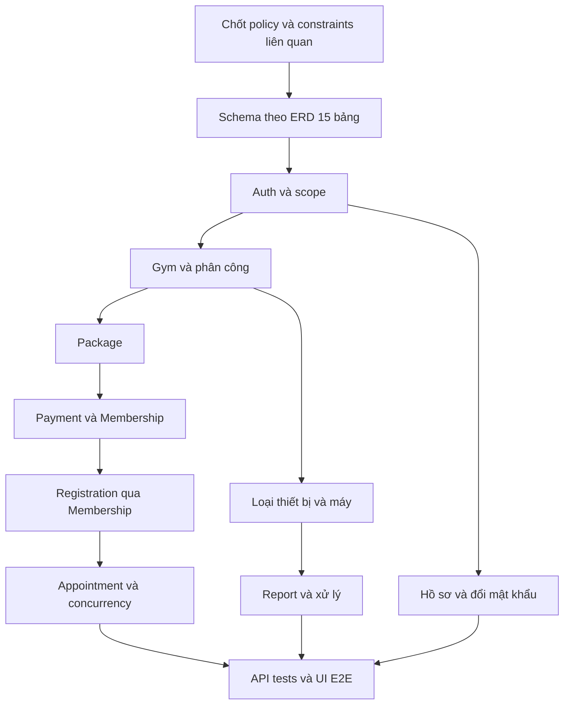

# Multi-Gym Platform — Implementation Plan

## 1. Phạm vi và nguyên tắc

Kế hoạch triển khai theo ERD 15 bảng và bộ tài liệu đã đồng bộ. **Lần cập nhật này chỉ sửa docs**, không tạo schema/migration, chạy database hoặc viết API/UI. Trạng thái nhiệm vụ dưới đây là kế hoạch mục tiêu, không phải xác nhận code hiện có đã hoàn thành.

Thứ tự căn cứ theo PROJECT_RULES.md: yêu cầu người dùng → Architecture → Project Rules → Domain/Feature → Database/API → implementation → giả định. UI/plan phải bám contract và không tự chốt nghiệp vụ. Q-01–Q-13 ở Domain §9 là danh mục chung; chỉ chặn các nhiệm vụ phụ thuộc. Không giữ giả định SQL/constraints cũ sau khi ERD đã đổi.

## 2. Dependency graph và thứ tự schema

Thứ tự tạo bảng dự kiến theo FK (chưa sinh migration):

1. users, roles, gyms, equipment_types.
2. user_profiles, user_roles, gym_managers, gym_trainers, packages.
3. payments, equipments.
4. memberships (tham chiếu Payment tùy chọn).
5. pt_registrations (Membership và Gym Trainer).
6. pt_appointments, gym_reports (Report có FK Equipment và User xử lý).

Đúng 15 bảng. PK user_roles là cặp; mọi bảng còn lại dùng tên PK riêng. Không tự cài btree_gist hoặc dùng lại exclusion constraint trên các cột Appointment đã bỏ; cơ chế bảo vệ mới chờ Q-06/Q-11.

## 3. Công việc chuẩn bị và checkpoint

| Task | Kết quả review | Phụ thuộc / trạng thái | Kiểm tra |
| :--- | :--- | :--- | :--- |
| PLAN-01 | Chốt constraints/naming/nullability/precision và PK/FK cho 15 bảng | Q-11 — BLOCKED phần chưa chốt | Đối chiếu từng cột Database Spec; không thêm cột scope PT |
| PLAN-02 | Chốt nguồn thanh toán, giá lịch sử, trạng thái thẻ/refund | Q-01/Q-02/Q-03 — BLOCKED | Có lifecycle, actor và contract callback; retry/concurrency có acceptance |
| PLAN-03 | Chốt Membership/PT/quota/lịch sử và chống trùng | Q-04/Q-05/Q-06/Q-07/Q-08 — BLOCKED | Không dùng cột đã bỏ; xác định cả Customer và PT, phạm vi và trạng thái giữ chỗ |
| PLAN-04 | Chốt thiết bị, tài khoản/ảnh và các action status | Q-09/Q-10/Q-12/Q-13 — BLOCKED phần tương ứng | Quyền, field allowlist và hành vi có nguồn rõ ràng |
| PLAN-05 | Kiểm tra nền tảng monorepo/Docker/scripts hiện có | TODO khi bắt đầu code | Build/typecheck thật; không coi placeholder lint là đã lint |

Checkpoint: trước mỗi lát cắt triển khai, chỉ cần các Q ảnh hưởng lát cắt đó đã chốt. Schema phần khác có thể được lên kế hoạch riêng nhưng không tuyên bố hoàn thành 15 bảng khi Q-11 còn mở. Không yêu cầu người dùng phê duyệt lại công việc tài liệu đã được yêu cầu.

## 4. Các lát cắt triển khai

Mỗi task nên giới hạn một nhóm chức năng và một lượt review. Mỗi lát cắt có schema phần liên quan → backend/contract → kiểm thử → UI. Khi vượt 3–5 file logic chính, tách tiếp thay vì gộp toàn domain vào một task.

| Task | Nội dung / file dự kiến | Phụ thuộc | Nghiệm thu và verification |
| :--- | :--- | :--- | :--- |
| AUTH-01 | users/profiles/roles/user_roles schema tại apps/api/src/database; seed role | PLAN-01 | Đúng PK, phone ở User, profile unique; seed 4 role không Guest; migration test khi được yêu cầu triển khai |
| AUTH-02 | Auth service/routes, DTO chia sẻ, đổi mật khẩu | AUTH-01 | Register transaction, Argon2id, cookie, không hash trong JSON, must_change_password gate; Supertest auth/IDOR |
| AUTH-03 | Form login/register/profile và guards apps/web | AUTH-02 | phone/address đúng chỗ, đổi mật khẩu tạm; Playwright login/profile/403 |
| GYM-01 | gyms/managers/trainers schema và scope repository | AUTH-01, PLAN-01 | Trực tiếp/gián tiếp scope, cặp phân công unique, giới hạn Manager ACTIVE; integration Gym A/B |
| GYM-02 | Gym API và provisioning Manager/PT | GYM-01, AUTH-02; Q-10/Q-12 cho provisioning/tái bổ nhiệm | Transaction, không tự cấp role/scope từ client, không vượt giới hạn Manager; concurrency test phân công |
| GYM-03 | Public Gym/PT và Manager/Admin forms | GYM-02 | Các field mới và route đúng API; dữ liệu riêng tư không lọt public projection |
| PKG-01 | Package schema/service/API | GYM-01, AUTH-02 | duration_days, package_name, price; chuyển ACTIVE/INACTIVE, không đổi giá lịch sử; integration |
| PKG-02 | Package UI công khai/quản trị | PKG-01 | Mua gói đi qua Payment; không field quota; E2E quyền và validation |
| PAY-01 | Payment/Membership schema và callback contract | PLAN-02, PLAN-01, PKG-01 | UNIQUE payment_id nullable, cùng User/Gym/Package, precision/giá snapshot; integration |
| PAY-02 | Payment xác nhận → tạo Membership | PAY-01, AUTH-02 | Giả mạo bị chặn, retry và đồng thời chỉ một thẻ, rollback, giữ purchase_price; test concurrency |
| PAY-03 | Checkout/Payment history và Membership UI đọc | PAY-02 | Không tự xác nhận SUCCESS, Payment thành công không giả định ACTIVE thẻ, hiển thị giá lịch sử; E2E theo policy |
| PTR-01 | Registration schema/repository/API | PAY-01, GYM-01, PLAN-03 | Chọn Membership + Gym Trainer cùng Gym; Customer/PT scope bằng JOIN; không quota tự chế; tests Gym A/B |
| PTR-02 | Reassign/cancel và bảo toàn lịch sử | PTR-01; Q-07/Q-13 | Không đổi danh tính lịch cũ ngoài policy; test có lịch sử/lịch tương lai |
| APP-01 | Appointment schema/service/actions | PTR-01, PLAN-03, PLAN-01 | end_time > start_time, chống trùng và race condition theo policy; test đồng thời/ranh giới slot |
| APP-02 | Calendar/booking Customer/PT/Manager | APP-01 | Chỉ action đã duyệt; không counter quota; E2E sai quyền, dời/hủy/xác nhận/hoàn thành |
| EQP-01 | Equipment types/equipments schema và API | GYM-01, PLAN-01; Q-09 phần quyền danh mục/eligibility | Mã máy unique mỗi Gym, condition/status riêng; integration khác Gym |
| EQP-02 | Manager equipment list/form và selector report | EQP-01 | Chỉ máy cùng Gym, xóa selection khi đổi Gym, không chuyển Gym tùy ý; E2E |
| REP-01 | Report schema/API | EQP-01, AUTH-02; Q-09/Q-13 phần phụ thuộc | content/type/equipment/resolver, tối đa 1 ảnh; resolve atomic; test cùng Gym và giả mạo resolved_by |
| REP-02 | Customer report và Manager xử lý UI | REP-01, EQP-02 | PENDING → IN_PROGRESS → RESOLVED với note; không tự sửa condition máy; E2E |
| QA-01 | Kiểm tra bảo mật và hợp đồng toàn hệ thống | Các lát cắt cần phát hành | IDOR, role/scope, cookie, log/response secrets, contract snapshots |
| QA-02 | Kiểm tra build/typecheck, responsive/a11y | QA-01 | npm run typecheck, npm run build; kiểm tra lint thực sự đã cấu hình, test suites được tạo trước khi chạy |

Các đường dẫn trong bảng chỉ là dự kiến khi triển khai, không phải file được tạo bởi lần cập nhật tài liệu này. Chưa có runner/test script thì bổ sung trong nhiệm vụ code được cho phép; không báo test pass dựa trên lệnh placeholder.

## 5. Ma trận Feature → API → UI

Bảng này dùng đúng Feature ID của Feature Spec. Method/path chi tiết và trạng thái DRAFT ở API §6; không cố định số endpoint/màn hình từ thiết kế cũ.

| Feature | API | Màn hình |
| :--- | :--- | :--- |
| FEAT-AUTH-001 | `POST /api/v1/auth/register` | SCR-GST-006 |
| FEAT-AUTH-002 | `POST /api/v1/auth/login` | SCR-GST-007 |
| FEAT-AUTH-003 | `POST /api/v1/auth/logout` |  |
| FEAT-AUTH-004 | `GET /api/v1/auth/me`; `GET /api/v1/users/me/profile` | SCR-GST-007, SCR-CUS-002, SCR-TRN-002, SCR-MGR-003 |
| FEAT-AUTH-005 | `PATCH /api/v1/users/me/profile` | SCR-CUS-002 |
| FEAT-AUTH-006 | `POST /api/v1/auth/change-password` | SCR-CUS-002 |
| FEAT-GYM-001 | `GET /api/v1/gyms` | SCR-GST-001, SCR-GST-002, SCR-ADM-001, SCR-ADM-004 |
| FEAT-GYM-002 | `GET /api/v1/gyms/:gymId` | SCR-GST-003 |
| FEAT-GYM-003 | `POST /api/v1/gyms` | SCR-ADM-005 |
| FEAT-GYM-004 | `PATCH /api/v1/gyms/:gymId` | SCR-MGR-002, SCR-ADM-004 |
| FEAT-GYM-005 | `PATCH /api/v1/gyms/:gymId/status` | SCR-ADM-004, SCR-ADM-005 |
| FEAT-MGR-001 | `POST /api/v1/admin/managers/provision` | SCR-ADM-006 |
| FEAT-MGR-002 | `GET /api/v1/gyms/:gymId/managers` | SCR-MGR-003, SCR-ADM-006 |
| FEAT-MGR-003 | `POST /api/v1/gyms/:gymId/managers/assign` | SCR-ADM-006 |
| FEAT-MGR-004 | `POST /api/v1/gyms/:gymId/managers/:managerId/revoke` | SCR-ADM-006 |
| FEAT-TRN-001 | `GET /api/v1/gyms/:gymId/trainers` | SCR-GST-005, SCR-MGR-004 |
| FEAT-TRN-002 | `GET /api/v1/gyms/:gymId/trainers/:trainerId` | SCR-GST-005, SCR-TRN-002 |
| FEAT-TRN-003 | `POST /api/v1/gyms/:gymId/trainers` | SCR-MGR-005 |
| FEAT-TRN-004 | `PATCH /api/v1/gyms/:gymId/trainers/:trainerId/status` | SCR-MGR-004 |
| FEAT-TRN-005 | `POST /api/v1/gyms/:gymId/trainers/provision` | SCR-MGR-005 |
| FEAT-PKG-001 | `GET /api/v1/gyms/:gymId/packages` | SCR-GST-004 |
| FEAT-PKG-002 | `GET /api/v1/gyms/:gymId/packages/:packageId` | SCR-GST-004 |
| FEAT-PKG-003 | `POST /api/v1/gyms/:gymId/packages` | SCR-MGR-006 |
| FEAT-PKG-004 | `PATCH /api/v1/gyms/:gymId/packages/:packageId` | SCR-MGR-006 |
| FEAT-PKG-005 | `PATCH /api/v1/gyms/:gymId/packages/:packageId/deactivate` | SCR-MGR-006 |
| FEAT-PKG-006 | `PATCH /api/v1/gyms/:gymId/packages/:packageId/activate` | SCR-MGR-006 |
| FEAT-PAY-001 | `POST /api/v1/gyms/:gymId/payments` | SCR-CUS-010 |
| FEAT-PAY-002 | `GET /api/v1/payments/me`; `GET /api/v1/payments/:paymentId` | SCR-CUS-001, SCR-CUS-004, SCR-CUS-011 |
| FEAT-MEM-002 | `GET /api/v1/memberships/me` | SCR-CUS-001, SCR-CUS-003, SCR-CUS-011 |
| FEAT-MEM-003 | `GET /api/v1/gyms/:gymId/memberships` | SCR-MGR-001, SCR-MGR-007 |
| FEAT-MEM-004 | `GET /api/v1/memberships/:membershipId` | SCR-CUS-004, SCR-MGR-007 |
| FEAT-PTR-001 | `POST /api/v1/gyms/:gymId/pt-registrations` | SCR-CUS-005, SCR-MGR-008 |
| FEAT-PTR-002 | `GET /api/v1/pt-registrations/me` | SCR-CUS-005, SCR-CUS-006, SCR-TRN-001, SCR-TRN-003 |
| FEAT-PTR-003 | `GET /api/v1/gyms/:gymId/pt-registrations` | SCR-MGR-008 |
| FEAT-PTR-004 | `PATCH /api/v1/gyms/:gymId/pt-registrations/:registrationId/assign` | SCR-MGR-008 |
| FEAT-PTR-005 | `PATCH /api/v1/gyms/:gymId/pt-registrations/:registrationId/cancel` | SCR-MGR-008 |
| FEAT-APP-001 | `POST /api/v1/gyms/:gymId/pt-appointments` | SCR-CUS-007, SCR-TRN-003, SCR-TRN-006, SCR-MGR-009 |
| FEAT-APP-002 | `GET /api/v1/pt-appointments/me` | SCR-CUS-001, SCR-CUS-006, SCR-CUS-007, SCR-TRN-001, SCR-TRN-004, SCR-TRN-005, SCR-TRN-006 |
| FEAT-APP-003 | `GET /api/v1/gyms/:gymId/pt-appointments` | SCR-MGR-001, SCR-MGR-009 |
| FEAT-APP-004 | `PATCH /api/v1/gyms/:gymId/pt-appointments/:appointmentId/reschedule` | SCR-CUS-007, SCR-TRN-004 |
| FEAT-APP-005 | `PATCH /api/v1/gyms/:gymId/pt-appointments/:appointmentId/cancel` | SCR-CUS-007, SCR-TRN-004 |
| FEAT-APP-006 | `PATCH /api/v1/gyms/:gymId/pt-appointments/:appointmentId/complete` | SCR-TRN-004, SCR-TRN-005 |
| FEAT-APP-008 | `PATCH /api/v1/gyms/:gymId/pt-appointments/:appointmentId/confirm` | SCR-TRN-004 |
| FEAT-EQT-001 | `GET /api/v1/equipment-types` | SCR-MGR-011, SCR-MGR-012 |
| FEAT-EQP-001 | `GET /api/v1/gyms/:gymId/equipments` | SCR-CUS-009, SCR-MGR-011 |
| FEAT-EQP-002 | `POST /api/v1/gyms/:gymId/equipments` | SCR-MGR-012 |
| FEAT-EQP-003 | `PATCH /api/v1/gyms/:gymId/equipments/:equipmentId` | SCR-MGR-012 |
| FEAT-REP-001 | `POST /api/v1/gyms/:gymId/reports` | SCR-CUS-009 |
| FEAT-REP-002 | `GET /api/v1/reports/me` | SCR-CUS-008 |
| FEAT-REP-003 | `GET /api/v1/gyms/:gymId/reports` | SCR-MGR-001, SCR-MGR-010, SCR-ADM-007 |
| FEAT-REP-004 | `PATCH /api/v1/gyms/:gymId/reports/:reportId/investigate` | SCR-MGR-010 |
| FEAT-REP-005 | `PATCH /api/v1/gyms/:gymId/reports/:reportId/resolve` | SCR-MGR-010 |
| FEAT-REP-006 | `PATCH /api/v1/gyms/:gymId/reports/:reportId/reject` | SCR-MGR-010 |
| FEAT-ADM-001 | `GET /api/v1/admin/users` | SCR-ADM-001, SCR-ADM-002 |
| FEAT-ADM-002 | `PATCH /api/v1/admin/users/:userId/status` | SCR-ADM-002 |
| FEAT-ADM-003 | `GET /api/v1/admin/roles` | SCR-ADM-003 |
| FEAT-PAY-003 | Xử lý server theo Q-01/Q-02, chưa chốt callback route | SCR-CUS-010, SCR-CUS-011, SCR-CUS-003 |
| FEAT-MEM-001 | Xử lý server theo Q-01/Q-02, chưa chốt callback route | SCR-CUS-010, SCR-CUS-011, SCR-CUS-003 |
| FEAT-GYM-006 | `GET /api/v1/admin/gyms` | SCR-ADM-001, SCR-ADM-004 |
| FEAT-TRN-006 | `GET /api/v1/gyms/:gymId/management/trainers` | SCR-MGR-004 |
| FEAT-PKG-007 | `GET /api/v1/gyms/:gymId/management/packages` | SCR-MGR-006 |

## 6. Chiến lược kiểm thử

| Nhóm | Ca bắt buộc |
| :--- | :--- |
| Schema/contract | Đúng 15 bảng/cột/PK; FK hợp lệ; không field cũ; nhiều payment_id NULL, không trùng payment_id có giá trị |
| Auth | Email hoa/thường, sai credential không lộ User, cookie flags, User INACTIVE/SUSPENDED, mật khẩu tạm, logout |
| Scope | Manager A tác động Gym B; Customer xem tài nguyên khác; PT khác phân công; Registration/Appointment scope qua JOIN |
| Quan hệ | Payment/Package, Membership/Package/Payment, Membership/PT và Report/Equipment lệch Gym đều bị chặn |
| Thanh toán | SUCCESS nguồn giả, callback lặp/đồng thời, rollback, Package đổi giá, refund theo Q-02 |
| Lịch | Giờ không hợp lệ, slot trùng Customer/PT, hai request đồng thời, lịch liền kề theo Q-06, đổi PT có lịch sử |
| Thiết bị/report | Trùng equipment_code cùng Gym, cho phép mã ở Gym khác, resolved_by mạo danh, resolve nguyên tử |
| UI | Loading/empty/error, request pending, mất mạng không tạo trùng, form đổi Gym xóa liên kết cũ, responsive/a11y |

Vitest cho logic, Supertest cho API/DB integration, Playwright cho E2E. Chỉ chạy DB/migration và tests trong nhiệm vụ triển khai được yêu cầu; lần đồng bộ docs kiểm tra cấu trúc/nội dung và diff.

## 7. Trạng thái và Definition of Done

Tất cả công việc triển khai ở §4 là **TODO**, phần có Q chưa chốt là **BLOCKED phần phụ thuộc**. Không coi việc cập nhật tài liệu là hoàn thành schema/API/UI. Kiểm tra lại repository trước khi bắt đầu code để tái sử dụng scaffold đã có.

DoD cho từng lát cắt: Q liên quan có quyết định; schema đúng ERD; API và UI thống nhất allowlist/role/scope; tests phù hợp có kết quả thật; build/typecheck pass; không thêm bảng ngoài phạm vi; không rò rỉ secret hoặc dữ liệu chéo Gym; báo rõ phần chưa triển khai.

## 8. Lưu ý đồng bộ quy tắc ngoài docs

`.agent/rules/multi-gym.md` đã được đồng bộ với PROJECT_RULES.md và ERD 15 bảng. `.agents/rules/multi-gym.md` truy cập cùng file qua symlink, không phải bản sao độc lập. Khi thay đổi quy tắc, cập nhật hướng dẫn AI và PROJECT_RULES.md trong cùng lượt sửa. Các Q chưa chốt tiếp tục chặn đúng phần triển khai phụ thuộc.
