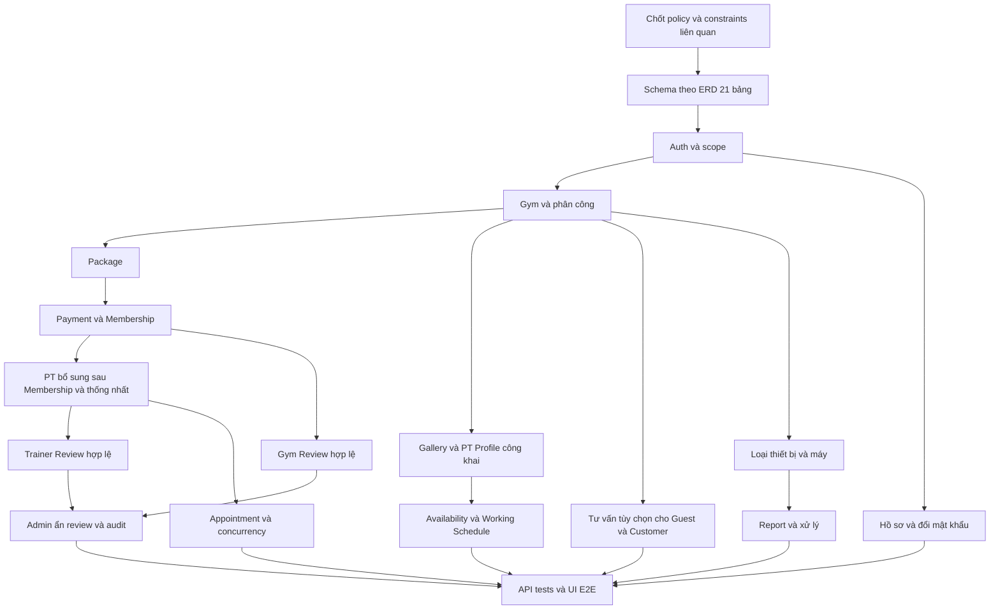

# Multi-Gym Platform — Implementation Plan

## 1. Phạm vi và nguyên tắc

Kế hoạch triển khai theo nghiệp vụ Gym/PT mới và schema 21 bảng hiện có. Bảng nhiệm vụ là kế hoạch mục tiêu; trạng thái triển khai thực tế được ghi riêng tại §4.1. Không suy ra toàn task hoàn thành từ schema hoặc một phần API đã có.

Thứ tự căn cứ theo PROJECT_RULES.md: yêu cầu người dùng → Architecture → Project Rules → Domain/Feature → Database/API → implementation → giả định. UI/plan phải bám contract và không tự chốt nghiệp vụ. Q-01–Q-19 ở Domain §9 là danh mục chung; chỉ chặn các nhiệm vụ phụ thuộc. Q-11 đã có baseline vật lý; Q-05 nằm ngoài phạm vi, không phải blocker của PT Registration.

## 2. Dependency graph và thứ tự schema

Thứ tự phụ thuộc schema để tham khảo; migration 0000/0001 đã có, không tạo lại các bảng:

1. users, roles, gyms, equipment_types.
2. user_profiles, user_roles, gym_managers, gym_trainers, packages.
3. payments, equipments.
4. memberships (tham chiếu Payment tùy chọn).
5. pt_registrations (Membership và Gym Trainer).
6. pt_appointments, gym_reports (Report có FK Equipment và User xử lý).
7. gym_images, consultation_requests, pt_social_links, pt_working_schedules, gym_reviews, trainer_reviews (migration 0001).

Đúng 21 bảng. PK user_roles là cặp; mọi bảng còn lại dùng tên PK riêng. Không tự cài btree_gist hoặc dùng lại exclusion constraint trên các cột Appointment đã bỏ; cơ chế bảo vệ mới chờ Q-06.

## 3. Công việc chuẩn bị và checkpoint

| Task | Kết quả review | Phụ thuộc / trạng thái | Kiểm tra |
| :--- | :--- | :--- | :--- |
| PLAN-01 | Đối chiếu baseline 21 bảng, FK/CHECK/index/trigger | ĐÃ CÓ migration 0000/0001; Q-11 không còn mở | Bảo toàn migration cũ, chỉ migration mới nếu task tiếp theo cần đổi policy |
| PLAN-02 | Chốt nguồn thanh toán, giá lịch sử, trạng thái thẻ/refund | Q-01/Q-02/Q-03 — BLOCKED | Có lifecycle, actor và contract callback; retry/concurrency có acceptance |
| PLAN-03 | Chốt Membership/PT/lịch sử và chống trùng | Q-04/Q-06/Q-07/Q-08 phần Customer/Q-16 — BLOCKED; Q-08 PT đã chốt | Không dùng cột đã bỏ; xác định cả Customer và PT, phạm vi và trạng thái giữ chỗ |
| PLAN-04 | Chốt thiết bị, tài khoản/ảnh và các action status | Q-09/Q-13 ngoài Gym/PT và Q-10 upload — BLOCKED phần tương ứng; Q-08 PT/Q-13 Gym/PT đã chốt; Q-10 provisioning/email và Q-12 đã chốt | Quyền, field allowlist và hành vi có nguồn rõ ràng |
| PLAN-05 | Kiểm tra nền tảng monorepo/Docker/scripts hiện có | TODO khi bắt đầu code | Build/typecheck thật; không coi placeholder lint là đã lint |

Checkpoint: trước mỗi lát cắt triển khai, chỉ cần các Q ảnh hưởng lát cắt đó đã chốt. Không đánh đồng schema đã có với API/UI hoàn thành; chỉ chặn task phụ thuộc Q chưa chốt. Không yêu cầu người dùng phê duyệt lại công việc tài liệu đã được yêu cầu.

## 4. Các lát cắt triển khai

Mỗi task nên giới hạn một nhóm chức năng và một lượt review. Mỗi lát cắt có schema phần liên quan → backend/contract → kiểm thử → UI. Khi vượt 3–5 file logic chính, tách tiếp thay vì gộp toàn domain vào một task.

| Task | Nội dung / file dự kiến | Phụ thuộc | Nghiệm thu và verification |
| :--- | :--- | :--- | :--- |
| AUTH-01 | users/profiles/roles/user_roles schema tại apps/api/src/database; seed role | PLAN-01 | Đúng PK, phone ở User, profile unique; seed 4 role không Guest; migration test khi được yêu cầu triển khai |
| AUTH-02 | Auth service/routes, DTO chia sẻ, đổi mật khẩu | AUTH-01 | Register transaction, Argon2id, cookie, không hash trong JSON, must_change_password gate; Supertest auth/IDOR |
| AUTH-03 | Form login/register/profile và guards apps/web | AUTH-02 | phone/address đúng chỗ, đổi mật khẩu tạm; Playwright login/profile/403 |
| GYM-01 | gyms/managers/trainers schema và scope repository | AUTH-01, PLAN-01 | Trực tiếp/gián tiếp scope, cặp phân công unique, giới hạn Manager ACTIVE; integration Gym A/B |
| GYM-02 | Gym API và provisioning Manager/PT — CLOSED (backend; xem §4.1) | GYM-01 CLOSED, AUTH-02; Q-10 provisioning/email và Q-12 đã chốt; Q-08 PT/Q-13 Gym/PT đã chốt | Transaction, không tự cấp role/scope từ client, không vượt giới hạn Manager; concurrency test phân công |
| GYM-03 | Public Gym/PT và Manager/Admin forms — CLOSED (implementation/verification UI) | GYM-02 | Field/route đúng API; 23 ca UI mock + 2 luồng browser/API/DB thật, responsive và guards; xem [GYM_03_VERIFICATION.md](GYM_03_VERIFICATION.md) |
| PKG-01 | Package schema/service/API | GYM-01, AUTH-02 | duration_days, package_name, price; chuyển ACTIVE/INACTIVE, không đổi giá lịch sử; integration |
| PKG-02 | Package UI công khai/quản trị | PKG-01 | Mua gói đi qua Payment; không field quota; E2E quyền và validation |
| PAY-01 | Payment/Membership schema và callback contract | PLAN-02, PLAN-01, PKG-01 | UNIQUE payment_id nullable, cùng User/Gym/Package, precision/giá snapshot; integration |
| PAY-02 | Payment xác nhận → tạo Membership | PAY-01, AUTH-02 | Giả mạo bị chặn, retry và đồng thời chỉ một thẻ, rollback, giữ purchase_price; test concurrency |
| PAY-03 | Checkout/Payment history và Membership UI đọc | PAY-02 | Không tự xác nhận SUCCESS, Payment thành công không giả định ACTIVE thẻ, hiển thị giá lịch sử; E2E theo policy |
| PTR-01 | Registration schema/repository/API | PAY-01, GYM-01, PLAN-03 | Chọn Membership + Gym Trainer cùng Gym; Customer/PT scope bằng JOIN; không quota tự chế; tests Gym A/B |
| PTR-02 | Reassign/cancel và bảo toàn lịch sử | PTR-01; Q-07/Q-13 | Không đổi danh tính lịch cũ ngoài policy; test có lịch sử/lịch tương lai |
| APP-01 | Appointment schema/service/actions | PTR-01, PLAN-03, PLAN-01 | end_time > start_time, chống trùng và race condition theo policy; test đồng thời/ranh giới slot |
| APP-02 | Calendar/booking Customer/PT/Manager | APP-01 | Chỉ action đã duyệt; không counter quota; E2E sai quyền, dời/hủy/xác nhận/hoàn thành |
| EQP-01 | Equipment types/equipments schema và API | GYM-01, PLAN-01; Q-09 phần quyền danh mục/eligibility | Mã máy unique mỗi Gym, condition/status riêng; integration khác Gym |
| EQP-02 | Manager equipment list/form và selector report | EQP-01 | Chỉ máy cùng Gym, xóa selection khi đổi Gym, không chuyển Gym tùy ý; E2E |
| REP-01 | Report schema/API | EQP-01, AUTH-02; Q-09/Q-13 phần phụ thuộc | content/type/equipment/resolver, tối đa 1 ảnh; resolve atomic; test cùng Gym và giả mạo resolved_by |
| REP-02 | Customer report và Manager xử lý UI | REP-01, EQP-02 | PENDING → IN_PROGRESS → RESOLVED với note; không tự sửa condition máy; E2E |
| QA-01 | Kiểm tra bảo mật và hợp đồng toàn hệ thống | Các lát cắt cần phát hành | IDOR, role/scope, cookie, log/response secrets, contract snapshots |
| QA-02 | Kiểm tra build/typecheck, responsive/a11y | QA-01 | npm run typecheck, npm run build; kiểm tra lint thực sự đã cấu hình, test suites được tạo trước khi chạy |

Các đường dẫn trong bảng là định hướng triển khai; đối chiếu §4.1 để biết phần đã có. Chưa có runner/test script thì bổ sung trong nhiệm vụ code được cho phép; không báo test pass dựa trên lệnh placeholder.

### 4.1. Hiện trạng đối chiếu source

| Phần | Hiện trạng |
| :--- | :--- |
| Schema/migration 21 bảng | Đã có 0000/0001, snapshot, journal, rollback có guard; không tạo lại. |
| Auth/User | Router /auth và /users, service, form/guards và E2E hiện có; giữ tương thích. |
| PT Registration / Review | Hai service và test database đã có; chưa có controller/route/UI nghiệp vụ. Rule tạm trong service/trigger cần đối chiếu Q-04/Q-15/Q-16 trước mở API. |
| GYM-02 — Q-10/Q-12 | Đã triển khai API provision Manager/PT, list/assign/revoke Manager, reactivate cùng bản ghi; staffing repository/service/controller/router/validator và integration tests. GymScopeService của GYM-01 được tái sử dụng, GYM-01 vẫn CLOSED. Không migration mới. |
| GYM-02 — Q-08 PT/Q-13 Gym/PT | Đã triển khai phân công PT có sẵn, đổi trạng thái Gym/PT, giữ history, chặn nghĩa vụ mở; migration 0002 index/guards và integration tests. Chưa áp dụng migration vào database vận hành. |
| GYM-02 đợt 1 — Public Gym API | Đã triển khai GET /gyms và GET /gyms/:gymId: ACTIVE-only, phân trang/search/sort allowlist, projection công khai, 404 cho Gym ẩn/không tồn tại; 7 ca integration trên database tạm. Không thay schema/migration. |
| GYM-02 đợt 2 — Tạo/cập nhật Gym | Đã triển khai POST /gyms cho Admin và PATCH /gyms/:gymId cho Admin/Manager ACTIVE đúng Gym; strict allowlist, transaction authorization, giữ identity/status và 7 ca integration. Không sửa schema/migration. |
| GYM-02 đợt 3 — Public PT API | Đã triển khai GET /gyms/:gymId/trainers và GET /gyms/:gymId/trainers/:trainerId; TrainerPublicView, Gym/PT ACTIVE, mọi availability, profile giới hạn trường, social links và lịch làm việc ACTIVE; 8 ca integration. Không sửa schema/migration. |
| GYM-02 đợt 4 — Danh sách quản trị | Đã triển khai GET /admin/gyms và GET /gyms/:gymId/management/trainers; status filter, pagination/search/sort, DB role/assignment scope, đọc nội bộ Gym INACTIVE, 6 ca integration. Không đổi schema/migration. |
| GYM-02 đợt 5 — Nghiệm thu tích hợp | CLOSED cho implementation/verification backend: 49 kiểm tra HTTP qua app thật, 16/16 endpoint; 52 ca integration trên schema 0002, typecheck source/tests và build pass. Xem [báo cáo nghiệm thu](GYM_02_VERIFICATION.md). Migration 0002 chưa áp dụng vào database vận hành. |
| GYM-03 — UI | CLOSED cho API GYM-02 hiện có: Public Gym/PT, Manager Gym/PT và Admin Gym/Manager; TanStack Query/Tailwind, guards, 23 ca UI mock + 2 luồng browser với API/DB tạm thật, typecheck/build pass. Xem [báo cáo nghiệm thu](GYM_03_VERIFICATION.md). Chưa triển khai Package/Consultation/Gallery/Review hoặc migration vận hành. |
| API nghiệp vụ còn lại | Package/Payment/Membership/Appointment/Equipment/Report API vẫn là catalog mục tiêu thuộc các lát cắt riêng; GYM-03 không triển khai các API này. |
| Consultation/Gallery/ghi PT Profile/Review API và UI | Chưa triển khai; phần đọc PT Profile công khai đã có ở đợt 3. Các task ghi/UI vẫn giữ phạm vi riêng. |

Verification cho phần Q-10/Q-12: `npm run test:database -w apps/api` và `GYM_TEST_ORDER=reverse npm run test:database -w apps/api` chạy trên database tạm riêng, gồm 12 ca staffing integration (HTTP, transaction, concurrency, password), cùng các regression hiện có. `npm run test:e2e -w apps/web`: 8 ca Auth. Kiểm tra TypeScript cả source/tests và build API. Không xem các kết quả này là hoàn thành Gym API/UI chưa xây dựng.

### 4.2. Task bổ sung và thứ tự ưu tiên

| Task | Kết quả | Phụ thuộc | Nghiệm thu |
| :--- | :--- | :--- | :--- |
| DISC-01 | Public Gym Detail/gallery/PT Profile/review list | GYM-01; DTO API §13 | Hai CTA; VISIBLE lọc ở server; không lộ Contact/audit, PT không bắt buộc. |
| CON-01 | Public Consultation submit | GYM-01; Q-19 validation | Guest user_id NULL; actor từ phiên; không bắt Membership; không sinh Appointment. |
| CON-02 | Manager inbox/process | CON-01; Q-14 Staff và Q-19 transition | Gym A/B isolation, assignment đúng quyền, contact private. |
| GIM-01 | Gallery management | DISC-01; Q-10/Q-19 upload và quyền | Nhiều ảnh/caption/order, logo riêng; ghi nguyên tử. |
| TPR-01 | Availability/social links/Working Schedule | GYM-01; Q-16/Q-18 | Scope PT, trạng thái độc lập, đổi lịch làm việc không đổi Appointment. |
| REV-01 | Nối service review với controllers/validators | DISC-01; Q-15 | Không tạo migration trùng; kiểm tra actor, eligibility, rating; giữ nội dung. |
| REV-02 | Admin moderation/API/UI | REV-01 | VISIBLE → HIDDEN, audit đủ, không DELETE/edit/unhide hoặc hide ghi đè. |
| FLOW-01 | Checkout và PT flow/UI | PAY-02; Q-17, Q-04/Q-16 | Membership không cần PT/tư vấn; PT chỉ sau thẻ phù hợp và thống nhất. |

Chức năng public đọc triển khai độc lập policy ghi chưa chốt. Không có task PT pricing/package/payment/quota, chat, recommendation hay realtime booking.

## 5. Ma trận Feature → API → UI

Bảng này dùng đúng Feature ID của Feature Spec. Method/path chi tiết và trạng thái DRAFT ở API §6; không cố định số endpoint/màn hình từ thiết kế cũ.

| Feature | API | Màn hình |
| :--- | :--- | :--- |
| FEAT-AUTH-001 | `POST /api/v1/auth/register` | SCR-GST-006 |
| FEAT-AUTH-002 | `POST /api/v1/auth/login` | SCR-GST-007 |
| FEAT-AUTH-003 | `POST /api/v1/auth/logout` |  |
| FEAT-AUTH-004 | `GET /api/v1/auth/me`; `GET /api/v1/users/me/profile` | SCR-GST-007, SCR-CUS-002, SCR-TRN-002, SCR-MGR-003 |
| FEAT-AUTH-005 | `PATCH /api/v1/users/me/profile` | SCR-CUS-002 |
| FEAT-AUTH-006 | `POST /api/v1/auth/change-password` | SCR-CUS-002 |
| FEAT-GYM-001 | `GET /api/v1/gyms` | SCR-GST-001, SCR-GST-002, SCR-ADM-001, SCR-ADM-004 |
| FEAT-GYM-002 | `GET /api/v1/gyms/:gymId` | SCR-GST-003 |
| FEAT-GYM-003 | `POST /api/v1/gyms` | SCR-ADM-005 |
| FEAT-GYM-004 | `PATCH /api/v1/gyms/:gymId` | SCR-MGR-002, SCR-ADM-004 |
| FEAT-GYM-005 | `PATCH /api/v1/gyms/:gymId/status` | SCR-ADM-004, SCR-ADM-005 |
| FEAT-MGR-001 | `POST /api/v1/admin/managers/provision` | SCR-ADM-006 |
| FEAT-MGR-002 | `GET /api/v1/gyms/:gymId/managers` | SCR-MGR-003, SCR-ADM-006 |
| FEAT-MGR-003 | `POST /api/v1/gyms/:gymId/managers/assign` | SCR-ADM-006 |
| FEAT-MGR-004 | `POST /api/v1/gyms/:gymId/managers/:managerId/revoke` | SCR-ADM-006 |
| FEAT-TRN-001 | `GET /api/v1/gyms/:gymId/trainers` | SCR-GST-005, SCR-MGR-004 |
| FEAT-TRN-002 | `GET /api/v1/gyms/:gymId/trainers/:trainerId` | SCR-GST-005, SCR-TRN-002 |
| FEAT-TRN-003 | `POST /api/v1/gyms/:gymId/trainers` | SCR-MGR-005 |
| FEAT-TRN-004 | `PATCH /api/v1/gyms/:gymId/trainers/:trainerId/status` | SCR-MGR-004 |
| FEAT-TRN-005 | `POST /api/v1/gyms/:gymId/trainers/provision` | SCR-MGR-005 |
| FEAT-PKG-001 | `GET /api/v1/gyms/:gymId/packages` | SCR-GST-004 |
| FEAT-PKG-002 | `GET /api/v1/gyms/:gymId/packages/:packageId` | SCR-GST-004 |
| FEAT-PKG-003 | `POST /api/v1/gyms/:gymId/packages` | SCR-MGR-006 |
| FEAT-PKG-004 | `PATCH /api/v1/gyms/:gymId/packages/:packageId` | SCR-MGR-006 |
| FEAT-PKG-005 | `PATCH /api/v1/gyms/:gymId/packages/:packageId/deactivate` | SCR-MGR-006 |
| FEAT-PKG-006 | `PATCH /api/v1/gyms/:gymId/packages/:packageId/activate` | SCR-MGR-006 |
| FEAT-PAY-001 | `POST /api/v1/gyms/:gymId/payments` | SCR-CUS-010 |
| FEAT-PAY-002 | `GET /api/v1/payments/me`; `GET /api/v1/payments/:paymentId` | SCR-CUS-001, SCR-CUS-004, SCR-CUS-011 |
| FEAT-MEM-002 | `GET /api/v1/memberships/me` | SCR-CUS-001, SCR-CUS-003, SCR-CUS-011 |
| FEAT-MEM-003 | `GET /api/v1/gyms/:gymId/memberships` | SCR-MGR-001, SCR-MGR-007 |
| FEAT-MEM-004 | `GET /api/v1/memberships/:membershipId` | SCR-CUS-004, SCR-MGR-007 |
| FEAT-PTR-001 | `POST /api/v1/gyms/:gymId/pt-registrations` | SCR-CUS-005, SCR-MGR-008 |
| FEAT-PTR-002 | `GET /api/v1/pt-registrations/me` | SCR-CUS-005, SCR-CUS-006, SCR-TRN-001, SCR-TRN-003 |
| FEAT-PTR-003 | `GET /api/v1/gyms/:gymId/pt-registrations` | SCR-MGR-008 |
| FEAT-PTR-004 | `PATCH /api/v1/gyms/:gymId/pt-registrations/:registrationId/assign` | SCR-MGR-008 |
| FEAT-PTR-005 | `PATCH /api/v1/gyms/:gymId/pt-registrations/:registrationId/cancel` | SCR-MGR-008 |
| FEAT-APP-001 | `POST /api/v1/gyms/:gymId/pt-appointments` | SCR-CUS-007, SCR-TRN-003, SCR-TRN-006, SCR-MGR-009 |
| FEAT-APP-002 | `GET /api/v1/pt-appointments/me` | SCR-CUS-001, SCR-CUS-006, SCR-CUS-007, SCR-TRN-001, SCR-TRN-004, SCR-TRN-005, SCR-TRN-006 |
| FEAT-APP-003 | `GET /api/v1/gyms/:gymId/pt-appointments` | SCR-MGR-001, SCR-MGR-009 |
| FEAT-APP-004 | `PATCH /api/v1/gyms/:gymId/pt-appointments/:appointmentId/reschedule` | SCR-CUS-007, SCR-TRN-004 |
| FEAT-APP-005 | `PATCH /api/v1/gyms/:gymId/pt-appointments/:appointmentId/cancel` | SCR-CUS-007, SCR-TRN-004 |
| FEAT-APP-006 | `PATCH /api/v1/gyms/:gymId/pt-appointments/:appointmentId/complete` | SCR-TRN-004, SCR-TRN-005 |
| FEAT-APP-008 | `PATCH /api/v1/gyms/:gymId/pt-appointments/:appointmentId/confirm` | SCR-TRN-004 |
| FEAT-EQT-001 | `GET /api/v1/equipment-types` | SCR-MGR-011, SCR-MGR-012 |
| FEAT-EQP-001 | `GET /api/v1/gyms/:gymId/equipments` | SCR-CUS-009, SCR-MGR-011 |
| FEAT-EQP-002 | `POST /api/v1/gyms/:gymId/equipments` | SCR-MGR-012 |
| FEAT-EQP-003 | `PATCH /api/v1/gyms/:gymId/equipments/:equipmentId` | SCR-MGR-012 |
| FEAT-REP-001 | `POST /api/v1/gyms/:gymId/reports` | SCR-CUS-009 |
| FEAT-REP-002 | `GET /api/v1/reports/me` | SCR-CUS-008 |
| FEAT-REP-003 | `GET /api/v1/gyms/:gymId/reports` | SCR-MGR-001, SCR-MGR-010, SCR-ADM-007 |
| FEAT-REP-004 | `PATCH /api/v1/gyms/:gymId/reports/:reportId/investigate` | SCR-MGR-010 |
| FEAT-REP-005 | `PATCH /api/v1/gyms/:gymId/reports/:reportId/resolve` | SCR-MGR-010 |
| FEAT-REP-006 | `PATCH /api/v1/gyms/:gymId/reports/:reportId/reject` | SCR-MGR-010 |
| FEAT-ADM-001 | `GET /api/v1/admin/users` | SCR-ADM-001, SCR-ADM-002 |
| FEAT-ADM-002 | `PATCH /api/v1/admin/users/:userId/status` | SCR-ADM-002 |
| FEAT-ADM-003 | `GET /api/v1/admin/roles` | SCR-ADM-003 |
| FEAT-PAY-003 | Xử lý server theo Q-01/Q-02, chưa chốt callback route | SCR-CUS-010, SCR-CUS-011, SCR-CUS-003 |
| FEAT-MEM-001 | Xử lý server theo Q-01/Q-02, chưa chốt callback route | SCR-CUS-010, SCR-CUS-011, SCR-CUS-003 |
| FEAT-GYM-006 | `GET /api/v1/admin/gyms` | SCR-ADM-001, SCR-ADM-004 |
| FEAT-TRN-006 | `GET /api/v1/gyms/:gymId/management/trainers` | SCR-MGR-004 |
| FEAT-PKG-007 | `GET /api/v1/gyms/:gymId/management/packages` | SCR-MGR-006 |
| FEAT-GIM-001 | `GET /api/v1/gyms/:gymId/images` | SCR-GST-003 |
| FEAT-GIM-002 | `PUT /api/v1/gyms/:gymId/images` | SCR-MGR-014 |
| FEAT-CON-001 | `POST /api/v1/gyms/:gymId/consultation-requests` | SCR-GST-007 |
| FEAT-CON-002 | `GET /api/v1/gyms/:gymId/consultation-requests` | SCR-MGR-013 |
| FEAT-CON-003 | `PATCH /api/v1/gyms/:gymId/consultation-requests/:requestId` | SCR-MGR-013 |
| FEAT-TRN-007 | `PATCH /api/v1/gyms/:gymId/trainers/:trainerId/availability` | SCR-TRN-007 |
| FEAT-TRN-008 | `PUT /api/v1/gyms/:gymId/trainers/:trainerId/social-links` | SCR-TRN-007 |
| FEAT-TRN-009 | `PUT /api/v1/gyms/:gymId/trainers/:trainerId/working-schedules` | SCR-TRN-007 |
| FEAT-REV-001 | `GET /api/v1/gyms/:gymId/reviews` | SCR-GST-003 |
| FEAT-REV-002 | `POST /api/v1/gyms/:gymId/reviews` | SCR-CUS-012 |
| FEAT-REV-003 | `GET /api/v1/gyms/:gymId/trainers/:trainerId/reviews` | SCR-GST-008 |
| FEAT-REV-004 | `POST /api/v1/gyms/:gymId/trainers/:trainerId/reviews` | SCR-CUS-013 |
| FEAT-REV-005 | `GET /api/v1/admin/reviews` | SCR-ADM-008 |
| FEAT-REV-006 | `PATCH /api/v1/admin/reviews/:kind/:reviewId/hide` | SCR-ADM-008 |

## 6. Chiến lược kiểm thử

| Nhóm | Ca bắt buộc |
| :--- | :--- |
| Schema/contract | Đúng 21 bảng/cột/PK; FK hợp lệ; không field cũ; nhiều payment_id NULL, không trùng payment_id có giá trị |
| Auth | Email hoa/thường, sai credential không lộ User, cookie flags, User INACTIVE/SUSPENDED, mật khẩu tạm, logout |
| Scope | Manager A tác động Gym B; Customer xem tài nguyên khác; PT khác phân công; Registration/Appointment scope qua JOIN |
| Quan hệ | Payment/Package, Membership/Package/Payment, Membership/PT và Report/Equipment lệch Gym đều bị chặn |
| Thanh toán | SUCCESS nguồn giả, callback lặp/đồng thời, rollback, Package đổi giá, refund theo Q-02 |
| Lịch | Giờ không hợp lệ, slot trùng Customer/PT, hai request đồng thời, lịch liền kề theo Q-06, đổi PT có lịch sử |
| Thiết bị/report | Trùng equipment_code cùng Gym, cho phép mã ở Gym khác, resolved_by mạo danh, resolve nguyên tử |
| UI | Loading/empty/error, request pending, mất mạng không tạo trùng, form đổi Gym xóa liên kết cũ, responsive/a11y |

Vitest/Supertest là định hướng cho logic/HTTP integration khi triển khai; test database hiện dùng tsx + node:assert + PostgreSQL database riêng, E2E dùng Playwright. Chỉ chạy DB/migration và tests trong nhiệm vụ triển khai được yêu cầu; lần đồng bộ docs kiểm tra cấu trúc/nội dung và diff.

## 7. Trạng thái và Definition of Done

§4 là danh mục công việc; phần schema/Auth đã có theo hiện trạng bên dưới, phần API/UI Gym/PT còn TODO. Chỉ phần phụ thuộc Q chưa chốt là BLOCKED. Không coi việc cập nhật tài liệu là hoàn thành schema/API/UI. Kiểm tra lại repository trước khi bắt đầu code để tái sử dụng scaffold đã có.

DoD cho từng lát cắt: Q liên quan có quyết định; schema đúng ERD; API và UI thống nhất allowlist/role/scope; tests phù hợp có kết quả thật; build/typecheck pass; không thêm bảng ngoài phạm vi; không rò rỉ secret hoặc dữ liệu chéo Gym; báo rõ phần chưa triển khai.

## 8. Lưu ý đồng bộ quy tắc ngoài docs

`.agent/rules/multi-gym.md` đã được đồng bộ với PROJECT_RULES.md và ERD 21 bảng. `.agents/rules/multi-gym.md` truy cập cùng file qua symlink, không phải bản sao độc lập. Khi thay đổi quy tắc, cập nhật hướng dẫn AI và PROJECT_RULES.md trong cùng lượt sửa. Các Q chưa chốt tiếp tục chặn đúng phần triển khai phụ thuộc.

## 9. Kiểm tra bổ sung cho nghiệp vụ mới

- Public: hai CTA chính, gallery tách logo, profile PT không có bảng giá cố định; không lọt review HIDDEN hoặc Contact/audit.
- Consultation: Guest thành công, phiên hợp lệ liên kết đúng User; spoof user_id/assigned_to bị chặn; không tạo booking/Payment/Membership.
- PT: status/availability độc lập, registration sai Gym/người bị từ chối, Working Schedule không thay Appointment.
- Review: thiếu Membership/Registration bị từ chối, moderation trái quyền bị chặn, hidden_* đầy đủ; DELETE/TRUNCATE/sửa nội dung/ghi đè audit bị chặn ở DB.
- Docs-only: so tên bảng/field/FK/index với snapshot và custom trigger SQL; so mã Feature/API/UI/Q, link và diff. Không chạy migration hay E2E có tác động dữ liệu chỉ để kiểm tra Markdown.

Verification Q-08 PT / Q-13 Gym/PT: `npm run test:lifecycle -w apps/api` tạo database tạm, kiểm tra upgrade fail-safe, rollback không mất dữ liệu, HTTP permission/validation, obligation counts, bảo toàn lịch sử, PT đa Gym và giao dịch thực sự chờ khóa. Chạy lại 12 staffing cases trên schema hiện tại 0002. `test:database` chạy cả baseline GYM-01 (fixture 0000/0001 giữ nguyên vì từng cho phép PT đa Gym) và lifecycle trên schema mới; không coi baseline là bằng chứng policy mới. Đợt policy không triển khai Gym CRUD/public Gym/PT hay UI; tiến độ Public Gym đợt 1 được cập nhật tại §4.1. GYM-02 đã CLOSED cho backend sau đợt 5; xem báo cáo nghiệm thu tại §4.1.

GYM-02 đợt 1: `test:lifecycle` và `test:database` bao gồm `public-gym.integration.test.ts` trên schema mới, kiểm tra Guest, projection, pagination/search/sort, query sai, Gym INACTIVE/không tồn tại, thay đổi visibility và lỗi DB an toàn. POST /gyms và PATCH /gyms/:gymId được triển khai riêng trong đợt 2 dưới đây. UI thuộc GYM-03, GYM-01 vẫn CLOSED.

GYM-02 đợt 2: `test:lifecycle`/`test:database` gồm `gym-write.integration.test.ts`: Admin tạo Gym không sinh tài khoản/phân công, Manager đúng Gym, quyền bị revoke/account/password gate, field allowlist/validation, partial update, Gym INACTIVE và concurrent partial updates. Sau đợt 2 đã triển khai tiếp đợt 3 (public PT); đợt 4 (danh sách quản trị Gym/PT) đã triển khai; đợt 5 đã nghiệm thu tích hợp, xem §4.1. Migration 0002 vẫn chưa áp dụng vào database vận hành; không thực hiện migration ở đợt 2.

GYM-02 đợt 3: `public-trainer.integration.test.ts` tích hợp trong `test:lifecycle`/`test:database`, kiểm tra Guest, isolation Gym/PT, DTO không lộ thông tin tài khoản, missing profile, social/schedule scope, lọc schedule ACTIVE, mọi availability, pagination/search/sort, validation và visibility sau ngừng/kích hoạt lại. Đợt 4 đã triển khai tiếp GET /admin/gyms và GET /gyms/:gymId/management/trainers, xem ghi nhận dưới đây. GYM-01 vẫn CLOSED; GYM-02 đã CLOSED cho backend sau đợt 5; UI thuộc GYM-03.

GYM-02 đợt 4: `gym-management.integration.test.ts` được gọi bởi `test:lifecycle`/`test:database`; kiểm tra Admin/Manager/Guest/PT/Customer, Gym A/B, role/assignment revoke, account/password gate, status filters/search/pagination, payload không lộ credential và sự tách biệt public/internal. Chạy cùng các ca đợt 1–3 và staffing/lifecycle trên database tạm. Đợt 5 đã nghiệm thu và đóng GYM-02 cho backend; chưa triển khai GYM-03 hoặc áp dụng migration vào database vận hành. Xem [báo cáo đợt 5](GYM_02_VERIFICATION.md) để phân biệt kết quả kiểm thử và trạng thái triển khai.
