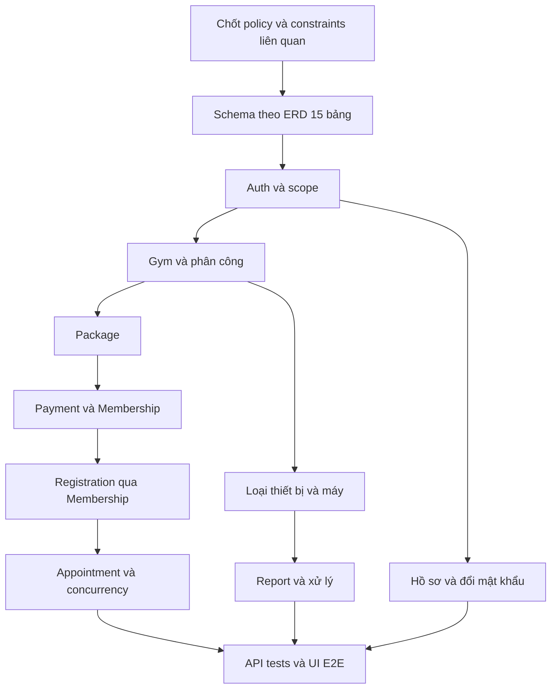

# Multi-Gym Platform — Implementation Plan

**QA tổng sau R22 — 14/10/2026:** cổng QA-02 tự động đã PASS toàn chuỗi root;28suite×2vòng,824lượt browser,retries0, cùng static/build/cache/backend QA-01. Đã hoàn thành bước hồi quy tổng sau R22; các phạm vi hoãn/design giữ trạng thái riêng. [Báo cáo](QA_02_POST_R22_VERIFICATION.md).

**R22 — 14/10/2026:** SCR-ADM-015 `/admin/gyms/:gymId/pt` đã đối chiếu ADM-BASE-24–26, bổ sung mock/live browser và HTTP/DB Admin read/end-registration/appointment DENY/current account gates. Tiếp theo QA tổng; ADM-UI-01 vẫn IN_PROGRESS. [Phạm vi, ảnh và kiểm chứng](ADMIN_PT_WORKSPACE_VERIFICATION.md).

**Lát cắt R21 — 12/10/2026:** SCR-ADM-014 `/admin/gyms/:gymId/gallery` đã chuẩn hóa theo5 REQ/AC/TC-ADM-BASE-15–19: context Gym/quota, private bytes, chốt chung cho conversion/upload/caption/order/delete, CAS/readback giữ draft, inline confirm/receipt và focus/responsive. [Phạm vi và kiểm chứng R21](ADMIN_GALLERY_VERIFICATION.md). Lost upload cần kiểm tra thủ công trước chọn lại, không idempotency giả; giữ contract/storage demo. Tiếp theo R22 giám sát PT, sau đó QA tổng; ADM-UI-01 vẫn IN_PROGRESS. Coverage Gallery thiếu trước R21 là lịch sử.

**Lát cắt R20 — 12/10/2026:** SCR-ADM-013 `/admin/gyms/:gymId/packages` đã chuẩn hóa theo5 REQ/AC/TC-ADM-BASE-10–14: context Gym INACTIVE, catalog12/URL/Back/empty recovery, tạo/sửa snapshot/partial PATCH, confirmation/pending/focus, receipt và đọc lại khi kết quả chưa rõ. [Phạm vi và kiểm chứng R20](ADMIN_PACKAGES_VERIFICATION.md). Contract chưa có CAS/idempotency; cùng field last write wins, lost POST không tự retry. Tiếp theo R21 Gallery Gym; ADM-UI-01 vẫn IN_PROGRESS. Coverage thiếu của Package trong baseline trước R20 là lịch sử.

**Lát cắt R19 — 12/10/2026:** SCR-ADM-008 `/admin/reviews` đã chuẩn hóa theo ADM-BASE-27/28: selector Gym và review paging10 độc lập, nội dung/audit, xác nhận hai bước, khóa ghi đến đọc lại sau lỗi chưa rõ, current session và focus. [Phạm vi và kiểm chứng R19](ADMIN_REVIEW_MODERATION_VERIFICATION.md). Tiếp theo R20: chuẩn hóa quản lý gói tập Admin theo Gym. ADM-UI-01 vẫn IN_PROGRESS; cập nhật R18 và baseline thiếu coverage bên dưới là lịch sử.

**Lát cắt R18 — 12/10/2026:** đã triển khai SCR-ADM-012 `/admin/reports` chọn Gym và chuẩn hóa phạm vi/state của SCR-ADM-007 theo8 REQ của §5.5. Entry chỉ GET Gym; báo cáo/ảnh chỉ tải sau chọn. Màn đích reset actor/Gym, bảo toàn note/receipt khi lỗi và đối soát trước thao tác tiếp; giữ contract/backend/quyền. [Bằng chứng R18](ADMIN_REPORT_ENTRY_VERIFICATION.md). Tiếp theo R19: kiểm duyệt đánh giá Admin theo baseline ADM-BASE-27/28. ADM-UI-01 vẫn IN_PROGRESS; trạng thái OPEN/chưa triển khai entry bên dưới là lịch sử.

**Lát cắt R17 — 12/10/2026:** đã triển khai SCR-ADM-011 `/admin/gyms/:gymId/memberships`, entry Gym/sidebar, paging20, mọi trạng thái, thông tin dòng chỉ đọc và recovery theo10 REQ của §5.4. Dùng GET hiện hành, giữ nguyên backend/schema/quyền. Kiểm chứng và giới hạn tại [báo cáo R17](ADMIN_MEMBERSHIP_VERIFICATION.md). Tiếp theo R18: điểm chọn Gym cho báo cáo sự cố theo §5.5; ADM-UI-01 vẫn IN_PROGRESS. Các ghi chú chưa triển khai Membership phía dưới là lịch sử đặc tả.

**Lát cắt R16 — 12/10/2026:** hoàn thành đối chiếu12 REQ/AC/TC PT Admin trên fixture, bổ sung19 ca browser và4 group backend. Sửa mất receipt/credential sau provision201 rồi Gym refetch lỗi và điều hướng401 trước khi kiểm phiên xong. Suite PT67/67 qua hai vòng;8 suite liên quan ×2 vòng =288 lượt browser PASS, backend/static/build/cache PASS. Chi tiết bằng chứng và giới hạn tại [nghiệm thu R16](ADMIN_TRAINER_ACCEPTANCE.md). Tiếp theo R17: Membership Admin chỉ đọc theo Gym, theo10 REQ của §5.4. ADM-UI-01 vẫn IN_PROGRESS; các ghi chú R15 trở về trước là lịch sử lát cắt.

**Lát cắt R15 — 12/10/2026:** đã triển khai ngừng/kích hoạt phân công PT trong SCR-ADM-009, xác nhận theo Gym/User/assignment, đọc nghĩa vụ/current account/role, chặn gửi lặp và bắt đọc lại sau lỗi, xử lý trang cuối rỗng. PT cuối48/48, hồi quy66/66, backend lifecycle/cache4/static/build PASS; kiểm chứng tổng hợp12REQ vẫn tiếp tục. Xem [báo cáo R15](ADMIN_TRAINER_LIFECYCLE_VERIFICATION.md). Tiếp theo R16: nghiệm thu toàn bộ luồng PT Admin theo12REQ và bổ sung coverage còn thiếu. ADM-UI-01 vẫn IN_PROGRESS.

**Lát cắt R14 — 12/10/2026:** đã triển khai SCR-ADM-010 tiếp nhận PT theo Gym: gán tài khoản có sẵn/provision mới, pending/success guard, bàn giao credential trong mounted form, đối soát trước retry khi kết quả chưa rõ, khóa Gym INACTIVE. Suite PT cuối31/31, hồi quy Gym/dashboard66/66, cache4/4 và lint/typecheck/build PASS. Xem [báo cáo R14](ADMIN_TRAINER_INTAKE_VERIFICATION.md). Tiếp theo R15: lifecycle confirmation, nghĩa vụ đang mở và reload/page recovery. ADM-UI-01 vẫn IN_PROGRESS.

**Lát cắt R13 — 12/10/2026:** đã triển khai SCR-ADM-009 đọc phân công PT theo Gym: route/link/context, search chuyên môn/tiểu sử, status/sort/paging/refresh, state và privacy. Sửa active NavLink theo exact. Roster11/11, hồi quy dashboard41/41 và Gym UI25/25 PASS; build/typecheck/lint PASS. Runner mặc định23suite, chưa chạy lại QA tổng23suite×2vòng. Xem [báo cáo R13](ADMIN_TRAINERS_READ_VERIFICATION.md). Tiếp theo R14: gán/provision PT và bàn giao credential. ADM-UI-01 vẫn IN_PROGRESS.

**Lát cắt R06 — 12/10/2026:** đã chuẩn hóa token/component Admin: navy sidebar, blue interaction/focus, KPI neutral đồng nhất và badge semantic. Token chỉ kế thừa trong Admin workspace. Build/typecheck, 49/49 browser tests Admin/Gym/Manager và kiểm tra computed styles PASS; lint file sửa PASS, lint toàn repo còn 115 lỗi prototype. Xem [báo cáo R06](ADMIN_UI_01_IMPLEMENTATION.md#r06--token-và-component-thị-giác-admin-12102026). ADM-UI-01 vẫn IN_PROGRESS; bố cục dashboard/nghiệm thu tổng thể tiếp tục ở task sau.

**Lát cắt R05 — 12/10/2026:** query dashboard đã dùng các nhóm tài nguyên Gym/User/Gym Review có User ID; invalidation hiện có phủ dashboard. Mutation tạo/phân công nhân sự bổ sung invalidation tài khoản; không tự tăng/giảm total trên client. Build/typecheck, 44/44 browser tests và 4/4 cache tests PASS; lint file sửa PASS, lint toàn repo còn 115 lỗi prototype. Xem [báo cáo R05](ADMIN_UI_01_IMPLEMENTATION.md#r05--đồng-bộ-cache-dashboard-sau-mutation-12102026). ADM-UI-01 vẫn IN_PROGRESS; visual redesign còn ở task tiếp theo.

**Lát cắt R04 — 12/10/2026:** đã phân biệt loading/missing/zero/error/stale, tách retry khỏi link KPI, thêm refresh ba nguồn và thời gian client nhận dữ liệu. Lỗi 401/403 ẩn dashboard và kiểm tra lại phiên/quyền; request Gym hỗ trợ AbortSignal. Build/typecheck và 41/41 browser tests Admin/Gym PASS; lint file sửa PASS, lint toàn repo còn 115 lỗi prototype. Xem [báo cáo R04](ADMIN_UI_01_IMPLEMENTATION.md#r04--trạng-thái-kpi-và-dashboard-12102026). ADM-UI-01 vẫn IN_PROGRESS; invalidation liên màn và visual redesign chưa hoàn thành.

**Lát cắt R03 — 12/10/2026:** đã triển khai focus trap, cô lập nền bằng `inert`, khóa cuộn, Escape và trả focus khi đóng drawer; dọn trạng thái khi chuyển desktop/rời shell. Build/typecheck và 24/24 browser tests Admin/Manager/PT/Customer PASS; lint các file sửa PASS, lint toàn repo còn 115 lỗi prototype `no-undef`. Xem [báo cáo R03](ADMIN_UI_01_IMPLEMENTATION.md#r03--keyboard-và-focus-cho-drawer-12102026). ADM-UI-01 vẫn IN_PROGRESS; tiếp theo R04 trạng thái KPI/dashboard.

**Lát cắt R02 — 12/10/2026:** đã sửa navigation tablet theo yêu cầu thực hiện task đầu tiên của proposal redesign; breakpoint 1024px thống nhất, drawer đầy đủ nhãn sau desktop collapse và reset khi chuyển desktop. Build/typecheck và 21/21 browser tests Admin/Manager/PT/Customer PASS; lint file sửa PASS, lint toàn repo còn 115 lỗi prototype `no-undef`. Xem [báo cáo R02](ADMIN_UI_01_IMPLEMENTATION.md#r02--sửa-navigation-tablet-12102026). ADM-UI-01 vẫn IN_PROGRESS; R03 focus management và redesign chưa triển khai.

**Cập nhật triển khai frontend — 11/10/2026:** theo yêu cầu tiếp tục đưa thiết kế vào ứng dụng, đã áp dụng lát cắt Admin đầu tiên (dashboard/tài khoản/vai trò/Gym/bổ nhiệm Manager). Xem [phạm vi và kiểm chứng ADM-UI-01](ADMIN_UI_01_IMPLEMENTATION.md). ADM-UI-01 IN_PROGRESS; các ghi chú “chưa sửa frontend” dưới đây mô tả trạng thái trước đợt này, không phải trạng thái hiện tại. Không suy ra duyệt toàn bộ thiết kế hoặc hoàn thành mọi Requirement.

## Quyết định G2 hiện hành — 11/10/2026

Người dùng yêu cầu “áp dụng các đề xuất và thực hiện” sau danh sách sáu nội dung duyệt. G2 **APPROVED về phạm vi thiết kế**: baseline Admin; PT roster/tiếp nhận; Membership read-only/paging-only; entry chọn Gym cho report scoped; nhãn “Đánh giá Gym toàn sàn”; các cải thiện UX/state/error/reload/cache/page recovery/keyboard/focus đã nêu. ADM-DEC-01–04 APPROVED về nội dung này; không mở quyền/API/backend/payment. Những trạng thái OPEN/PROPOSED/chưa duyệt trong các mục đặc tả ngày trước là lịch sử, được quyết định này thay thế về scope; route mới vẫn **chưa triển khai**. G3 chưa duyệt, các GAP được đưa vào thiết kế chưa phải lỗi đã sửa hoặc AC đã PASS.

ADM-DESIGN-01 đã soạn [ADMIN_FIGMA_BRIEF.md](ADMIN_FIGMA_BRIEF.md). Theo yêu cầu thực hiện bước02, đã tạo [pilot quản lý tài khoản để review](ADMIN_DESIGN_02_PILOT_REVIEW.md): prototype HTML độc lập có tương tác; Figma có24/33 frame được dựng và còn dở vì hạn mức Starter. ADM-DEC-06 đã chọn Figma + prototype HTML trong repo. ADM-DESIGN-02 **IN_PROGRESS — pilot READY_FOR_REVIEW**, G3 chưa duyệt. Theo yêu cầu ưu tiên Admin, đã tiếp tục [prototype vai trò/Gym/bổ nhiệm Manager](ADMIN_DESIGN_02_GYM_MANAGER_REVIEW.md): tổng cộng5/15 Screen IDs được dựng,10 IDs còn lại chưa thiết kế. ADM-UI-01 chưa bắt đầu, không đổi frontend/API/backend.

## Lộ trình bổ sung Admin — kế hoạch ngày 11/10/2026

Người dùng yêu cầu lập kế hoạch chi tiết phần Admin còn thiếu, thực hiện tuần tự trước khi thiết kế giao diện; **chưa áp dụng quản lý giao dịch tiền thật**. Xem [ADMIN_SPECIFICATION_ROADMAP.md](ADMIN_SPECIFICATION_ROADMAP.md) cho từng task, nguồn, đầu ra, acceptance, kiểm chứng và cổng review.

- ADM-SPEC-01–03: chuẩn hóa nguồn, catalog/quyền và pilot quản lý tài khoản.
- ADM-SPEC-04: hoàn thiện đặc tả chức năng hiện có.
- ADM-SPEC-05–07: đề xuất màn Admin PT, Membership read-only theo Gym và điểm truy cập sự cố; duyệt/hoãn riêng, không tự mở quyền/API.
- ADM-SPEC-08: dashboard theo nguồn dữ liệu và traceability đầy đủ.
- ADM-DESIGN-01–02: chuẩn bị brief/design system rồi thiết kế, sau khi đặc tả được review.
- ADM-UI-01 → ADM-QA-01: triển khai từng lát cắt đã duyệt và nghiệm thu bằng kết quả thực.

ADM-SPEC-01 đã thực hiện ngày 11/10/2026: inventory nguồn, phân loại trạng thái và sổ khác biệt ở roadmap §2.1–2.3; sửa mô tả stale trong docs, không thay code/API/schema. ADM-SPEC-02 đã soạn catalog tại Feature §5.1 và ma trận quyền tại Domain §8.1–8.3, READY_FOR_REVIEW. ADM-SPEC-03 đã soạn pilot tại Feature §5.2, SCR-ADM-002 và traceability §5.1. Theo yêu cầu tiếp tục, ADM-SPEC-04 đã áp dụng mẫu và soạn baseline tại Feature §5.3/UI baseline/traceability §5.2, READY_FOR_REVIEW; ADM-SPEC-05 đã soạn proposal PT tại Feature §5.4/UI proposal/traceability §5.3, READY_FOR_REVIEW, ADM-DEC-02 OPEN; ADM-SPEC-06 đã soạn proposal Membership tại Feature §5.5/UI proposal/traceability §5.4, READY_FOR_REVIEW, ADM-DEC-03 OPEN; ADM-SPEC-07 đã soạn entry proposal tại Feature §5.6/UI proposal/traceability §5.5, READY_FOR_REVIEW, ADM-DEC-04 OPEN; ADM-SPEC-08 đã soạn dashboard/KPI/traceability tại Feature §5.7/UI dashboard/§5.6, READY_FOR_REVIEW cho G2; design/UI/QA chưa thực hiện. G1 cấu trúc mẫu được áp dụng, GAP/KPI/màn mới vẫn cần review. Dùng prefix ADM-SPEC/ADM-DESIGN/ADM-UI để tránh nhầm với task PLAN-04 chuẩn bị domain và tài liệu PLAN_04 dashboard trước đó. Không mở lại nghiệp vụ đã CLOSED hoặc coi mở rộng mới là phần demo cũ chưa hoàn thành. Real payments/refund/revenue analytics và audit viewer/settings/notifications/thiết bị không nằm trong đường triển khai này.

| Task Admin | Trạng thái / đầu ra | Phụ thuộc và điều kiện đi tiếp |
| --- | --- | --- |
| ADM-SPEC-01 | DONE — source inventory/phân loại/sổ khác biệt tại roadmap §2.1–2.3 | User yêu cầu audit; không còn xung đột chặn mô tả account baseline |
| ADM-SPEC-02 | READY_FOR_REVIEW — 31 Feature IDs, 36 dòng quyền, nguồn/DTO/coverage | ADM-SPEC-01; review catalog/quyền hiện hành, không tự phê duyệt proposal |
| ADM-SPEC-03 | READY_FOR_REVIEW — pilot tài khoản FEAT-ADM-001/002, SCR-ADM-002 | Theo yêu cầu tiếp tục đã áp dụng cấu trúc ở 04; nội dung/GAP còn review, chưa nhận AC PASS |
| ADM-SPEC-04 | READY_FOR_REVIEW — 5 nhóm baseline, 28 REQ/AC/TC, UI state/recovery, 6 GAP | Đối chiếu contract/source/test, chờ review nội dung; không đổi API/quyền/code hoặc thông qua G2/G3 |
| ADM-SPEC-05 | READY_FOR_REVIEW — proposal PT, 12 REQ/AC/TC, reuse/error/credential | Backend/quyền đã có; hai màn/route vẫn PROPOSED, ADM-DEC-02 OPEN; chưa triển khai |
| ADM-SPEC-06 | READY_FOR_REVIEW — Membership read-only/paging-only, 10 REQ/AC/TC | Màn/route PROPOSED, ADM-DEC-03 OPEN; không filter mới/detail/payment quản trị |
| ADM-SPEC-07 | READY_FOR_REVIEW — entry chọn Gym, 8 REQ/AC/TC | Entry PROPOSED, ADM-DEC-04 OPEN; report scoped đã có, không inbox/count tổng mới |
| ADM-SPEC-08 | READY_FOR_REVIEW — dashboard,10REQ/AC/TC,5GAP và traceability79bộ | G2 scope APPROVED theo quyết định hiện hành; AC/runtime chưa nghiệm thu, Figma chưa thiết kế |
| ADM-DESIGN-01 | Brief đã được dùng ở bước02 —15Screen IDs/token/component/state/sample | Scope G2 đã duyệt; visual direction pilot còn review G3 |
| ADM-DESIGN-02 | IN_PROGRESS — pilot SCR-ADM-002 READY_FOR_REVIEW bằng HTML; Figma24/33 frame, còn dở | Review pilot rồi nhân rộng14 screen còn lại; G3 pending, ADM-UI-01 chưa bắt đầu |

## 1. Phạm vi và nguyên tắc

Kế hoạch triển khai theo ERD 15 bảng và bộ tài liệu đã đồng bộ. **Lần cập nhật này chỉ sửa docs**, không tạo schema/migration, chạy database hoặc viết API/UI. Trạng thái nhiệm vụ dưới đây là kế hoạch mục tiêu, không phải xác nhận code hiện có đã hoàn thành.

Thứ tự căn cứ theo PROJECT_RULES.md: yêu cầu người dùng → Architecture → Project Rules → Domain/Feature → Database/API → implementation → giả định. UI/plan phải bám contract và không tự chốt nghiệp vụ. Q-01–Q-13 ở Domain §9 là danh mục chung; chỉ chặn các nhiệm vụ phụ thuộc. Không giữ giả định SQL/constraints cũ sau khi ERD đã đổi.

## 2. Dependency graph và thứ tự schema

Thứ tự tạo bảng dự kiến theo FK (chưa sinh migration):

1. users, roles, gyms, equipment_types.
2. user_profiles, user_roles, gym_managers, gym_trainers, packages.
3. payments, equipments.
4. memberships (tham chiếu Payment tùy chọn).
5. pt_registrations (Membership và Gym Trainer).
6. pt_appointments, gym_reports (Report có FK Equipment và User xử lý).

Đúng 15 bảng. PK user_roles là cặp; mọi bảng còn lại dùng tên PK riêng. Không tự cài btree_gist hoặc dùng lại exclusion constraint trên các cột Appointment đã bỏ; cơ chế bảo vệ mới chờ Q-06/Q-11.

## 3. Công việc chuẩn bị và checkpoint

| Task | Kết quả review | Phụ thuộc / trạng thái | Kiểm tra |
| :--- | :--- | :--- | :--- |
| PLAN-01 | Chốt constraints/naming/nullability/precision và PK/FK cho 15 bảng | Q-11 — BLOCKED phần chưa chốt | Đối chiếu từng cột Database Spec; không thêm cột scope PT |
| PLAN-02 | Chốt nguồn thanh toán, giá lịch sử, trạng thái thẻ/refund | Q-01/Q-02/Q-03 — BLOCKED | Có lifecycle, actor và contract callback; retry/concurrency có acceptance |
| PLAN-03 | Chốt Membership/PT/quota/lịch sử và chống trùng | Q-04/Q-05/Q-06/Q-07/Q-08 — BLOCKED | Không dùng cột đã bỏ; xác định cả Customer và PT, phạm vi và trạng thái giữ chỗ |
| PLAN-04 | Chốt thiết bị, tài khoản/ảnh và các action status | Q-09/Q-10/Q-12/Q-13 — BLOCKED phần tương ứng | Quyền, field allowlist và hành vi có nguồn rõ ràng |
| PLAN-05 | Kiểm tra nền tảng monorepo/Docker/scripts hiện có | TODO khi bắt đầu code | Build/typecheck thật; không coi placeholder lint là đã lint |

Checkpoint: trước mỗi lát cắt triển khai, chỉ cần các Q ảnh hưởng lát cắt đó đã chốt. Schema phần khác có thể được lên kế hoạch riêng nhưng không tuyên bố hoàn thành 15 bảng khi Q-11 còn mở. Không yêu cầu người dùng phê duyệt lại công việc tài liệu đã được yêu cầu.

## 4. Các lát cắt triển khai

Mỗi task nên giới hạn một nhóm chức năng và một lượt review. Mỗi lát cắt có schema phần liên quan → backend/contract → kiểm thử → UI. Khi vượt 3–5 file logic chính, tách tiếp thay vì gộp toàn domain vào một task.

| Task | Nội dung / file dự kiến | Phụ thuộc | Nghiệm thu và verification |
| :--- | :--- | :--- | :--- |
| AUTH-01 | users/profiles/roles/user_roles schema tại apps/api/src/database; seed role | PLAN-01 | Đúng PK, phone ở User, profile unique; seed 4 role không Guest; migration test khi được yêu cầu triển khai |
| AUTH-02 | Auth service/routes, DTO chia sẻ, đổi mật khẩu | AUTH-01 | Register transaction, Argon2id, cookie, không hash trong JSON, must_change_password gate; Supertest auth/IDOR |
| AUTH-03 | Form login/register/profile và guards apps/web | AUTH-02 | phone/address đúng chỗ, đổi mật khẩu tạm; Playwright login/profile/403 |
| GYM-01 | gyms/managers/trainers schema và scope repository | AUTH-01, PLAN-01 | Trực tiếp/gián tiếp scope, cặp phân công unique, giới hạn Manager ACTIVE; integration Gym A/B |
| GYM-02 | Gym API và provisioning Manager/PT | GYM-01, AUTH-02; Q-10/Q-12 cho provisioning/tái bổ nhiệm | Transaction, không tự cấp role/scope từ client, không vượt giới hạn Manager; concurrency test phân công |
| GYM-03 | Public Gym/PT và Manager/Admin forms | GYM-02 | Các field mới và route đúng API; dữ liệu riêng tư không lọt public projection |
| PKG-01 | Package schema/service/API | GYM-01, AUTH-02 | duration_days, package_name, price; chuyển ACTIVE/INACTIVE, không đổi giá lịch sử; integration |
| PKG-02 | Package UI công khai/quản trị | PKG-01 | Mua gói đi qua Payment; không field quota; E2E quyền và validation |
| PAY-01 | Payment/Membership schema và callback contract | PLAN-02, PLAN-01, PKG-01 | UNIQUE payment_id nullable, cùng User/Gym/Package, precision/giá snapshot; integration |
| PAY-02 | Payment xác nhận → tạo Membership | PAY-01, AUTH-02 | Giả mạo bị chặn, retry và đồng thời chỉ một thẻ, rollback, giữ purchase_price; test concurrency |
| PAY-03 | Checkout/Payment history và Membership UI đọc | PAY-02 | Không tự xác nhận SUCCESS, Payment thành công không giả định ACTIVE thẻ, hiển thị giá lịch sử; E2E theo policy |
| PTR-01 | Registration schema/repository/API | PAY-01, GYM-01, PLAN-03 | Chọn Membership + Gym Trainer cùng Gym; Customer/PT scope bằng JOIN; không quota tự chế; tests Gym A/B |
| PTR-02 | Reassign/cancel và bảo toàn lịch sử | PTR-01; Q-07/Q-13 | Không đổi danh tính lịch cũ ngoài policy; test có lịch sử/lịch tương lai |
| APP-01 | Appointment schema/service/actions | PTR-01, PLAN-03, PLAN-01 | end_time > start_time, chống trùng và race condition theo policy; test đồng thời/ranh giới slot |
| APP-02 | Calendar/booking Customer/PT/Manager | APP-01 | Chỉ action đã duyệt; không counter quota; E2E sai quyền, dời/hủy/xác nhận/hoàn thành |
| EQP-01 | Equipment types/equipments schema và API | GYM-01, PLAN-01; Q-09 phần quyền danh mục/eligibility | Mã máy unique mỗi Gym, condition/status riêng; integration khác Gym |
| EQP-02 | Manager equipment list/form và selector report | EQP-01 | Chỉ máy cùng Gym, xóa selection khi đổi Gym, không chuyển Gym tùy ý; E2E |
| REP-01 | Report schema/API | EQP-01, AUTH-02; Q-09/Q-13 phần phụ thuộc | content/type/equipment/resolver, tối đa 1 ảnh; resolve atomic; test cùng Gym và giả mạo resolved_by |
| REP-02 | Customer report và Manager xử lý UI | REP-01, EQP-02 | PENDING → IN_PROGRESS → RESOLVED với note; không tự sửa condition máy; E2E |
| QA-01 | Kiểm tra bảo mật và hợp đồng toàn hệ thống | Các lát cắt cần phát hành | IDOR, role/scope, cookie, log/response secrets, contract snapshots |
| QA-02 | Kiểm tra build/typecheck, responsive/a11y | QA-01 | npm run typecheck, npm run build; kiểm tra lint thực sự đã cấu hình, test suites được tạo trước khi chạy |

Các đường dẫn trong bảng chỉ là dự kiến khi triển khai, không phải file được tạo bởi lần cập nhật tài liệu này. Chưa có runner/test script thì bổ sung trong nhiệm vụ code được cho phép; không báo test pass dựa trên lệnh placeholder.

## 5. Ma trận Feature → API → UI

Bảng này dùng đúng Feature ID của Feature Spec. Method/path chi tiết và trạng thái DRAFT ở API §6; không cố định số endpoint/màn hình từ thiết kế cũ.

| Feature | API | Màn hình |
| :--- | :--- | :--- |
| FEAT-AUTH-001 | `POST /api/v1/auth/register` | SCR-GST-006 |
| FEAT-AUTH-002 | `POST /api/v1/auth/login` | SCR-GST-007 |
| FEAT-AUTH-003 | `POST /api/v1/auth/logout` |  |
| FEAT-AUTH-004 | `GET /api/v1/auth/me`; `GET /api/v1/users/me/profile` | SCR-GST-007, SCR-CUS-002, SCR-TRN-002, SCR-MGR-003 |
| FEAT-AUTH-005 | `PATCH /api/v1/users/me/profile` | SCR-CUS-002 |
| FEAT-AUTH-006 | `POST /api/v1/auth/change-password` | SCR-CUS-002 |
| FEAT-GYM-001 | `GET /api/v1/gyms` | SCR-GST-001, SCR-GST-002, SCR-ADM-001, SCR-ADM-004 |
| FEAT-GYM-002 | `GET /api/v1/gyms/:gymId` | SCR-GST-003 |
| FEAT-GYM-003 | `POST /api/v1/gyms` | SCR-ADM-005 |
| FEAT-GYM-004 | `PATCH /api/v1/gyms/:gymId` | SCR-MGR-002, SCR-ADM-004 |
| FEAT-GYM-005 | `PATCH /api/v1/gyms/:gymId/status` | SCR-ADM-004, SCR-ADM-005 |
| FEAT-MGR-001 | `POST /api/v1/admin/managers/provision` | SCR-ADM-006 |
| FEAT-MGR-002 | `GET /api/v1/gyms/:gymId/managers` | SCR-MGR-003, SCR-ADM-006 |
| FEAT-MGR-003 | `POST /api/v1/gyms/:gymId/managers/assign` | SCR-ADM-006 |
| FEAT-MGR-004 | `POST /api/v1/gyms/:gymId/managers/:managerId/revoke` | SCR-ADM-006 |
| FEAT-TRN-001 | `GET /api/v1/gyms/:gymId/trainers` | SCR-GST-005, SCR-MGR-004 |
| FEAT-TRN-002 | `GET /api/v1/gyms/:gymId/trainers/:trainerId` | SCR-GST-005, SCR-TRN-002 |
| FEAT-TRN-003 | `POST /api/v1/gyms/:gymId/trainers` | SCR-MGR-005 |
| FEAT-TRN-004 | `PATCH /api/v1/gyms/:gymId/trainers/:trainerId/status` | SCR-MGR-004 |
| FEAT-TRN-005 | `POST /api/v1/gyms/:gymId/trainers/provision` | SCR-MGR-005 |
| FEAT-PKG-001 | `GET /api/v1/gyms/:gymId/packages` | SCR-GST-004 |
| FEAT-PKG-002 | `GET /api/v1/gyms/:gymId/packages/:packageId` | SCR-GST-004 |
| FEAT-PKG-003 | `POST /api/v1/gyms/:gymId/packages` | SCR-MGR-006 |
| FEAT-PKG-004 | `PATCH /api/v1/gyms/:gymId/packages/:packageId` | SCR-MGR-006 |
| FEAT-PKG-005 | `PATCH /api/v1/gyms/:gymId/packages/:packageId/deactivate` | SCR-MGR-006 |
| FEAT-PKG-006 | `PATCH /api/v1/gyms/:gymId/packages/:packageId/activate` | SCR-MGR-006 |
| FEAT-PAY-001 | `POST /api/v1/gyms/:gymId/payments` | SCR-CUS-010 |
| FEAT-PAY-002 | `GET /api/v1/payments/me`; `GET /api/v1/payments/:paymentId` | SCR-CUS-001, SCR-CUS-004, SCR-CUS-011 |
| FEAT-MEM-002 | `GET /api/v1/memberships/me` | SCR-CUS-001, SCR-CUS-003, SCR-CUS-011 |
| FEAT-MEM-003 | `GET /api/v1/gyms/:gymId/memberships` | SCR-MGR-001, SCR-MGR-007 |
| FEAT-MEM-004 | `GET /api/v1/memberships/:membershipId` | SCR-CUS-004, SCR-MGR-007 |
| FEAT-PTR-001 | `POST /api/v1/gyms/:gymId/pt-registrations` | SCR-CUS-005, SCR-MGR-008 |
| FEAT-PTR-002 | `GET /api/v1/pt-registrations/me` | SCR-CUS-005, SCR-CUS-006, SCR-TRN-001, SCR-TRN-003 |
| FEAT-PTR-003 | `GET /api/v1/gyms/:gymId/pt-registrations` | SCR-MGR-008 |
| FEAT-PTR-004 | `PATCH /api/v1/gyms/:gymId/pt-registrations/:registrationId/assign` | SCR-MGR-008 |
| FEAT-PTR-005 | `PATCH /api/v1/gyms/:gymId/pt-registrations/:registrationId/cancel` | SCR-MGR-008 |
| FEAT-APP-001 | `POST /api/v1/gyms/:gymId/pt-appointments` | SCR-CUS-007, SCR-TRN-003, SCR-TRN-006, SCR-MGR-009 |
| FEAT-APP-002 | `GET /api/v1/pt-appointments/me` | SCR-CUS-001, SCR-CUS-006, SCR-CUS-007, SCR-TRN-001, SCR-TRN-004, SCR-TRN-005, SCR-TRN-006 |
| FEAT-APP-003 | `GET /api/v1/gyms/:gymId/pt-appointments` | SCR-MGR-001, SCR-MGR-009 |
| FEAT-APP-004 | `PATCH /api/v1/gyms/:gymId/pt-appointments/:appointmentId/reschedule` | SCR-CUS-007, SCR-TRN-004 |
| FEAT-APP-005 | `PATCH /api/v1/gyms/:gymId/pt-appointments/:appointmentId/cancel` | SCR-CUS-007, SCR-TRN-004 |
| FEAT-APP-006 | `PATCH /api/v1/gyms/:gymId/pt-appointments/:appointmentId/complete` | SCR-TRN-004, SCR-TRN-005 |
| FEAT-APP-008 | `PATCH /api/v1/gyms/:gymId/pt-appointments/:appointmentId/confirm` | SCR-TRN-004 |
| FEAT-EQT-001 | `GET /api/v1/equipment-types` | SCR-MGR-011, SCR-MGR-012 |
| FEAT-EQP-001 | `GET /api/v1/gyms/:gymId/equipments` | SCR-CUS-009, SCR-MGR-011 |
| FEAT-EQP-002 | `POST /api/v1/gyms/:gymId/equipments` | SCR-MGR-012 |
| FEAT-EQP-003 | `PATCH /api/v1/gyms/:gymId/equipments/:equipmentId` | SCR-MGR-012 |
| FEAT-REP-001 | `POST /api/v1/gyms/:gymId/reports` | SCR-CUS-009 |
| FEAT-REP-002 | `GET /api/v1/reports/me` | SCR-CUS-008 |
| FEAT-REP-003 | `GET /api/v1/gyms/:gymId/reports` | SCR-MGR-001, SCR-MGR-010, SCR-ADM-007 |
| FEAT-REP-004 | `PATCH /api/v1/gyms/:gymId/reports/:reportId/investigate` | SCR-MGR-010 |
| FEAT-REP-005 | `PATCH /api/v1/gyms/:gymId/reports/:reportId/resolve` | SCR-MGR-010 |
| FEAT-REP-006 | `PATCH /api/v1/gyms/:gymId/reports/:reportId/reject` | SCR-MGR-010 |
| FEAT-ADM-001 | `GET /api/v1/admin/users` | SCR-ADM-001, SCR-ADM-002 |
| FEAT-ADM-002 | `PATCH /api/v1/admin/users/:userId/status` | SCR-ADM-002 |
| FEAT-ADM-003 | `GET /api/v1/admin/roles` | SCR-ADM-003 |
| FEAT-PAY-003 | Xử lý server theo Q-01/Q-02, chưa chốt callback route | SCR-CUS-010, SCR-CUS-011, SCR-CUS-003 |
| FEAT-MEM-001 | Xử lý server theo Q-01/Q-02, chưa chốt callback route | SCR-CUS-010, SCR-CUS-011, SCR-CUS-003 |
| FEAT-GYM-006 | `GET /api/v1/admin/gyms` | SCR-ADM-001, SCR-ADM-004 |
| FEAT-TRN-006 | `GET /api/v1/gyms/:gymId/management/trainers` | SCR-MGR-004 |
| FEAT-PKG-007 | `GET /api/v1/gyms/:gymId/management/packages` | SCR-MGR-006 |
| FEAT-GIM-001 | `GET /api/v1/gyms/:gymId/images` | SCR-GST-003 |
| FEAT-GIM-002 | `PUT /api/v1/gyms/:gymId/images` | SCR-MGR-014 |
| FEAT-CON-001 | `POST /api/v1/gyms/:gymId/consultation-requests` | SCR-GST-007 |
| FEAT-CON-002 | `GET /api/v1/gyms/:gymId/consultation-requests` | SCR-MGR-013 |
| FEAT-CON-003 | `PATCH /api/v1/gyms/:gymId/consultation-requests/:requestId` | SCR-MGR-013 |
| FEAT-TRN-007 | `PATCH /api/v1/gyms/:gymId/trainers/:trainerId/availability` | SCR-TRN-007 |
| FEAT-TRN-008 | `PUT /api/v1/gyms/:gymId/trainers/:trainerId/social-links` | SCR-TRN-007 |
| FEAT-TRN-009 | `PUT /api/v1/gyms/:gymId/trainers/:trainerId/working-schedules` | SCR-TRN-007 |
| FEAT-REV-001 | `GET /api/v1/gyms/:gymId/reviews` | SCR-GST-003 |
| FEAT-REV-002 | `POST /api/v1/gyms/:gymId/reviews` | SCR-CUS-012 |
| FEAT-REV-003 | `GET /api/v1/gyms/:gymId/trainers/:trainerId/reviews` | SCR-GST-008 |
| FEAT-REV-004 | `POST /api/v1/gyms/:gymId/trainers/:trainerId/reviews` | SCR-CUS-013 |
| FEAT-REV-005 | `GET /api/v1/admin/reviews` | SCR-ADM-008 |
| FEAT-REV-006 | `PATCH /api/v1/admin/reviews/:kind/:reviewId/hide` | SCR-ADM-008 |

### 5.1. Truy vết pilot tài khoản — ADM-SPEC-03

Ngày đối chiếu source: 11/10/2026. [Feature §5.2](FEATURE_SPEC.md#52-pilot-quản-lý-tài-khoản--adm-spec-03-11102026-ready_for_review) có 11 Requirement/AC mới; [SCR-ADM-002](UI_UX_SPEC.md#scr-adm-002-platform-users--accounts-directory-quản-lý-tài-khoản-toàn-sàn) có luồng/state/GAP. Mọi dòng dưới map về màn này và FEAT-ADM-001/002; `/admin/roles` là link phụ sang SCR-ADM-003/FEAT-ADM-003. **Chỉ đọc source test trong bước này, chưa chạy integration/E2E; coverage có mã không có nghĩa PASS hoặc đủ toàn bộ AC.** Figma/frame chưa được tạo.

Nguồn triển khai: [validator](../apps/api/src/validators/admin-user.validator.ts), [controller](../apps/api/src/controllers/admin-user.controller.ts), [service backend](../apps/api/src/services/admin-user.service.ts), [repository](../apps/api/src/repositories/admin-user.repository.ts), [AdminUsersPage](../apps/web/src/pages/admin/AdminUsersPage.tsx), [AccountStatusAction](../apps/web/src/pages/admin/AccountStatusAction.tsx), [client](../apps/web/src/services/admin-user.service.ts). API chuẩn: [API_SPEC §30](API_SPEC.md#30-adm-01--admin-user-management-2026-10-10).

Các alias BE/FE sau chỉ là ký hiệu tra cứu trong tài liệu, không đặt lại tên test:

| Alias tài liệu | Group/title thực tế và file |
| --- | --- |
| BE-01 | `DB-current Admin only, Guest/Customer/Manager/PT denied despite forged claims` — [admin-user.integration.test.ts](../apps/api/tests/admin-user.integration.test.ts) |
| BE-02 | `Safe projection, literal search, role/status paging, readonly role catalog` — cùng file backend |
| BE-03 | `Strict query/body/params, all Admin accounts protected, missing and stale targets` — cùng file backend |
| BE-04 | `Concurrent CAS commits once, suspension blocks old session; no changes to open duties` — cùng file backend |
| BE-05 | `Manager/PT suspension retains assignments; internal actor can resolve open appointment` — cùng file backend |
| BE-06 | `Revoked Admin role, suspended actor and password gate enforced from DB` — cùng file backend |
| BE-07 | `Profile transaction waiting behind suspension rechecks status before either table writes` — cùng file backend |
| BE-08 | `Password update waiting behind suspension cannot commit; login blocked, reopen preserves gate` — cùng file backend |
| FE-01 | `Admin finds accounts, protects Admin, confirms suspend/unlock; existing Customer session follows DB status` — [admin-users.spec.ts](../apps/web/e2e/admin-users.spec.ts) |
| FE-02 | `Paging, pending prevents repeat writes, stale version requires reload before new confirmation` — cùng file E2E; mock API, không chứng minh transaction DB |

| TC mới → Requirement/AC cùng hậu tố | API/local behavior | Source/test có coverage và phần cần bổ sung |
| --- | --- | --- |
| TC-ADM-ACC-01 → REQ/AC-ADM-ACC-01 | GET users, auth/route guard | Backend service/routes; BE-01/06, FE-01 kiểm tra non-Admin; cần E2E actor mất quyền ngay khi đang mở màn. |
| TC-ADM-ACC-02 → REQ/AC-ADM-ACC-02 | GET users search/role/status; submit local reset page | Validator/repository/Page; BE-02, FE-01; chưa có test đầy đủ đổi từng filter từ page 2 và phân biệt text chưa submit. |
| TC-ADM-ACC-03 → REQ/AC-ADM-ACC-03 | GET users paging/total, local prev/next/empty | Repository/Page; BE-02 kiểm tra total/limit, FE-02 kiểm tra phân trang, FE-01 empty; chưa có test tie-break thứ tự hoặc page rỗng sau giảm total (GAP-01). |
| TC-ADM-ACC-04 → REQ/AC-ADM-ACC-04 | GET users projection; GET roles qua màn phụ | Repository/client/Page; BE-02 kiểm tra dữ liệu loại trừ/catalog, FE-01 role link; cần fixture profile null, phone null, roles/assignments rỗng cho fallback. |
| TC-ADM-ACC-05 → REQ/AC-ADM-ACC-05 | PATCH users/status protect ADMIN | Service/Action; BE-03 self và Admin khác, FE-01 ẩn nút; chưa có E2E target nhận role ADMIN giữa GET/PATCH. |
| TC-ADM-ACC-06 → REQ/AC-ADM-ACC-06 | Local mở/hủy xác nhận; PATCH SUSPENDED/ACTIVE | Action; FE-01 khóa/hủy/mở và hậu quả, BE-06 API INACTIVE; chưa có E2E mở target INACTIVE, lời nhắc bàn giao Manager. |
| TC-ADM-ACC-07 → REQ/AC-ADM-ACC-07 | PATCH strict params/query/body/version | Validator/service/client; BE-03 invalid input/offset, FE-02 đúng body; offset trong BE-03 chỉ kiểm +00:00, chưa đủ test offset khác 0 tương đương UTC. |
| TC-ADM-ACC-08 → REQ/AC-ADM-ACC-08 | PATCH pending/no retry/CAS; GET reload | Service/Action; BE-03/04, FE-02 một write khi pending và conflict/reload; GAP-04 chưa được cưỡng chế phía UI, cần test đường Hủy sau lỗi rồi mở lại. |
| TC-ADM-ACC-09 → REQ/AC-ADM-ACC-09 | PATCH success → invalidate GET; session DB state | Service/Page/Action; BE-04/05/06/07/08 không cascade/gate/races, FE-01 phiên cũ khóa/mở; dashboard invalidation GAP-02 chưa có test. |
| TC-ADM-ACC-10 → REQ/AC-ADM-ACC-10 | GET/PATCH error/retry/refresh session | Page/Action; BE-01/03/06 HTTP errors, FE-02 UI 409; còn thiếu UI GET lỗi, 400/401/403/404/5xx/network và PATCH commit rồi mất response. |
| TC-ADM-ACC-11 → REQ/AC-ADM-ACC-11 | Local keyboard/responsive/live state | Page/Action; FE-01/02 kiểm tra không tràn ngang tại 4 widths, FE-02 có email dài; chưa có keyboard/focus/screen reader test (GAP-03). |

**Thứ tự bổ sung khi chuyển sang implementation/QA sau duyệt:** chốt GAP-01–04 và điểm trả focus → cập nhật UI/error recovery/invalidation → test sự cố và concurrent role/target change → test fallback/filter/paging → keyboard/responsive → chạy integration trên fixture cô lập và E2E theo [playwright.admin-users.config.ts](../apps/web/playwright.admin-users.config.ts), ghi lệnh/kết quả thật. Không thêm test trong bước viết đặc tả.

**G1:** mẫu Field → Flow → State/Error → AC → Test đã được áp dụng vào ADM-SPEC-04 theo yêu cầu tiếp tục sau pilot. `READY_FOR_REVIEW` giữ cho nội dung/GAP, không có nghĩa toàn bộ AC đã PASS. Mở rộng PT/Membership/report và real payments không được suy từ pilot.

### 5.2. Truy vết baseline Admin — ADM-SPEC-04

Ngày 11/10/2026, người dùng yêu cầu thực hiện bước tiếp theo sau pilot; áp dụng cấu trúc mẫu cho baseline. Không suy yêu cầu này thành duyệt các GAP/màn/quyền mới. Đã soạn [Feature §5.3](FEATURE_SPEC.md#53-đặc-tả-chức-năng-admin-hiện-hành--adm-spec-04-11102026-ready_for_review) và [UI baseline](UI_UX_SPEC.md#adm-spec-04--baseline-admin-đầu-vào-thiết-kế-11102026), **READY_FOR_REVIEW**. Chỉ đối chiếu mã/contract/test; không chạy backend/E2E, không tuyên bố coverage đầy đủ hoặc test PASS.

**Nguồn triển khai theo nhóm:** role tại AdminRolesPage/admin-user; Gym/Manager tại AdminGymsPage/AdminManagersPage, GymForm/CreateGymWithManagerForm/StaffForm, gym-write/gym-management/staffing/gym-lifecycle service và validator; Package tại ManagedPackagesPage/PackageForm và package service/validator; Gallery tại GalleryPage/GalleryUploadForm, gallery service/validator; Report tại ReportsPage, report service/validator; PT tại PtWorkspacePage/PtForms, pt-workflow service/validator; Review tại ReviewModerationPage/HideReviewForm/ReviewGymFilter, review-moderation service. Các đường dẫn exact source đã có ở inventory roadmap và link dưới; contract API §14/15/17/19/20/22/23/24/26/29/30 giữ nguyên.

Alias A–R dưới đây là nhóm bằng chứng đã đọc, không tên test mới. Các group cụ thể giúp phân biệt coverage backend với journey E2E dùng actor khác Admin:

| Alias | File và group/title tiêu biểu có trong source |
| --- | --- |
| A | [admin-user.integration.test.ts](../apps/api/tests/admin-user.integration.test.ts) — `Safe projection, literal search, role/status paging, readonly role catalog`; [admin-users.spec.ts](../apps/web/e2e/admin-users.spec.ts) có link/catalog roles |
| B | [gym-management.integration.test.ts](../apps/api/tests/gym-management.integration.test.ts) — `Admin lists both Gym statuses with consistent filters, search and pagination` |
| C | [gym-write.integration.test.ts](../apps/api/tests/gym-write.integration.test.ts) — `Partial update preserves identity/status/creation and omitted fields; nullable fields can be cleared` |
| D | [gym-onboarding.cases.ts](../apps/api/tests/gym-onboarding.cases.ts), chạy qua [gym-onboarding.integration.test.ts](../apps/api/tests/gym-onboarding.integration.test.ts) — `Duplicate identity rolls back Gym and all account side effects` |
| E | [gym-lifecycle.integration.test.ts](../apps/api/tests/gym-lifecycle.integration.test.ts) — `Gym shutdown returns exact blockers, including overdue unfinished appointments` |
| F | [staffing.integration.test.ts](../apps/api/tests/staffing.integration.test.ts) — `HTTP provisioning: safe one-time credential, normalized identity, no email gate`; `revoke/reactivate same row; preserve creation; refresh assigned_at; no role mutation` và concurrency/identity rollback |
| G | [package-write.cases.ts](../apps/api/tests/package-write.cases.ts), chạy qua [package.integration.test.ts](../apps/api/tests/package.integration.test.ts) — `Price/duration/status changes preserve Payment and purchased Membership history`; `Status actions are repeatable and reject client-controlled body fields` |
| H | [gallery.integration.test.ts](../apps/api/tests/gallery.integration.test.ts) — `Caption stale checks and complete atomic reorder reject duplicates/foreign IDs/old order`; `Concurrent tenth upload: one commit only, no quota overflow or leftover file; revoke takes effect` |
| I | [report.integration.test.ts](../apps/api/tests/report.integration.test.ts) — `Owner/local Manager/Admin may read private image; others never receive bytes`; `Terminal transitions are scoped, atomic and preserve original evidence` |
| J | [pt-workflow.integration.test.ts](../apps/api/tests/pt-workflow.integration.test.ts) — `End/change PT resolves each open and preserves history` chủ yếu dùng Manager; `Ownership, Manager cross-Gym and wrong PT` chặn Admin tạo registration |
| K | [review-moderation.integration.test.ts](../apps/api/tests/review-moderation.integration.test.ts) — `Concurrent hiding once, original content/audit immutable, public aggregate removes hidden`; `Historical reviews remain manageable with PT/Gym INACTIVE` |
| L | [gym-ui.spec.ts](../apps/web/e2e/gym-ui.spec.ts) — `Admin creates Gym with Manager, hands off credential and prevents duplicate submit`; `Combined creation keeps inputs on identity conflict and validates Manager fields` (mock API) |
| M | Cùng gym-ui.spec.ts — `Manager assignment uses selected Gym; switching clears form and credential`; `Admin inactive Gym editable using internal list; status conflict shows obligation counts` (mock API) |
| N | [package-live.spec.ts](../apps/web/e2e/package-live.spec.ts) — `Real Admin manages INACTIVE Gym catalog; Manager cross-Gym requests rejected`; create/edit/status journey chủ yếu Manager |
| O | [gallery.spec.ts](../apps/web/e2e/gallery.spec.ts) — `Manager uploads/captions/reorders; Guest sees actual resized images; Admin deletes with confirmation` |
| P | [reports.spec.ts](../apps/web/e2e/reports.spec.ts) — `Real incident journey: demo member sends photo without equipment; Manager resolves; owner sees outcome` |
| Q | [pt-workflow.spec.ts](../apps/web/e2e/pt-workflow.spec.ts) — `Real PT journey: availability, demo Membership, registration, request, confirm, reschedule and preserve history`; cuối journey kiểm Admin đọc được registration và không có nút Đặt lịch tập |
| R | [review-moderation.spec.ts](../apps/web/e2e/review-moderation.spec.ts) — `Admin filters and confirms hiding Gym/PT, audit retained; public and Customer projections`; `Pending blocks duplicate hide, conflict keeps reason; reload shows existing audit` |

TC dưới đây là mã tài liệu mới; mỗi hậu tố ánh xạ đúng REQ-ADM-BASE và AC-ADM-BASE cùng số ở Feature §5.3. API đều prefix `/api/v1`; local actions đã mô tả trong UI baseline.

| TC mới / REQ-AC cùng hậu tố | Feature → API/action → Screen | Coverage có mã / phần chưa được chứng minh |
| --- | --- | --- |
| TC-ADM-BASE-01 | ADM-003 → GET roles → SCR-ADM-003 | A; còn thiếu role description null và GET failure/a11y của màn roles. |
| TC-ADM-BASE-02 | GYM-006 → GET admin/gyms, frontend quét ID → SCR-ADM-004/005 | B/M; cần Gym detail nằm ngoài trang đầu và list cuối không tìm thấy. |
| TC-ADM-BASE-03 | GYM-003 → POST gyms + manager → SCR-ADM-005 | D/L, onboarding còn concurrent identity/assignment rollback; cần response bị mất sau commit và handoff bằng bàn phím. |
| TC-ADM-BASE-04 | GYM-004 → PATCH gyms/:gymId → SCR-ADM-005 | C/M; cần Admin concurrent cùng field/snapshot UX, không giả có CAS. |
| TC-ADM-BASE-05 | GYM-005 → PATCH gyms/:gymId/status → SCR-ADM-004/005 | E/M; cần keyboard/error recovery inline và page rỗng sau filter đổi. |
| TC-ADM-BASE-06 | MGR-002 → GET scoped managers → SCR-ADM-006 | F/M; cần empty/error, Gym selector ngoài trang đầu và mất quyền khi đang mở. |
| TC-ADM-BASE-07 | MGR-001 → POST admin/managers/provision → SCR-ADM-006 | F; L chỉ chứng minh handoff khi tạo kèm Gym, không đủ standalone; cần E2E Admin standalone provision/credential mất response. |
| TC-ADM-BASE-08 | MGR-003 → POST scoped managers/assign → SCR-ADM-006 | F/M; cần E2E reactivate/conflicting Manager và target đổi role/account giữa GET/POST. |
| TC-ADM-BASE-09 | MGR-004 → POST scoped managers/:managerId/revoke → SCR-ADM-006 | F; cần E2E Admin revoke/hủy và mất quyền khi xác nhận. |
| TC-ADM-BASE-10 | PKG-007 → GET management/packages → SCR-ADM-013 | G/N + R20 mock/live: URL/Back/search/status/sort/page, metadata25row, INACTIVE Gym, loading/cache/error/auth/Gym/actor và empty recovery. [Bằng chứng](ADMIN_PACKAGES_VERIFICATION.md). |
| TC-ADM-BASE-11 | PKG-003 → POST scoped packages → SCR-ADM-013 | G/N + R20 Admin validation/pending/submit guard/success lock/201+refetch error/lost POST và catalog review trước đóng. Không suy identity từ tên trùng. |
| TC-ADM-BASE-12 | PKG-004 → PATCH scoped package → SCR-ADM-013 | G/N + R20 snapshot/nullable/partial/no-change/baseline, live omitted và same-field last write wins, draft qua GET/Gym failure và read-back đúng ID. History có backend coverage. |
| TC-ADM-BASE-13 | PKG-005 → PATCH package/deactivate → SCR-ADM-013 | G/N + R20 confirm/Hủy/Escape/focus/pending, receipt200+refetch500 và lost response/read-back INACTIVE private. |
| TC-ADM-BASE-14 | PKG-006 → PATCH package/activate → SCR-ADM-013 | G/N + R20 Admin repeatable/concurrent same-status200, body rỗng, pending/filter empty/last-page recovery và inactive parent Gym/public visibility. |
| TC-ADM-BASE-15 | GIM-002 → GET internal images/file → SCR-ADM-014 | H/O + R21 Admin inactive/private DTO/bytes thật;401/403 kiểm phiên,404/network/decode fallback và retry ảnh riêng, wrong scope/actor/Gym/GET trễ. |
| TC-ADM-BASE-16 | GIM-002 → POST images → SCR-ADM-014 | H/O + R21 Admin upload/resize1600, quota9→hai request tranh slot cuối201/409, UI409 đọc10/giữ draft/xóa chủ động/upload mới; conversion/global pending/synthetic duplicate,400/413/503/lost POST. |
| TC-ADM-BASE-17 | GIM-002 → PATCH image caption → SCR-ADM-014 | H/O + R21 Admin CAS409→GET→explicit adopt timestamp, bản nháp giữ qua read/context lỗi;nullable caption, target vắng, permission loss và200 rồiGET500/receipt. |
| TC-ADM-BASE-18 | GIM-002 → PATCH images/order → SCR-ADM-014 | H/O + R21 full expected/new IDs; concurrent upload409→đọc list mới→click mới đủ IDs; keyboard/boundaries/focus, global lock trong upload/delete/conversion. |
| TC-ADM-BASE-19 | GIM-002 → DELETE image + inline confirm → SCR-ADM-014 | H/O + R21 Admin Hủy/Escape/focus/no-body, private file404 thật và wrong-Gym404; mock row commit rồi mất response/cleanup500 đọc lại vắng, không DELETE lần hai; pending khóa mọi thao tác. |
| TC-ADM-BASE-20 | REP-003 → GET reports/image → SCR-ADM-007 | I/P; cần Admin filter/paging/ảnh lỗi/expired session trên UI. |
| TC-ADM-BASE-21 | REP-004 → PATCH investigate → SCR-ADM-007 | I/P; P journey Manager; cần Admin pending/conflict/permission loss. |
| TC-ADM-BASE-22 | REP-005 → PATCH resolve → SCR-ADM-007 | I/P; cần Admin note validation/error giữ input và terminal race UX. |
| TC-ADM-BASE-23 | REP-006 → PATCH reject → SCR-ADM-007 | I; cần E2E Admin reject PENDING/IN_PROGRESS và repeated terminal. |
| TC-ADM-BASE-24 | PTR-003 → GET scoped registrations → SCR-ADM-015 | R22 mock/live: paging20 độc lập, total nguồn, sai scope/invalid Gym, empty/page shrink, nullable fallback, mất quyền; inactive history bằng API thật. |
| TC-ADM-BASE-25 | PTR-005 → PATCH registration/cancel → SCR-ADM-015 | R22 Admin HTTP200/409/wrong-Gym404/reason400/repeat history; browser pending/focus/Escape, giữ lý do/receipt qua GET500, lost response và lookup target ở trang khác, đọc trùng; live PT xử lý lịch rồi Admin kết thúc. |
| TC-ADM-BASE-26 | APP-003 → GET scoped appointments → SCR-ADM-015 | R22 list/paging20 và UTC+7 ở browser timezone khác; không action lịch/availability; HTTP/live ADMIN-only DENY confirm/reschedule/cancel/complete, HTTP DENY create; gates current role/account/password. |
| TC-ADM-BASE-27 | REV-005 → GET admin/reviews → SCR-ADM-008 | R19: mock/live selector nhiều trang, giữ Gym đã chọn, fallback PT/comment, expired/revoked role, actor/filter reset; [nghiệm thu](ADMIN_REVIEW_MODERATION_VERIFICATION.md). |
| TC-ADM-BASE-28 | REV-006 → PATCH hide + hai bước local → SCR-ADM-008 | R19: keyboard/focus/Escape/hủy, synchronous pending guard, giữ reason/receipt, bắt buộc read-back409/network/5xx, committed/lost response; [nghiệm thu](ADMIN_REVIEW_MODERATION_VERIFICATION.md). |

**Nghiệm thu tài liệu:** đủ 5 nhóm/28 REQ-AC-TC; field/source/nullable, action→contract, state/error/recovery, screen/route hiện có, coverage có mã và thiếu test được tách. Đây không phải nghiệm thu chức năng runtime. G1 mẫu đã được áp dụng theo yêu cầu tiếp tục; ADM-ACC-GAP-01–04 và ADM-BASE-GAP-01–06 vẫn OPEN, ADM-DEC-01–04/06 chưa duyệt. Các sửa UX chỉ được lập slice code sau design review; không tự sửa code để đóng GAP trong bước docs.

### 5.3. Truy vết đề xuất màn PT Admin — ADM-SPEC-05

**READY_FOR_REVIEW — đề xuất màn/route, ADM-DEC-02 OPEN.** [Feature §5.4](FEATURE_SPEC.md#54-đề-xuất-admin-quản-lý-pt-theo-gym--adm-spec-05-11102026-ready_for_review) có 12 REQ/AC mới; [UI proposal](UI_UX_SPEC.md#adm-spec-05--đề-xuất-màn-admin-quản-lý-pt-theo-gym-11102026) có roster/tiếp nhận/state/error/reuse. Dùng FEAT-TRN-003–006 và P-ADM-13–16 hiện hành; không thêm Screen ID chính thức, API hoặc quyền. Chưa thiết kế/viết code/chạy tests trong task này.

Nguồn frontend để đối chiếu/tái sử dụng: [ManagedTrainersPage](../apps/web/src/pages/gym/ManagedTrainersPage.tsx), [StaffForm](../apps/web/src/components/gym/StaffForm.tsx), [gym.service](../apps/web/src/services/gym.service.ts), [gym.types](../apps/web/src/types/gym.types.ts), [useListFilters](../apps/web/src/hooks/useListFilters.ts), [AppRoutes](../apps/web/src/routes/AppRoutes.tsx). Source backend: [gym-management.service](../apps/api/src/services/gym-management.service.ts), [repository](../apps/api/src/repositories/gym-management.repository.ts), [staffing.service](../apps/api/src/services/staffing.service.ts), [gym-lifecycle.service](../apps/api/src/services/gym-lifecycle.service.ts); validators link ở Feature §5.4. Scope/data không thể suy từ UI Manager.

Alias test chỉ phục vụ đọc source, không có nghĩa PASS:

| Alias | File/group thực tế |
| --- | --- |
| PT-BE-01 | [gym-management.integration.test.ts](../apps/api/tests/gym-management.integration.test.ts) — `Admin and local Manager list both PT statuses with assignment-only projection`, cùng group validation/current DB role/revocation/inactive Gym |
| PT-BE-02 | [staffing.integration.test.ts](../apps/api/tests/staffing.integration.test.ts) — `PT: Admin and active local Manager allowed; other Gym and revoked Manager denied`, cùng group one-time credential/strict payload/account gate |
| PT-BE-03 | [gym-lifecycle.integration.test.ts](../apps/api/tests/gym-lifecycle.integration.test.ts) — `PT deactivation checks registrations and appointments independently; preserves identity/history`; `Q08 concurrent multi-Gym assignments have one winner, then explicit transfer/reuse`; `PT activation requires current role and active account; inactive PT rejects new work` |
| PT-BE-04 | [pt-workflow.integration.test.ts](../apps/api/tests/pt-workflow.integration.test.ts) — `NOT_ACCEPTING blocks new and only owner/Manager change availability`; Admin denied availability/registration create, không chứng minh toàn bộ hồ sơ TPR-01 |
| PT-FE-01 | [gym-ui.spec.ts](../apps/web/e2e/gym-ui.spec.ts) — `PT provisioning uses new fields and temporary password can be dismissed`; `Assign existing PT sends user_id and new profile fields without supplying Gym in body`; cả hai dùng MANAGER/mock API |

Mỗi TC mới dưới map REQ-ADM-PT/AC-ADM-PT cùng hậu tố. API prefix `/api/v1`; “Roster/Tiếp nhận” là màn đề xuất, chưa có route trong code.

| TC mới | Feature → API/local → màn đề xuất | Coverage source / còn thiếu |
| --- | --- | --- |
| TC-ADM-PT-01 | TRN-006 → GET management/trainers + Gym context → Roster | PT-BE-01; thiếu E2E Admin context/Gym switch/abort đọc cũ. |
| TC-ADM-PT-02 | TRN-006 → GET search/status/sort/page → Roster | PT-BE-01; thiếu toolbar URL, search literal specialization/bio, reset trang và total đúng trên UI Admin. |
| TC-ADM-PT-03 | TRN-006 → DTO/null/availability display → Roster | PT-BE-01 projection; thiếu UI Admin null/0/ID dài/INACTIVE Gym/User status không suy đoán. |
| TC-ADM-PT-04 | TRN-003 → POST trainers → Tiếp nhận | PT-BE-03, PT-FE-01 Manager; thiếu Admin assign/new-account restrictions/target mất role ở runtime UI. |
| TC-ADM-PT-05 | TRN-003/004 → duplicate pair, PATCH status → Roster/Tiếp nhận | PT-BE-03 reuse; thiếu Admin UI duplicate INACTIVE pair/read lại/chọn action kích hoạt. |
| TC-ADM-PT-06 | TRN-005 → POST provision, credential local → Tiếp nhận | PT-BE-02 có Admin201; PT-FE-01 Manager handoff; thiếu Admin pending/success lock/hide/unmount/cache và response mất sau commit. |
| TC-ADM-PT-07 | TRN-004 → PATCH INACTIVE → Roster | PT-BE-03 blocker/history; thiếu Admin UI exact counts, confirm cancel/focus và không cascade/không nút ghi lịch. |
| TC-ADM-PT-08 | TRN-004 → PATCH ACTIVE → Roster | PT-BE-03 current role/account/concurrent multi-Gym; thiếu UI stale state/same-status/availability giữ nguyên. |
| TC-ADM-PT-09 | TRN-003/004/005 → Gym inactive gating/transfer explicit → hai màn | PT-BE-03 lifecycle; thiếu Admin banner/disable và Gym ngừng giữa GET/mutation; không thể coi disable là server guard. |
| TC-ADM-PT-10 | Local pending/success/Pager + GET refetch → hai màn | Các service không retry tự động; thiếu UI Admin duplicate submit/page cuối rỗng/refetch failure sau success. |
| TC-ADM-PT-11 | HTTP error/reload/unknown result → hai màn | PT-BE-01/02/03 các lỗi backend; thiếu E2E Admin400/401/403/404/409/network/5xx và cưỡng chế read-before-retry. |
| TC-ADM-PT-12 | Local allowed actions/a11y + direct denied API → hai màn | PT-BE-04 availability denied; Manager component hiện có forbidden Admin actions; thiếu UI Admin assert không profile/social/hours/availability, keyboard/focus/responsive và credential không persistence. |

**Thứ tự thực hiện nếu ADM-DEC-02 được duyệt:**
Scope G2 đã duyệt theo quyết định hiện hành. R13 hoàn thành phần roster đọc ở bước2; R14 hoàn thành bước3 gán/provision; R15 hoàn thành bước4 lifecycle; R16 hoàn thành bước5 nghiệm thu12 REQ/AC/TC. Bảng TC/proposal phía trên là baseline lịch sử về các ca thiếu trước triển khai, được thay bằng [ma trận nghiệm thu R16](ADMIN_TRAINER_ACCEPTANCE.md). Tiếp theo R17: Membership Admin chỉ đọc theo Gym ở §5.4; không mở API/quyền/payment mới.

1. Chốt hai route, cách nhận diện PT và thiết kế xác nhận/focus; cấp Screen ID không trùng ở bước design. Không thêm query/DTO tìm tên nếu chưa có proposal riêng.
2. Tách catalog theo explicit gymId/actions; type DTO đủ timestamps, cấu hình query default; thêm route/link Admin, context/loading/empty/error và read-only roster trước mutation.
3. Gán/provision PT: form strict, pending/success guard, credential chỉ mounted state/clear cache, đổi mode/Gym/session xóa credential; kiểm chứng một slice end-to-end.
4. Lifecycle confirmation: đọc counts, current account/role/Gym, không force/auto-transfer; reload/page recovery/invalidation sau success và sau lỗi chưa rõ.
5. Thêm E2E Admin theo 12 TC, direct denied actions/permission loss/concurrency còn thiếu, rồi chạy staffing/management/lifecycle tests trên fixture cô lập và kiểm keyboard/responsive. Ghi kết quả lệnh thực; coverage Manager không thay Admin coverage.

**Điều kiện xong bước lập đặc tả:** đủ field/flow/state/error/quyền/12 REQ-AC-TC, mapping hiện có vs thiếu test và thứ tự slice. Không có action Admin update bio/social/working hours/availability về sau; không thêm User/Profile join/storage/payment. Đặc tả READY_FOR_REVIEW không phê duyệt màn/route hoặc thông qua G2/G3. Nếu hoãn ADM-DEC-02, ghi deferred và tiếp tục ADM-SPEC-06 rồi dashboard baseline.

### 5.4. Truy vết đề xuất Membership Admin — ADM-SPEC-06

**Hiện hành R17:** scope G2 đã duyệt; SCR-ADM-011 đã triển khai theo10 REQ/AC/TC. [Ma trận nghiệm thu R17](ADMIN_MEMBERSHIP_VERIFICATION.md) thay thế coverage thiếu trong baseline lịch sử dưới đây. Route/paging-only và field phụ inline đã chọn; frontend dùng type/client riêng đúng DTO, không đổi form Membership của Manager. R18 tiếp theo là entry report §5.5.

**READY_FOR_REVIEW — ADM-DEC-03 OPEN; chưa triển khai màn/route.** [Feature §5.5](FEATURE_SPEC.md#55-đề-xuất-tra-cứu-thẻ-hội-viên-theo-gym--adm-spec-06-11102026-ready_for_review) và [UI proposal](UI_UX_SPEC.md#adm-spec-06--đề-xuất-tra-cứu-thẻ-hội-viên-theo-gym-11102026) dùng FEAT-MEM-003/P-ADM-23, GET `/api/v1/gyms/:gymId/memberships` hiện hành. Không Screen ID mới/API/schema/quyền mới. Task này chỉ soạn tài liệu/đối chiếu source, không chạy integration/E2E hoặc tuyên bố PASS.

Source: [pt-workflow routes](../apps/api/src/routes/pt-workflow.routes.ts), [controller](../apps/api/src/controllers/pt-workflow.controller.ts), [service listMemberships](../apps/api/src/services/pt-workflow.service.ts), [repository listMemberships](../apps/api/src/repositories/pt-workflow.repository.ts), [validator](../apps/api/src/validators/pt-workflow.validator.ts), [schema Membership](../apps/api/src/database/schema/memberships.ts). Frontend reuse: [pt.service/PtMembershipChoice](../apps/web/src/services/pt.service.ts), [RegisterPtPage](../apps/web/src/pages/pt/RegisterPtPage.tsx) chỉ là form chọn thẻ, [GymUi/Pager](../apps/web/src/components/gym/GymUi.tsx). Không dùng Customer demo contract hoặc catalog detail cũ làm bằng chứng API Admin mới.

**Coverage đã đọc:** [pt-workflow.integration.test.ts](../apps/api/tests/pt-workflow.integration.test.ts), group `Manager Membership choices are scoped, paged and safe` kiểm Customer403, Manager khác Gym403, Manager pageSize1/total/projection không hash và Admin GET200. Fixture group chỉ có một thẻ; không chứng minh paging nhiều trang, mọi status, payment_id null/profile thiếu hoặc toàn bộ privacy allowlist. [pt-workflow.spec.ts](../apps/web/e2e/pt-workflow.spec.ts) có journey Manager chọn thẻ/Registration, không có màn Membership Admin độc lập. Cần bổ sung test theo TC nếu được duyệt, không coi test Manager là Admin E2E.

TC dưới là mã tài liệu mới, mapping REQ-ADM-MEM/AC-ADM-MEM cùng hậu tố; mọi dòng về màn đề xuất `/admin/gyms/:gymId/memberships` và FEAT-MEM-003. API chỉ GET; mở/đóng thông tin, Pager và auth state là local behavior.

| TC mới | API/local và coverage có source | Verification còn thiếu |
| --- | --- | --- |
| TC-ADM-MEM-01 | GET Gym memberships; group hiện có Admin200/scope Manager | Admin Gym INACTIVE/missing/context-switch và direct wrong-role access theo endpoint này. |
| TC-ADM-MEM-02 | GET page/pageSize; group hiện có pageSize1/total với một thẻ | Fixture >20 thẻ, tie-break created_at, page cuối, không trùng/thiếu dòng, URL page/reset Gym. |
| TC-ADM-MEM-03 | GET projection/status; service trả mọi status, không eligibility filter | Một User nhiều thẻ/all4 status, tổng Membership khác unique User; UI không lọc chỉ ACTIVE. |
| TC-ADM-MEM-04 | GET DTO join profile nullable/payment nullable | Fixture tên null/rỗng, payment_id null/giá0; assert allowlist không email/phone/avatar/health/credential/demo, đúng Gym/Package ownership. |
| TC-ADM-MEM-05 | Local hiển thị date/status | ACTIVE quá end_date, PENDING/chưa bắt đầu, midnight VN/browser timezone khác; không mutation DB/booking promise. |
| TC-ADM-MEM-06 | Local purchase_price/payment metadata | Decimal lớn/cents không mất chính xác, không current Package price/revenue/demo inference; không fetch payment API. |
| TC-ADM-MEM-07 | Local inline thông tin dòng | Không gọi detail endpoint; đóng/refetch/page/Gym đổi xóa snapshot cũ, focus quay về control hợp lệ. |
| TC-ADM-MEM-08 | GET loading/empty/error/retry/Pager | total0 khác page vượt cuối, network/5xx/concurrency, stale query không render Gym khác, recovery không loop. |
| TC-ADM-MEM-09 | GET auth/current DB role/account/gate | Guest401/Admin role revoked/status/password gate403/UUID400/query lạ400/Gym404 và UI ẩn dữ liệu khi mất quyền. |
| TC-ADM-MEM-10 | Local read-only/a11y/responsive | Không nút write/Registration create/payment; request spy không POST/PATCH/DELETE, keyboard/focus/live state, ID/tên dài tại4 widths. |

**Thứ tự triển khai nếu ADM-DEC-03 được duyệt:** (1) chốt route/field hiển thị/paging-only và cấp Screen ID khi design, (2) khai type/client đúng DTO, context Gym/route/querykey/scoped read, (3) list/Pager/null/status/date/price và vùng thông tin read-only, (4) empty/error/auth/abort/focus recovery, (5) fixture nhiều thẻ/null/all status và E2E Admin theo10TC, chạy checks phù hợp rồi ghi kết quả thật. Giữ backend contract, không migration/new dependency hoặc endpoint detail/search/filter trong slice này.

**Kết thúc task đặc tả:** đủ field/flow/state/permission/10 REQ-AC-TC, giới hạn demo/detail/query và coverage còn thiếu. READY_FOR_REVIEW không duyệt route hoặc thông qua G2/G3; hoãn Membership vẫn tiếp tục ADM-SPEC-07/08 trên baseline. Giá lúc mua và nullable payment ID chỉ để hiểu dữ liệu thẻ, không mở quản lý tiền thật.

### 5.5. Truy vết entry báo cáo Admin — ADM-SPEC-07

**Hiện hành R18:** scope G2 đã duyệt; SCR-ADM-012 và recovery của SCR-ADM-007 đã triển khai theo8 REQ/AC/TC. [Ma trận nghiệm thu R18](ADMIN_REPORT_ENTRY_VERIFICATION.md) thay thế coverage thiếu trong baseline bên dưới. Chọn Gym khác dẫn entry mặc định, Browser Back giữ URL selector; report status/page vẫn local, không thêm return URL tùy ý. Tiếp theo R19 chuẩn hóa kiểm duyệt đánh giá Admin.

**READY_FOR_REVIEW — ADM-DEC-04 OPEN.** [Feature §5.6](FEATURE_SPEC.md#56-đề-xuất-điểm-truy-cập-báo-cáo-sự-cố--adm-spec-07-11102026-ready_for_review) và [UI proposal](UI_UX_SPEC.md#adm-spec-07--đề-xuất-điểm-chọn-gym-cho-báo-cáo-sự-cố-11102026) có8REQ/AC và navigation/state/recovery. Entry `/admin/reports` chưa tồn tại, màn scoped SCR-ADM-007 đã có; không endpoint mới/Feature ID mới. Đối chiếu source/test trong task docs, chưa chạy integration/E2E hoặc coi mã test là PASS.

Source: [AdminLayout](../apps/web/src/layouts/AdminLayout.tsx), [AppRoutes](../apps/web/src/routes/AppRoutes.tsx), [AdminGymsPage](../apps/web/src/pages/gym/AdminGymsPage.tsx), [useListFilters](../apps/web/src/hooks/useListFilters.ts), [gym client](../apps/web/src/services/gym.service.ts), [ReportsPage](../apps/web/src/pages/report/ReportsPage.tsx), [report client](../apps/web/src/services/report.service.ts). API/contracts giữ nguyên §19/24; mapping report mutation baseline tại §5.2.

Coverage hiện có: [gym-management.integration.test.ts](../apps/api/tests/gym-management.integration.test.ts) group `Admin lists both Gym statuses with consistent filters, search and pagination`; [report.integration.test.ts](../apps/api/tests/report.integration.test.ts) groups `Lists enforce scope, owner and strict pagination`, `Terminal transitions are scoped, atomic and preserve original evidence`; [admin-dashboard.spec.ts](../apps/web/e2e/admin-dashboard.spec.ts) test `Dual-mode navigation: transitions smoothly between system-wide and facility-scoped layouts` cho navigation baseline; [reports.spec.ts](../apps/web/e2e/reports.spec.ts) journey `Real incident journey: demo member sends photo without equipment; Manager resolves; owner sees outcome` chủ yếu Manager. Không có E2E cho entry mới, và test navigation shell không chứng minh reset form/status khi đổi Gym.

Mỗi TC mới map REQ-ADM-REP/AC-ADM-REP cùng hậu tố; selector dùng FEAT-GYM-006 và report destination FEAT-REP-003–006/SCR-ADM-007. Màn entry chỉ đề xuất, chưa có reference Figma.

| TC mới | API/local → màn | Coverage/verification còn thiếu |
| --- | --- | --- |
| TC-ADM-REP-01 | Route/sidebar/link local → entry | Navigation shell test baseline; cần Admin entry menu/access control và không mutation lúc vào. |
| TC-ADM-REP-02 | GET admin/gyms search/status/paging → entry | Backend list test; cần E2E search literal/URL reload/back/page ngoài cuối, tổng Gym đúng. |
| TC-ADM-REP-03 | Local chọn Gym → GET scoped reports/image → SCR-ADM-007 | Backend scope/image test có mã; cần GymA/B/INACTIVE navigation và request spy xác nhận không report fan-out trước chọn. |
| TC-ADM-REP-04 | Local scope reset + GET report query → SCR-ADM-007 | ReportsPage key có actor/mode/scope, local state chưa reset theo scope; cần đổi Gym khi page2/status/note/ảnh pending, deep link/reload. |
| TC-ADM-REP-05 | Local history/back/default selector → hai route | Selector mới chưa có; cần back restore Gym filters, direct link return default, không truyền report status/page URL chưa hỗ trợ. |
| TC-ADM-REP-06 | GET errors/auth/empty → hai route | Backend validation/scope hiện có; cần E2E Admin401/403/404/400/network/5xx, empty Gym khác empty report, current role/password gate loss. |
| TC-ADM-REP-07 | PATCH investigate/resolve/reject scoped → SCR-ADM-007 | Backend terminal race và Manager E2E; cần E2E Admin notes/state/action/409/unknown outcome, không edit/delete/reopen hoặc quyền mới. |
| TC-ADM-REP-08 | Local keyboard/responsive/scope pending → hai route | Shell responsive baseline; cần entry links/filter/Pager/focus, tên dài ở4widths, stale GET và mutation feedback không sang Gym khác. |

**Slices nếu ADM-DEC-04 được duyệt:** (1) chốt entry/navigation và thiết kế selector trong shell; (2) route guarded, list Gym/URL filters/Pager/loading/empty/error; (3) link scoped/back/default deep link và reset ReportsPage scope/form/query; (4) E2E Admin8TC/request counts/permission loss, kiểm keyboard/responsive và ghi kết quả chạy thật. Không tạo API all-reports/query report URL mới hoặc thay chính sách xử lý. Nếu hoãn, giữ Gym list → detail/sidebar → report scoped, đánh dấu deferred và tiếp tục ADM-SPEC-08.

### 5.6. Dashboard và traceability tổng thể — ADM-SPEC-08

**Cập nhật R08, 12/10/2026:** coverage và kết quả chạy hiện tại nằm trong [báo cáo nghiệm thu dashboard](ADMIN_DASHBOARD_ACCEPTANCE.md#đối-chiếu-req-adm-dash-01–10). Phần dưới lưu baseline tại thời điểm ADM-SPEC-08; các GAP loading/refresh/auth/cache/keyboard đã có thay đổi R02–R08, không dùng bảng baseline làm trạng thái triển khai hiện tại. G2/entry proposal và backend integration chưa được suy ra là thông qua từ QA frontend.

**READY_FOR_REVIEW — G2 chưa thông qua.** [Feature §5.7](FEATURE_SPEC.md#57-dashboard-admin-kpi-và-độ-mới-dữ-liệu--adm-spec-08-11102026-ready_for_review) có nguồn/semantics/10REQ-AC; [UI dashboard](UI_UX_SPEC.md#adm-spec-08--dashboard-kpi-state-và-cache-11102026) có states/invalidation audit/5GAP mới. Source: [AdminDashboardPage](../apps/web/src/pages/dashboard/AdminDashboardPage.tsx), [useAdminDashboard](../apps/web/src/hooks/useAdminDashboard.ts), [SummaryMetric](../apps/web/src/components/management/SummaryMetric.tsx), [AuthContext](../apps/web/src/contexts/AuthContext.tsx). Chưa đổi code/API/schema hoặc chạy integration/E2E trong bước docs.

Coverage dashboard từ [admin-dashboard.spec.ts](../apps/web/e2e/admin-dashboard.spec.ts): `Redirects /admin to /admin/dashboard and renders KPI summary metrics`, `Partial failure isolation: users metric error shows retry and does not crash other cards`, `Dual-mode navigation: transitions smoothly between system-wide and facility-scoped layouts`, `Responsive viewports without overflow and WCAG AA Accessibility audit`, `Customer cannot access Admin Workspace`. Đây là mock API; không chứng minh tổng backend, invalidation mutation hoặc runtime đang PASS. Backend nguồn xem gym-management/admin-user/review-moderation integration tests, đã dẫn ở §5.1/5.2.

Mỗi TC mới map REQ-ADM-DASH/AC-ADM-DASH cùng hậu tố. Tất cả về SCR-ADM-001; Figma reference **chưa thiết kế**, implementation dashboard baseline có code, GAP/proposal chưa triển khai. Không ghi fake frame links.

| TC mới | FEAT → API/local | Coverage source / verification còn thiếu |
| --- | --- | --- |
| TC-ADM-DASH-01 | GYM-006/ADM-001/REV-005 →3GET + redirect/shell | Mock redirect/KPI và non-Admin denied; thiếu runtime current DB role/gate loss ở dashboard. |
| TC-ADM-DASH-02 | GYM-006 → GET admin/gyms totalItems/list | Backend list metadata + mock KPI; cần total>5/mixed status/tie-break, create tăng count/status giữ count sau back. |
| TC-ADM-DASH-03 | ADM-001 → GET admin/users total | Backend account projection + mock42; cần provision tăng1/assign không tăng/status giữ total và không contact render. |
| TC-ADM-DASH-04 | REV-005 → GET admin/reviews kind gym/total | Backend moderation + mock18; cần assert actual kind/all-status/label theo ADM-DEC-01, hide giữ total, trainer không cộng. |
| TC-ADM-DASH-05 |3GET → loading/error/null/zero/retry | Mock users500/Thử lại có coverage; cần zero/null/missing metadata, lỗi Gym/review/GET refetch với cache, retry không navigation. |
| TC-ADM-DASH-06 | Mutation nguồn → invalidate actual dashboard keys → GET | Audit prefix mismatch; chưa có test create/provision/edit/status/hide/back hoặc mounted query invalidation; kỳ vọng totals đúng all-status. |
| TC-ADM-DASH-07 | Local actor/logout/scope + query signal | AuthContext clear login/register/logout có source; cần switched account/revoked grant/stale response/abort Gym request và private cache không render. |
| TC-ADM-DASH-08 | Local links/navigation → màn baseline/scoped | Mock dual-mode test; cần tất cả5shortcuts/card/detail links và assert không route proposal khi chưa triển khai. |
| TC-ADM-DASH-09 | GET401/403 → refreshSession/guard | Dashboard chưa có query-specific auth recovery; cần một nguồn auth failure không giữ private cards khác, password gate, no auto mutation. |
| TC-ADM-DASH-10 | Local refresh/refetch feedback/a11y/responsive | Mock4widths/Axe375+1440/menu; chưa có manual refresh và tests keyboard/focus/live state/retry structure/refetch timestamps. |

#### Ma trận traceability toàn bộ đặc tả Admin

Mỗi nhóm dẫn đến bảng từng TC ở mục tương ứng; các TC map REQ/AC cùng hậu tố, Feature/Screen/API/source có trong từng dòng hoặc quy ước của bảng. Catalog31Feature và quyền36P-ADM tại Feature §5.1/Domain §8. Không tổng79Requirements thành79tests PASS; TC là tiêu chí kiểm chứng cần đối chiếu coverage.

| Requirement/AC → TC (mã tài liệu mới) | FEAT / SCR / API | Figma reference | Trạng thái spec và implementation |
| --- | --- | --- | --- |
| ADM-ACC-01–11 → §5.1 | ADM-001/002, SCR-ADM-002; GET users/PATCH status; roles link phụ | Chưa thiết kế | Pilot READY_FOR_REVIEW; baseline có code,4GAP OPEN, chưa chạy test trong docs |
| ADM-BASE-01–28 → §5.2 | Roles/Gym/Manager/Package/Gallery/Report/Registration/Appointment/Review; SCR-ADM-003–008 và scoped routes; contract tại bảng28TC | Chưa thiết kế | Baseline READY_FOR_REVIEW; có code,6GAP OPEN, coverage thiếu ghi theo TC |
| ADM-PT-01–12 → §5.3 | TRN-003–006/P-ADM-13–16; roster/assign route proposal;4API đã có | Chưa thiết kế | Proposal READY_FOR_REVIEW, ADM-DEC-02 OPEN; backend có, Admin roster UI chưa có |
| ADM-MEM-01–10 → §5.4 | MEM-003/P-ADM-23; Membership route proposal; GET scoped memberships | Chưa thiết kế | Proposal READY_FOR_REVIEW, ADM-DEC-03 OPEN; backend có, Admin standalone UI chưa có |
| ADM-REP-01–08 → §5.5 | GYM-006 và REP-003–006/SCR-ADM-007; selector proposal + scoped reports hiện có | Chưa thiết kế | Proposal READY_FOR_REVIEW, ADM-DEC-04 OPEN; selector chưa có, màn đích có code |
| ADM-DASH-01–10 → §5.6 | GYM-006/ADM-001/REV-005/SCR-ADM-001;3GET hiện có | Chưa thiết kế | Dashboard READY_FOR_REVIEW; baseline có,5GAP/ADM-DEC-01 OPEN |

Tổng79bộ REQ/AC/TC mới:11+28+12+10+8+10. Không cấp Screen ID giả cho proposal; screen inventory chính thức cập nhật sau scope review. Đặc tả API hiện hành không bị sửa để lấp UI gap, bảng lỗi/coverage không thay runtime evidence.

#### Phạm vi G2 và thứ tự đi tiếp

- Khuyến nghị baseline design gồm dashboard/tài khoản/roles/Gym/Manager/scoped Package/Gallery/Report/PT giám sát/Review. Nội dung không rõ không tự mở quyền; giữ Admin Appointment read-only, Registration end có điều kiện.
- Cần quyết định ADM-DEC-01 label và chọn/hoãn ADM-DEC-02/03/04; chưa có phản hồi thì proposal giữ OPEN và không lẫn vào baseline đã triển khai. Chốt recovery/cache/focus GAP nào được đưa vào design/UI slices; không coi toàn bộ GAP được duyệt theo việc soạn tài liệu.
- Chuẩn bị ADM-DESIGN-01 sau review scope: inventory tokens/component/screen-state/brief, dữ liệu mẫu có nhãn, Figma hoặc prototype tool theo ADM-DEC-06. Chưa tạo Figma/brief trong ADM-SPEC-08.
- UI slice dashboard sau design review: semantics label/null/auth/controls → actual keys/signal/refetch feedback → tests mutation/refetch/permission loss/partial errors → keyboard/responsive. Không thêm analytics backend hoặc real payment.

**Kết thúc bước docs:** nguồn KPI/đích/query/state/semantics và cache gaps được nêu, toàn79REQ/AC/TC có mapping đến source/tests hoặc thiếu test, Figma chưa thiết kế, implementation/proposal tách rõ. G2 ở READY_FOR_REVIEW, G3 chưa thông qua; chưa tuyên bố spec/designed/runtime hoàn tất toàn lộ trình.

## 6. Chiến lược kiểm thử

| Nhóm | Ca bắt buộc |
| :--- | :--- |
| Schema/contract | Đúng 15 bảng/cột/PK; FK hợp lệ; không field cũ; nhiều payment_id NULL, không trùng payment_id có giá trị |
| Auth | Email hoa/thường, sai credential không lộ User, cookie flags, User INACTIVE/SUSPENDED, mật khẩu tạm, logout |
| Scope | Manager A tác động Gym B; Customer xem tài nguyên khác; PT khác phân công; Registration/Appointment scope qua JOIN |
| Quan hệ | Payment/Package, Membership/Package/Payment, Membership/PT và Report/Equipment lệch Gym đều bị chặn |
| Thanh toán | SUCCESS nguồn giả, callback lặp/đồng thời, rollback, Package đổi giá, refund theo Q-02 |
| Lịch | Giờ không hợp lệ, slot trùng Customer/PT, hai request đồng thời, lịch liền kề theo Q-06, đổi PT có lịch sử |
| Thiết bị/report | Trùng equipment_code cùng Gym, cho phép mã ở Gym khác, resolved_by mạo danh, resolve nguyên tử |
| UI | Loading/empty/error, request pending, mất mạng không tạo trùng, form đổi Gym xóa liên kết cũ, responsive/a11y |

Vitest cho logic, Supertest cho API/DB integration, Playwright cho E2E. Chỉ chạy DB/migration và tests trong nhiệm vụ triển khai được yêu cầu; lần đồng bộ docs kiểm tra cấu trúc/nội dung và diff.

## 7. Trạng thái và Definition of Done

Tất cả công việc triển khai ở §4 là **TODO**, phần có Q chưa chốt là **BLOCKED phần phụ thuộc**. Không coi việc cập nhật tài liệu là hoàn thành schema/API/UI. Kiểm tra lại repository trước khi bắt đầu code để tái sử dụng scaffold đã có.

DoD cho từng lát cắt: Q liên quan có quyết định; schema đúng ERD; API và UI thống nhất allowlist/role/scope; tests phù hợp có kết quả thật; build/typecheck pass; không thêm bảng ngoài phạm vi; không rò rỉ secret hoặc dữ liệu chéo Gym; báo rõ phần chưa triển khai.

## 8. Lưu ý đồng bộ quy tắc ngoài docs

`.agent/rules/multi-gym.md` đã được đồng bộ với PROJECT_RULES.md và ERD 15 bảng. `.agents/rules/multi-gym.md` truy cập cùng file qua symlink, không phải bản sao độc lập. Khi thay đổi quy tắc, cập nhật hướng dẫn AI và PROJECT_RULES.md trong cùng lượt sửa. Các Q chưa chốt tiếp tục chặn đúng phần triển khai phụ thuộc.
