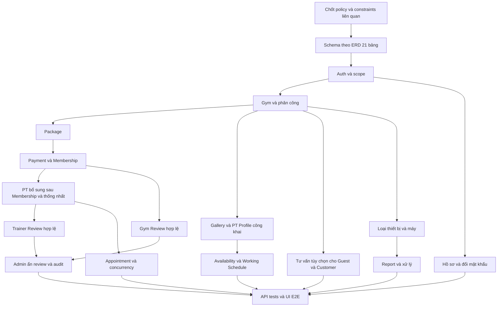

# Multi-Gym Platform — Implementation Plan

**Cập nhật triển khai frontend — 11/10/2026:** theo yêu cầu tiếp tục đưa thiết kế vào ứng dụng, đã áp dụng lát cắt Admin đầu tiên (dashboard/tài khoản/vai trò/Gym/bổ nhiệm Manager). Xem [phạm vi và kiểm chứng ADM-UI-01](ADMIN_UI_01_IMPLEMENTATION.md). ADM-UI-01 IN_PROGRESS; các ghi chú “chưa sửa frontend” dưới đây mô tả trạng thái trước đợt này, không phải trạng thái hiện tại. Không suy ra duyệt toàn bộ thiết kế hoặc hoàn thành mọi Requirement.

## Quyết định G2 hiện hành — 11/10/2026

Người dùng yêu cầu “áp dụng các đề xuất và thực hiện” sau danh sách sáu nội dung duyệt. G2 **APPROVED về phạm vi thiết kế**: baseline Admin; PT roster/tiếp nhận; Membership read-only/paging-only; entry chọn Gym cho report scoped; nhãn “Đánh giá Gym toàn sàn”; các cải thiện UX/state/error/reload/cache/page recovery/keyboard/focus đã nêu. ADM-DEC-01–04 APPROVED về nội dung này; không mở quyền/API/backend/payment. Những trạng thái OPEN/PROPOSED/chưa duyệt trong các mục đặc tả ngày trước là lịch sử, được quyết định này thay thế về scope; route mới vẫn **chưa triển khai**. G3 chưa duyệt, các GAP được đưa vào thiết kế chưa phải lỗi đã sửa hoặc AC đã PASS.

ADM-DESIGN-01 đã soạn [ADMIN_FIGMA_BRIEF.md](ADMIN_FIGMA_BRIEF.md). Theo yêu cầu thực hiện bước02, đã tạo [pilot quản lý tài khoản để review](ADMIN_DESIGN_02_PILOT_REVIEW.md): prototype HTML độc lập có tương tác; Figma có24/33 frame được dựng và còn dở vì hạn mức Starter. ADM-DEC-06 đã chọn Figma + prototype HTML trong repo. ADM-DESIGN-02 **IN_PROGRESS — pilot READY_FOR_REVIEW**, G3 chưa duyệt. Theo yêu cầu ưu tiên Admin, đã tiếp tục [prototype vai trò/Gym/bổ nhiệm Manager](ADMIN_DESIGN_02_GYM_MANAGER_REVIEW.md): tổng cộng5/15 Screen IDs được dựng,10 IDs còn lại chưa thiết kế. ADM-UI-01 chưa bắt đầu, không đổi frontend/API/backend.

## Lộ trình bổ sung Admin — kế hoạch ngày 11/10/2026

Người dùng yêu cầu lập kế hoạch chi tiết phần Admin còn thiếu, thực hiện tuần tự trước khi thiết kế giao diện; **chưa áp dụng quản lý giao dịch tiền thật**. Xem [ADMIN_SPECIFICATION_ROADMAP.md](ADMIN_SPECIFICATION_ROADMAP.md) cho từng task, nguồn, đầu ra, acceptance, kiểm chứng và cổng review.

- ADM-SPEC-01–03: chuẩn hóa nguồn, catalog/quyền và pilot quản lý tài khoản.
- ADM-SPEC-04: hoàn thiện đặc tả chức năng hiện có.
- ADM-SPEC-05–07: đề xuất màn Admin PT, Membership read-only theo Gym và điểm truy cập sự cố; duyệt/hoãn riêng, không tự mở quyền/API.
- ADM-SPEC-08: dashboard theo nguồn dữ liệu và traceability đầy đủ.
- ADM-DESIGN-01–02: chuẩn bị brief/design system rồi thiết kế, sau khi đặc tả được review.
- ADM-UI-01 → ADM-QA-01: triển khai từng lát cắt đã duyệt và nghiệm thu bằng kết quả thực.

ADM-SPEC-01 đã thực hiện ngày 11/10/2026: inventory nguồn, phân loại trạng thái và sổ khác biệt ở roadmap §2.1–2.3; sửa mô tả stale trong docs, không thay code/API/schema. ADM-SPEC-02 đã soạn catalog tại Feature §5.1 và ma trận quyền tại Domain §8.1–8.3, READY_FOR_REVIEW. ADM-SPEC-03 đã soạn pilot tại Feature §5.2, SCR-ADM-002 và traceability §5.1. Theo yêu cầu tiếp tục, ADM-SPEC-04 đã áp dụng mẫu và soạn baseline tại Feature §5.3/UI baseline/traceability §5.2, READY_FOR_REVIEW; ADM-SPEC-05 đã soạn proposal PT tại Feature §5.4/UI proposal/traceability §5.3, READY_FOR_REVIEW, ADM-DEC-02 OPEN; ADM-SPEC-06 đã soạn proposal Membership tại Feature §5.5/UI proposal/traceability §5.4, READY_FOR_REVIEW, ADM-DEC-03 OPEN; ADM-SPEC-07 đã soạn entry proposal tại Feature §5.6/UI proposal/traceability §5.5, READY_FOR_REVIEW, ADM-DEC-04 OPEN; ADM-SPEC-08 đã soạn dashboard/KPI/traceability tại Feature §5.7/UI dashboard/§5.6, READY_FOR_REVIEW cho G2; design/UI/QA chưa thực hiện. G1 cấu trúc mẫu được áp dụng, GAP/KPI/màn mới vẫn cần review. Dùng prefix ADM-SPEC/ADM-DESIGN/ADM-UI để tránh nhầm với task PLAN-04 chuẩn bị domain và tài liệu PLAN_04 dashboard trước đó. Không mở lại nghiệp vụ đã CLOSED hoặc coi mở rộng mới là phần demo cũ chưa hoàn thành. Real payments/refund/revenue analytics và audit viewer/settings/notifications/thiết bị không nằm trong đường triển khai này.

| Task Admin | Trạng thái / đầu ra | Phụ thuộc và điều kiện đi tiếp |
| --- | --- | --- |
| ADM-SPEC-01 | DONE — source inventory/phân loại/sổ khác biệt tại roadmap §2.1–2.3 | User yêu cầu audit; không còn xung đột chặn mô tả account baseline |
| ADM-SPEC-02 | READY_FOR_REVIEW — 31 Feature IDs, 36 dòng quyền, nguồn/DTO/coverage | ADM-SPEC-01; review catalog/quyền hiện hành, không tự phê duyệt proposal |
| ADM-SPEC-03 | READY_FOR_REVIEW — pilot tài khoản FEAT-ADM-001/002, SCR-ADM-002 | Theo yêu cầu tiếp tục đã áp dụng cấu trúc ở 04; nội dung/GAP còn review, chưa nhận AC PASS |
| ADM-SPEC-04 | READY_FOR_REVIEW — 5 nhóm baseline, 28 REQ/AC/TC, UI state/recovery, 6 GAP | Đối chiếu contract/source/test, chờ review nội dung; không đổi API/quyền/code hoặc thông qua G2/G3 |
| ADM-SPEC-05 | READY_FOR_REVIEW — proposal PT, 12 REQ/AC/TC, reuse/error/credential | Backend/quyền đã có; hai màn/route vẫn PROPOSED, ADM-DEC-02 OPEN; chưa triển khai |
| ADM-SPEC-06 | READY_FOR_REVIEW — Membership read-only/paging-only, 10 REQ/AC/TC | Màn/route PROPOSED, ADM-DEC-03 OPEN; không filter mới/detail/payment quản trị |
| ADM-SPEC-07 | READY_FOR_REVIEW — entry chọn Gym, 8 REQ/AC/TC | Entry PROPOSED, ADM-DEC-04 OPEN; report scoped đã có, không inbox/count tổng mới |
| ADM-SPEC-08 | READY_FOR_REVIEW — dashboard,10REQ/AC/TC,5GAP và traceability79bộ | G2 scope APPROVED theo quyết định hiện hành; AC/runtime chưa nghiệm thu, Figma chưa thiết kế |
| ADM-DESIGN-01 | Brief đã được dùng ở bước02 —15Screen IDs/token/component/state/sample | Scope G2 đã duyệt; visual direction pilot còn review G3 |
| ADM-DESIGN-02 | IN_PROGRESS — pilot SCR-ADM-002 READY_FOR_REVIEW bằng HTML; Figma24/33 frame, còn dở | Review pilot rồi nhân rộng14 screen còn lại; G3 pending, ADM-UI-01 chưa bắt đầu |

## 1. Phạm vi và nguyên tắc

Kế hoạch triển khai theo nghiệp vụ Gym/PT mới và schema 21 bảng hiện có. Bảng nhiệm vụ là kế hoạch mục tiêu; trạng thái triển khai thực tế được ghi riêng tại §4.1. Không suy ra toàn task hoàn thành từ schema hoặc một phần API đã có.

Thứ tự căn cứ theo PROJECT_RULES.md: yêu cầu người dùng → Architecture → Project Rules → Domain/Feature → Database/API → implementation → giả định. UI/plan phải bám contract và không tự chốt nghiệp vụ. Q-01–Q-19 ở Domain §9 là danh mục chung; chỉ chặn các nhiệm vụ phụ thuộc. Q-11 đã có baseline vật lý; Q-05 nằm ngoài phạm vi, không phải blocker của PT Registration.

## 2. Dependency graph và thứ tự schema

Thứ tự phụ thuộc schema để tham khảo; migration 0000/0001 đã có, không tạo lại các bảng:

1. users, roles, gyms, equipment_types.
2. user_profiles, user_roles, gym_managers, gym_trainers, packages.
3. payments, equipments.
4. memberships (tham chiếu Payment tùy chọn).
5. pt_registrations (Membership và Gym Trainer).
6. pt_appointments, gym_reports (Report có FK Equipment và User xử lý).
7. gym_images, consultation_requests, pt_social_links, pt_working_schedules, gym_reviews, trainer_reviews (migration 0001).

Đúng 21 bảng. PK user_roles là cặp; mọi bảng còn lại dùng tên PK riêng. Không tự cài btree_gist hoặc dùng lại exclusion constraint trên các cột Appointment đã bỏ; cơ chế bảo vệ mới chờ Q-06.

## 3. Công việc chuẩn bị và checkpoint

| Task | Kết quả review | Phụ thuộc / trạng thái | Kiểm tra |
| :--- | :--- | :--- | :--- |
| PLAN-01 | Đối chiếu baseline 21 bảng, FK/CHECK/index/trigger | ĐÃ CÓ migration 0000/0001; Q-11 không còn mở | Bảo toàn migration cũ, chỉ migration mới nếu task tiếp theo cần đổi policy |
| PLAN-02 | Chốt nguồn thanh toán, giá lịch sử, trạng thái thẻ/refund | Demo đã được chọn ngày 2026-10-08; Q-01/Q-02/Q-03 tiền thật còn OPEN | Có lifecycle, actor và contract callback; retry/concurrency có acceptance. Xem [đề xuất và 24 ca nghiệm thu dự kiến](PLAN_02_PAYMENT_POLICY_PROPOSAL.md); chưa đóng Q hoặc mở PAY phụ thuộc. |
| PLAN-03 | Chốt Membership/PT/lịch sử và chống trùng | APPROVED 2026-10-09: Q-04/Q-06/Q-07 và availability Q-16 chốt; Q-08 Customer production còn OPEN | Không dùng cột đã bỏ; xác định cả Customer và PT, phạm vi và trạng thái giữ chỗ; xem [đề xuất PLAN-03](PLAN_03_PT_APPOINTMENT_POLICY_PROPOSAL.md) |
| PLAN-04 | Chốt thiết bị, tài khoản/ảnh và các action status | Q-09/Q-13 ngoài Gym/PT và Q-10 upload — BLOCKED phần tương ứng; Q-08 PT/Q-13 Gym/PT đã chốt; Q-10 provisioning/email và Q-12 đã chốt | Quyền, field allowlist và hành vi có nguồn rõ ràng |
| PLAN-05 | Kiểm tra nền tảng monorepo/Docker/scripts hiện có | TODO khi bắt đầu code | Build/typecheck thật; không coi placeholder lint là đã lint |

Checkpoint: trước mỗi lát cắt triển khai, chỉ cần các Q ảnh hưởng lát cắt đó đã chốt. Không đánh đồng schema đã có với API/UI hoàn thành; chỉ chặn task phụ thuộc Q chưa chốt. Không yêu cầu người dùng phê duyệt lại công việc tài liệu đã được yêu cầu.

## 4. Các lát cắt triển khai

Mỗi task nên giới hạn một nhóm chức năng và một lượt review. Mỗi lát cắt có schema phần liên quan → backend/contract → kiểm thử → UI. Khi vượt 3–5 file logic chính, tách tiếp thay vì gộp toàn domain vào một task.

| Task | Nội dung / file dự kiến | Phụ thuộc | Nghiệm thu và verification |
| :--- | :--- | :--- | :--- |
| AUTH-01 | users/profiles/roles/user_roles schema tại apps/api/src/database; seed role | PLAN-01 | Đúng PK, phone ở User, profile unique; seed 4 role không Guest; migration test khi được yêu cầu triển khai |
| AUTH-02 | Auth service/routes, DTO chia sẻ, đổi mật khẩu | AUTH-01 | Register transaction, Argon2id, cookie, không hash trong JSON, must_change_password gate; Supertest auth/IDOR |
| AUTH-03 | Form login/register/profile và guards apps/web | AUTH-02 | phone/address đúng chỗ, đổi mật khẩu tạm; Playwright login/profile/403 |
| GYM-01 | gyms/managers/trainers schema và scope repository | AUTH-01, PLAN-01 | Trực tiếp/gián tiếp scope, cặp phân công unique, giới hạn Manager ACTIVE; integration Gym A/B |
| GYM-02 | Gym API và provisioning Manager/PT — CLOSED (backend; xem §4.1) | GYM-01 CLOSED, AUTH-02; Q-10 provisioning/email và Q-12 đã chốt; Q-08 PT/Q-13 Gym/PT đã chốt | Transaction, không tự cấp role/scope từ client, không vượt giới hạn Manager; concurrency test phân công |
| GYM-03 | Public Gym/PT và Manager/Admin forms — CLOSED (implementation/verification UI) | GYM-02 | Field/route đúng API; 23 ca UI mock + 2 luồng browser/API/DB thật, responsive và guards; xem [GYM_03_VERIFICATION.md](GYM_03_VERIFICATION.md) |
| PKG-01 | Package service/API — CLOSED (backend; schema hiện có) | GYM-01, AUTH-02 | 7 endpoint, decimal-string price, ACTIVE/INACTIVE, giữ giá lịch sử; xem [PKG_01_VERIFICATION.md](PKG_01_VERIFICATION.md) |
| PKG-02 | Package UI công khai/quản trị — CLOSED (catalog/forms; checkout thuộc Payment) | PKG-01 | Public list/detail, Manager/Admin create/edit/status; 23 UI cases + 2 browser/API/DB flows; xem [PKG_02_VERIFICATION.md](PKG_02_VERIFICATION.md) |
| PAY-DEMO | CLOSED — Checkout mô phỏng → Payment SUCCESS + Membership ACTIVE và lịch sử cá nhân | Yêu cầu mock ngày 2026-10-08, PKG-01/02, AUTH-02 | Phương thức hợp lệ đều thành công, server-priced, atomic/idempotent, demo mode/nhãn; xem [nghiệm thu](PAYMENT_DEMO_VERIFICATION.md) |
| PAY-01 | Payment/Membership schema và callback contract | PLAN-02, PLAN-01, PKG-01 | UNIQUE payment_id nullable, cùng User/Gym/Package, precision/giá snapshot; integration |
| PAY-02 | Payment xác nhận → tạo Membership | PAY-01, AUTH-02 | Giả mạo bị chặn, retry và đồng thời chỉ một thẻ, rollback, giữ purchase_price; test concurrency |
| PAY-03 | Checkout/Payment history và Membership UI đọc | PAY-02 | Không tự xác nhận SUCCESS, Payment thành công không giả định ACTIVE thẻ, hiển thị giá lịch sử; E2E theo policy |
| PTR-01 | DONE — Registration schema/repository/API | PAY-01, GYM-01, PLAN-03 | Chọn Membership + Gym Trainer cùng Gym; Customer/PT scope bằng JOIN; không quota tự chế; tests Gym A/B |
| PTR-02 | DONE — cancel/tạo mới bảo toàn lịch sử | PTR-01; Q-07/Q-13 | Không đổi danh tính lịch cũ ngoài policy; test có lịch sử/lịch tương lai |
| APP-01 | DONE — Appointment schema/service/actions | PTR-01, PLAN-03, PLAN-01 | end_time > start_time, chống trùng và race condition theo policy; test đồng thời/ranh giới slot |
| APP-02 | Booking/actions + calendar Customer DONE | APP-01 | Chỉ action đã duyệt; không counter quota; E2E sai quyền, dời/hủy/xác nhận/hoàn thành |
| EQP-01 | DEFERRED khỏi demo — giữ schema, không mở API danh mục/máy | GYM-01, PLAN-01; Q-09 phần quyền danh mục/eligibility | Mã máy unique mỗi Gym, condition/status riêng; integration khác Gym |
| EQP-02 | DEFERRED khỏi demo — không list/form/selector máy | EQP-01 | Chỉ máy cùng Gym, xóa selection khi đổi Gym, không chuyển Gym tùy ý; E2E |
| REP-01 | Báo cáo nội dung/ảnh — triển khai 2026-10-10 | AUTH-02; quyết định demo Q-09/Q-13 | content/type/equipment/resolver, tối đa 1 ảnh; resolve atomic; test cùng Gym và giả mạo resolved_by |
| REP-02 | Customer report và Manager xử lý UI — triển khai 2026-10-10 | REP-01; không phụ thuộc EQP-02 | PENDING → IN_PROGRESS → RESOLVED với note; không tự sửa condition máy; E2E |
| ADM-01 | CLOSED — Admin users/roles/status API/UI (2026-10-10) | AUTH-02/03; quyết định account status ADM-01 | List/search/filter/paging, Gym assignments, readonly roles, xác nhận khóa/mở, Admin protected; CAS/no-cascade/old session/profile/password concurrency; xem ADMIN_USERS_VERIFICATION.md |
| QA-01 | CLOSED — kiểm tra/gia cố bảo mật và hợp đồng demo (2026-10-11) | Các lát cắt demo đã triển khai | 66 private routes; 12 security tests + 13 full-app groups, toàn bộ backend regression và 10 browser cases; xem [QA_01_VERIFICATION.md](QA_01_VERIFICATION.md), dependency production còn follow-up |
| QA-02 | CLOSED — lint/build/typecheck, responsive/a11y và ổn định kiểm thử (2026-10-11) | QA-01 | 39 trang × 4 độ rộng, axe và keyboard; 17 browser suites × 2 vòng = 182 lượt không retry; backend regression PASS; xem [QA_02_VERIFICATION.md](QA_02_VERIFICATION.md) |

Các đường dẫn trong bảng là định hướng triển khai; đối chiếu §4.1 để biết phần đã có. Chưa có runner/test script thì bổ sung trong nhiệm vụ code được cho phép; không báo test pass dựa trên lệnh placeholder.

### 4.1. Hiện trạng đối chiếu source

Snapshot tài liệu được đồng bộ ở ADM-SPEC-01 ngày 11/10/2026. Trạng thái implementation dựa trên source và các cập nhật nghiệp vụ; số test/deployment trong báo cáo là kết quả lịch sử, không phải kiểm tra mới ở lượt docs này. Không suy ra migration/runtime đang chạy từ việc đọc repo.

| Phần | Hiện trạng |
| :--- | :--- |
| Schema/migration 21 bảng | Đã có chain 0000–0005 trong repo, metadata và rollback liên quan; không tạo lại. Migration live phải kiểm tra trong task vận hành riêng. |
| Auth/User | Router /auth và /users, service, form/guards và E2E hiện có; giữ tương thích. |
| PT Registration / Review | PT workflow và REV-01/REV-02 đã có service/controller/routes/UI/test sources. Q-04/Q-06/Q-07 và review tối giản được cập nhật; Admin đọc lịch/kết thúc Registration theo điều kiện, review hide-only. Xem PT_WORKFLOW_VERIFICATION.md và REVIEW_MODERATION_VERIFICATION.md cho báo cáo lịch sử. |
| GYM-02 — Q-10/Q-12 | Đã triển khai API provision Manager/PT, list/assign/revoke Manager, reactivate cùng bản ghi; staffing repository/service/controller/router/validator và integration tests. GymScopeService của GYM-01 được tái sử dụng, GYM-01 vẫn CLOSED. Không migration mới. |
| GYM-02 — Q-08 PT/Q-13 Gym/PT | Đã triển khai phân công PT có sẵn, đổi trạng thái Gym/PT, giữ history, chặn nghĩa vụ mở; migration 0002 index/guards và integration tests. Báo cáo PT_WORKFLOW_VERIFICATION.md ghi triển khai 0002/0003 ở Docker dev ngày 2026-10-09; không xác nhận trạng thái DB hiện tại trong audit docs. |
| GYM-02 đợt 1 — Public Gym API | Đã triển khai GET /gyms và GET /gyms/:gymId: ACTIVE-only, phân trang/search/sort allowlist, projection công khai, 404 cho Gym ẩn/không tồn tại; 7 ca integration trên database tạm. Không thay schema/migration. |
| GYM-02 đợt 2 — Tạo/cập nhật Gym | Đã triển khai POST /gyms cho Admin và PATCH /gyms/:gymId cho Admin/Manager ACTIVE đúng Gym; strict allowlist, transaction authorization, giữ identity/status và 7 ca integration. Không sửa schema/migration. |
| GYM-02 đợt 3 — Public PT API | Đã triển khai GET /gyms/:gymId/trainers và GET /gyms/:gymId/trainers/:trainerId; TrainerPublicView, Gym/PT ACTIVE, mọi availability, profile giới hạn trường, social links và lịch làm việc ACTIVE; 8 ca integration. Không sửa schema/migration. |
| GYM-02 đợt 4 — Danh sách quản trị | Đã triển khai GET /admin/gyms và GET /gyms/:gymId/management/trainers; status filter, pagination/search/sort, DB role/assignment scope, đọc nội bộ Gym INACTIVE, 6 ca integration. Không đổi schema/migration. |
| GYM-02 đợt 5 — Nghiệm thu tích hợp | CLOSED theo [báo cáo lịch sử](GYM_02_VERIFICATION.md): 49 kiểm tra HTTP, 16/16 endpoint; 52 ca integration, typecheck/build. Trạng thái triển khai migration về sau được ghi ở PT_WORKFLOW_VERIFICATION.md, không dùng ghi chú chưa deploy của lượt GYM-02 làm hiện trạng. |
| GYM-03 — UI | CLOSED theo [báo cáo lịch sử](GYM_03_VERIFICATION.md): Public Gym/PT, Manager Gym/PT và Admin Gym/Manager. Package/Consultation/Gallery/Review và onboarding mở rộng đã triển khai trong các lát cắt tiếp theo; không nằm trong kết quả GYM-03 ban đầu. |
| PKG-01 — Package backend | 7 endpoint public/quản trị/create/update/activate/deactivate; strict Zod, quyền/scope từ DB, giá decimal string và history không đổi. Schema Package có sẵn; không migration mới. Xem [PKG_01_VERIFICATION.md](PKG_01_VERIFICATION.md). UI thuộc PKG-02. |
| PKG-02 — Package UI | Public catalog/detail, Manager assigned Gym, Admin catalog cả INACTIVE, form decimal/partial PATCH và status confirmation; xem [báo cáo nghiệm thu](PKG_02_VERIFICATION.md). Checkout vẫn thuộc Payment. |
| Payment/Membership/Appointment/Report/Equipment | Demo Payment/Membership, PT Appointment và Report đơn giản đã có API/UI theo updates dưới đây; tiền thật và Equipment vẫn ngoài phạm vi hiện tại. PKG-01 không phải task triển khai các API này. |
| Consultation/Gallery/ghi PT Profile/Review API và UI | Đã triển khai theo CON-01/02, GIM-01, TPR-01, REV-01/02; giới hạn quyền/storage/immutable review theo quyết định riêng và báo cáo tương ứng. Admin không mặc định có quyền inbox Consultation hoặc ghi TPR-01. |
| Admin account và workspace/dashboard | ADM-01 users/roles/status đã có API/UI; AdminLayout/ManagementShell và `/admin/dashboard` đã có. Review KPI hiện kind=gym, label rộng hơn nguồn là gap OPEN, chưa sửa UI trong ADM-SPEC-01. |

Verification cho phần Q-10/Q-12: `npm run test:database -w apps/api` và `GYM_TEST_ORDER=reverse npm run test:database -w apps/api` chạy trên database tạm riêng, gồm 12 ca staffing integration (HTTP, transaction, concurrency, password), cùng các regression hiện có. `npm run test:e2e -w apps/web`: 8 ca Auth. Kiểm tra TypeScript cả source/tests và build API. Không xem các kết quả này là hoàn thành Gym API/UI chưa xây dựng.

### 4.2. Task bổ sung và thứ tự ưu tiên

| Task | Kết quả | Phụ thuộc | Nghiệm thu |
| :--- | :--- | :--- | :--- |
| DISC-01 | CLOSED — Public Gym Detail/gallery/PT Profile/review list (2026-10-10) | GYM-01; GIM-01; TPR-01; REV-01 | Hai CTA, gallery/PT profile và review VISIBLE đã nối; public không contact riêng/audit. Xem REVIEW_VERIFICATION.md. |
| CON-01 | CLOSED — Đăng ký tư vấn Guest/User (2026-10-10) | GYM-01; Q-19 consultation đã duyệt | Contact strict, actor từ phiên, Gym ACTIVE, rate limit; không Membership/Appointment. |
| CON-02 | CLOSED — Manager inbox/process (2026-10-10) | CON-01; Manager-only theo quyết định đã duyệt | Gym A/B isolation, bốn trạng thái, lý do hủy/ghi chú riêng; Staff ngoài phạm vi. |
| GIM-01 | CLOSED — Gallery demo (2026-10-10) | Gym API hiện có; Q-10/Q-19 gallery demo đã duyệt | Tối đa 10 ảnh, caption/order/delete; scope/metadata/concurrency/browser; xem GALLERY_VERIFICATION.md. |
| TPR-01 | CLOSED — Hồ sơ PT, availability/social links/Working Schedule | GYM-01; Q-16/Q-18 đã chốt | PT tự sửa giới thiệu/liên kết/giờ; Manager sửa chuyên môn/kinh nghiệm đúng Gym. Giờ tham khảo không chặn hoặc đổi Appointment. Xem TRAINER_PROFILE_VERIFICATION.md. |
| REV-01 | CLOSED — Customer review API/UI (2026-10-10) | Gym/PT public; Q-15 đã chốt | Một review mỗi User/target, PT cần COMPLETED; scope/duplicate/hidden/privacy/browser đã kiểm chứng. Xem REVIEW_VERIFICATION.md. |
| REV-02 | CLOSED — Admin moderation/API/UI (2026-10-10) | REV-01 | List/filter/Gym/PT INACTIVE, hide có lý do/xác nhận, atomic audit; API/browser/regression pass. Xem REVIEW_MODERATION_VERIFICATION.md. |
| FLOW-01 | Checkout và PT flow/UI | PAY-02; Q-17, Q-04/Q-16 | Membership không cần PT/tư vấn; PT chỉ sau thẻ phù hợp và thống nhất. |

Chức năng public đọc triển khai độc lập policy ghi chưa chốt. Không có task PT pricing/package/payment/quota, chat, recommendation hay realtime booking.

## 5. Ma trận Feature → API → UI

Bảng này dùng đúng Feature ID của Feature Spec. Method/path chi tiết và trạng thái DRAFT ở API §6; không cố định số endpoint/màn hình từ thiết kế cũ.

| Feature | API | Màn hình |
| :--- | :--- | :--- |
| FEAT-AUTH-001 | `POST /api/v1/auth/register` | SCR-GST-006 |
| FEAT-AUTH-002 | `POST /api/v1/auth/login` | SCR-GST-007 |
| FEAT-AUTH-003 | `POST /api/v1/auth/logout` |  |
| FEAT-AUTH-004 | `GET /api/v1/auth/me`; `GET /api/v1/users/me/profile` | SCR-GST-007, SCR-CUS-002, SCR-TRN-002, SCR-MGR-003 |
| FEAT-AUTH-005 | `PATCH /api/v1/users/me/profile` | SCR-CUS-002 |
| FEAT-AUTH-006 | `POST /api/v1/auth/change-password` | SCR-CUS-002 |
| FEAT-GYM-001 | `GET /api/v1/gyms` | SCR-GST-001, SCR-GST-002, SCR-ADM-001, SCR-ADM-004 |
| FEAT-GYM-002 | `GET /api/v1/gyms/:gymId` | SCR-GST-003 |
| FEAT-GYM-003 | `POST /api/v1/gyms` | SCR-ADM-005 |
| FEAT-GYM-004 | `PATCH /api/v1/gyms/:gymId` | SCR-MGR-002, SCR-ADM-004 |
| FEAT-GYM-005 | `PATCH /api/v1/gyms/:gymId/status` | SCR-ADM-004, SCR-ADM-005 |
| FEAT-MGR-001 | `POST /api/v1/admin/managers/provision` | SCR-ADM-006 |
| FEAT-MGR-002 | `GET /api/v1/gyms/:gymId/managers` | SCR-MGR-003, SCR-ADM-006 |
| FEAT-MGR-003 | `POST /api/v1/gyms/:gymId/managers/assign` | SCR-ADM-006 |
| FEAT-MGR-004 | `POST /api/v1/gyms/:gymId/managers/:managerId/revoke` | SCR-ADM-006 |
| FEAT-TRN-001 | `GET /api/v1/gyms/:gymId/trainers` | SCR-GST-005, SCR-MGR-004 |
| FEAT-TRN-002 | `GET /api/v1/gyms/:gymId/trainers/:trainerId` | SCR-GST-005, SCR-TRN-002 |
| FEAT-TRN-003 | `POST /api/v1/gyms/:gymId/trainers` | SCR-MGR-005 |
| FEAT-TRN-004 | `PATCH /api/v1/gyms/:gymId/trainers/:trainerId/status` | SCR-MGR-004 |
| FEAT-TRN-005 | `POST /api/v1/gyms/:gymId/trainers/provision` | SCR-MGR-005 |
| FEAT-PKG-001 | `GET /api/v1/gyms/:gymId/packages` | SCR-GST-004 |
| FEAT-PKG-002 | `GET /api/v1/gyms/:gymId/packages/:packageId` | SCR-GST-004 |
| FEAT-PKG-003 | `POST /api/v1/gyms/:gymId/packages` | SCR-MGR-006 |
| FEAT-PKG-004 | `PATCH /api/v1/gyms/:gymId/packages/:packageId` | SCR-MGR-006 |
| FEAT-PKG-005 | `PATCH /api/v1/gyms/:gymId/packages/:packageId/deactivate` | SCR-MGR-006 |
| FEAT-PKG-006 | `PATCH /api/v1/gyms/:gymId/packages/:packageId/activate` | SCR-MGR-006 |
| FEAT-PAY-001 | `POST /api/v1/gyms/:gymId/payments` | SCR-CUS-010 |
| FEAT-PAY-002 | `GET /api/v1/payments/me`; `GET /api/v1/payments/:paymentId` | SCR-CUS-001, SCR-CUS-004, SCR-CUS-011 |
| FEAT-MEM-002 | `GET /api/v1/memberships/me` | SCR-CUS-001, SCR-CUS-003, SCR-CUS-011 |
| FEAT-MEM-003 | `GET /api/v1/gyms/:gymId/memberships` | SCR-MGR-001, SCR-MGR-007 |
| FEAT-MEM-004 | `GET /api/v1/memberships/:membershipId` | SCR-CUS-004, SCR-MGR-007 |
| FEAT-PTR-001 | `POST /api/v1/gyms/:gymId/pt-registrations` | SCR-CUS-005, SCR-MGR-008 |
| FEAT-PTR-002 | `GET /api/v1/pt-registrations/me` | SCR-CUS-005, SCR-CUS-006, SCR-TRN-001, SCR-TRN-003 |
| FEAT-PTR-003 | `GET /api/v1/gyms/:gymId/pt-registrations` | SCR-MGR-008 |
| FEAT-PTR-004 | `PATCH /api/v1/gyms/:gymId/pt-registrations/:registrationId/assign` | SCR-MGR-008 |
| FEAT-PTR-005 | `PATCH /api/v1/gyms/:gymId/pt-registrations/:registrationId/cancel` | SCR-MGR-008 |
| FEAT-APP-001 | `POST /api/v1/gyms/:gymId/pt-appointments` | SCR-CUS-007, SCR-TRN-003, SCR-TRN-006, SCR-MGR-009 |
| FEAT-APP-002 | `GET /api/v1/pt-appointments/me` | SCR-CUS-001, SCR-CUS-006, SCR-CUS-007, SCR-TRN-001, SCR-TRN-004, SCR-TRN-005, SCR-TRN-006 |
| FEAT-APP-003 | `GET /api/v1/gyms/:gymId/pt-appointments` | SCR-MGR-001, SCR-MGR-009 |
| FEAT-APP-004 | `PATCH /api/v1/gyms/:gymId/pt-appointments/:appointmentId/reschedule` | SCR-CUS-007, SCR-TRN-004 |
| FEAT-APP-005 | `PATCH /api/v1/gyms/:gymId/pt-appointments/:appointmentId/cancel` | SCR-CUS-007, SCR-TRN-004 |
| FEAT-APP-006 | `PATCH /api/v1/gyms/:gymId/pt-appointments/:appointmentId/complete` | SCR-TRN-004, SCR-TRN-005 |
| FEAT-APP-008 | `PATCH /api/v1/gyms/:gymId/pt-appointments/:appointmentId/confirm` | SCR-TRN-004 |
| FEAT-EQT-001 | `GET /api/v1/equipment-types` | SCR-MGR-011, SCR-MGR-012 |
| FEAT-EQP-001 | `GET /api/v1/gyms/:gymId/equipments` | SCR-CUS-009, SCR-MGR-011 |
| FEAT-EQP-002 | `POST /api/v1/gyms/:gymId/equipments` | SCR-MGR-012 |
| FEAT-EQP-003 | `PATCH /api/v1/gyms/:gymId/equipments/:equipmentId` | SCR-MGR-012 |
| FEAT-REP-001 | `POST /api/v1/gyms/:gymId/reports` | SCR-CUS-009 |
| FEAT-REP-002 | `GET /api/v1/reports/me` | SCR-CUS-008 |
| FEAT-REP-003 | `GET /api/v1/gyms/:gymId/reports` | SCR-MGR-001, SCR-MGR-010, SCR-ADM-007 |
| FEAT-REP-004 | `PATCH /api/v1/gyms/:gymId/reports/:reportId/investigate` | SCR-MGR-010 |
| FEAT-REP-005 | `PATCH /api/v1/gyms/:gymId/reports/:reportId/resolve` | SCR-MGR-010 |
| FEAT-REP-006 | `PATCH /api/v1/gyms/:gymId/reports/:reportId/reject` | SCR-MGR-010 |
| FEAT-ADM-001 | `GET /api/v1/admin/users` | SCR-ADM-001, SCR-ADM-002 |
| FEAT-ADM-002 | `PATCH /api/v1/admin/users/:userId/status` | SCR-ADM-002 |
| FEAT-ADM-003 | `GET /api/v1/admin/roles` | SCR-ADM-003 |
| FEAT-PAY-003 | Xử lý server theo Q-01/Q-02, chưa chốt callback route | SCR-CUS-010, SCR-CUS-011, SCR-CUS-003 |
| FEAT-MEM-001 | Xử lý server theo Q-01/Q-02, chưa chốt callback route | SCR-CUS-010, SCR-CUS-011, SCR-CUS-003 |
| FEAT-GYM-006 | `GET /api/v1/admin/gyms` | SCR-ADM-001, SCR-ADM-004 |
| FEAT-TRN-006 | `GET /api/v1/gyms/:gymId/management/trainers` | SCR-MGR-004 |
| FEAT-PKG-007 | `GET /api/v1/gyms/:gymId/management/packages` | SCR-MGR-006 |
| FEAT-GIM-001 | `GET /api/v1/gyms/:gymId/images` | SCR-GST-003 |
| FEAT-GIM-002 | `PUT /api/v1/gyms/:gymId/images` | SCR-MGR-014 |
| FEAT-CON-001 | `POST /api/v1/gyms/:gymId/consultation-requests` | SCR-GST-007 |
| FEAT-CON-002 | `GET /api/v1/gyms/:gymId/consultation-requests` | SCR-MGR-013 |
| FEAT-CON-003 | `PATCH /api/v1/gyms/:gymId/consultation-requests/:requestId` | SCR-MGR-013 |
| FEAT-TRN-007 | `PATCH /api/v1/gyms/:gymId/trainers/:trainerId/availability` | SCR-TRN-007 |
| FEAT-TRN-008 | `PUT /api/v1/gyms/:gymId/trainers/:trainerId/social-links` | SCR-TRN-007 |
| FEAT-TRN-009 | `PUT /api/v1/gyms/:gymId/trainers/:trainerId/working-schedules` | SCR-TRN-007 |
| FEAT-REV-001 | `GET /api/v1/gyms/:gymId/reviews` | SCR-GST-003 |
| FEAT-REV-002 | `POST /api/v1/gyms/:gymId/reviews` | SCR-CUS-012 |
| FEAT-REV-003 | `GET /api/v1/gyms/:gymId/trainers/:trainerId/reviews` | SCR-GST-008 |
| FEAT-REV-004 | `POST /api/v1/gyms/:gymId/trainers/:trainerId/reviews` | SCR-CUS-013 |
| FEAT-REV-005 | `GET /api/v1/admin/reviews` | SCR-ADM-008 |
| FEAT-REV-006 | `PATCH /api/v1/admin/reviews/:kind/:reviewId/hide` | SCR-ADM-008 |

### 5.1. Truy vết pilot tài khoản — ADM-SPEC-03

Ngày đối chiếu source: 11/10/2026. [Feature §5.2](FEATURE_SPEC.md#52-pilot-quản-lý-tài-khoản--adm-spec-03-11102026-ready_for_review) có 11 Requirement/AC mới; [SCR-ADM-002](UI_UX_SPEC.md#scr-adm-002-platform-users--accounts-directory-quản-lý-tài-khoản-toàn-sàn) có luồng/state/GAP. Mọi dòng dưới map về màn này và FEAT-ADM-001/002; `/admin/roles` là link phụ sang SCR-ADM-003/FEAT-ADM-003. **Chỉ đọc source test trong bước này, chưa chạy integration/E2E; coverage có mã không có nghĩa PASS hoặc đủ toàn bộ AC.** Figma/frame chưa được tạo.

Nguồn triển khai: [validator](../apps/api/src/validators/admin-user.validator.ts), [controller](../apps/api/src/controllers/admin-user.controller.ts), [service backend](../apps/api/src/services/admin-user.service.ts), [repository](../apps/api/src/repositories/admin-user.repository.ts), [AdminUsersPage](../apps/web/src/pages/admin/AdminUsersPage.tsx), [AccountStatusAction](../apps/web/src/pages/admin/AccountStatusAction.tsx), [client](../apps/web/src/services/admin-user.service.ts). API chuẩn: [API_SPEC §30](API_SPEC.md#30-adm-01--admin-user-management-2026-10-10).

Các alias BE/FE sau chỉ là ký hiệu tra cứu trong tài liệu, không đặt lại tên test:

| Alias tài liệu | Group/title thực tế và file |
| --- | --- |
| BE-01 | `DB-current Admin only, Guest/Customer/Manager/PT denied despite forged claims` — [admin-user.integration.test.ts](../apps/api/tests/admin-user.integration.test.ts) |
| BE-02 | `Safe projection, literal search, role/status paging, readonly role catalog` — cùng file backend |
| BE-03 | `Strict query/body/params, all Admin accounts protected, missing and stale targets` — cùng file backend |
| BE-04 | `Concurrent CAS commits once, suspension blocks old session; no changes to open duties` — cùng file backend |
| BE-05 | `Manager/PT suspension retains assignments; internal actor can resolve open appointment` — cùng file backend |
| BE-06 | `Revoked Admin role, suspended actor and password gate enforced from DB` — cùng file backend |
| BE-07 | `Profile transaction waiting behind suspension rechecks status before either table writes` — cùng file backend |
| BE-08 | `Password update waiting behind suspension cannot commit; login blocked, reopen preserves gate` — cùng file backend |
| FE-01 | `Admin finds accounts, protects Admin, confirms suspend/unlock; existing Customer session follows DB status` — [admin-users.spec.ts](../apps/web/e2e/admin-users.spec.ts) |
| FE-02 | `Paging, pending prevents repeat writes, stale version requires reload before new confirmation` — cùng file E2E; mock API, không chứng minh transaction DB |

| TC mới → Requirement/AC cùng hậu tố | API/local behavior | Source/test có coverage và phần cần bổ sung |
| --- | --- | --- |
| TC-ADM-ACC-01 → REQ/AC-ADM-ACC-01 | GET users, auth/route guard | Backend service/routes; BE-01/06, FE-01 kiểm tra non-Admin; cần E2E actor mất quyền ngay khi đang mở màn. |
| TC-ADM-ACC-02 → REQ/AC-ADM-ACC-02 | GET users search/role/status; submit local reset page | Validator/repository/Page; BE-02, FE-01; chưa có test đầy đủ đổi từng filter từ page 2 và phân biệt text chưa submit. |
| TC-ADM-ACC-03 → REQ/AC-ADM-ACC-03 | GET users paging/total, local prev/next/empty | Repository/Page; BE-02 kiểm tra total/limit, FE-02 kiểm tra phân trang, FE-01 empty; chưa có test tie-break thứ tự hoặc page rỗng sau giảm total (GAP-01). |
| TC-ADM-ACC-04 → REQ/AC-ADM-ACC-04 | GET users projection; GET roles qua màn phụ | Repository/client/Page; BE-02 kiểm tra dữ liệu loại trừ/catalog, FE-01 role link; cần fixture profile null, phone null, roles/assignments rỗng cho fallback. |
| TC-ADM-ACC-05 → REQ/AC-ADM-ACC-05 | PATCH users/status protect ADMIN | Service/Action; BE-03 self và Admin khác, FE-01 ẩn nút; chưa có E2E target nhận role ADMIN giữa GET/PATCH. |
| TC-ADM-ACC-06 → REQ/AC-ADM-ACC-06 | Local mở/hủy xác nhận; PATCH SUSPENDED/ACTIVE | Action; FE-01 khóa/hủy/mở và hậu quả, BE-06 API INACTIVE; chưa có E2E mở target INACTIVE, lời nhắc bàn giao Manager. |
| TC-ADM-ACC-07 → REQ/AC-ADM-ACC-07 | PATCH strict params/query/body/version | Validator/service/client; BE-03 invalid input/offset, FE-02 đúng body; offset trong BE-03 chỉ kiểm +00:00, chưa đủ test offset khác 0 tương đương UTC. |
| TC-ADM-ACC-08 → REQ/AC-ADM-ACC-08 | PATCH pending/no retry/CAS; GET reload | Service/Action; BE-03/04, FE-02 một write khi pending và conflict/reload; GAP-04 chưa được cưỡng chế phía UI, cần test đường Hủy sau lỗi rồi mở lại. |
| TC-ADM-ACC-09 → REQ/AC-ADM-ACC-09 | PATCH success → invalidate GET; session DB state | Service/Page/Action; BE-04/05/06/07/08 không cascade/gate/races, FE-01 phiên cũ khóa/mở; dashboard invalidation GAP-02 chưa có test. |
| TC-ADM-ACC-10 → REQ/AC-ADM-ACC-10 | GET/PATCH error/retry/refresh session | Page/Action; BE-01/03/06 HTTP errors, FE-02 UI 409; còn thiếu UI GET lỗi, 400/401/403/404/5xx/network và PATCH commit rồi mất response. |
| TC-ADM-ACC-11 → REQ/AC-ADM-ACC-11 | Local keyboard/responsive/live state | Page/Action; FE-01/02 kiểm tra không tràn ngang tại 4 widths, FE-02 có email dài; chưa có keyboard/focus/screen reader test (GAP-03). |

**Thứ tự bổ sung khi chuyển sang implementation/QA sau duyệt:** chốt GAP-01–04 và điểm trả focus → cập nhật UI/error recovery/invalidation → test sự cố và concurrent role/target change → test fallback/filter/paging → keyboard/responsive → chạy integration trên fixture cô lập và E2E theo [playwright.admin-users.config.ts](../apps/web/playwright.admin-users.config.ts), ghi lệnh/kết quả thật. Không thêm test trong bước viết đặc tả.

**G1:** mẫu Field → Flow → State/Error → AC → Test đã được áp dụng vào ADM-SPEC-04 theo yêu cầu tiếp tục sau pilot. `READY_FOR_REVIEW` giữ cho nội dung/GAP, không có nghĩa toàn bộ AC đã PASS. Mở rộng PT/Membership/report và real payments không được suy từ pilot.

### 5.2. Truy vết baseline Admin — ADM-SPEC-04

Ngày 11/10/2026, người dùng yêu cầu thực hiện bước tiếp theo sau pilot; áp dụng cấu trúc mẫu cho baseline. Không suy yêu cầu này thành duyệt các GAP/màn/quyền mới. Đã soạn [Feature §5.3](FEATURE_SPEC.md#53-đặc-tả-chức-năng-admin-hiện-hành--adm-spec-04-11102026-ready_for_review) và [UI baseline](UI_UX_SPEC.md#adm-spec-04--baseline-admin-đầu-vào-thiết-kế-11102026), **READY_FOR_REVIEW**. Chỉ đối chiếu mã/contract/test; không chạy backend/E2E, không tuyên bố coverage đầy đủ hoặc test PASS.

**Nguồn triển khai theo nhóm:** role tại AdminRolesPage/admin-user; Gym/Manager tại AdminGymsPage/AdminManagersPage, GymForm/CreateGymWithManagerForm/StaffForm, gym-write/gym-management/staffing/gym-lifecycle service và validator; Package tại ManagedPackagesPage/PackageForm và package service/validator; Gallery tại GalleryPage/GalleryUploadForm, gallery service/validator; Report tại ReportsPage, report service/validator; PT tại PtWorkspacePage/PtForms, pt-workflow service/validator; Review tại ReviewModerationPage/HideReviewForm/ReviewGymFilter, review-moderation service. Các đường dẫn exact source đã có ở inventory roadmap và link dưới; contract API §14/15/17/19/20/22/23/24/26/29/30 giữ nguyên.

Alias A–R dưới đây là nhóm bằng chứng đã đọc, không tên test mới. Các group cụ thể giúp phân biệt coverage backend với journey E2E dùng actor khác Admin:

| Alias | File và group/title tiêu biểu có trong source |
| --- | --- |
| A | [admin-user.integration.test.ts](../apps/api/tests/admin-user.integration.test.ts) — `Safe projection, literal search, role/status paging, readonly role catalog`; [admin-users.spec.ts](../apps/web/e2e/admin-users.spec.ts) có link/catalog roles |
| B | [gym-management.integration.test.ts](../apps/api/tests/gym-management.integration.test.ts) — `Admin lists both Gym statuses with consistent filters, search and pagination` |
| C | [gym-write.integration.test.ts](../apps/api/tests/gym-write.integration.test.ts) — `Partial update preserves identity/status/creation and omitted fields; nullable fields can be cleared` |
| D | [gym-onboarding.cases.ts](../apps/api/tests/gym-onboarding.cases.ts), chạy qua [gym-onboarding.integration.test.ts](../apps/api/tests/gym-onboarding.integration.test.ts) — `Duplicate identity rolls back Gym and all account side effects` |
| E | [gym-lifecycle.integration.test.ts](../apps/api/tests/gym-lifecycle.integration.test.ts) — `Gym shutdown returns exact blockers, including overdue unfinished appointments` |
| F | [staffing.integration.test.ts](../apps/api/tests/staffing.integration.test.ts) — `HTTP provisioning: safe one-time credential, normalized identity, no email gate`; `revoke/reactivate same row; preserve creation; refresh assigned_at; no role mutation` và concurrency/identity rollback |
| G | [package-write.cases.ts](../apps/api/tests/package-write.cases.ts), chạy qua [package.integration.test.ts](../apps/api/tests/package.integration.test.ts) — `Price/duration/status changes preserve Payment and purchased Membership history`; `Status actions are repeatable and reject client-controlled body fields` |
| H | [gallery.integration.test.ts](../apps/api/tests/gallery.integration.test.ts) — `Caption stale checks and complete atomic reorder reject duplicates/foreign IDs/old order`; `Concurrent tenth upload: one commit only, no quota overflow or leftover file; revoke takes effect` |
| I | [report.integration.test.ts](../apps/api/tests/report.integration.test.ts) — `Owner/local Manager/Admin may read private image; others never receive bytes`; `Terminal transitions are scoped, atomic and preserve original evidence` |
| J | [pt-workflow.integration.test.ts](../apps/api/tests/pt-workflow.integration.test.ts) — `End/change PT resolves each open and preserves history` chủ yếu dùng Manager; `Ownership, Manager cross-Gym and wrong PT` chặn Admin tạo registration |
| K | [review-moderation.integration.test.ts](../apps/api/tests/review-moderation.integration.test.ts) — `Concurrent hiding once, original content/audit immutable, public aggregate removes hidden`; `Historical reviews remain manageable with PT/Gym INACTIVE` |
| L | [gym-ui.spec.ts](../apps/web/e2e/gym-ui.spec.ts) — `Admin creates Gym with Manager, hands off credential and prevents duplicate submit`; `Combined creation keeps inputs on identity conflict and validates Manager fields` (mock API) |
| M | Cùng gym-ui.spec.ts — `Manager assignment uses selected Gym; switching clears form and credential`; `Admin inactive Gym editable using internal list; status conflict shows obligation counts` (mock API) |
| N | [package-live.spec.ts](../apps/web/e2e/package-live.spec.ts) — `Real Admin manages INACTIVE Gym catalog; Manager cross-Gym requests rejected`; create/edit/status journey chủ yếu Manager |
| O | [gallery.spec.ts](../apps/web/e2e/gallery.spec.ts) — `Manager uploads/captions/reorders; Guest sees actual resized images; Admin deletes with confirmation` |
| P | [reports.spec.ts](../apps/web/e2e/reports.spec.ts) — `Real incident journey: demo member sends photo without equipment; Manager resolves; owner sees outcome` |
| Q | [pt-workflow.spec.ts](../apps/web/e2e/pt-workflow.spec.ts) — `Real PT journey: availability, demo Membership, registration, request, confirm, reschedule and preserve history`; cuối journey kiểm Admin đọc được registration và không có nút Đặt lịch tập |
| R | [review-moderation.spec.ts](../apps/web/e2e/review-moderation.spec.ts) — `Admin filters and confirms hiding Gym/PT, audit retained; public and Customer projections`; `Pending blocks duplicate hide, conflict keeps reason; reload shows existing audit` |

TC dưới đây là mã tài liệu mới; mỗi hậu tố ánh xạ đúng REQ-ADM-BASE và AC-ADM-BASE cùng số ở Feature §5.3. API đều prefix `/api/v1`; local actions đã mô tả trong UI baseline.

| TC mới / REQ-AC cùng hậu tố | Feature → API/action → Screen | Coverage có mã / phần chưa được chứng minh |
| --- | --- | --- |
| TC-ADM-BASE-01 | ADM-003 → GET roles → SCR-ADM-003 | A; còn thiếu role description null và GET failure/a11y của màn roles. |
| TC-ADM-BASE-02 | GYM-006 → GET admin/gyms, frontend quét ID → SCR-ADM-004/005 | B/M; cần Gym detail nằm ngoài trang đầu và list cuối không tìm thấy. |
| TC-ADM-BASE-03 | GYM-003 → POST gyms + manager → SCR-ADM-005 | D/L, onboarding còn concurrent identity/assignment rollback; cần response bị mất sau commit và handoff bằng bàn phím. |
| TC-ADM-BASE-04 | GYM-004 → PATCH gyms/:gymId → SCR-ADM-005 | C/M; cần Admin concurrent cùng field/snapshot UX, không giả có CAS. |
| TC-ADM-BASE-05 | GYM-005 → PATCH gyms/:gymId/status → SCR-ADM-004/005 | E/M; cần keyboard/error recovery inline và page rỗng sau filter đổi. |
| TC-ADM-BASE-06 | MGR-002 → GET scoped managers → SCR-ADM-006 | F/M; cần empty/error, Gym selector ngoài trang đầu và mất quyền khi đang mở. |
| TC-ADM-BASE-07 | MGR-001 → POST admin/managers/provision → SCR-ADM-006 | F; L chỉ chứng minh handoff khi tạo kèm Gym, không đủ standalone; cần E2E Admin standalone provision/credential mất response. |
| TC-ADM-BASE-08 | MGR-003 → POST scoped managers/assign → SCR-ADM-006 | F/M; cần E2E reactivate/conflicting Manager và target đổi role/account giữa GET/POST. |
| TC-ADM-BASE-09 | MGR-004 → POST scoped managers/:managerId/revoke → SCR-ADM-006 | F; cần E2E Admin revoke/hủy và mất quyền khi xác nhận. |
| TC-ADM-BASE-10 | PKG-007 → GET management/packages → scoped Package | G/N; cần URL filter/back-navigation/empty cuối trang cho Admin. |
| TC-ADM-BASE-11 | PKG-003 → POST scoped packages → scoped Package | G/N; N tạo chủ yếu Manager; cần Admin create pending/unknown outcome. |
| TC-ADM-BASE-12 | PKG-004 → PATCH scoped package → scoped Package | G/N; cần Admin same-field concurrent edit UX, nullable/snapshot. |
| TC-ADM-BASE-13 | PKG-005 → PATCH package/deactivate → scoped Package | G/N; cần Admin confirm cancel/keyboard và refetch lỗi sau success. |
| TC-ADM-BASE-14 | PKG-006 → PATCH package/activate → scoped Package | G/N; cần Admin repeatable status/pending và empty-page recovery. |
| TC-ADM-BASE-15 | GIM-002 → GET internal images/file → scoped Gallery | H/O; cần Admin private image session expiry và file error fallback. |
| TC-ADM-BASE-16 | GIM-002 → POST images → scoped Gallery | H/O; upload journey Manager, mock upload test có pending/error; cần Admin upload/slot cuối và liên khóa mutations. |
| TC-ADM-BASE-17 | GIM-002 → PATCH image caption → scoped Gallery | H/O; cần Admin stale caption/read-before-retry UI. |
| TC-ADM-BASE-18 | GIM-002 → PATCH images/order → scoped Gallery | H/O; cần Admin concurrent upload/reorder và keyboard Lên/Xuống/focus. |
| TC-ADM-BASE-19 | GIM-002 → DELETE image + local confirm → scoped Gallery | H/O có Admin confirm/hủy; cần delete rồi mất response hoặc cleanup failure UX. |
| TC-ADM-BASE-20 | REP-003 → GET reports/image → SCR-ADM-007 | I/P; cần Admin filter/paging/ảnh lỗi/expired session trên UI. |
| TC-ADM-BASE-21 | REP-004 → PATCH investigate → SCR-ADM-007 | I/P; P journey Manager; cần Admin pending/conflict/permission loss. |
| TC-ADM-BASE-22 | REP-005 → PATCH resolve → SCR-ADM-007 | I/P; cần Admin note validation/error giữ input và terminal race UX. |
| TC-ADM-BASE-23 | REP-006 → PATCH reject → SCR-ADM-007 | I; cần E2E Admin reject PENDING/IN_PROGRESS và repeated terminal. |
| TC-ADM-BASE-24 | PTR-003 → GET scoped registrations → scoped PT | J/Q; cần Admin pagination độc lập/fallback/sai Gym trên UI. |
| TC-ADM-BASE-25 | PTR-005 → PATCH registration/cancel → scoped PT | J test Manager; cần trực tiếp Admin 200/409 nghĩa vụ + E2E reason pending/success/history. |
| TC-ADM-BASE-26 | APP-003 → GET scoped appointments → scoped PT | J/Q; Q chỉ kiểm Admin không có nút Đặt lịch tập, chưa đủ các nút dời/hủy/xác nhận/hoàn thành, direct API ADMIN-only DENY và read paging. |
| TC-ADM-BASE-27 | REV-005 → GET admin/reviews → SCR-ADM-008 | K/R; cần Gym selector nhiều trang/fallback target và quyền mất lúc mở màn. |
| TC-ADM-BASE-28 | REV-006 → PATCH hide + hai bước local → SCR-ADM-008 | K/R; cần keyboard/focus và commit rồi mất response/cưỡng chế reload. |

**Nghiệm thu tài liệu:** đủ 5 nhóm/28 REQ-AC-TC; field/source/nullable, action→contract, state/error/recovery, screen/route hiện có, coverage có mã và thiếu test được tách. Đây không phải nghiệm thu chức năng runtime. G1 mẫu đã được áp dụng theo yêu cầu tiếp tục; ADM-ACC-GAP-01–04 và ADM-BASE-GAP-01–06 vẫn OPEN, ADM-DEC-01–04/06 chưa duyệt. Các sửa UX chỉ được lập slice code sau design review; không tự sửa code để đóng GAP trong bước docs.

### 5.3. Truy vết đề xuất màn PT Admin — ADM-SPEC-05

**READY_FOR_REVIEW — đề xuất màn/route, ADM-DEC-02 OPEN.** [Feature §5.4](FEATURE_SPEC.md#54-đề-xuất-admin-quản-lý-pt-theo-gym--adm-spec-05-11102026-ready_for_review) có 12 REQ/AC mới; [UI proposal](UI_UX_SPEC.md#adm-spec-05--đề-xuất-màn-admin-quản-lý-pt-theo-gym-11102026) có roster/tiếp nhận/state/error/reuse. Dùng FEAT-TRN-003–006 và P-ADM-13–16 hiện hành; không thêm Screen ID chính thức, API hoặc quyền. Chưa thiết kế/viết code/chạy tests trong task này.

Nguồn frontend để đối chiếu/tái sử dụng: [ManagedTrainersPage](../apps/web/src/pages/gym/ManagedTrainersPage.tsx), [StaffForm](../apps/web/src/components/gym/StaffForm.tsx), [gym.service](../apps/web/src/services/gym.service.ts), [gym.types](../apps/web/src/types/gym.types.ts), [useListFilters](../apps/web/src/hooks/useListFilters.ts), [AppRoutes](../apps/web/src/routes/AppRoutes.tsx). Source backend: [gym-management.service](../apps/api/src/services/gym-management.service.ts), [repository](../apps/api/src/repositories/gym-management.repository.ts), [staffing.service](../apps/api/src/services/staffing.service.ts), [gym-lifecycle.service](../apps/api/src/services/gym-lifecycle.service.ts); validators link ở Feature §5.4. Scope/data không thể suy từ UI Manager.

Alias test chỉ phục vụ đọc source, không có nghĩa PASS:

| Alias | File/group thực tế |
| --- | --- |
| PT-BE-01 | [gym-management.integration.test.ts](../apps/api/tests/gym-management.integration.test.ts) — `Admin and local Manager list both PT statuses with assignment-only projection`, cùng group validation/current DB role/revocation/inactive Gym |
| PT-BE-02 | [staffing.integration.test.ts](../apps/api/tests/staffing.integration.test.ts) — `PT: Admin and active local Manager allowed; other Gym and revoked Manager denied`, cùng group one-time credential/strict payload/account gate |
| PT-BE-03 | [gym-lifecycle.integration.test.ts](../apps/api/tests/gym-lifecycle.integration.test.ts) — `PT deactivation checks registrations and appointments independently; preserves identity/history`; `Q08 concurrent multi-Gym assignments have one winner, then explicit transfer/reuse`; `PT activation requires current role and active account; inactive PT rejects new work` |
| PT-BE-04 | [pt-workflow.integration.test.ts](../apps/api/tests/pt-workflow.integration.test.ts) — `NOT_ACCEPTING blocks new and only owner/Manager change availability`; Admin denied availability/registration create, không chứng minh toàn bộ hồ sơ TPR-01 |
| PT-FE-01 | [gym-ui.spec.ts](../apps/web/e2e/gym-ui.spec.ts) — `PT provisioning uses new fields and temporary password can be dismissed`; `Assign existing PT sends user_id and new profile fields without supplying Gym in body`; cả hai dùng MANAGER/mock API |

Mỗi TC mới dưới map REQ-ADM-PT/AC-ADM-PT cùng hậu tố. API prefix `/api/v1`; “Roster/Tiếp nhận” là màn đề xuất, chưa có route trong code.

| TC mới | Feature → API/local → màn đề xuất | Coverage source / còn thiếu |
| --- | --- | --- |
| TC-ADM-PT-01 | TRN-006 → GET management/trainers + Gym context → Roster | PT-BE-01; thiếu E2E Admin context/Gym switch/abort đọc cũ. |
| TC-ADM-PT-02 | TRN-006 → GET search/status/sort/page → Roster | PT-BE-01; thiếu toolbar URL, search literal specialization/bio, reset trang và total đúng trên UI Admin. |
| TC-ADM-PT-03 | TRN-006 → DTO/null/availability display → Roster | PT-BE-01 projection; thiếu UI Admin null/0/ID dài/INACTIVE Gym/User status không suy đoán. |
| TC-ADM-PT-04 | TRN-003 → POST trainers → Tiếp nhận | PT-BE-03, PT-FE-01 Manager; thiếu Admin assign/new-account restrictions/target mất role ở runtime UI. |
| TC-ADM-PT-05 | TRN-003/004 → duplicate pair, PATCH status → Roster/Tiếp nhận | PT-BE-03 reuse; thiếu Admin UI duplicate INACTIVE pair/read lại/chọn action kích hoạt. |
| TC-ADM-PT-06 | TRN-005 → POST provision, credential local → Tiếp nhận | PT-BE-02 có Admin201; PT-FE-01 Manager handoff; thiếu Admin pending/success lock/hide/unmount/cache và response mất sau commit. |
| TC-ADM-PT-07 | TRN-004 → PATCH INACTIVE → Roster | PT-BE-03 blocker/history; thiếu Admin UI exact counts, confirm cancel/focus và không cascade/không nút ghi lịch. |
| TC-ADM-PT-08 | TRN-004 → PATCH ACTIVE → Roster | PT-BE-03 current role/account/concurrent multi-Gym; thiếu UI stale state/same-status/availability giữ nguyên. |
| TC-ADM-PT-09 | TRN-003/004/005 → Gym inactive gating/transfer explicit → hai màn | PT-BE-03 lifecycle; thiếu Admin banner/disable và Gym ngừng giữa GET/mutation; không thể coi disable là server guard. |
| TC-ADM-PT-10 | Local pending/success/Pager + GET refetch → hai màn | Các service không retry tự động; thiếu UI Admin duplicate submit/page cuối rỗng/refetch failure sau success. |
| TC-ADM-PT-11 | HTTP error/reload/unknown result → hai màn | PT-BE-01/02/03 các lỗi backend; thiếu E2E Admin400/401/403/404/409/network/5xx và cưỡng chế read-before-retry. |
| TC-ADM-PT-12 | Local allowed actions/a11y + direct denied API → hai màn | PT-BE-04 availability denied; Manager component hiện có forbidden Admin actions; thiếu UI Admin assert không profile/social/hours/availability, keyboard/focus/responsive và credential không persistence. |

**Thứ tự thực hiện nếu ADM-DEC-02 được duyệt:**
1. Chốt hai route, cách nhận diện PT và thiết kế xác nhận/focus; cấp Screen ID không trùng ở bước design. Không thêm query/DTO tìm tên nếu chưa có proposal riêng.
2. Tách catalog theo explicit gymId/actions; type DTO đủ timestamps, cấu hình query default; thêm route/link Admin, context/loading/empty/error và read-only roster trước mutation.
3. Gán/provision PT: form strict, pending/success guard, credential chỉ mounted state/clear cache, đổi mode/Gym/session xóa credential; kiểm chứng một slice end-to-end.
4. Lifecycle confirmation: đọc counts, current account/role/Gym, không force/auto-transfer; reload/page recovery/invalidation sau success và sau lỗi chưa rõ.
5. Thêm E2E Admin theo 12 TC, direct denied actions/permission loss/concurrency còn thiếu, rồi chạy staffing/management/lifecycle tests trên fixture cô lập và kiểm keyboard/responsive. Ghi kết quả lệnh thực; coverage Manager không thay Admin coverage.

**Điều kiện xong bước lập đặc tả:** đủ field/flow/state/error/quyền/12 REQ-AC-TC, mapping hiện có vs thiếu test và thứ tự slice. Không có action Admin update bio/social/working hours/availability về sau; không thêm User/Profile join/storage/payment. Đặc tả READY_FOR_REVIEW không phê duyệt màn/route hoặc thông qua G2/G3. Nếu hoãn ADM-DEC-02, ghi deferred và tiếp tục ADM-SPEC-06 rồi dashboard baseline.

### 5.4. Truy vết đề xuất Membership Admin — ADM-SPEC-06

**READY_FOR_REVIEW — ADM-DEC-03 OPEN; chưa triển khai màn/route.** [Feature §5.5](FEATURE_SPEC.md#55-đề-xuất-tra-cứu-thẻ-hội-viên-theo-gym--adm-spec-06-11102026-ready_for_review) và [UI proposal](UI_UX_SPEC.md#adm-spec-06--đề-xuất-tra-cứu-thẻ-hội-viên-theo-gym-11102026) dùng FEAT-MEM-003/P-ADM-23, GET `/api/v1/gyms/:gymId/memberships` hiện hành. Không Screen ID mới/API/schema/quyền mới. Task này chỉ soạn tài liệu/đối chiếu source, không chạy integration/E2E hoặc tuyên bố PASS.

Source: [pt-workflow routes](../apps/api/src/routes/pt-workflow.routes.ts), [controller](../apps/api/src/controllers/pt-workflow.controller.ts), [service listMemberships](../apps/api/src/services/pt-workflow.service.ts), [repository listMemberships](../apps/api/src/repositories/pt-workflow.repository.ts), [validator](../apps/api/src/validators/pt-workflow.validator.ts), [schema Membership](../apps/api/src/database/schema/memberships.ts). Frontend reuse: [pt.service/PtMembershipChoice](../apps/web/src/services/pt.service.ts), [RegisterPtPage](../apps/web/src/pages/pt/RegisterPtPage.tsx) chỉ là form chọn thẻ, [GymUi/Pager](../apps/web/src/components/gym/GymUi.tsx). Không dùng Customer demo contract hoặc catalog detail cũ làm bằng chứng API Admin mới.

**Coverage đã đọc:** [pt-workflow.integration.test.ts](../apps/api/tests/pt-workflow.integration.test.ts), group `Manager Membership choices are scoped, paged and safe` kiểm Customer403, Manager khác Gym403, Manager pageSize1/total/projection không hash và Admin GET200. Fixture group chỉ có một thẻ; không chứng minh paging nhiều trang, mọi status, payment_id null/profile thiếu hoặc toàn bộ privacy allowlist. [pt-workflow.spec.ts](../apps/web/e2e/pt-workflow.spec.ts) có journey Manager chọn thẻ/Registration, không có màn Membership Admin độc lập. Cần bổ sung test theo TC nếu được duyệt, không coi test Manager là Admin E2E.

TC dưới là mã tài liệu mới, mapping REQ-ADM-MEM/AC-ADM-MEM cùng hậu tố; mọi dòng về màn đề xuất `/admin/gyms/:gymId/memberships` và FEAT-MEM-003. API chỉ GET; mở/đóng thông tin, Pager và auth state là local behavior.

| TC mới | API/local và coverage có source | Verification còn thiếu |
| --- | --- | --- |
| TC-ADM-MEM-01 | GET Gym memberships; group hiện có Admin200/scope Manager | Admin Gym INACTIVE/missing/context-switch và direct wrong-role access theo endpoint này. |
| TC-ADM-MEM-02 | GET page/pageSize; group hiện có pageSize1/total với một thẻ | Fixture >20 thẻ, tie-break created_at, page cuối, không trùng/thiếu dòng, URL page/reset Gym. |
| TC-ADM-MEM-03 | GET projection/status; service trả mọi status, không eligibility filter | Một User nhiều thẻ/all4 status, tổng Membership khác unique User; UI không lọc chỉ ACTIVE. |
| TC-ADM-MEM-04 | GET DTO join profile nullable/payment nullable | Fixture tên null/rỗng, payment_id null/giá0; assert allowlist không email/phone/avatar/health/credential/demo, đúng Gym/Package ownership. |
| TC-ADM-MEM-05 | Local hiển thị date/status | ACTIVE quá end_date, PENDING/chưa bắt đầu, midnight VN/browser timezone khác; không mutation DB/booking promise. |
| TC-ADM-MEM-06 | Local purchase_price/payment metadata | Decimal lớn/cents không mất chính xác, không current Package price/revenue/demo inference; không fetch payment API. |
| TC-ADM-MEM-07 | Local inline thông tin dòng | Không gọi detail endpoint; đóng/refetch/page/Gym đổi xóa snapshot cũ, focus quay về control hợp lệ. |
| TC-ADM-MEM-08 | GET loading/empty/error/retry/Pager | total0 khác page vượt cuối, network/5xx/concurrency, stale query không render Gym khác, recovery không loop. |
| TC-ADM-MEM-09 | GET auth/current DB role/account/gate | Guest401/Admin role revoked/status/password gate403/UUID400/query lạ400/Gym404 và UI ẩn dữ liệu khi mất quyền. |
| TC-ADM-MEM-10 | Local read-only/a11y/responsive | Không nút write/Registration create/payment; request spy không POST/PATCH/DELETE, keyboard/focus/live state, ID/tên dài tại4 widths. |

**Thứ tự triển khai nếu ADM-DEC-03 được duyệt:** (1) chốt route/field hiển thị/paging-only và cấp Screen ID khi design, (2) khai type/client đúng DTO, context Gym/route/querykey/scoped read, (3) list/Pager/null/status/date/price và vùng thông tin read-only, (4) empty/error/auth/abort/focus recovery, (5) fixture nhiều thẻ/null/all status và E2E Admin theo10TC, chạy checks phù hợp rồi ghi kết quả thật. Giữ backend contract, không migration/new dependency hoặc endpoint detail/search/filter trong slice này.

**Kết thúc task đặc tả:** đủ field/flow/state/permission/10 REQ-AC-TC, giới hạn demo/detail/query và coverage còn thiếu. READY_FOR_REVIEW không duyệt route hoặc thông qua G2/G3; hoãn Membership vẫn tiếp tục ADM-SPEC-07/08 trên baseline. Giá lúc mua và nullable payment ID chỉ để hiểu dữ liệu thẻ, không mở quản lý tiền thật.

### 5.5. Truy vết entry báo cáo Admin — ADM-SPEC-07

**READY_FOR_REVIEW — ADM-DEC-04 OPEN.** [Feature §5.6](FEATURE_SPEC.md#56-đề-xuất-điểm-truy-cập-báo-cáo-sự-cố--adm-spec-07-11102026-ready_for_review) và [UI proposal](UI_UX_SPEC.md#adm-spec-07--đề-xuất-điểm-chọn-gym-cho-báo-cáo-sự-cố-11102026) có8REQ/AC và navigation/state/recovery. Entry `/admin/reports` chưa tồn tại, màn scoped SCR-ADM-007 đã có; không endpoint mới/Feature ID mới. Đối chiếu source/test trong task docs, chưa chạy integration/E2E hoặc coi mã test là PASS.

Source: [AdminLayout](../apps/web/src/layouts/AdminLayout.tsx), [AppRoutes](../apps/web/src/routes/AppRoutes.tsx), [AdminGymsPage](../apps/web/src/pages/gym/AdminGymsPage.tsx), [useListFilters](../apps/web/src/hooks/useListFilters.ts), [gym client](../apps/web/src/services/gym.service.ts), [ReportsPage](../apps/web/src/pages/report/ReportsPage.tsx), [report client](../apps/web/src/services/report.service.ts). API/contracts giữ nguyên §19/24; mapping report mutation baseline tại §5.2.

Coverage hiện có: [gym-management.integration.test.ts](../apps/api/tests/gym-management.integration.test.ts) group `Admin lists both Gym statuses with consistent filters, search and pagination`; [report.integration.test.ts](../apps/api/tests/report.integration.test.ts) groups `Lists enforce scope, owner and strict pagination`, `Terminal transitions are scoped, atomic and preserve original evidence`; [admin-dashboard.spec.ts](../apps/web/e2e/admin-dashboard.spec.ts) test `Dual-mode navigation: transitions smoothly between system-wide and facility-scoped layouts` cho navigation baseline; [reports.spec.ts](../apps/web/e2e/reports.spec.ts) journey `Real incident journey: demo member sends photo without equipment; Manager resolves; owner sees outcome` chủ yếu Manager. Không có E2E cho entry mới, và test navigation shell không chứng minh reset form/status khi đổi Gym.

Mỗi TC mới map REQ-ADM-REP/AC-ADM-REP cùng hậu tố; selector dùng FEAT-GYM-006 và report destination FEAT-REP-003–006/SCR-ADM-007. Màn entry chỉ đề xuất, chưa có reference Figma.

| TC mới | API/local → màn | Coverage/verification còn thiếu |
| --- | --- | --- |
| TC-ADM-REP-01 | Route/sidebar/link local → entry | Navigation shell test baseline; cần Admin entry menu/access control và không mutation lúc vào. |
| TC-ADM-REP-02 | GET admin/gyms search/status/paging → entry | Backend list test; cần E2E search literal/URL reload/back/page ngoài cuối, tổng Gym đúng. |
| TC-ADM-REP-03 | Local chọn Gym → GET scoped reports/image → SCR-ADM-007 | Backend scope/image test có mã; cần GymA/B/INACTIVE navigation và request spy xác nhận không report fan-out trước chọn. |
| TC-ADM-REP-04 | Local scope reset + GET report query → SCR-ADM-007 | ReportsPage key có actor/mode/scope, local state chưa reset theo scope; cần đổi Gym khi page2/status/note/ảnh pending, deep link/reload. |
| TC-ADM-REP-05 | Local history/back/default selector → hai route | Selector mới chưa có; cần back restore Gym filters, direct link return default, không truyền report status/page URL chưa hỗ trợ. |
| TC-ADM-REP-06 | GET errors/auth/empty → hai route | Backend validation/scope hiện có; cần E2E Admin401/403/404/400/network/5xx, empty Gym khác empty report, current role/password gate loss. |
| TC-ADM-REP-07 | PATCH investigate/resolve/reject scoped → SCR-ADM-007 | Backend terminal race và Manager E2E; cần E2E Admin notes/state/action/409/unknown outcome, không edit/delete/reopen hoặc quyền mới. |
| TC-ADM-REP-08 | Local keyboard/responsive/scope pending → hai route | Shell responsive baseline; cần entry links/filter/Pager/focus, tên dài ở4widths, stale GET và mutation feedback không sang Gym khác. |

**Slices nếu ADM-DEC-04 được duyệt:** (1) chốt entry/navigation và thiết kế selector trong shell; (2) route guarded, list Gym/URL filters/Pager/loading/empty/error; (3) link scoped/back/default deep link và reset ReportsPage scope/form/query; (4) E2E Admin8TC/request counts/permission loss, kiểm keyboard/responsive và ghi kết quả chạy thật. Không tạo API all-reports/query report URL mới hoặc thay chính sách xử lý. Nếu hoãn, giữ Gym list → detail/sidebar → report scoped, đánh dấu deferred và tiếp tục ADM-SPEC-08.

### 5.6. Dashboard và traceability tổng thể — ADM-SPEC-08

**READY_FOR_REVIEW — G2 chưa thông qua.** [Feature §5.7](FEATURE_SPEC.md#57-dashboard-admin-kpi-và-độ-mới-dữ-liệu--adm-spec-08-11102026-ready_for_review) có nguồn/semantics/10REQ-AC; [UI dashboard](UI_UX_SPEC.md#adm-spec-08--dashboard-kpi-state-và-cache-11102026) có states/invalidation audit/5GAP mới. Source: [AdminDashboardPage](../apps/web/src/pages/dashboard/AdminDashboardPage.tsx), [useAdminDashboard](../apps/web/src/hooks/useAdminDashboard.ts), [SummaryMetric](../apps/web/src/components/management/SummaryMetric.tsx), [AuthContext](../apps/web/src/contexts/AuthContext.tsx). Chưa đổi code/API/schema hoặc chạy integration/E2E trong bước docs.

Coverage dashboard từ [admin-dashboard.spec.ts](../apps/web/e2e/admin-dashboard.spec.ts): `Redirects /admin to /admin/dashboard and renders KPI summary metrics`, `Partial failure isolation: users metric error shows retry and does not crash other cards`, `Dual-mode navigation: transitions smoothly between system-wide and facility-scoped layouts`, `Responsive viewports without overflow and WCAG AA Accessibility audit`, `Customer cannot access Admin Workspace`. Đây là mock API; không chứng minh tổng backend, invalidation mutation hoặc runtime đang PASS. Backend nguồn xem gym-management/admin-user/review-moderation integration tests, đã dẫn ở §5.1/5.2.

Mỗi TC mới map REQ-ADM-DASH/AC-ADM-DASH cùng hậu tố. Tất cả về SCR-ADM-001; Figma reference **chưa thiết kế**, implementation dashboard baseline có code, GAP/proposal chưa triển khai. Không ghi fake frame links.

| TC mới | FEAT → API/local | Coverage source / verification còn thiếu |
| --- | --- | --- |
| TC-ADM-DASH-01 | GYM-006/ADM-001/REV-005 →3GET + redirect/shell | Mock redirect/KPI và non-Admin denied; thiếu runtime current DB role/gate loss ở dashboard. |
| TC-ADM-DASH-02 | GYM-006 → GET admin/gyms totalItems/list | Backend list metadata + mock KPI; cần total>5/mixed status/tie-break, create tăng count/status giữ count sau back. |
| TC-ADM-DASH-03 | ADM-001 → GET admin/users total | Backend account projection + mock42; cần provision tăng1/assign không tăng/status giữ total và không contact render. |
| TC-ADM-DASH-04 | REV-005 → GET admin/reviews kind gym/total | Backend moderation + mock18; cần assert actual kind/all-status/label theo ADM-DEC-01, hide giữ total, trainer không cộng. |
| TC-ADM-DASH-05 |3GET → loading/error/null/zero/retry | Mock users500/Thử lại có coverage; cần zero/null/missing metadata, lỗi Gym/review/GET refetch với cache, retry không navigation. |
| TC-ADM-DASH-06 | Mutation nguồn → invalidate actual dashboard keys → GET | Audit prefix mismatch; chưa có test create/provision/edit/status/hide/back hoặc mounted query invalidation; kỳ vọng totals đúng all-status. |
| TC-ADM-DASH-07 | Local actor/logout/scope + query signal | AuthContext clear login/register/logout có source; cần switched account/revoked grant/stale response/abort Gym request và private cache không render. |
| TC-ADM-DASH-08 | Local links/navigation → màn baseline/scoped | Mock dual-mode test; cần tất cả5shortcuts/card/detail links và assert không route proposal khi chưa triển khai. |
| TC-ADM-DASH-09 | GET401/403 → refreshSession/guard | Dashboard chưa có query-specific auth recovery; cần một nguồn auth failure không giữ private cards khác, password gate, no auto mutation. |
| TC-ADM-DASH-10 | Local refresh/refetch feedback/a11y/responsive | Mock4widths/Axe375+1440/menu; chưa có manual refresh và tests keyboard/focus/live state/retry structure/refetch timestamps. |

#### Ma trận traceability toàn bộ đặc tả Admin

Mỗi nhóm dẫn đến bảng từng TC ở mục tương ứng; các TC map REQ/AC cùng hậu tố, Feature/Screen/API/source có trong từng dòng hoặc quy ước của bảng. Catalog31Feature và quyền36P-ADM tại Feature §5.1/Domain §8. Không tổng79Requirements thành79tests PASS; TC là tiêu chí kiểm chứng cần đối chiếu coverage.

| Requirement/AC → TC (mã tài liệu mới) | FEAT / SCR / API | Figma reference | Trạng thái spec và implementation |
| --- | --- | --- | --- |
| ADM-ACC-01–11 → §5.1 | ADM-001/002, SCR-ADM-002; GET users/PATCH status; roles link phụ | Chưa thiết kế | Pilot READY_FOR_REVIEW; baseline có code,4GAP OPEN, chưa chạy test trong docs |
| ADM-BASE-01–28 → §5.2 | Roles/Gym/Manager/Package/Gallery/Report/Registration/Appointment/Review; SCR-ADM-003–008 và scoped routes; contract tại bảng28TC | Chưa thiết kế | Baseline READY_FOR_REVIEW; có code,6GAP OPEN, coverage thiếu ghi theo TC |
| ADM-PT-01–12 → §5.3 | TRN-003–006/P-ADM-13–16; roster/assign route proposal;4API đã có | Chưa thiết kế | Proposal READY_FOR_REVIEW, ADM-DEC-02 OPEN; backend có, Admin roster UI chưa có |
| ADM-MEM-01–10 → §5.4 | MEM-003/P-ADM-23; Membership route proposal; GET scoped memberships | Chưa thiết kế | Proposal READY_FOR_REVIEW, ADM-DEC-03 OPEN; backend có, Admin standalone UI chưa có |
| ADM-REP-01–08 → §5.5 | GYM-006 và REP-003–006/SCR-ADM-007; selector proposal + scoped reports hiện có | Chưa thiết kế | Proposal READY_FOR_REVIEW, ADM-DEC-04 OPEN; selector chưa có, màn đích có code |
| ADM-DASH-01–10 → §5.6 | GYM-006/ADM-001/REV-005/SCR-ADM-001;3GET hiện có | Chưa thiết kế | Dashboard READY_FOR_REVIEW; baseline có,5GAP/ADM-DEC-01 OPEN |

Tổng79bộ REQ/AC/TC mới:11+28+12+10+8+10. Không cấp Screen ID giả cho proposal; screen inventory chính thức cập nhật sau scope review. Đặc tả API hiện hành không bị sửa để lấp UI gap, bảng lỗi/coverage không thay runtime evidence.

#### Phạm vi G2 và thứ tự đi tiếp

- Khuyến nghị baseline design gồm dashboard/tài khoản/roles/Gym/Manager/scoped Package/Gallery/Report/PT giám sát/Review. Nội dung không rõ không tự mở quyền; giữ Admin Appointment read-only, Registration end có điều kiện.
- Cần quyết định ADM-DEC-01 label và chọn/hoãn ADM-DEC-02/03/04; chưa có phản hồi thì proposal giữ OPEN và không lẫn vào baseline đã triển khai. Chốt recovery/cache/focus GAP nào được đưa vào design/UI slices; không coi toàn bộ GAP được duyệt theo việc soạn tài liệu.
- Chuẩn bị ADM-DESIGN-01 sau review scope: inventory tokens/component/screen-state/brief, dữ liệu mẫu có nhãn, Figma hoặc prototype tool theo ADM-DEC-06. Chưa tạo Figma/brief trong ADM-SPEC-08.
- UI slice dashboard sau design review: semantics label/null/auth/controls → actual keys/signal/refetch feedback → tests mutation/refetch/permission loss/partial errors → keyboard/responsive. Không thêm analytics backend hoặc real payment.

**Kết thúc bước docs:** nguồn KPI/đích/query/state/semantics và cache gaps được nêu, toàn79REQ/AC/TC có mapping đến source/tests hoặc thiếu test, Figma chưa thiết kế, implementation/proposal tách rõ. G2 ở READY_FOR_REVIEW, G3 chưa thông qua; chưa tuyên bố spec/designed/runtime hoàn tất toàn lộ trình.

## 6. Chiến lược kiểm thử

| Nhóm | Ca bắt buộc |
| :--- | :--- |
| Schema/contract | Đúng 21 bảng/cột/PK; FK hợp lệ; không field cũ; nhiều payment_id NULL, không trùng payment_id có giá trị |
| Auth | Email hoa/thường, sai credential không lộ User, cookie flags, User INACTIVE/SUSPENDED, mật khẩu tạm, logout |
| Scope | Manager A tác động Gym B; Customer xem tài nguyên khác; PT khác phân công; Registration/Appointment scope qua JOIN |
| Quan hệ | Payment/Package, Membership/Package/Payment, Membership/PT và Report/Equipment lệch Gym đều bị chặn |
| Thanh toán | SUCCESS nguồn giả, callback lặp/đồng thời, rollback, Package đổi giá, refund theo Q-02 |
| Lịch | Giờ không hợp lệ, slot trùng Customer/PT, hai request đồng thời, lịch liền kề theo Q-06, đổi PT có lịch sử |
| Thiết bị/report | Trùng equipment_code cùng Gym, cho phép mã ở Gym khác, resolved_by mạo danh, resolve nguyên tử |
| UI | Loading/empty/error, request pending, mất mạng không tạo trùng, form đổi Gym xóa liên kết cũ, responsive/a11y |

Vitest/Supertest là định hướng cho logic/HTTP integration khi triển khai; test database hiện dùng tsx + node:assert + PostgreSQL database riêng, E2E dùng Playwright. Chỉ chạy DB/migration và tests trong nhiệm vụ triển khai được yêu cầu; lần đồng bộ docs kiểm tra cấu trúc/nội dung và diff.

## 7. Trạng thái và Definition of Done

§4 là danh mục công việc; phần schema/Auth đã có theo hiện trạng bên dưới, phần API/UI Gym/PT còn TODO. Chỉ phần phụ thuộc Q chưa chốt là BLOCKED. Không coi việc cập nhật tài liệu là hoàn thành schema/API/UI. Kiểm tra lại repository trước khi bắt đầu code để tái sử dụng scaffold đã có.

DoD cho từng lát cắt: Q liên quan có quyết định; schema đúng ERD; API và UI thống nhất allowlist/role/scope; tests phù hợp có kết quả thật; build/typecheck pass; không thêm bảng ngoài phạm vi; không rò rỉ secret hoặc dữ liệu chéo Gym; báo rõ phần chưa triển khai.

## 8. Lưu ý đồng bộ quy tắc ngoài docs

`.agent/rules/multi-gym.md` đã được đồng bộ với PROJECT_RULES.md và ERD 21 bảng. `.agents/rules/multi-gym.md` truy cập cùng file qua symlink, không phải bản sao độc lập. Khi thay đổi quy tắc, cập nhật hướng dẫn AI và PROJECT_RULES.md trong cùng lượt sửa. Các Q chưa chốt tiếp tục chặn đúng phần triển khai phụ thuộc.

## 9. Kiểm tra bổ sung cho nghiệp vụ mới

- Public: hai CTA chính, gallery tách logo, profile PT không có bảng giá cố định; không lọt review HIDDEN hoặc Contact/audit.
- Consultation: Guest thành công, phiên hợp lệ liên kết đúng User; spoof user_id/assigned_to bị chặn; không tạo booking/Payment/Membership.
- PT: status/availability độc lập, registration sai Gym/người bị từ chối, Working Schedule không thay Appointment.
- Review: thiếu Membership/Registration bị từ chối, moderation trái quyền bị chặn, hidden_* đầy đủ; DELETE/TRUNCATE/sửa nội dung/ghi đè audit bị chặn ở DB.
- Docs-only: so tên bảng/field/FK/index với snapshot và custom trigger SQL; so mã Feature/API/UI/Q, link và diff. Không chạy migration hay E2E có tác động dữ liệu chỉ để kiểm tra Markdown.

Verification Q-08 PT / Q-13 Gym/PT: `npm run test:lifecycle -w apps/api` tạo database tạm, kiểm tra upgrade fail-safe, rollback không mất dữ liệu, HTTP permission/validation, obligation counts, bảo toàn lịch sử, PT đa Gym và giao dịch thực sự chờ khóa. Chạy lại 12 staffing cases trên schema hiện tại 0002. `test:database` chạy cả baseline GYM-01 (fixture 0000/0001 giữ nguyên vì từng cho phép PT đa Gym) và lifecycle trên schema mới; không coi baseline là bằng chứng policy mới. Đợt policy không triển khai Gym CRUD/public Gym/PT hay UI; tiến độ Public Gym đợt 1 được cập nhật tại §4.1. GYM-02 đã CLOSED cho backend sau đợt 5; xem báo cáo nghiệm thu tại §4.1.

GYM-02 đợt 1: `test:lifecycle` và `test:database` bao gồm `public-gym.integration.test.ts` trên schema mới, kiểm tra Guest, projection, pagination/search/sort, query sai, Gym INACTIVE/không tồn tại, thay đổi visibility và lỗi DB an toàn. POST /gyms và PATCH /gyms/:gymId được triển khai riêng trong đợt 2 dưới đây. UI thuộc GYM-03, GYM-01 vẫn CLOSED.

GYM-02 đợt 2: `test:lifecycle`/`test:database` gồm `gym-write.integration.test.ts`: Admin tạo Gym không sinh tài khoản/phân công, Manager đúng Gym, quyền bị revoke/account/password gate, field allowlist/validation, partial update, Gym INACTIVE và concurrent partial updates. Sau đợt 2 đã triển khai tiếp đợt 3 (public PT); đợt 4 (danh sách quản trị Gym/PT) đã triển khai; đợt 5 đã nghiệm thu tích hợp, xem §4.1. Migration 0002 vẫn chưa áp dụng vào database vận hành; không thực hiện migration ở đợt 2.

GYM-02 đợt 3: `public-trainer.integration.test.ts` tích hợp trong `test:lifecycle`/`test:database`, kiểm tra Guest, isolation Gym/PT, DTO không lộ thông tin tài khoản, missing profile, social/schedule scope, lọc schedule ACTIVE, mọi availability, pagination/search/sort, validation và visibility sau ngừng/kích hoạt lại. Đợt 4 đã triển khai tiếp GET /admin/gyms và GET /gyms/:gymId/management/trainers, xem ghi nhận dưới đây. GYM-01 vẫn CLOSED; GYM-02 đã CLOSED cho backend sau đợt 5; UI thuộc GYM-03.

GYM-02 đợt 4: `gym-management.integration.test.ts` được gọi bởi `test:lifecycle`/`test:database`; kiểm tra Admin/Manager/Guest/PT/Customer, Gym A/B, role/assignment revoke, account/password gate, status filters/search/pagination, payload không lộ credential và sự tách biệt public/internal. Chạy cùng các ca đợt 1–3 và staffing/lifecycle trên database tạm. Đợt 5 đã nghiệm thu và đóng GYM-02 cho backend; chưa triển khai GYM-03 hoặc áp dụng migration vào database vận hành. Xem [báo cáo đợt 5](GYM_02_VERIFICATION.md) để phân biệt kết quả kiểm thử và trạng thái triển khai.

## PT workflow — tiến độ 2026-10-09

PTR-01: API đọc/tạo Registration. PTR-02: cancel + đổi PT bằng kết thúc/tạo mới, không mở assign ghi đè. APP-01: create/read/confirm/reschedule/cancel/complete, chống trùng và race. APP-02: giao diện danh sách và form yêu cầu lịch Customer/PT/Manager, Admin giám sát; Calendar Customer ngày/tuần/danh sách, lọc Gym/trạng thái và chi tiết dời/hủy đã triển khai; PT/Manager/Admin giữ danh sách và action hiện có. TPR-01: availability đã có trong luồng PT; profile/social/ghi Working Schedule được hoàn tất ngày 2026-10-10 theo Q-16/Q-18. PAY-DEMO là nguồn thẻ demo đủ eligibility, không phụ thuộc payment thật.

Verification và giới hạn tại [PT_WORKFLOW_VERIFICATION.md](PT_WORKFLOW_VERIFICATION.md). Database Docker development đã migrate qua 0003 và API/web đã restart ngày 2026-10-09; môi trường khác cần migrate trước sử dụng. Không tự reconcile legacy.

## APP-02 — Calendar Customer (2026-10-09)

Đã bổ sung lịch tại `/my-pt` cho Customer: ngày/tuần/danh sách, tuần bắt đầu thứ Hai, giờ Việt Nam, lọc Gym/trạng thái, chi tiết buổi và dời/hủy qua API APP-01. Tải đủ các trang `/pt-appointments/me`, không hiển thị một phần nếu trang tiếp theo lỗi. Không đổi policy hoặc thêm endpoint/migration. Calendar cho PT/Manager ngoài phạm vi lần này; tài khoản CUSTOMER đồng thời PT giữ workspace đa vai trò hiện có. Bằng chứng và giới hạn: [APP_02_CUSTOMER_CALENDAR_VERIFICATION.md](APP_02_CUSTOMER_CALENDAR_VERIFICATION.md).

## Bổ sung GYM-03 — tạo Gym kèm Manager (2026-10-09)

Người dùng duyệt gộp form và tạo nguyên tử. Mở rộng POST /gyms bằng manager identity tùy chọn, giữ contract Gym-only cũ. Frontend tạo mới bắt buộc Manager, bàn giao credential một lần; màn gán/sửa giữ nguyên. Tái sử dụng provisioning staff, hash ngoài transaction, recheck quyền DB trong transaction ghi. Không thêm package/endpoint/schema/migration. Bằng chứng: [GYM_ONBOARDING_VERIFICATION.md](GYM_ONBOARDING_VERIFICATION.md).

## Report demo đơn giản — 2026-10-10

Áp dụng hai sửa đổi được duyệt: Customer gửi nội dung/ảnh không mã/chọn máy; hoãn UI/API danh mục và quản lý máy, giữ 21 bảng. Report eligibility, transition, ảnh private và migration 0004 theo API §24/Architecture quyết định 2026-10-10. Xem [REPORT_DEMO_VERIFICATION.md](REPORT_DEMO_VERIFICATION.md). Q-19 Consultation và storage production/Gallery không được chốt bởi công việc này.

## CON-01/CON-02 — kế hoạch 2026-10-10

1. Contract/schema/migration: ghi quyết định trên, hai cột nullable; kiểm tra upgrade và rollback giữ dữ liệu.
2. CON-01: Guest submit/public form, phiên tùy chọn được kiểm tra, Gym ACTIVE, contact validation, bounded rate limit và response riêng tư.
3. CON-02: Manager inbox đúng Gym, pagination/filter/call/note, transition và concurrency; không mở Admin/Staff.
4. Kiểm tra API/DB thật và browser: Guest → Manager → completed/cancelled, spoof/cross-Gym/revoke/validation/pending/error/responsive; typecheck/build, backup và migrate Docker dev. Báo cáo tại CONSULTATION_VERIFICATION.md sau nghiệm thu.

CON-01/CON-02 đã triển khai và kiểm chứng; migration 0005 đã áp dụng Docker dev ngày 2026-10-10. Xem [CONSULTATION_VERIFICATION.md](CONSULTATION_VERIFICATION.md) để biết kết quả, giới hạn và hướng dẫn thử.

## GIM-01 — kế hoạch triển khai 2026-10-10

1. Contract/decision: quyền/giới hạn/storage demo đã duyệt, dùng gym_images hiện có.
2. Backend: list public/private, upload/caption/reorder/delete, bytes scoped; kiểm tra quota/concurrency/visibility và metadata.
3. UI: gallery Public Gym và màn Admin/Manager, một ảnh/lần, preview/caption/Lên-Xuống/xác nhận xóa/loading-error.
4. Tests: API/DB thật và browser, cross-Gym/revoke/limit/pending/error/metadata/public-private; regression report, typecheck/build. Backup DB, build API, gắn volume riêng, smoke read-only trên Docker.

GIM-01 đã kiểm chứng và triển khai Docker dev với volume gallery riêng, không migration. DISC-01 phần gallery public đã nối; review vẫn là task riêng. Bằng chứng và giới hạn tại [GALLERY_VERIFICATION.md](GALLERY_VERIFICATION.md).

## TPR-01 — kế hoạch 2026-10-10

1. Quyết định/contract: Q-16/Q-18 được duyệt như trên, giữ schema.
2. Backend: self read/save bio-links-schedule; Manager read/certification info edit; DB ownership/scope/lock/stale/history.
3. UI: trang PT tự quản lý; Manager sửa chuyên môn/kinh nghiệm và xem giờ; Public giờ tham khảo theo thứ.
4. Tests DB/API/browser cross-Gym/role/revoke/overlap/adjacent/history/stale; chứng minh đổi giờ không đổi/chặn lịch hẹn; build/typecheck và Docker smoke.

TPR-01 đã hoàn tất và cập nhật API Docker dev ngày 2026-10-10, không migration hoặc package mới. Kết quả, hướng dẫn thử và giới hạn tại [TRAINER_PROFILE_VERIFICATION.md](TRAINER_PROFILE_VERIFICATION.md). Review và các quyết định thanh toán production vẫn thuộc task riêng.

## REV-01 — kế hoạch 2026-10-10

1. Ghi nhận Q-15/contract đã duyệt; giữ schema và review service hiện có.
2. Repository/service/validator/controller/routes public create/list và self eligibility; khóa Gym/cross-Gym/privacy/concurrency.
3. Form Customer và list public tích hợp Gym/PT Detail (phần review DISC-01), không mở moderation UI.
4. API/DB/browser eligibility/duplicate/hidden/pending/error/responsive và regression; build/typecheck, Docker read-only smoke, báo cáo.

REV-01 và phần review DISC-01 đã triển khai/kiểm chứng, API Docker dev cập nhật ngày 2026-10-10. Xem [REVIEW_VERIFICATION.md](REVIEW_VERIFICATION.md). REV-02 Admin moderation/API/UI đã CLOSED; xem nghiệm thu bên dưới.

## REV-02 — kế hoạch 2026-10-10

1. Contract/policy đơn giản đã duyệt, giữ baseline immutable review/audit.
2. Repository/service/validator/controller/API Admin list/hide, DB quyền hiện hành/Gym khóa/atomic audit/strict DTO.
3. `/admin/reviews`: lọc loại/Gym/status, nội dung/audit, lý do/xác nhận/pending/error; invalidation public/self.
4. API/DB/browser permissions/concurrency/retention/public aggregate/INACTIVE/privacy/responsive, regression/build/typecheck và Docker smoke read-only.

REV-02 đã triển khai/kiểm chứng và cập nhật API Docker dev ngày 2026-10-10. Xem [REVIEW_MODERATION_VERIFICATION.md](REVIEW_MODERATION_VERIFICATION.md). Không mở eligibility mới, payment thật, quản lý máy hoặc chức năng unhide.

## ADM-01 — kế hoạch 2026-10-10

1. Policy status/obligations/Admin protection và contract theo yêu cầu người dùng.
2. API users/roles/status, scoped system Admin DTO/strict validators, sorted account locks/stale/structured operational event.
3. `/admin/users` list/search/roles/status/active Gym assignments, xác nhận khóa/mở/pending/error.
4. API/DB/browser auth/revoke/concurrency/no-cascade/old-session/restore/secret projection/responsive; build/typecheck/regression, Docker read-only smoke và báo cáo.

ADM-01 đã triển khai/kiểm chứng và cập nhật API Docker dev ngày 2026-10-10. Xem [ADMIN_USERS_VERIFICATION.md](ADMIN_USERS_VERIFICATION.md). QA-01 (bảo mật/hợp đồng toàn hệ thống) và QA-02 (build/responsive/a11y và ổn định kiểm thử) đã CLOSED cho demo ngày 2026-10-11; không tính thanh toán production hoặc quản lý máy đã deferred vào demo hoàn thành.

## QA-01 — nghiệm thu 2026-10-11

QA-01 CLOSED cho demo: safe logs, no-store/nosniff, browser write Origin guard, HS256/UUID JWT, strict Auth/Profile validation, profile password gate, login limiter theo spec và lỗi concurrent email/phone đúng 409. Thêm test:security/test:qa01, kiểm tra 66 private routes qua full app, hồi quy toàn bộ backend và 10 browser cases. Workspace typecheck/build, API test typecheck và Docker dev smoke PASS; không migration/reset dữ liệu vận hành. Bằng chứng tại [QA_01_VERIFICATION.md](QA_01_VERIFICATION.md).

Tại thời điểm chốt QA-01, task còn lại là QA-02 (lint thật, responsive/a11y và ổn định kiểm thử); QA-02 đã được nghiệm thu bên dưới. Audit dependency còn 15 package entries (2 moderate entries trong runtime dependencies); cần lượt cập nhật/kiểm chứng trước production, không tự nâng major trong QA-01. Payment/storage production và quản lý máy giữ phạm vi hoãn hiện có.

## QA-02 — nghiệm thu 2026-10-11

QA-02 CLOSED cho demo: ESLint thật, sửa tương phản/skip focus/ngôn ngữ/lỗi biểu mẫu và Profile responsive; Auth E2E chuyển khỏi database demo, tài khoản độc lập và fixture được dọn. Cập nhật test Package theo luồng tạo Gym kèm Manager. Typecheck/build, API test types, Web E2E types và toàn bộ backend regression PASS. Browser: 17 suites × 2 vòng mới, 182 lượt PASS, không retry; 39 trang ở 375/768/1024/1440, axe và keyboard PASS trong phạm vi đã kiểm tra. Dữ liệu demo không thay đổi; xem [QA_02_VERIFICATION.md](QA_02_VERIFICATION.md).

**Task còn lại trong phạm vi demo hiện đã chốt: 0.** Follow-up trước production: dependency advisories (15 entries toàn bộ, 2 moderate runtime), kiểm tra trình duyệt/thiết bị và trình đọc màn hình bổ sung, payment/storage production cùng các nghiệp vụ đã deferred. Không coi nghiệm thu demo là xác nhận production ready.
