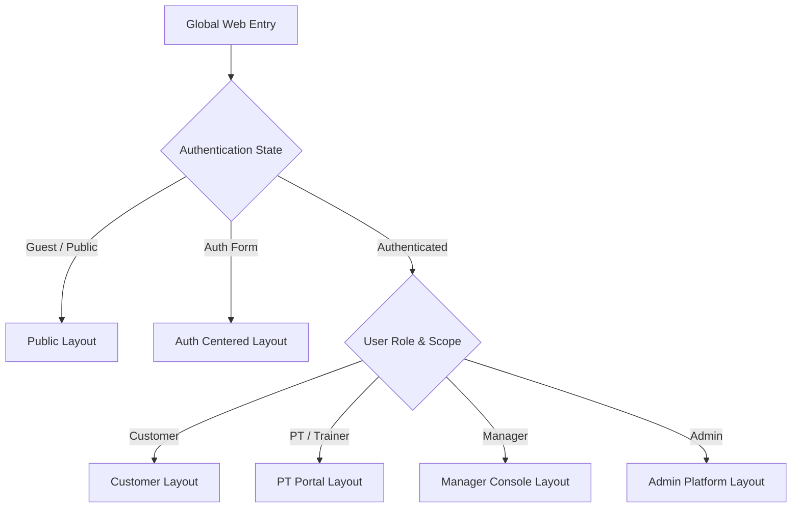

# Multi-Gym Platform — UI/UX Specification

**Tài liệu:** Đặc tả Giao diện & Trải nghiệm Người dùng (UI/UX Specification)  
**Phiên bản:** 1.0.0  
**Ngày phê duyệt:** 19/09/2026  
**Trạng thái:** Official Specification  
**Tài liệu tham chiếu:**
- [`docs/ARCHITECTURE_DECISIONS.md`](file:///srv/gym/docs/ARCHITECTURE_DECISIONS.md)
- [`docs/DOMAIN_RULES.md`](file:///srv/gym/docs/DOMAIN_RULES.md)
- [`docs/DATABASE_SPEC.md`](file:///srv/gym/docs/DATABASE_SPEC.md)
- [`docs/API_SPEC.md`](file:///srv/gym/docs/API_SPEC.md)
- [`docs/FEATURE_SPEC.md`](file:///srv/gym/docs/FEATURE_SPEC.md)
- Taste Skill (`.taste-skill/skills/minimalist-skill/SKILL.md`)

---

## 1. UI/UX PRINCIPLES

### 1.1. Triết Lý Thiết Kế (Design Direction)
Hệ thống Web tập Gym — Multi-Gym Platform được định vị là nền tảng quản trị và vận hành thể thao chuyên nghiệp. Định hướng thiết kế tuân thủ nghiêm ngặt **Taste Skill: Premium Utilitarian Minimalism & Editorial UI**:
- **Minimalist & Clean:** Giao diện tài liệu hóa (document-style), tập trung vào dữ liệu nghiệp vụ, cắt giảm tối đa các chi tiết trang trí rườm rà.
- **Modern & Professional:** Đậm chất kỹ thuật số, tin cậy, sắc nét.
- **Bảng màu chủ đạo:** Dark Navy (`#0B132B` / `#1C2541`), Crimson Red (`#DC2626` / `#B91C1C`), Pure White (`#FFFFFF`), Light Slate/Bone Gray (`#F8FAFC` / `#F1F5F9`).
- **Kiềm chế thị giác (Visual Restraint):**
  - Tuyệt đối **không sử dụng gradient đa sắc sặc sỡ**.
  - **Hạn chế shadow:** Không dùng drop-shadow đậm màu hay mờ ảo diện rộng; ưu tiên viền phẳng siêu mảnh (`1px solid #E2E8F0`).
  - **Hạn chế card lồng card (Card-in-card nesting):** Giảm thiểu phân mảnh giao diện thành quá nhiều ô hộp nhỏ.
  - **Border radius vừa phải:** Bo góc từ `4px` đến `8px` cho components; chỉ sử dụng `rounded-full` cho Status Badges và User Avatars.
  - **Micro-animation có mục đích:** Thời gian chuyển động ngắn ($\le 250\text{ms}$), gia tốc `ease-out`, phục vụ phản hồi xúc giác (hover, focus, modal open) thay vì hiệu ứng biểu diễn.

### 1.2. Phân Cấp Thị Giác (Visual Hierarchy)
- **Typographic Dominance:** Sử dụng độ tương phản kích thước và trọng lượng font để dẫn dắt mắt đọc thay vì dùng mảng màu nổi bật.
- **Khoảng trống chủ động (Macro-Whitespace):** Sử dụng padding và margin hào phóng (`24px` – `48px`) giữa các khối chức năng lớn để tạo cảm giác thoáng đãng, dễ đọc.
- **Màu nhấn có kiểm soát (Scarce Color):** Màu đỏ Crimson và các gam màu pastel nhạt chỉ xuất hiện tại các điểm kích hoạt hành động chính (Primary CTA), trạng thái cảnh báo hoặc tag định danh.

### 1.3. Bố Cục & Trình Bày (Layout Principles)
- **Khung lưới chuẩn:** Hệ thống CSS Grid / Flexbox đáp ứng theo chiều dọc (Vertical Rhythm) 4px.
- **Vùng nội dung trọng tâm:** Không thiết kế dashboard dạng "card grid dày đặc" (dense widget soup). Mỗi màn hình tập trung vào 1 bảng điều khiển cốt lõi hoặc 1 bảng dữ liệu chính kèm thanh công cụ thao tác rõ ràng.

### 1.4. Nguyên Tắc Thích Ứng (Responsive Principles)
- Hệ thống hỗ trợ hoàn chỉnh 3 nhóm thiết bị: Desktop ($\ge 1024\text{px}$), Tablet ($768\text{px} - 1023\text{px}$), Mobile ($< 768\text{px}$).
- **Không co ép dữ liệu Desktop xuống Mobile:** Trên màn hình nhỏ, các bảng dữ liệu phức tạp (Table) tự động chuyển sang dạng thẻ tóm tắt (Summary Cards) có khả năng xem chi tiết; Menu bên (Sidebar) ẩn vào Drawer trượt.

### 1.5. Trợ Năng & Dễ Tiếp Cận (Accessibility - WCAG AA)
- Độ tương phản chữ tối thiểu: `4.5:1` cho nội dung thông thường và `3:1` cho tiêu đề lớn.
- Bắt buộc hỗ trợ điều hướng hoàn toàn bằng bàn phím (Keyboard Navigation với Focus Ring rõ nét `outline: 2px solid #1C2541`).
- Mọi trường nhập liệu đều gắn nhãn tường minh `<label for="...">`, hỗ trợ đọc màn hình qua các thuộc tính ARIA (`aria-describedby`, `aria-invalid`, `aria-live`).

### 1.6. Trạng Thái Giao Diện Chuẩn Hóa (Standard UI States)
Mọi khối giao diện tải dữ liệu đều có 4 trạng thái bắt buộc:
1. **Loading State:** Sử dụng Skeleton Shimmer tông xám nhạt phẳng (`#F1F5F9` $\leftrightarrow$ `#E2E8F0`), giữ nguyên khung kích thước thật của nội dung để chống giật layout (Layout Shift).
2. **Empty State:** Biểu tượng đường nét tối giản (Minimal SVG Line Icon), 1 câu giải thích rõ ràng (ví dụ: *"Chưa có lịch hẹn nào sắp tới"*), và 1 nút bấm Primary CTA dẫn tới hành vi khởi tạo (nếu người dùng có quyền).
3. **Error State:** Khung cảnh báo màu đỏ pastel nhẹ (`#FEF2F2`), viền đỏ nhạt (`#FECACA`), thông điệp giải thích thân thiện và nút "Thử lại" (Retry Action).
4. **Success State:** Phản hồi xúc giác tức thì: Modal đóng lại, dòng dữ liệu mới chèn vào đầu bảng với viền sáng thoáng qua ($300\text{ms}$), kèm thông báo Toast nổi nhẹ góc dưới màn hình.

### 1.7. Biểu Mẫu & Xác Thực (Form Validation UX)
- **Inline Validation:** Kiểm tra lỗi ngay khi người dùng rời khỏi ô nhập liệu (`onBlur`). Khi đang gõ (`onChange`), nếu đã có lỗi thì xóa lỗi khi người dùng sửa đúng.
- **Disable Submit & Anti-Double-Click:** Khi đang gửi request (Pending/Submitting), nút bấm bị vô hiệu hóa, chuyển sang trạng thái Loading Spinner và ngăn chặn bấm nhiều lần.
- **Server Error Mapping:** Ánh xạ chính xác mã lỗi từ `API_SPEC.md` thành thông báo trực tiếp dưới trường tương ứng (ví dụ: `409` slot conflict, `400` invalid time range).

### 1.8. Hộp Thoại Xác Nhận (Confirmation Dialogs)
- Bắt buộc áp dụng cho mọi thao tác phá hủy (Destructive) hoặc thay đổi trạng thái lớn: Bãi nhiệm Manager, Chấm dứt PT, Hủy ca tập, Bảo lưu/Chấm dứt Thẻ, Đổi PT.
- Dialog gồm: Tiêu đề rõ ràng, mô tả hệ quả nghiệp vụ ngắn gọn, nút Hủy (Secondary) và nút Xác nhận (Destructive Red hoặc Solid Navy).

### 1.9. Cơ Chế Thông Báo (Toast Notification)
- Vị trí: Cố định góc dưới bên phải (`bottom-right`), nổi nhẹ trên nền trắng, viền mảnh `1px solid #E2E8F0`.
- Thời lượng: Tự biến mất sau `4000ms` đối với thành công (`Success`) / thông tin (`Info`); giữ nguyên cho tới khi bấm đóng đối với lỗi nghiêm trọng (`Error`).

---

## 2. DESIGN TOKENS

Toàn bộ giao diện sử dụng các biến CSS Design Tokens tập trung. Tuyệt đối không hard-code mã màu hay giá trị ad-hoc trong mã nguồn thành phần.

```css
:root {
  /* --- Brand & Monochrome Palette --- */
  --color-canvas: #FFFFFF;
  --color-canvas-subtle: #F8FAFC;
  --color-surface: #FFFFFF;
  --color-surface-hover: #F1F5F9;
  --color-border: #E2E8F0;
  --color-border-subtle: #F1F5F9;
  --color-border-strong: #CBD5E1;

  /* Typography Colors */
  --color-text-primary: #0F172A;     /* Slate 900 */
  --color-text-secondary: #475569;   /* Slate 600 */
  --color-text-muted: #94A3B8;       /* Slate 400 */
  --color-text-inverse: #FFFFFF;

  /* Dark Navy (Primary Accent) */
  --color-navy-900: #0B132B;
  --color-navy-800: #1C2541;
  --color-navy-700: #2F3E66;

  /* Crimson Red (Action & Destructive Accent) */
  --color-crimson-700: #B91C1C;
  --color-crimson-600: #DC2626;
  --color-crimson-500: #EF4444;
  --color-crimson-50: #FEF2F2;

  /* Semantic State Colors */
  --color-success-text: #166534;
  --color-success-bg: #DCFCE7;
  --color-warning-text: #854D0E;
  --color-warning-bg: #FEF9C3;
  --color-error-text: #991B1B;
  --color-error-bg: #FEE2E2;
  --color-info-text: #1E40AF;
  --color-info-bg: #DBEAFE;
  --color-neutral-text: #334155;
  --color-neutral-bg: #F1F5F9;

  /* --- Typography Hierarchy --- */
  --font-sans: -apple-system, BlinkMacSystemFont, "Segoe UI", Roboto, "Geist Sans", Helvetica, Arial, sans-serif;
  --font-mono: "Geist Mono", SFMono-Regular, Menlo, Monaco, Consolas, monospace;

  --text-display: 700 2rem/1.25 var(--font-sans);      /* 32px */
  --text-h1: 600 1.5rem/1.3 var(--font-sans);           /* 24px */
  --text-h2: 600 1.25rem/1.35 var(--font-sans);         /* 20px */
  --text-h3: 600 1rem/1.4 var(--font-sans);             /* 16px */
  --text-body: 400 0.875rem/1.5 var(--font-sans);       /* 14px */
  --text-body-medium: 500 0.875rem/1.5 var(--font-sans);
  --text-caption: 400 0.75rem/1.4 var(--font-sans);     /* 12px */
  --text-mono-data: 400 0.8125rem/1.4 var(--font-mono); /* 13px */

  /* --- Spacing Scale (4px Base) --- */
  --space-1: 4px;
  --space-2: 8px;
  --space-3: 12px;
  --space-4: 16px;
  --space-5: 20px;
  --space-6: 24px;
  --space-8: 32px;
  --space-10: 40px;
  --space-12: 48px;
  --space-16: 64px;

  /* --- Border Radius --- */
  --radius-sm: 4px;
  --radius-md: 6px;
  --radius-lg: 8px;
  --radius-full: 9999px;

  /* --- Elevation & Shadows (Subtle / Flat) --- */
  --shadow-none: none;
  --shadow-subtle: 0 1px 2px 0 rgba(15, 23, 42, 0.04);
  --shadow-dropdown: 0 4px 12px 0 rgba(15, 23, 42, 0.08);
  --shadow-modal: 0 8px 24px 0 rgba(15, 23, 42, 0.12);

  /* --- Motion / Timing --- */
  --motion-duration-fast: 150ms;
  --motion-duration-normal: 250ms;
  --motion-ease: cubic-bezier(0.16, 1, 0.3, 1);
}
```

---

## 3. GLOBAL LAYOUT ARCHITECTURE

Hệ thống phân tách rõ rệt thành 5 phân hệ giao diện tương ứng với các Actor và mức độ bảo vệ phạm vi:



### 3.1. Public Layout (Khách vãng lai & Tham quan)
- **Header:** Cố định trên đầu (Sticky), cao `64px`, gồm:
  - Trái: Logo Multi-Gym tối giản kèm khẩu hiệu thương hiệu.
  - Giữa: Menu điều hướng (`Phòng Gym`, `Gói Tập`, `Đội Ngũ PT`).
  - Phải: Nút "Đăng nhập" (Ghost Button) và "Đăng ký hội viên" (Solid Navy Button).
- **Body:** Container cực đại `max-w-7xl` căn giữa, lề hai bên tự thích ứng.
- **Footer:** Tối giản, tông xám nhạt, liệt kê danh sách cơ sở, thông tin liên hệ và giấy phép hoạt động.

### 3.2. Auth Centered Layout (Đăng nhập / Đăng ký)
- Bố cục cột đơn căn giữa màn hình (Single Column Centered, rộng tối đa `420px`).
- Nền trang `var(--color-canvas-subtle)`, hộp form nền trắng `var(--color-surface)` viền `1px solid var(--color-border)`.
- Không sử dụng hình ảnh minh họa lòe loẹt; tập trung trải nghiệm vào các ô nhập liệu và nút bấm chính.

### 3.3. Customer Layout (Hội viên / Khách hàng cá nhân)
- **Top Navigation Bar:** Tích hợp đầy đủ các chức năng cá nhân:
  - Brand Logo $\rightarrow$ Dashboard.
  - Links: `Tổng quan`, `Gói tập của tôi`, `Lịch PT`, `Phản ánh sự cố`.
  - Góc phải: Thông tin User Avatar, Họ tên, Tag Role `CUSTOMER` và Dropdown menu:
    - Hồ sơ cá nhân (`/profile`)
    - Đổi mật khẩu (`/profile/security`)
    - Đăng xuất (`POST /api/v1/auth/logout`)
- **Không có Sidebar:** Tối đa hóa diện tích ngang cho bảng theo dõi tiến độ buổi tập và lịch hẹn.

### 3.4. PT Layout (Huấn luyện viên cá nhân)
- **Giao diện Sidebar Cố Định Trái (Width `240px`):**
  - Khối định danh PT: Avatar, Họ tên, Role `PT`.
  - Danh mục:
    - `Tổng quan ca dạy` (`/pt/dashboard`)
    - `Lịch biểu tuần` (`/pt/schedule`)
    - `Học viên phụ trách` (`/pt/registrations`)
    - `Quản lý lịch hẹn` (`/pt/appointments`)
    - `Hồ sơ cá nhân` (`/pt/profile`)
- **Top Bar:** Hiển thị cố định Gym được phân công theo `Gym_Trainer.gym_id`, đồng hồ hệ thống và nút Đăng xuất. Không có Gym Selector hoặc danh sách nhiều Gym `ACTIVE`; PT không có cross-Gym access (`DOMAIN_RULES.md` §2.3).

### 3.5. Manager Layout (Quản lý điều hành cơ sở)
- **Khung Định Danh Gym Cố Định (Gym Context Banner):** Trên cùng của Sidebar luôn hiển thị cố định huy hiệu:
  > **CƠ SỞ HIỆN TẠI:** [Tên Phòng Gym]  
  > *Trạng thái:* `ACTIVE MANAGER`
  *(Tuyệt đối không có Gym Dropdown Selector vì mỗi Manager chỉ được quản lý duy nhất 1 cơ sở tại một thời điểm).*
- **Left Sidebar Navigation (Width `260px`):**
  - `Bàn làm việc` (`/manager/dashboard`)
  - `Thông tin cơ sở` (`/manager/gym`)
  - `Huấn luyện viên` (`/manager/trainers`)
  - `Gói tập cơ sở` (`/manager/packages`)
  - `Hợp đồng Hội viên` (`/manager/memberships`)
  - `Đăng ký & Đổi PT` (`/manager/pt-registrations`)
  - `Lịch hẹn PT toàn cơ sở` (`/manager/pt-appointments`)
  - `Xử lý sự cố & Phản ánh` (`/manager/reports`)
  - `Hồ sơ Quản lý` (`/manager/profile`)

### 3.6. Admin Layout (Quản trị viên toàn hệ thống)
- **Left Sidebar Navigation (Width `260px`):**
  - Huy hiệu: **SYSTEM ADMINISTRATOR**
  - `Báo cáo hệ thống` (`/admin/dashboard`)
  - `Quản trị cơ sở Gym` (`/admin/gyms`)
  - `Bổ nhiệm & Cấp Quản lý` (`/admin/managers`)
  - `Tài khoản & Phân quyền` (`/admin/users`)
  - `Giám sát phản ánh toàn sàn` (`/admin/reports`)
- **Top Bar:** Tìm kiếm điều hướng hệ thống (UI Suggestion: Command Palette tìm kiếm menu/route nội bộ phía client; hệ thống không có API Global Search liên thực thể), Breadcrumbs chi tiết và User Menu.

---

## 4. SCREEN INVENTORY

Danh mục toàn bộ 39 màn hình được chuẩn hóa, phân chia theo 5 Actor:

```
├── GUEST SCREENS (7)
│   ├── SCR-GST-001: Landing Page (Home)
│   ├── SCR-GST-002: Public Gym Directory (List)
│   ├── SCR-GST-003: Public Gym Detail
│   ├── SCR-GST-004: Public Gym Packages
│   ├── SCR-GST-005: Public Gym Trainers
│   ├── SCR-GST-006: Customer Register
│   └── SCR-GST-007: User Login
├── CUSTOMER SCREENS (9)
│   ├── SCR-CUS-001: Customer Dashboard
│   ├── SCR-CUS-002: Personal Profile & Security
│   ├── SCR-CUS-003: My Memberships List
│   ├── SCR-CUS-004: Membership Detail Card
│   ├── SCR-CUS-005: My PT Registrations
│   ├── SCR-CUS-006: PT Registration Detail & Sessions
│   ├── SCR-CUS-007: PT Appointments & Booking
│   ├── SCR-CUS-008: My Submitted Reports
│   └── SCR-CUS-009: Submit Gym Report Form
├── PT SCREENS (6)
│   ├── SCR-TRN-001: PT Dashboard
│   ├── SCR-TRN-002: PT Profile View
│   ├── SCR-TRN-003: Assigned Trainees & Registrations
│   ├── SCR-TRN-004: PT Appointments Management
│   ├── SCR-TRN-005: PT Appointment Execution Detail
│   └── SCR-TRN-006: PT Weekly Schedule Calendar
├── MANAGER SCREENS (10)
│   ├── SCR-MGR-001: Manager Dashboard
│   ├── SCR-MGR-002: Gym Information & Profile Edit
│   ├── SCR-MGR-003: Manager Profile View
│   ├── SCR-MGR-004: Gym Trainers Roster
│   ├── SCR-MGR-005: Onboard Trainer to Gym
│   ├── SCR-MGR-006: Gym Packages Catalog Management
│   ├── SCR-MGR-007: Gym Memberships Operations
│   ├── SCR-MGR-008: Gym PT Registrations & Trainer Reassignment
│   ├── SCR-MGR-009: Gym PT Master Appointments Calendar
│   └── SCR-MGR-010: Gym Incident Reports Resolution
└── ADMIN SCREENS (7)
    ├── SCR-ADM-001: Platform Admin Dashboard
    ├── SCR-ADM-002: Platform Users & Accounts Directory
    ├── SCR-ADM-003: System Roles & Permissions Viewer
    ├── SCR-ADM-004: Platform Gyms Management
    ├── SCR-ADM-005: Gym Facility Creation & Status Control
    ├── SCR-ADM-006: Manager Provisioning & Assignment Console
    └── SCR-ADM-007: System-wide Incident Reports Monitor
```

---

## 5. DETAILED SCREEN SPECIFICATIONS

Mỗi màn hình được đặc tả chi tiết các thuộc tính cấu trúc kỹ thuật.

### Nguyên Tắc Dữ Liệu & Hợp Đồng API Đối Với Giao Diện:
1. **Dữ liệu có sẵn từ Backend:** Mọi trường hiển thị, biểu mẫu và bộ lọc chuẩn được thiết kế dựa trên 12 bảng dữ liệu của [DATABASE_SPEC.md](file:///srv/gym/docs/DATABASE_SPEC.md) và query parameters chuẩn tại [API_SPEC.md](file:///srv/gym/docs/API_SPEC.md) (`page`, `pageSize`, `search` trên các trường text, `status` theo enum của từng thực thể, `sortBy`, `sortOrder`).
2. **Phần tử Tối ưu Trải nghiệm `(UI Suggestion)`:** Các phần tử như đồng hồ đếm ngược thời gian, sinh mã QR định danh từ UUID, mở nhanh modal điền sẵn thời gian, hoặc lọc/sắp xếp in-memory phía client trên tập dữ liệu đã tải là các cải tiến UX thuần túy được xử lý hoàn toàn phía Client. UI Spec tuyệt đối **không ngầm yêu cầu Backend** phải tạo thêm entity, cột dữ liệu hoặc API mới ngoài phạm vi hiện tại.
3. **Phần tử cần mở rộng schema/API (Future Extensibility):** Các nội dung chưa có trường dữ liệu trong Backend (tiện ích/giờ mở cửa phòng gym, API global search liên thực thể, kiểm toán lịch sử chi tiết) được ghi nhận minh bạch tại Mục 15 (Open Questions / Future Extensibility) để chờ Backend chuẩn hóa trước khi tích hợp.

---

### 5.1. Nhóm Màn Hình Khách Vãng Lai (Guest Screens)

#### SCR-GST-001: Landing Page (Trang Chủ Nền Tảng)
- **Screen ID:** `SCR-GST-001` | **Actor:** `Guest`, All Users | **Route:** `/` | **Scope:** Public.
- **Purpose:** Giới thiệu tổng quan hệ thống Multi-Gym, định hướng khách hàng tìm phòng tập và trải nghiệm dịch vụ.
- **Entry Points:** Truy cập URL gốc hoặc bấm Logo.
- **Main Content:**
  - Hero Section: Thông điệp cốt lõi, nút "Tìm phòng gym gần bạn" và "Khám phá gói tập".
  - Feature Highlights: Giới thiệu hệ thống đa cơ sở, đội ngũ huấn luyện viên chứng chỉ chuyên nghiệp.
  - Danh sách 3 phòng gym tiêu biểu đang ở trạng thái `ACTIVE`.
- **Components:** `PublicHeader`, `HeroBanner`, `GymShowcaseCard`, `PublicFooter`.
- **Actions:** Bấm chuyển trang xem danh sách Gym, Gói tập hoặc Đăng ký.
- **Permissions:** Public không yêu cầu đăng nhập.
- **States:** Loading: Skeleton thẻ; Empty: Không áp dụng; Error: Thông báo không tải được danh mục.

#### SCR-GST-002: Public Gym Directory (Danh Sách Phòng Gym)
- **Screen ID:** `SCR-GST-002` | **Actor:** `Guest`, All Users | **Route:** `/gyms` | **Scope:** Public.
- **Purpose:** Liệt kê các cơ sở phòng gym thuộc hệ sinh thái.
- **API Mapping:** `GET /api/v1/gyms` (`page`, `limit`).
- **Main Content:**
  - Danh sách dạng lưới phẳng (Grid 3 cột) hiển thị các cơ sở phòng tập.
  - Thông tin mỗi thẻ: Tên phòng tập, địa chỉ, số điện thoại hotline, trạng thái cơ sở (`ACTIVE`/`MAINTENANCE`).
- **Table/List Spec:**
  - Phân trang: Điều khiển trang kiểu số (`Pagination Controls`).
  - Bộ lọc: *(UI Suggestion)* Lọc theo trạng thái `ACTIVE`.
- **Actions:** Bấm vào thẻ để chuyển đến `SCR-GST-003`.
- **States:** Empty State: Hiển thị minh họa *"Hiện chưa có cơ sở phòng tập nào hoạt động"*.

#### SCR-GST-003: Public Gym Detail (Chi Tiết Phòng Gym)
- **Screen ID:** `SCR-GST-003` | **Actor:** `Guest`, All Users | **Route:** `/gyms/:gymId` | **Scope:** Public Resource.
- **Purpose:** Hiển thị thông tin cơ sở phòng gym (Tên, địa chỉ, hotline, trạng thái hoạt động từ API) và là cổng dẫn tới xem Gói tập / Đội ngũ PT của cơ sở.
- **API Mapping:** `GET /api/v1/gyms/:gymId`.
- **Main Content:**
  - Header: Tên Gym, Huy hiệu Trạng thái (`ACTIVE`/`MAINTENANCE`/`CLOSED`), Hotline, Địa chỉ đầy đủ (dữ liệu từ `GET /api/v1/gyms/:gymId`).
  - Tabs điều hướng con:
    - Tab 1: Thông tin cơ sở & Liên hệ (Hiển thị địa chỉ, hotline, trạng thái từ API; các nội dung bổ sung như giới thiệu, giờ mở cửa, tiện ích/cơ sở vật chất, thông tin pháp lý là **(UI Suggestion)** hiển thị dạng tĩnh phía client do entity `Gym` hiện tại chỉ chứa `name, address, phone_number, status`; xem Mục 15 STT 7).
    - Tab 2: Bảng giá Gói hội viên & PT (`SCR-GST-004`).
    - Tab 3: Đội ngũ Huấn luyện viên (`SCR-GST-005`).
- **Actions:** Bấm nút "Mua thẻ hội viên" hoặc "Đăng ký tập PT" $\rightarrow$ Nếu chưa đăng nhập, chuyển hướng sang `/login?returnUrl=...`.

#### SCR-GST-004: Public Gym Packages (Danh Sách Gói Tập Cơ Sở)
- **Screen ID:** `SCR-GST-004` | **Actor:** `Guest`, All Users | **Route:** `/gyms/:gymId/packages` | **Scope:** Public Resource.
- **Purpose:** Khách hàng tham khảo các gói tập đang mở bán (`ACTIVE`) tại đúng cơ sở phòng gym.
- **API Mapping:** `GET /api/v1/gyms/:gymId/packages`.
- **Main Content:** Thẻ gói tập hiển thị: Tên gói, loại gói (`MEMBERSHIP` / `PT`), thời hạn (`duration_months`), số buổi PT (`pt_session_count`), giá niêm yết (VND).
- **Actions:**
  - Bấm "Đăng ký gói" (Customer) $\rightarrow$ Mở Drawer xác nhận hợp đồng.
  - Bấm "Đăng ký gói" (Guest) $\rightarrow$ Điều hướng sang Đăng nhập.

#### SCR-GST-005: Public Gym Trainers (Đội Ngũ Huấn Luyện Viên Cơ Sở)
- **Screen ID:** `SCR-GST-005` | **Actor:** `Guest`, All Users | **Route:** `/gyms/:gymId/trainers` | **Scope:** Public Resource.
- **Purpose:** Giới thiệu danh sách PT đang công tác `ACTIVE` tại cơ sở.
- **API Mapping:** `GET /api/v1/gyms/:gymId/trainers`.
- **Main Content:** Danh sách PT: Họ tên, avatar, chuyên môn / tiểu sử (từ Profile), số năm kinh nghiệm.
- **Actions:** Bấm xem chi tiết PT $\rightarrow$ `GET /api/v1/gyms/:gymId/trainers/:trainerId`.

#### SCR-GST-006: Customer Register (Đăng Ký Tài Khoản Khách Hàng)
- **Screen ID:** `SCR-GST-006` | **Actor:** `Guest` | **Route:** `/register` | **Scope:** Public.
- **Purpose:** Khách hàng mới khởi tạo tài khoản đăng nhập và tự động nhận vai trò `CUSTOMER`.
- **API Mapping:** `POST /api/v1/auth/register`.
- **Form Specification:**
  - `email`: Bắt buộc, định dạng email hợp lệ, kiểm tra trùng lặp.
  - `password`: Bắt buộc, tối thiểu 8 ký tự, có chữ hoa, chữ thường và số.
  - `confirmPassword`: Bắt buộc, trùng khớp với `password`.
  - `full_name`: Bắt buộc, độ dài 2-100 ký tự.
  - `phone_number`: Không bắt buộc, định dạng số điện thoại chuẩn VN (10 chữ số).
- **Submit Behavior:** Gửi payload $\rightarrow$ Thành công: Tự động lưu HttpOnly Cookie, hiển thị Toast chúc mừng và chuyển hướng về `/dashboard`.
- **Error Handling:** Trùng email $\rightarrow$ Hiển thị lỗi inline tại ô Email: *"Email này đã được sử dụng trên hệ thống"*.

#### SCR-GST-007: User Login (Đăng Nhập Người Dùng)
- **Screen ID:** `SCR-GST-007` | **Actor:** `Guest` | **Route:** `/login` | **Scope:** Public.
- **Purpose:** Xác thực người dùng (mọi vai trò) thông qua tài khoản và mật khẩu.
- **API Mapping:** `POST /api/v1/auth/login`.
- **Form Specification:**
  - `email`: Bắt buộc.
  - `password`: Bắt buộc.
- **Submit Behavior:** Gửi request $\rightarrow$ Thành công: Server cấp Cookie; Client tự động gọi `GET /api/v1/auth/me` để định tuyến người dùng theo vai trò:
  - `ADMIN` $\rightarrow$ Chuyển tới `/admin/dashboard`.
  - `MANAGER` $\rightarrow$ Chuyển tới `/manager/dashboard`.
  - `PT` $\rightarrow$ Chuyển tới `/pt/dashboard`.
  - `CUSTOMER` $\rightarrow$ Chuyển tới `returnUrl` (nếu có) hoặc `/dashboard`.
- **Error Handling:** `401 INVALID_CREDENTIALS` $\rightarrow$ Hiển thị cảnh báo: *"Email hoặc mật khẩu không chính xác"*. Tài khoản bị khóa (`ACCOUNT_SUSPENDED`) $\rightarrow$ *"Tài khoản của bạn đã bị vô hiệu hóa. Vui lòng liên hệ ban quản trị"*.

---

### 5.2. Nhóm Màn Hình Hội Viên (Customer Screens)

#### SCR-CUS-001: Customer Dashboard (Bàn Làm Việc Hội Viên)
- **Screen ID:** `SCR-CUS-001` | **Actor:** `Customer` | **Route:** `/dashboard` | **Scope:** Personal Scope.
- **Purpose:** Cung cấp bức tranh toàn cảnh về tình trạng tập luyện cá nhân của Hội viên.
- **Main Content:**
  - Khối 1: Thẻ hội viên đang hoạt động (`ACTIVE`) gần nhất (Tên Gym, Ngày hết hạn, Trạng thái).
  - Khối 2: Tiến độ gói tập PT hiện tại (Số buổi đã hoàn thành / Tổng số buổi).
  - Khối 3: Lịch hẹn buổi tập kế tiếp (Thời gian, Huấn luyện viên, Địa điểm).
  - Khối 4: Danh sách các ca tập sắp diễn ra (`SCHEDULED`) trong 7 ngày tới.
- **Actions:** Bấm "Đặt lịch tập ngay" $\rightarrow$ Mở Modal đặt lịch (`FEAT-APP-001`).

#### SCR-CUS-002: Personal Profile & Security (Hồ Sơ & Bảo Mật)
- **Screen ID:** `SCR-CUS-002` | **Actor:** All Authenticated (`Customer`, `PT`, `Manager`, `Admin`) | **Route:** `/profile` | **Scope:** Personal Scope.
- **Purpose:** Quản lý thông tin định danh cá nhân và cập nhật mật khẩu.
- **API Mapping:** `GET /api/v1/users/me/profile`, `PATCH /api/v1/users/me/profile`, `POST /api/v1/auth/change-password`.
- **Forms:**
  - *Form 1 (Hồ sơ):* `full_name`, `phone_number`, `date_of_birth`, `avatar_url`. Bấm "Lưu thay đổi" $\rightarrow$ Cập nhật thông tin.
  - *Form 2 (Đổi mật khẩu):* `current_password`, `new_password`, `confirm_new_password`.

#### SCR-CUS-003: My Memberships List (Danh Sách Hợp Đồng Hội Viên Của Tôi)
- **Screen ID:** `SCR-CUS-003` | **Actor:** `Customer` | **Route:** `/memberships` | **Scope:** Personal Scope.
- **Purpose:** Theo dõi các thẻ hội viên thuộc chính Customer do `GET /api/v1/memberships/me` trả về, gồm trạng thái hiện tại và các hợp đồng trước đây.
- **Giới hạn nghiệp vụ:** Cột Gym nhận diện cơ sở của từng hợp đồng; không khẳng định Customer được có Membership `ACTIVE` đồng thời tại nhiều Gym. Chính sách này chưa quyết định (`DOMAIN_RULES.md` §9.1; `FEATURE_SPEC.md` §10 STT 1), xem Mục 15 STT 11.
- **API Mapping:** `GET /api/v1/memberships/me`.
- **Main Content:** Bảng danh sách (Table / Cards trên mobile):
  - Cột: Mã hợp đồng, Cơ sở phòng Gym, Tên gói tập, Ngày bắt đầu, Ngày kết thúc, Trạng thái (`PENDING_ACTIVATION`, `ACTIVE`, `SUSPENDED`, `EXPIRED`, `TERMINATED`).
  - Bộ lọc (Filters): Trạng thái (`Tất cả`, `PENDING_ACTIVATION`, `ACTIVE`, `SUSPENDED`, `EXPIRED`, `TERMINATED`).
- **Actions:** Bấm vào dòng để xem chi tiết (`SCR-CUS-004`).

#### SCR-CUS-004: Membership Detail Card (Chi Tiết Hợp Đồng Hội Viên)
- **Screen ID:** `SCR-CUS-004` | **Actor:** `Customer` | **Route:** `/memberships/:membershipId` | **Scope:** Resource Ownership (`membership.user_id === auth.user_id`).
- **Purpose:** Xem quy chế sử dụng thẻ, thời hạn và phòng gym bảo trợ hợp đồng.
- **API Mapping:** `GET /api/v1/memberships/:membershipId`.
- **Main Content:** Mã QR định danh hội viên (UI Suggestion: Render mã QR client-side từ chuỗi UUID của `membership.id` phục vụ đối chiếu tại quầy lễ tân; backend không cần lưu trữ hay trả về file ảnh QR), Địa chỉ phòng tập, Tình trạng kích hoạt (`status`), Mốc thời gian hiệu lực (`start_date`, `end_date`), Dòng thời gian cập nhật trạng thái (UI Suggestion: Hiển thị dựa trên `created_at`, `updated_at` và `status` hiện tại do hệ thống không có entity `Audit_Log` riêng).

#### SCR-CUS-005: My PT Registrations (Hợp Đồng Tập Huấn Luyện Viên Của Tôi)
- **Screen ID:** `SCR-CUS-005` | **Actor:** `Customer` | **Route:** `/pt-registrations` | **Scope:** Personal Scope.
- **Purpose:** Quản lý các gói đăng ký huấn luyện viên cá nhân (PT).
- **API Mapping:** `GET /api/v1/pt-registrations/me`.
- **Main Content:** Danh sách gói PT:
  - Thông tin: Tên cơ sở Gym, Huấn luyện viên phụ trách, Tổng số buổi, Số buổi đã hoàn thành (`completed_sessions`), Trạng thái (`ASSIGNED`, `IN_PROGRESS`, `COMPLETED`, `CANCELLED`).
  - Bộ lọc (Filters): Trạng thái (`Tất cả`, `ASSIGNED`, `IN_PROGRESS`, `COMPLETED`, `CANCELLED`).
  - Thanh tiến độ: $\frac{\text{completed\_sessions}}{\text{total\_sessions}} \times 100\%$.
- **Actions:** Bấm vào gói để xem chi tiết ca tập hoặc đặt lịch (`SCR-CUS-006`).

#### SCR-CUS-006: PT Registration Detail & Sessions (Chi Tiết Gói PT & Tiến Độ)
- **Screen ID:** `SCR-CUS-006` | **Actor:** `Customer` | **Route:** `/pt-registrations/:registrationId` | **Scope:** Resource Ownership.
- **Purpose:** Theo dõi cụ thể từng buổi tập trong gói và kích hoạt đặt lịch mới.
- **Main Content:**
  - Thẻ thông tin Huấn luyện viên phụ trách (Avatar, Tên, Số điện thoại liên hệ).
  - Chỉ số hiển thị: `available_sessions = total_sessions - (completed_sessions + scheduled_sessions)`, trong đó `scheduled_sessions` là số ca `SCHEDULED` thuộc đúng `registration_id`. Công thức dựa trên `FEATURE_SPEC.md` (`FEAT-APP-001`, §8.5) và `API_SPEC.md` §7.9.1; đây là giá trị tính để hiển thị, không phải field mới của schema/API. Chỉ hiển thị số khả dụng khi có đủ dữ liệu để đếm, không lấy số ca của một trang phân trang làm tổng. Backend kiểm tra quota khi đặt lịch và quyết định kết quả.
  - Bảng danh sách các ca tập thuộc gói này: Ngày giờ, Trạng thái ca tập (`SCHEDULED`, `COMPLETED`, `CANCELLED`, `NO_SHOW`).
- **Actions:** Nút "Đặt ca tập mới" $\rightarrow$ Kích hoạt Modal đặt lịch `FEAT-APP-001`.

#### SCR-CUS-007: PT Appointments & Booking (Lịch Hẹn PT & Đặt Ca Tập)
- **Screen ID:** `SCR-CUS-007` | **Actor:** `Customer` | **Route:** `/pt-appointments` | **Scope:** Personal Scope.
- **Purpose:** Quản lý toàn bộ lịch hẹn các ca tập cá nhân, thực hiện đổi lịch hoặc hủy ca.
- **API Mapping:**
  - Danh sách: `GET /api/v1/pt-appointments/me`.
  - Đặt lịch: `POST /api/v1/gyms/:gymId/pt-appointments`.
  - Đổi giờ: `PATCH /api/v1/gyms/:gymId/pt-appointments/:id/reschedule`.
  - Hủy lịch: `PATCH /api/v1/gyms/:gymId/pt-appointments/:id/cancel`.
- **Modal Specification - Đặt Lịch Hẹn Mới (`FEAT-APP-001`):**
  - Trường chọn Gói PT: Danh sách hợp đồng đang `ASSIGNED` hoặc `IN_PROGRESS`.
  - Trường chọn Ngày: DatePicker (chỉ cho phép chọn ngày hiện tại hoặc tương lai).
  - Trường chọn Khung giờ: `start_time` và `end_time` (bắt buộc `end_time > start_time`).
  - Nút bấm: "Xác nhận đặt ca tập" (Có trạng thái Pending).
  - Lỗi `409 APPOINTMENT_TRAINER_SLOT_CONFLICT`: Thông báo *"Huấn luyện viên đã có lịch dạy trong khung giờ này. Vui lòng chọn giờ khác"*.
  - Lỗi `409 APPOINTMENT_CUSTOMER_SLOT_CONFLICT`: Thông báo *"Bạn đã có một buổi tập khác trùng khung giờ này"*.
- **Hành động Hủy Lịch:** Hiển thị cho các ca tập ở trạng thái `SCHEDULED`. Bấm "Hủy buổi tập" $\rightarrow$ Modal xác nhận $\rightarrow$ Gửi yêu cầu tới `PATCH /api/v1/gyms/:gymId/pt-appointments/:id/cancel`. UI phản hồi theo kết quả do Backend trả về (nếu Backend từ chối do vi phạm quy định hủy lịch, hiển thị thông báo lỗi từ máy chủ).

#### SCR-CUS-008: My Submitted Reports (Lịch Sử Phản Ánh Của Tôi)
- **Screen ID:** `SCR-CUS-008` | **Actor:** `Customer` | **Route:** `/reports` | **Scope:** Personal Scope.
- **Purpose:** Khách hàng theo dõi tiến độ xử lý các phản ánh, khiếu nại đã gửi tới Ban Quản Lý.
- **API Mapping:** `GET /api/v1/reports/me`.
- **Main Content:** Bảng danh sách:
  - Cột: Mã phản ánh (`id`), Cơ sở phòng tập (tham chiếu `gym_id`; tên Gym lấy từ dữ liệu Gym đã tải), Tiêu đề (`title`), Ngày gửi (`created_at`), Huy hiệu trạng thái (`status`: `SUBMITTED`, `INVESTIGATING`, `RESOLVED`, `REJECTED`), Ngày xử lý xong (`resolved_at`, hiển thị “—” khi null). Không thêm field vào `Gym_Report` (`DATABASE_SPEC.md` §3.12; `API_SPEC.md` §7.10).
  - Bộ lọc (Filters): Trạng thái (`Tất cả`, `SUBMITTED`, `INVESTIGATING`, `RESOLVED`, `REJECTED`).

#### SCR-CUS-009: Submit Gym Report Form (Gửi Phản Ánh Sự Cố Phòng Gym)
- **Screen ID:** `SCR-CUS-009` | **Actor:** `Customer` | **Route:** `/gyms/:gymId/reports/new` | **Scope:** Personal / Gym Scope.
- **Purpose:** Khách hàng gửi báo cáo sự cố kỹ thuật hoặc chất lượng dịch vụ tới Ban Quản Lý cơ sở.
- **API Mapping:** `POST /api/v1/gyms/:gymId/reports`.
- **Form Specification:**
  - Ngữ cảnh Gym: Cố định theo `:gymId` trên URL, không gửi `gym_id` trong request body.
  - `title`: Bắt buộc, chuỗi từ 5 đến 200 ký tự, áp dụng validation `.min(5).max(200).trim()` theo API.
  - `description`: Bắt buộc, chuỗi từ 10 đến 3000 ký tự, áp dụng validation `.min(10).max(3000).trim()` theo API.
  - `image_url`: Tùy chọn hoặc null, URL hợp lệ tối đa 2048 ký tự; tối đa đúng 01 ảnh (`INV-008`).
- **Contract:** Body chỉ gồm `title`, `description`, `image_url` theo `API_SPEC.md` §7.10.1. Các field này đã tồn tại trong `DATABASE_SPEC.md` §3.12; `user_id` lấy từ phiên đăng nhập ở Backend, các field trạng thái/timestamps do Backend quản lý.
- **Submit Behavior:** Thành công $\rightarrow$ Chuyển về `/reports` kèm Toast: *"Đã gửi phản ánh thành công tới Ban Quản Lý phòng gym"*.

---

### 5.3. Nhóm Màn Hình Huấn Luyện Viên (PT Screens)

#### SCR-TRN-001: PT Dashboard (Bàn Làm Việc Huấn Luyện Viên)
- **Screen ID:** `SCR-TRN-001` | **Actor:** `PT` | **Route:** `/pt/dashboard` | **Scope:** PT Assigned / Gym được phân công.
- **Purpose:** Tổng hợp lịch dạy trong ngày và danh sách học viên cần tương tác.
- **Main Content:**
  - Thẻ 1: Số ca dạy hôm nay.
  - Thẻ 2: Số hợp đồng học viên đang hướng dẫn (hợp đồng `ASSIGNED` hoặc `IN_PROGRESS`).
  - Thẻ 3: Ca dạy kế tiếp sắp bắt đầu (UI Suggestion: Đồng hồ đếm ngược được tính toán client-side từ `start_time` của ca `SCHEDULED` gần nhất so với thời gian hiện tại; không yêu cầu field mới từ API).
  - Bảng: Lịch dạy hôm nay (Giờ tập, Tên học viên, Phòng tập, Thao tác nhanh: Hoàn thành / Vắng mặt).

#### SCR-TRN-002: PT Profile View (Hồ Sơ Nghề Nghiệp Huấn Luyện Viên)
- **Screen ID:** `SCR-TRN-002` | **Actor:** `PT` | **Route:** `/pt/profile` | **Scope:** Hồ sơ cá nhân / thông tin Gym được phân công.
- **Purpose:** Xem hồ sơ cá nhân và thông tin phân công `Gym_Trainer` tại Gym trực thuộc, gồm trạng thái do API trả về (`ACTIVE`, `ON_LEAVE`, `TERMINATED`). Không thiết kế danh sách nhiều Gym đang công tác hoặc quyền chuyển Gym; trạng thái phân công không mở rộng quyền truy cập dữ liệu ngoài Gym được phân công.

#### SCR-TRN-003: Assigned Trainees (Danh Sách Học Viên Phụ Trách)
- **Screen ID:** `SCR-TRN-003` | **Actor:** `PT` | **Route:** `/pt/registrations` | **Scope:** PT Assigned / Gym được phân công.
- **API Mapping:** `GET /api/v1/pt-registrations/me`.
- **Main Content:** Danh sách các hợp đồng PT mà huấn luyện viên được phân công tại Gym trực thuộc (`trainer_id` tham chiếu `Gym_Trainer.id`, với `Gym_Trainer.user_id === auth.user_id` và đúng `gym_id`; theo `FEAT-PTR-002`):
  - Cột: Tên học viên, Số điện thoại, Tên gói tập, Tổng số buổi, Số buổi đã hoàn thành (`completed_sessions`), Trạng thái (`ASSIGNED`, `IN_PROGRESS`, `COMPLETED`, `CANCELLED`).
  - Bộ lọc (Filters): Trạng thái (`Tất cả`, `ASSIGNED`, `IN_PROGRESS`, `COMPLETED`, `CANCELLED`).
- **Actions:** Bấm vào học viên để xem lịch sử ca tập; tạo lịch cho hợp đồng được phân công tại đúng Gym qua `POST /api/v1/gyms/:gymId/pt-appointments`. Quyền PT tạo lịch được xác nhận tại `API_SPEC.md` §7.9.1 và `FEATURE_SPEC.md` `FEAT-APP-001`; chỉ chọn hợp đồng `ASSIGNED`/`IN_PROGRESS`, Backend kiểm tra scope, quota và thời gian.

#### SCR-TRN-004: PT Appointments Management (Quản Lý Ca Dạy PT)
- **Screen ID:** `SCR-TRN-004` | **Actor:** `PT` | **Route:** `/pt/appointments` | **Scope:** PT Assigned / Gym được phân công.
- **API Mapping:** `GET /api/v1/pt-appointments/me`.
- **Filters:** Trạng thái (`SCHEDULED`, `COMPLETED`, `CANCELLED`, `NO_SHOW`), Khoảng thời gian (Hôm nay, Tuần này, Tháng này - UI Suggestion: Lọc in-memory client-side trên dữ liệu danh sách ca tập đã tải).
- **Row Actions:**
  - Hoàn thành ca tập (`FEAT-APP-002` $\rightarrow$ `PATCH /complete`).
  - Điểm danh vắng mặt (`FEAT-APP-003` $\rightarrow$ `PATCH /no-show`).
  - Dời giờ tập (`FEAT-APP-004` $\rightarrow$ Mở Modal dời giờ).

#### SCR-TRN-005: Appointment Execution Detail (Chi Tiết & Xác Nhận Buổi Tập)
- **Screen ID:** `SCR-TRN-005` | **Actor:** `PT` | **Route:** `/pt/appointments/:appointmentId` | **Scope:** PT Assigned / Gym được phân công.
- **Purpose:** Xem chi tiết hợp đồng, thời gian bắt đầu/kết thúc và thực hiện xác nhận kết quả ca tập.
- **Actions:**
  - Nút "Xác nhận hoàn thành ca tập": Gửi yêu cầu `PATCH /api/v1/gyms/:gymId/pt-appointments/:id/complete` (Chuyển sang `COMPLETED`, hệ thống Backend tự động cộng 1 buổi vào `completed_sessions` theo quy định tại `DOMAIN_RULES.md`).
  - Nút "Ghi nhận học viên vắng mặt": Gửi yêu cầu `PATCH /api/v1/gyms/:gymId/pt-appointments/:id/no-show` (Chuyển sang `NO_SHOW`; UI không tự quyết định việc có cộng vào `completed_sessions` hay không, chính sách tính buổi khi vắng mặt đang là Open Question).

#### SCR-TRN-006: PT Weekly Schedule Calendar (Lịch Biểu Tuần Huấn Luyện Viên)
- **Screen ID:** `SCR-TRN-006` | **Actor:** `PT` | **Route:** `/pt/schedule` | **Scope:** PT Assigned / Gym được phân công.
- **Purpose:** Trực quan hóa lịch giảng dạy của PT tại Gym được phân công dưới dạng thời khóa biểu 7 ngày (Thứ 2 đến Chủ nhật).
- **API Mapping:** `GET /api/v1/pt-appointments/me`; dữ liệu hiển thị giới hạn theo PT phụ trách và Gym được phân công, không tổng hợp lịch cross-Gym.
- **Interactive:**
  - Khung giờ có ca `SCHEDULED` hiển thị khối màu Navy kèm tên học viên và tên phòng gym.
  - Bấm vào khung giờ trống: Mở nhanh Modal tạo lịch hẹn cho hợp đồng PT đang phụ trách tại đúng Gym, trạng thái `ASSIGNED`/`IN_PROGRESS`. Quyền tạo lịch đã được xác nhận tại `API_SPEC.md` §7.9.1 và `FEATURE_SPEC.md` `FEAT-APP-001`, dùng `POST /api/v1/gyms/:gymId/pt-appointments`. Pre-fill `start_time`/`end_time` là UI Suggestion phía client; vẫn kiểm tra `start_time > now()`, `end_time > start_time` và xử lý lỗi quota/scope/trùng lịch từ Backend. Không có hợp đồng hợp lệ thì chỉ xem lịch.

---

### 5.4. Nhóm Màn Hình Quản Lý Cơ Sở (Manager Screens)

#### SCR-MGR-001: Manager Dashboard (Bàn Làm Việc Quản Lý Phòng Gym)
- **Screen ID:** `SCR-MGR-001` | **Actor:** `Manager` | **Route:** `/manager/dashboard` | **Scope:** Gym Scope (Cơ sở phân công `ACTIVE`).
- **Purpose:** Theo dõi toàn diện chỉ số vận hành của đúng cơ sở phòng gym mình phụ trách.
- **Main Content:**
  - Huy hiệu cố định: **Phòng Gym: [Tên Cơ Sở]** | Trạng thái cơ sở: `ACTIVE`.
  - 4 Thẻ chỉ số cốt lõi:
    - Tổng hội viên đang hoạt động (`ACTIVE Memberships`).
    - Số hợp đồng PT đang thực hiện (`IN_PROGRESS PT Registrations`).
    - Số ca tập PT diễn ra hôm nay.
    - Sự cố đang chờ xử lý (`SUBMITTED Reports`).
  - Khối truy cập nhanh: Danh sách 5 phản ánh mới nhất và 5 ca tập sắp bắt đầu tại cơ sở.

#### SCR-MGR-002: Gym Information & Profile Edit (Cập Nhật Thông Tin Cơ Sở)
- **Screen ID:** `SCR-MGR-002` | **Actor:** `Manager`, `Admin` | **Route:** `/manager/gym` | **Scope:** Gym Scope (Active Manager).
- **API Mapping:** `GET /api/v1/gyms/:gymId`, `PATCH /api/v1/gyms/:gymId`.
- **Form Specification:**
  - `name`: Tên phòng gym (bắt buộc, 3-100 ký tự).
  - `address`: Địa chỉ cơ sở (bắt buộc, 5-255 ký tự).
  - `phone_number`: Số điện thoại hotline (bắt buộc, 10 ký tự số).
  *(Lưu ý: Cột `status` của Gym là thuộc tính bất biến đối với Manager, chỉ Admin mới có quyền đổi trạng thái qua API riêng).*

#### SCR-MGR-003: Manager Profile View (Hồ Sơ Quản Lý)
- **Screen ID:** `SCR-MGR-003` | **Actor:** `Manager` | **Route:** `/manager/profile` | **Scope:** Personal Scope.
- **Purpose:** Quản lý tài khoản cá nhân, mật khẩu và xem quyết định bổ nhiệm `Gym_Manager` tại phòng tập.

#### SCR-MGR-004: Gym Trainers Roster (Quản Lý Huấn Luyện Viên Cơ Sở)
- **Screen ID:** `SCR-MGR-004` | **Actor:** `Manager` | **Route:** `/manager/trainers` | **Scope:** Gym Scope.
- **API Mapping:** `GET /api/v1/gyms/:gymId/trainers`, `PATCH /api/v1/gyms/:gymId/trainers/:trainerId/status`.
- **Table Specification:**
  - Cột: Họ tên PT, Email, Điện thoại, Ngày ký hợp đồng, Trạng thái (`ACTIVE`, `ON_LEAVE`, `TERMINATED`).
  - Bộ lọc (Filters): Trạng thái (`Tất cả`, `ACTIVE`, `ON_LEAVE`, `TERMINATED`).
  - Thao tác:
    - Nút "Cho nghỉ phép" (`ACTIVE` $\rightarrow$ `ON_LEAVE`).
    - Nút "Kích hoạt lại" (`ON_LEAVE` $\rightarrow$ `ACTIVE`).
    - Nút "Chấm dứt hợp đồng" (`ACTIVE`/`ON_LEAVE` $\rightarrow$ `TERMINATED` - Hành động không thể đảo ngược).
- **Actions:** Nút "Tiếp nhận PT mới vào cơ sở" $\rightarrow$ Chuyển tới `SCR-MGR-005`.

#### SCR-MGR-005: Onboard Trainer to Gym (Tiếp Nhận Huấn Luyện Viên)
- **Screen ID:** `SCR-MGR-005` | **Actor:** `Manager` | **Route:** `/manager/trainers/assign` | **Scope:** Gym Scope.
- **API Mapping:** `POST /api/v1/gyms/:gymId/trainers`.
- **Form Specification:**
  - `user_id`: Định danh người dùng đã có tài khoản và vai trò `PT`.
- **Validation:** Nếu người dùng này đã có hợp đồng tại Gym này $\rightarrow$ Báo lỗi trùng lặp `409 TRAINER_ALREADY_ASSIGNED_TO_GYM`.

#### SCR-MGR-006: Gym Packages Catalog Management (Quản Lý Gói Tập Cơ Sở)
- **Screen ID:** `SCR-MGR-006` | **Actor:** `Manager` | **Route:** `/manager/packages` | **Scope:** Gym Scope.
- **API Mapping:** `GET /api/v1/gyms/:gymId/packages`, `POST /api/v1/gyms/:gymId/packages`, `PATCH .../activate`, `PATCH .../deactivate`.
- **Table Specification:**
  - Cột: Tên gói, Phân loại (`MEMBERSHIP`/`PT`), Thời hạn (tháng), Số buổi PT, Giá niêm yết (VND), Trạng thái (`ACTIVE`/`INACTIVE`).
  - Bộ lọc (Filters): Trạng thái (`Tất cả`, `ACTIVE`, `INACTIVE`), Phân loại (`Tất cả`, `MEMBERSHIP`, `PT`).
  - Thao tác: Nút "Ngừng bán" (Deactivate) / "Mở bán lại" (Activate), Nút "Sửa thông tin".
- **Form Tạo Mới / Chỉnh Sửa Gói:**
  - `name`: Tên gói (bắt buộc, 3-100 ký tự).
  - `package_type`: Chọn `MEMBERSHIP` hoặc `PT`.
  - `price`: Giá tiền (bắt buộc, số dương $\ge 0$).
  - `duration_months`: Số tháng hiệu lực (bắt buộc, $\ge 1$).
  - `pt_session_count`: Số buổi tập PT (nếu loại là `PT` thì $\ge 1$, nếu `MEMBERSHIP` thì bằng 0).

#### SCR-MGR-007: Gym Memberships Operations (Vận Hành Thẻ Hội Viên Cơ Sở)
- **Screen ID:** `SCR-MGR-007` | **Actor:** `Manager` | **Route:** `/manager/memberships` | **Scope:** Gym Scope.
- **API Mapping:** `GET /api/v1/gyms/:gymId/memberships`, `POST /api/v1/gyms/:gymId/memberships`, `PATCH .../activate`, `PATCH .../suspend`, `PATCH .../terminate`.
- **Table Specification:**
  - Cột: Mã hợp đồng, Họ tên hội viên, Gói tập, Ngày bắt đầu, Ngày kết thúc, Trạng thái (`PENDING_ACTIVATION`, `ACTIVE`, `SUSPENDED`, `EXPIRED`, `TERMINATED`).
  - Bộ lọc (Filters): Trạng thái (`Tất cả`, `PENDING_ACTIVATION`, `ACTIVE`, `SUSPENDED`, `EXPIRED`, `TERMINATED`).
- **Thao tác Nghiệp Vụ Tại Quầy:**
  - *Tạo thẻ cho khách:* Chọn `customer_id` khách hàng + Gói tập $\rightarrow$ Tạo hợp đồng `PENDING_ACTIVATION`.
  - *Kích hoạt thẻ:* Sau khi đủ điều kiện kích hoạt theo quy trình nghiệp vụ ngoài hệ thống $\rightarrow$ Manager thực hiện "Kích hoạt" (`PENDING_ACTIVATION` $\rightarrow$ `ACTIVE`).
  - *Bảo lưu thẻ:* Khách có đơn xin tạm dừng $\rightarrow$ Bấm "Bảo lưu" (`ACTIVE` $\rightarrow$ `SUSPENDED`).
  - *Mở lại bảo lưu:* Bấm "Mở bảo lưu" (`SUSPENDED` $\rightarrow$ `ACTIVE`).
  - *Chấm dứt thẻ vi phạm:* Bấm "Chấm dứt thẻ" (`ACTIVE`/`SUSPENDED` $\rightarrow$ `TERMINATED`).

#### SCR-MGR-008: Gym PT Registrations & Trainer Reassignment (Đăng Ký & Điều Chuyển PT)
- **Screen ID:** `SCR-MGR-008` | **Actor:** `Manager` | **Route:** `/manager/pt-registrations` | **Scope:** Gym Scope.
- **API Mapping:** `GET /api/v1/gyms/:gymId/pt-registrations`, `PATCH /api/v1/gyms/:gymId/pt-registrations/:id/assign` (`FEAT-PTR-004`), `PATCH /api/v1/gyms/:gymId/pt-registrations/:id/cancel`.
- **Table Specification:**
  - Cột: Mã hợp đồng, Học viên, Huấn luyện viên phụ trách, Gói tập, Tiến độ buổi tập (`completed_sessions`/`total_sessions`), Trạng thái (`ASSIGNED`, `IN_PROGRESS`, `COMPLETED`, `CANCELLED`).
  - Bộ lọc (Filters): Trạng thái (`Tất cả`, `ASSIGNED`, `IN_PROGRESS`, `COMPLETED`, `CANCELLED`), Huấn luyện viên.
- **Thao Tác Điều Chuyển Huấn Luyện Viên (`FEAT-PTR-004`):**
  - Quản lý chọn hợp đồng mục tiêu $\rightarrow$ Bấm "Đổi Huấn luyện viên".
  - Form điều chuyển: Hiển thị danh sách các Huấn luyện viên đang ở trạng thái `ACTIVE` tại cùng cơ sở để Quản lý chọn `new_trainer_id`.
  - Gửi yêu cầu: Submit `PATCH /api/v1/gyms/:gymId/pt-registrations/:id/assign`.
  - Phản hồi từ Backend:
    - *Thành công (200 OK):* Hợp đồng cập nhật sang PT mới, UI hiển thị Toast thông báo thành công và cập nhật lại bảng dữ liệu.
    - *Thất bại (4xx / 409):* UI hiển thị thông báo lỗi do Backend trả về (ví dụ: PT không hợp lệ hoặc Backend từ chối do chính sách lịch hẹn chưa được giải quyết).
  - *(Lưu ý: UI không tự ý áp đặt quy tắc khóa thao tác hay bắt buộc người dùng phải tự hủy các ca tập trước khi đổi PT; hành vi xử lý ca tập `SCHEDULED` đang là Open Question / Conflict giữa API Spec và Feature Spec, được theo dõi tại Mục 15 STT 4).*

#### SCR-MGR-009: Gym PT Master Appointments Calendar (Lịch Vận Hành Ca Tập Phòng Gym)
- **Screen ID:** `SCR-MGR-009` | **Actor:** `Manager` | **Route:** `/manager/pt-appointments` | **Scope:** Gym Scope.
- **Purpose:** Giám sát toàn bộ các ca tập PT đang diễn ra tại cơ sở phòng gym.
- **Chế độ xem:** Dạng Bảng danh sách hoặc Dạng Lịch tổng hợp (Master Calendar View).
- **Bộ lọc (Filters):** Lọc theo Huấn luyện viên, Trạng thái ca tập (`Tất cả`, `SCHEDULED`, `COMPLETED`, `CANCELLED`, `NO_SHOW`), Ngày trong tháng.

#### SCR-MGR-010: Gym Incident Reports Resolution (Xử Lý Sự Cố & Phản Ánh Cơ Sở)
- **Screen ID:** `SCR-MGR-010` | **Actor:** `Manager` | **Route:** `/manager/reports` | **Scope:** Gym Scope.
- **API Mapping:** `GET /api/v1/gyms/:gymId/reports`, `PATCH .../investigate`, `PATCH .../resolve`, `PATCH .../reject`.
- **Table Specification:**
  - Cột: Mã phản ánh, Người gửi, Tiêu đề sự cố, Ngày gửi, Trạng thái (`SUBMITTED`, `INVESTIGATING`, `RESOLVED`, `REJECTED`), Ngày xử lý (`resolved_at`).
  - Bộ lọc (Filters): Trạng thái (`Tất cả`, `SUBMITTED`, `INVESTIGATING`, `RESOLVED`, `REJECTED`).
- **Workflow Trực Quan:**
  - Báo cáo `SUBMITTED`: Quản lý bấm "Tiếp nhận xử lý" $\rightarrow$ Chuyển sang `INVESTIGATING`.
  - Đang xử lý: Sau khi kỹ thuật sửa xong $\rightarrow$ Bấm "Đã khắc phục" $\rightarrow$ Chuyển sang `RESOLVED` (hệ thống tự lưu `resolved_at = now()`).
  - Báo cáo sai sự thật / spam: Bấm "Từ chối phản ánh" $\rightarrow$ Xác nhận thao tác $\rightarrow$ Gọi API reject và hiển thị `REJECTED` khi thành công. Không nhập/gửi lý do vì contract §7.10.4 chưa có field này.

---

### 5.5. Nhóm Màn Hình Quản Trị Hệ Thống (Admin Screens)

#### SCR-ADM-001: Platform Admin Dashboard (Bàn Làm Việc Ban Quản Trị Toàn Sàn)
- **Screen ID:** `SCR-ADM-001` | **Actor:** `Admin` | **Route:** `/admin/dashboard` | **Scope:** System Scope.
- **Purpose:** Thống kê vĩ mô toàn sàn: Tổng số cơ sở Gym (`ACTIVE`, `MAINTENANCE`), Tổng tài khoản người dùng, Tổng phản ánh sự cố chưa xử lý.

#### SCR-ADM-002: Platform Users & Accounts Directory (Quản Lý Tài Khoản Toàn Sàn)
- **Screen ID:** `SCR-ADM-002` | **Actor:** `Admin` | **Route:** `/admin/users` | **Scope:** System Scope.
- **API Mapping:** `GET /api/v1/admin/users`, `PATCH /api/v1/admin/users/:userId/status`.
- **Table Specification:**
  - Cột: ID, Email, Họ tên, Các vai trò hiện có (`User_Role`), Trạng thái tài khoản (`ACTIVE`, `SUSPENDED`, `DEACTIVATED`), Ngày tạo.
  - Bộ lọc (Filters): Trạng thái (`Tất cả`, `ACTIVE`, `SUSPENDED`, `DEACTIVATED`), Vai trò (`Tất cả`, `CUSTOMER`, `PT`, `MANAGER`, `ADMIN`).
  - Thao tác: Khóa tài khoản (`SUSPENDED`) / Mở khóa tài khoản (`ACTIVE`) / Ngừng kích hoạt (`DEACTIVATED`).

#### SCR-ADM-003: System Roles & Permissions Viewer (Xem Danh Mục Vai Trò Hệ Thống)
- **Screen ID:** `SCR-ADM-003` | **Actor:** `Admin` | **Route:** `/admin/roles` | **Scope:** System Scope.
- **Purpose:** Xem 4 vai trò cố định của hệ sinh thái (`CUSTOMER`, `PT`, `MANAGER`, `ADMIN`) và quy chế phân quyền RBAC.

#### SCR-ADM-004: Platform Gyms Management (Danh Sách Cơ Sở Toàn Sàn)
- **Screen ID:** `SCR-ADM-004` | **Actor:** `Admin` | **Route:** `/admin/gyms` | **Scope:** System Scope.
- **API Mapping:** `GET /api/v1/gyms` (Admin View - Xem cả cơ sở `MAINTENANCE` và `CLOSED`).
- **Table Specification:**
  - Cột: Tên cơ sở, Địa chỉ, Hotline, Manager điều hành hiện tại (`ACTIVE`), Trạng thái phòng tập (`ACTIVE`, `MAINTENANCE`, `CLOSED`).
  - Bộ lọc (Filters): Trạng thái (`Tất cả`, `ACTIVE`, `MAINTENANCE`, `CLOSED`).
- **Actions:** Nút "Thêm phòng gym mới" $\rightarrow$ Mở `SCR-ADM-005`.

#### SCR-ADM-005: Gym Facility Creation & Status Control (Tạo Mới & Đổi Trạng Thái Phòng Gym)
- **Screen ID:** `SCR-ADM-005` | **Actor:** `Admin` | **Route:** `/admin/gyms/:gymId` | **Scope:** System Scope.
- **API Mapping:** `POST /api/v1/gyms` (`FEAT-GYM-001`), `PATCH /api/v1/gyms/:gymId/status` (`FEAT-GYM-003`).
- **Form Tạo Mới:** `name`, `address`, `phone_number`. Tự động tạo Gym ở trạng thái `ACTIVE`.
- **Hành Động Đổi Trạng Thái:**
  - Nút "Tạm ngừng bảo trì" $\rightarrow$ `MAINTENANCE`.
  - Nút "Mở cửa hoạt động lại" $\rightarrow$ `ACTIVE`.
  - Nút "Đóng cửa vĩnh viễn" $\rightarrow$ `CLOSED` (Yêu cầu nhập xác nhận văn bản: *"ĐỒNG Ý ĐÓNG CỬA"*).

#### SCR-ADM-006: Manager Provisioning & Assignment Console (Khởi Tạo & Bổ Nhiệm Quản Lý)
- **Screen ID:** `SCR-ADM-006` | **Actor:** `Admin` | **Route:** `/admin/managers` | **Scope:** System Scope.
- **API Mapping:** `POST /api/v1/admin/managers/provision` (`FEAT-MGR-001`), `POST /api/v1/gyms/:gymId/managers/assign` (`FEAT-MGR-003`).
- **Table Specification (Danh Mục Phân Công):**
  - Cột: Họ tên Quản lý, Email, Số điện thoại, Phòng gym phụ trách, Trạng thái bổ nhiệm (`Gym_Manager`: `ACTIVE`, `REVOKED`), Ngày bổ nhiệm.
  - Bộ lọc (Filters): Trạng thái (`Tất cả`, `ACTIVE`, `REVOKED`), Cơ sở phòng gym.
- **Modal 1 - Cấp mới tài khoản Manager (`FEAT-MGR-001`):**
  - Nhập `email`, `password`, `full_name`, `phone_number` và chọn Phòng Gym mục tiêu.
  - Hệ thống tự động tạo User, gán Role `MANAGER` và phân công `Gym_Manager` ở trạng thái `ACTIVE` trong cùng 1 Transaction.
- **Modal 2 - Bổ nhiệm User có sẵn làm Manager (`FEAT-MGR-003`):**
  - Nhập `target_user_id` và chọn Phòng Gym mục tiêu.
  - **Quy tắc 1-1 Hai chiều:** Nếu User này đã có `Gym_Manager` trạng thái `ACTIVE` tại phòng gym khác $\rightarrow$ Báo lỗi `409 USER_ALREADY_ACTIVE_MANAGER`. Hệ thống không tự động bãi nhiệm ở Gym cũ.

#### SCR-ADM-007: System-wide Incident Reports Monitor (Giám Sát Sự Cố Toàn Sàn)
- **Screen ID:** `SCR-ADM-007` | **Actor:** `Admin` | **Route:** `/admin/reports` | **Scope:** System Scope.
- **Purpose:** Ban Quản Trị cấp cao theo dõi chất lượng dịch vụ của toàn bộ các chi nhánh, can thiệp vào các báo cáo chậm trễ.
- **Table Specification:**
  - Cột: Mã phản ánh, Cơ sở phòng tập, Người gửi, Tiêu đề sự cố, Ngày gửi, Trạng thái (`SUBMITTED`, `INVESTIGATING`, `RESOLVED`, `REJECTED`), Ngày giải quyết (`resolved_at`).
  - Bộ lọc (Filters): Trạng thái (`Tất cả`, `SUBMITTED`, `INVESTIGATING`, `RESOLVED`, `REJECTED`), Cơ sở phòng gym.

---

## 6. ROLE & ACCESS UI MATRIX

Bảng ma trận phân quyền hiển thị và thao tác trên giao diện:

| Mã Màn Hình | Nhóm Chức Năng | Route | Guest | Customer | PT | Manager | Admin | Ghi Chú Phạm Vi (Scope) |
| :--- | :--- | :--- | :---: | :---: | :---: | :---: | :---: | :--- |
| **SCR-GST-001** | Landing Page | `/` | V | V | V | V | V | Public |
| **SCR-GST-002** | Danh sách Gym | `/gyms` | V | V | V | V | V | Public |
| **SCR-GST-003** | Chi tiết Gym | `/gyms/:gymId` | V | V | V | V | V | Public |
| **SCR-GST-004** | Gói tập cơ sở | `/gyms/:gymId/packages` | V | V | V | V | V | Public |
| **SCR-GST-005** | Đội ngũ PT cơ sở | `/gyms/:gymId/trainers` | V | V | V | V | V | Public |
| **SCR-GST-006** | Đăng ký | `/register` | V, C | ⛔ | ⛔ | ⛔ | ⛔ | Public (Chưa login) |
| **SCR-GST-007** | Đăng nhập | `/login` | V, C | ⛔ | ⛔ | ⛔ | ⛔ | Public (Chưa login) |
| **SCR-CUS-001** | Customer Dashboard | `/dashboard` | ⛔ | V | ⛔ | ⛔ | ⛔ | Personal Scope |
| **SCR-CUS-002** | Profile & Đổi pass | `/profile` | ⛔ | V, U | V, U | V, U | V, U | Personal Scope |
| **SCR-CUS-003** | Thẻ hội viên của tôi | `/memberships` | ⛔ | V | ⛔ | ⛔ | ⛔ | Personal Scope |
| **SCR-CUS-004** | Chi tiết thẻ | `/memberships/:id` | ⛔ | V | ⛔ | ⛔ | ⛔ | Personal Scope |
| **SCR-CUS-005** | Gói PT của tôi | `/pt-registrations` | ⛔ | V | ⛔ | ⛔ | ⛔ | Personal Scope |
| **SCR-CUS-006** | Chi tiết gói PT | `/pt-registrations/:id`| ⛔ | V | ⛔ | ⛔ | ⛔ | Personal Scope |
| **SCR-CUS-007** | Lịch hẹn & Đặt lịch | `/pt-appointments` | ⛔ | V, C, U | ⛔ | ⛔ | ⛔ | Personal Scope |
| **SCR-CUS-008** | Lịch sử phản ánh | `/reports` | ⛔ | V | ⛔ | ⛔ | ⛔ | Personal Scope |
| **SCR-CUS-009** | Gửi phản ánh | `/gyms/:id/reports/new`| ⛔ | V, C | ⛔ | ⛔ | ⛔ | Personal Scope |
| **SCR-TRN-001** | PT Dashboard | `/pt/dashboard` | ⛔ | ⛔ | V | ⛔ | ⛔ | PT / Gym được phân công |
| **SCR-TRN-002** | Hồ sơ PT | `/pt/profile` | ⛔ | ⛔ | V | ⛔ | ⛔ | PT / Gym được phân công |
| **SCR-TRN-003** | Học viên phụ trách | `/pt/registrations` | ⛔ | ⛔ | V, C | ⛔ | ⛔ | PT Assigned / Gym được phân công |
| **SCR-TRN-004** | Quản lý ca tập PT | `/pt/appointments` | ⛔ | ⛔ | V, U | ⛔ | ⛔ | PT Assigned / Gym được phân công |
| **SCR-TRN-005** | Xác nhận buổi tập | `/pt/appointments/:id`| ⛔ | ⛔ | V, U | ⛔ | ⛔ | PT Assigned / Gym được phân công |
| **SCR-TRN-006** | Lịch biểu tuần PT | `/pt/schedule` | ⛔ | ⛔ | V, C | ⛔ | ⛔ | PT / Gym được phân công |
| **SCR-MGR-001** | Manager Dashboard | `/manager/dashboard` | ⛔ | ⛔ | ⛔ | V | ⛔ | Active Gym Scope |
| **SCR-MGR-002** | Thông tin phòng Gym | `/manager/gym` | ⛔ | ⛔ | ⛔ | V, U | V | Active Gym Scope |
| **SCR-MGR-003** | Hồ sơ Quản lý | `/manager/profile` | ⛔ | ⛔ | ⛔ | V | ⛔ | Personal Scope |
| **SCR-MGR-004** | Danh sách PT cơ sở | `/manager/trainers` | ⛔ | ⛔ | ⛔ | V, U | V | Active Gym Scope |
| **SCR-MGR-005** | Tiếp nhận PT | `/manager/trainers/assign`| ⛔ | ⛔ | ⛔ | V, C | V | Active Gym Scope |
| **SCR-MGR-006** | Quản lý Gói tập | `/manager/packages` | ⛔ | ⛔ | ⛔ | V, C, U | V | Active Gym Scope |
| **SCR-MGR-007** | Thẻ hội viên cơ sở | `/manager/memberships` | ⛔ | ⛔ | ⛔ | V, C, U | V | Active Gym Scope |
| **SCR-MGR-008** | Đổi PT cho học viên | `/manager/pt-registrations`| ⛔ | ⛔ | ⛔ | V, U | V | Active Gym Scope |
| **SCR-MGR-009** | Lịch hẹn PT cơ sở | `/manager/pt-appointments`| ⛔ | ⛔ | ⛔ | V, C, U | V | Active Gym Scope |
| **SCR-MGR-010** | Xử lý phản ánh sự cố | `/manager/reports` | ⛔ | ⛔ | ⛔ | V, U | V | Active Gym Scope |
| **SCR-ADM-001** | Admin Dashboard | `/admin/dashboard` | ⛔ | ⛔ | ⛔ | ⛔ | V | System Scope |
| **SCR-ADM-002** | Danh mục tài khoản | `/admin/users` | ⛔ | ⛔ | ⛔ | ⛔ | V, U | System Scope |
| **SCR-ADM-003** | Danh mục vai trò | `/admin/roles` | ⛔ | ⛔ | ⛔ | ⛔ | V | System Scope |
| **SCR-ADM-004** | Quản lý cơ sở sàn | `/admin/gyms` | ⛔ | ⛔ | ⛔ | ⛔ | V, C | System Scope |
| **SCR-ADM-005** | Trạng thái phòng Gym | `/admin/gyms/:id` | ⛔ | ⛔ | ⛔ | ⛔ | V, U | System Scope |
| **SCR-ADM-006** | Bổ nhiệm Quản lý | `/admin/managers` | ⛔ | ⛔ | ⛔ | ⛔ | V, C, U | System Scope |
| **SCR-ADM-007** | Giám sát phản ánh | `/admin/reports` | ⛔ | ⛔ | ⛔ | ⛔ | V | System Scope |

*Ký hiệu:* `V`: View (Xem); `C`: Create (Tạo mới); `U`: Update (Cập nhật / Đổi trạng thái); `D`: Delete (Xóa); `⛔`: Cấm truy cập (Từ chối hiển thị và chặn qua Route Guard).

---

## 7. GYM SCOPE UX ARCHITECTURE

### 7.1. Trải Nghiệm Phạm Vi Của Quản Lý (Manager Gym Scope UX)
- **Khóa cứng ngữ cảnh (Locked Context):** Manager khi đăng nhập được gắn cố định với `gym_id` nơi người đó đang giữ trạng thái `Gym_Manager.status === 'ACTIVE'`.
- **Tuyệt đối không có Gym Dropdown Selector:** Giao diện không bao giờ hiển thị thanh chọn phòng gym cho Manager vì mỗi Quản lý chỉ được điều hành duy nhất 1 cơ sở tại một thời điểm theo quy định Domain.
- **Huy hiệu nhận diện trên mọi màn hình:** Góc trên bên trái luôn hiển thị huy hiệu cố định:
  ```
  [Icon Gym] Cơ sở: Gym Quận 1 | Quản lý: Nguyễn Văn A (ACTIVE)
  ```
- **Xử lý khi bị bãi nhiệm giữa phiên:** Nếu Admin thực hiện Revoke quyền Manager của User khi User đang mở trình duyệt, thao tác ghi tiếp theo sẽ nhận mã lỗi `403 GYM_SCOPE_FORBIDDEN`. Giao diện lập tức hiển thị Modal cảnh báo:
  > *"Quyền quản trị phòng gym của bạn đã kết thúc. Phiên làm việc sẽ được đóng lại."*  
  $\rightarrow$ Tự động chuyển hướng về `/login`.

### 7.2. Trải Nghiệm Phạm Vi Của Huấn Luyện Viên (PT Scope UX)
- PT chỉ nhìn thấy dữ liệu tại Gym được phân công (`DOMAIN_RULES.md` §2.3):
  1. Các ca tập mình phụ trách (`trainer_id` tham chiếu `Gym_Trainer.id`, liên kết tới `auth.user_id` qua `Gym_Trainer.user_id`, đúng `gym_id`).
  2. Các hợp đồng đăng ký PT được chỉ định cho mình tại cùng Gym.
- `Gym Badge` và Top Bar nhận diện cố định cơ sở trực thuộc, không dùng để chuyển Gym hoặc tổng hợp lịch nhiều Gym. Quyền thao tác theo scope do Backend xác thực (`API_SPEC.md` §5.2).
- Khả năng PT cộng tác nhiều Gym vẫn là câu hỏi chưa chốt tại Domain §9.2 / Feature §10 STT 2; không dùng câu hỏi này để mở cross-Gym access trong UI hiện tại.

### 7.3. Trải Nghiệm Phạm Vi Của Khách Hàng (Customer Scope UX)
- Customer chỉ xem tài nguyên cá nhân do các API `/me` trả về và thao tác theo quyền sở hữu, đúng Gym của hợp đồng (`DOMAIN_RULES.md` §2.2; `API_SPEC.md` §5.2).
- Việc có Membership `ACTIVE` đồng thời tại nhiều Gym chưa được quyết định (Mục 15 STT 11). Danh sách hoặc lịch sử có nhãn Gym không phải xác nhận quyền này; UI không tự cho phép hay tự cấm dựa trên giả định.
- Giao diện của Customer nhận diện cơ sở của từng tài nguyên:
  - Khi xem thẻ hội viên: Hiển thị rõ tên phòng gym sở hữu thẻ.
  - Khi đặt lịch hẹn PT: Hộp chọn gói tập tự động gắn cố định với đúng phòng gym bảo trợ hợp đồng đó, không cho phép học viên đặt lịch ở phòng gym khác với hợp đồng PT gốc (`INV-004`).

### 7.4. Trải Nghiệm Phạm Vi Của Quản Trị Viên (Admin Scope UX)
- Admin sở hữu quyền toàn sàn (System Scope).
- Giao diện Admin có thanh điều hướng Breadcrumb phân cấp:  
  `Trang chủ Admin` $\rightarrow$ `Danh sách cơ sở Gym` $\rightarrow$ `Chi tiết cơ sở Gym Quận 1`.

---

## 8. FORM & VALIDATION UX

### 8.1. Thời Điểm Kích Hoạt Kiểm Tra Hợp Lệ (Validation Timing)
- **Trường nhập liệu (Field-level):** Kích hoạt kiểm tra khi người dùng rời khỏi ô (`onBlur`). Nếu có lỗi, hiển thị dòng thông báo đỏ dưới chân ô nhập liệu. Khi người dùng bắt đầu gõ lại (`onChange`), nếu nội dung hợp lệ thì xóa thông báo lỗi ngay lập tức.
- **Toàn biểu mẫu (Form-level):** Khi bấm nút Submit, kích hoạt kiểm tra đồng loạt toàn bộ các trường. Tự động cuộn trang (Scroll) và trỏ con trỏ chuột (`focus`) vào ô lỗi đầu tiên.

### 8.2. Bản Đồ Ánh Xạ Mã Lỗi Backend Sang Thông Báo Giao Diện (Error Mapping)

| Mã Lỗi API | Http Status | Thông Báo Thân Thiện Trên Giao Diện (UI Toast / Inline) |
| :--- | :---: | :--- |
| `VALIDATION_ERROR` | `400` | *"Vui lòng kiểm tra lại các trường dữ liệu được đánh dấu đỏ."* |
| `INVALID_TIME_RANGE` | `400` | *"Thời gian kết thúc ca tập bắt buộc phải sau thời gian bắt đầu."* |
| `UNAUTHORIZED` | `401` | *"Phiên đăng nhập đã hết hạn. Vui lòng đăng nhập lại."* (Chuyển về `/login?returnUrl=...`) |
| `FORBIDDEN` | `403` | *"Bạn không có quyền thực hiện thao tác này."* |
| `GYM_SCOPE_FORBIDDEN` | `403` | *"Bạn không có thẩm quyền thao tác trên dữ liệu của cơ sở phòng gym này."* |
| `RESOURCE_NOT_FOUND` | `404` | *"Không tìm thấy dữ liệu yêu cầu hoặc tài nguyên đã bị xóa."* |
| `APPOINTMENT_TRAINER_SLOT_CONFLICT` | `409` | *"Huấn luyện viên đã có lịch dạy trùng khung giờ này. Vui lòng chọn giờ khác."* |
| `APPOINTMENT_CUSTOMER_SLOT_CONFLICT`| `409` | *"Bạn đã có một lịch hẹn tập khác trùng khung giờ này."* |
| `PT_SESSIONS_EXHAUSTED` | `409` | *"Gói tập PT của bạn đã hết số buổi khả dụng."* |
| `USER_ALREADY_ACTIVE_MANAGER` | `409` | *"Người dùng này hiện đang là Quản lý hoạt động tại một phòng gym khác."* |
| `ACTIVE_APPOINTMENTS_EXIST` | `409` | *"Không thể hoàn tất đổi PT theo chính sách ca tập hiện tại của hệ thống."* |
| `INTERNAL_SERVER_ERROR` | `500` | *"Hệ thống đang gặp sự cố gián đoạn. Vui lòng thử lại sau giây lát."* |

### 8.3. Cơ Chế Chống Bấm Gửi Trùng Lặp (Double-Submit Prevention)
- Khi form bắt đầu submit: Nút hành động chính tự động chuyển sang trạng thái Disabled, hiện icon Spinner xoay nhẹ và chữ chuyển thành *"Đang xử lý..."*.
- Mọi phím tắt Enter đều bị khóa tạm thời cho đến khi API phản hồi xong.

---

## 9. STATUS UX SPECIFICATION

Chuẩn hóa giao diện hiển thị 9 bộ trạng thái thực thể của hệ thống. Mỗi trạng thái sử dụng Badge dạng viên thuốc (`border-radius: 9999px`) với màu nền pastel và chữ tương phản cao:

```
[ ● ACTIVE ]              -> Chấm tròn xanh lá, nền pastel xanh lá nhạt, chữ xanh đậm
[ ● PENDING_ACTIVATION ]  -> Chấm tròn vàng cam, nền pastel vàng nhạt, chữ vàng sẫm
[ ● SUBMITTED ]           -> Chấm tròn vàng cam, nền pastel vàng nhạt, chữ vàng sẫm
[ ● TERMINATED ]          -> Chấm tròn đỏ, nền pastel đỏ nhạt, chữ đỏ sẫm
```

| Thực Thể | Trạng Thái (Status) | Nhãn Tiếng Việt | Màu Chữ (Text) | Màu Nền (Bg) | Icon / Chấm Tròn |
| :--- | :--- | :--- | :--- | :--- | :---: |
| **Gym** | `ACTIVE` | Hoạt động | `#166534` | `#DCFCE7` | Xanh lá |
| | `MAINTENANCE` | Đang bảo trì | `#854D0E` | `#FEF9C3` | Vàng cam |
| | `CLOSED` | Đã đóng cửa | `#991B1B` | `#FEE2E2` | Đỏ |
| **Gym_Manager** | `ACTIVE` | Đang điều hành | `#166534` | `#DCFCE7` | Xanh lá |
| | `REVOKED` | Đã bãi nhiệm | `#475569` | `#F1F5F9` | Xám |
| **Gym_Trainer** | `ACTIVE` | Đang làm việc | `#166534` | `#DCFCE7` | Xanh lá |
| | `ON_LEAVE` | Đang nghỉ phép | `#854D0E` | `#FEF9C3` | Vàng cam |
| | `TERMINATED` | Đã chấm dứt | `#991B1B` | `#FEE2E2` | Đỏ |
| **Package** | `ACTIVE` | Đang mở bán | `#166534` | `#DCFCE7` | Xanh lá |
| | `INACTIVE` | Ngừng bán | `#475569` | `#F1F5F9` | Xám |
| **Membership** | `PENDING_ACTIVATION` | Chờ kích hoạt | `#854D0E` | `#FEF9C3` | Vàng cam |
| | `ACTIVE` | Đang hiệu lực | `#166534` | `#DCFCE7` | Xanh lá |
| | `SUSPENDED` | Đang bảo lưu | `#1E40AF` | `#DBEAFE` | Xanh dương |
| | `EXPIRED` | Đã hết hạn | `#475569` | `#F1F5F9` | Xám |
| | `TERMINATED` | Đã hủy bỏ | `#991B1B` | `#FEE2E2` | Đỏ |
| **PT_Registration** | `ASSIGNED` | Đã chỉ định PT | `#1E40AF` | `#DBEAFE` | Xanh dương |
| | `IN_PROGRESS`| Đang tập luyện | `#166534` | `#DCFCE7` | Xanh lá |
| | `COMPLETED` | Đã hoàn tất | `#0F172A` | `#E2E8F0` | Đen xám |
| | `CANCELLED` | Đã hủy gói | `#991B1B` | `#FEE2E2` | Đỏ |
| **PT_Appointment** | `SCHEDULED` | Đã lên lịch | `#1E40AF` | `#DBEAFE` | Xanh dương |
| | `COMPLETED` | Đã tập xong | `#166534` | `#DCFCE7` | Xanh lá |
| | `CANCELLED` | Đã hủy ca | `#475569` | `#F1F5F9` | Xám |
| | `NO_SHOW` | Vắng mặt | `#991B1B` | `#FEE2E2` | Đỏ |
| **Gym_Report** | `SUBMITTED` | Đã gửi / Chờ tiếp nhận | `#854D0E` | `#FEF9C3` | Vàng cam |
| | `INVESTIGATING` | Đang xử lý | `#1E40AF` | `#DBEAFE` | Xanh dương |
| | `RESOLVED` | Đã khắc phục | `#166534` | `#DCFCE7` | Xanh lá |
| | `REJECTED` | Từ chối xử lý | `#991B1B` | `#FEE2E2` | Đỏ |
| **User** | `ACTIVE` | Đang hoạt động | `#166534` | `#DCFCE7` | Xanh lá |
| | `SUSPENDED` | Đang bị khóa | `#854D0E` | `#FEF9C3` | Vàng cam |
| | `DEACTIVATED` | Ngừng kích hoạt | `#991B1B` | `#FEE2E2` | Đỏ |

---

## 10. CRITICAL USER FLOWS

### Flow 1: Guest $\rightarrow$ Đăng ký $\rightarrow$ Đăng nhập $\rightarrow$ Dashboard
1. **Start:** Guest vào `/register` từ trang chủ.
2. **Action:** Điền Họ tên, Email, Mật khẩu, Số điện thoại $\rightarrow$ Bấm "Tạo tài khoản".
3. **Validation:** Client kiểm tra định dạng email và độ mạnh mật khẩu.
4. **Result / State:** Server trả `201 Created` kèm HttpOnly Cookie $\rightarrow$ Chuyển thẳng về `/dashboard` với vai trò `CUSTOMER`.

### Flow 2: Guest $\rightarrow$ Khám phá Phòng Gym $\rightarrow$ Xem Gói Tập
1. **Start:** Guest bấm vào mục `Phòng Gym` trên thanh điều hướng (`/gyms`).
2. **Action:** Xem danh mục các cơ sở phòng tập $\rightarrow$ Bấm vào "Gym Quận 1".
3. **Display:** Trang chi tiết cơ sở (`/gyms/:gymId`) tải thông tin kèm Tab `Gói tập`.
4. **Next State:** Khách xem bảng giá niêm yết các gói Hội viên và gói PT.

### Flow 3: Customer $\rightarrow$ Đăng ký Thẻ Hội Viên (`POST /memberships`)
1. **Start:** Customer xem gói tập tại `/gyms/:gymId/packages`.
2. **Action:** Bấm nút "Đăng ký gói này" trên thẻ gói `MEMBERSHIP`.
3. **UI Interaction:** Mở Drawer xác nhận hợp đồng. Giao diện hiển thị: Tên khách hàng (lấy từ phiên đăng nhập), Cơ sở phòng tập, Giá gói, Ngày dự kiến kích hoạt.
4. **Client Protection:** Client **không cho phép nhập customer_id**; payload gửi đi chỉ chứa `package_id`.
5. **Success:** Server trả về hợp đồng ở trạng thái `PENDING_ACTIVATION`. Toast thông báo: *"Đăng ký thành công. Vui lòng liên hệ Manager để được kích hoạt thẻ theo quy trình nghiệp vụ"*.

### Flow 4: Customer $\rightarrow$ Đăng ký Gói Tập PT (`POST /pt-registrations`)
1. **Start:** Customer xem gói tập loại `PT` tại phòng gym.
2. **Action:** Bấm "Đăng ký huấn luyện viên cá nhân".
3. **Modal Form:** Hiển thị số buổi tập theo gói. Khách hàng chọn 1 Huấn luyện viên mong muốn trong danh sách PT `ACTIVE` của cơ sở (theo API Spec, `trainer_id` là trường bắt buộc khi đăng ký).
4. **Submit:** Gửi `POST /api/v1/gyms/:gymId/pt-registrations`.
5. **Success:** Tạo hợp đồng ở trạng thái `ASSIGNED`. Chuyển hướng tới danh sách hợp đồng PT (`/pt-registrations`).

### Flow 5: Customer $\rightarrow$ Đặt Lịch Hẹn Ca Tập (`FEAT-APP-001`)
1. **Start:** Customer truy cập `/pt-appointments` $\rightarrow$ Bấm "Đặt lịch tập mới".
2. **Action:** Chọn gói PT hợp lệ $\rightarrow$ Chọn ngày $\rightarrow$ Chọn khung giờ (Ví dụ: `08:00 - 09:00`).
3. **Client Check:** Kiểm tra `end_time > start_time` và `start_time > now()`.
4. **Submit:** Gửi `POST /api/v1/gyms/:gymId/pt-appointments`.
5. **Conflict Handling:**
   - Nếu PT bị trùng: Báo lỗi inline đỏ: *"Huấn luyện viên bận vào khung giờ này"*.
   - Nếu Customer trùng ca: Báo lỗi inline: *"Bạn đã có ca tập khác trong giờ này"*.
6. **Success:** Lịch hẹn hiển thị ngay lập tức trên thời khóa biểu với nhãn `SCHEDULED`.

### Flow 6: Customer $\rightarrow$ Gửi Báo Cáo Phản Ánh Sự Cố (`FEAT-REP-001`)
1. **Start:** Customer vào `/gyms/:gymId/reports/new`.
2. **Action:** Nhập Tiêu đề, Mô tả sự cố (vệ sinh, thiết bị hỏng) và dán 1 URL ảnh minh chứng.
3. **Submit:** Gửi `POST /api/v1/gyms/:gymId/reports`.
4. **Success:** Báo cáo ghi nhận ở trạng thái `SUBMITTED`. Chuyển về trang lịch sử `/reports`.

### Flow 7: PT $\rightarrow$ Quản Lý & Xác Nhận Hoàn Thành Buổi Tập (`FEAT-APP-002`)
1. **Start:** PT đăng nhập $\rightarrow$ Xem lịch dạy hôm nay trên `/pt/dashboard`.
2. **Action:** Khi ca tập kết thúc, PT bấm "Hoàn thành ca tập" tại dòng buổi hẹn.
3. **Confirmation Dialog:** *"Xác nhận học viên [Tên] đã hoàn thành trọn vẹn buổi tập hôm nay?"*.
4. **Submit:** Gửi `PATCH /api/v1/gyms/:gymId/pt-appointments/:id/complete`.
5. **State Transition:** Ca tập chuyển sang `COMPLETED`; thanh tiến độ gói PT của học viên tự động tăng thêm 1 buổi đã hoàn thành.

### Flow 8: Manager $\rightarrow$ Quản Lý & Chấm Dứt Huấn Luyện Viên (`FEAT-TRN-003`)
1. **Start:** Manager vào danh mục nhân sự `/manager/trainers`.
2. **Action:** Chọn PT vi phạm kỷ luật $\rightarrow$ Bấm "Chấm dứt hợp đồng" (`TERMINATED`).
3. **Destructive Warning Dialog:**
   > ⚠️ **HÀNH ĐỘNG KHÔNG THỂ HOÀN TÁC**  
   > Huấn luyện viên sẽ bị chuyển sang trạng thái `TERMINATED` vĩnh viễn và không thể phục hồi tại cơ sở này.
4. **Submit:** Gửi `PATCH /api/v1/gyms/:gymId/trainers/:trainerId/status`.
5. **Success:** Huy hiệu PT chuyển thành `TERMINATED` màu đỏ. Khóa toàn bộ các nút thao tác tiếp theo trên PT này.

### Flow 9: Manager $\rightarrow$ Tạo & Mở Bán Gói Tập (`FEAT-PKG-001`)
1. **Start:** Manager vào `/manager/packages` $\rightarrow$ Bấm "Tạo gói tập mới".
2. **Action:** Nhập Tên gói, Phân loại, Giá tiền, Thời hạn $\rightarrow$ Bấm "Tạo gói".
3. **Submit:** Gửi `POST /api/v1/gyms/:gymId/packages`.
4. **Success:** Gói tập mới hiển thị trên bảng ở trạng thái `ACTIVE` và lập tức xuất hiện trên trang công khai của cơ sở.

### Flow 10: Manager $\rightarrow$ Kích Hoạt Thẻ Hội Viên Tại Quầy (`FEAT-MBR-002`)
1. **Start:** Sau khi đủ điều kiện kích hoạt theo quy trình nghiệp vụ ngoài hệ thống $\rightarrow$ Manager mở `/manager/memberships`.
2. **Action:** Tìm hợp đồng `PENDING_ACTIVATION` của khách $\rightarrow$ Bấm "Kích hoạt thẻ".
3. **Submit:** Gửi `PATCH /api/v1/memberships/:membershipId/activate`.
4. **Success:** Server cập nhật thẻ sang `ACTIVE`; UI hiển thị trạng thái mới và thông tin hợp đồng được trả về từ API.

### Flow 11: Manager $\rightarrow$ Điều Chuyển Huấn Luyện Viên Cho Học Viên (`FEAT-PTR-004`)
1. **Start:** Manager vào `/manager/pt-registrations`.
2. **Action:** Bấm "Đổi Huấn luyện viên" trên hợp đồng học viên mục tiêu.
3. **Form Selection:** Chọn Huấn luyện viên mới (`new_trainer_id`) từ danh sách PT đang `ACTIVE` tại cùng cơ sở.
4. **Submit:** Gửi `PATCH /api/v1/gyms/:gymId/pt-registrations/:id/assign`.
5. **Response & Next State:**
   - *Thành công (200 OK):* Hợp đồng cập nhật sang Huấn luyện viên mới, Toast thông báo cập nhật thành công.
   - *Lỗi (4xx / 409):* Hiển thị thông báo lỗi từ Backend (ví dụ lỗi do Backend từ chối vì chính sách lịch hẹn chưa hoàn tất hoặc PT không hợp lệ).

### Flow 12: Manager $\rightarrow$ Tiếp Nhận & Khắc Phục Sự Cố (`FEAT-REP-002`, `003`)
1. **Start:** Manager thấy có báo cáo mới (trạng thái `SUBMITTED`) trên Dashboard (`/manager/reports`).
2. **Action 1:** Bấm "Tiếp nhận điều tra" $\rightarrow$ Báo cáo chuyển sang `INVESTIGATING`.
3. **Action 2:** Khi bảo trì xong thiết bị $\rightarrow$ Bấm "Đã giải quyết sự cố".
4. **Success:** Báo cáo chuyển sang `RESOLVED`, lưu vết thời gian hoàn thành.

### Flow 13: Admin $\rightarrow$ Cấp Mới Tài Khoản Manager Cho Cơ Sở (`FEAT-MGR-001`)
1. **Start:** Admin vào `/admin/managers` $\rightarrow$ Bấm "Cấp mới Quản lý".
2. **Action:** Nhập Email, Mật khẩu, Họ tên và Chọn Phòng Gym tiếp nhận.
3. **Submit:** Gửi `POST /api/v1/admin/managers/provision`.
4. **Transaction Success:** User được tạo với Role `MANAGER`, được gán `Gym_Manager` `ACTIVE` tại Gym đó. Quản lý cũ của Gym (nếu có) tự động chuyển sang `REVOKED`.

### Flow 14: Admin $\rightarrow$ Tạo Cơ Sở Gym & Chuyển Trạng Thái Bảo Trì (`FEAT-GYM-001`, `003`)
1. **Start:** Admin vào `/admin/gyms` $\rightarrow$ Bấm "Thêm phòng gym mới".
2. **Action:** Nhập Tên, Địa chỉ, Hotline $\rightarrow$ Submit $\rightarrow$ Tạo Gym mới `ACTIVE`.
3. **Action Đổi Trạng Thái:** Khi cơ sở cần sửa chữa lớn $\rightarrow$ Admin chọn Gym $\rightarrow$ Bấm "Chuyển sang bảo trì" $\rightarrow$ Trạng thái chuyển thành `MAINTENANCE`. Toàn bộ khách hàng truy cập cơ sở này sẽ thấy cảnh báo bảo trì.

---

## 11. RESPONSIVE UX SPECIFICATION

Chi tiết chiến lược thích ứng cho các thành phần then chốt:

```
+-------------------------------------------------------------------------+
| BREAKPOINTS:                                                            |
| Mobile: < 768px  |  Tablet: 768px - 1023px  |  Desktop: >= 1024px       |
+-------------------------------------------------------------------------+
```

### 11.1. Bảng Dữ Liệu (Data Tables)
- **Desktop ($\ge 1024\text{px}$):** Hiển thị dạng bảng kẻ viền đầy đủ các cột dữ liệu, hỗ trợ cố định tiêu đề (Sticky Table Header).
- **Tablet ($768\text{px} - 1023\text{px}$):** Ẩn bớt các cột thứ yếu (như ngày tạo, mã định danh nội bộ); thanh cuộn ngang mượt mà cho bảng nhiều dữ liệu.
- **Mobile ($< 768\text{px}$):** Tự động chuyển đổi từ bảng sang **Danh sách thẻ tóm tắt (Card List)**:
  - Mỗi hàng dữ liệu biến thành 1 thẻ độc lập viền `1px solid var(--color-border)`.
  - Hàng trên: Tiêu đề chính + Huy hiệu trạng thái.
  - Hàng giữa: 2 chỉ số quan trọng nhất (ví dụ: Ngày hết hạn, Tên cơ sở).
  - Hàng dưới: Hàng nút bấm hành động (Action Buttons) kích thước lớn vừa vặn ngón tay cái ($\ge 44\text{px}$).

### 11.2. Biểu Mẫu Nhập Liệu (Forms)
- **Desktop:** Biểu mẫu 2 cột (Two-column grid) cho các form dài (ví dụ: Thông tin cá nhân + Liên hệ).
- **Mobile:** Biểu mẫu co về 1 cột đơn (Single-column layout). Bàn phím ảo tối ưu theo loại dữ liệu (`type="email"`, `type="tel"`, `inputmode="numeric"`). Nút Submit cố định ở chân màn hình (Sticky Bottom Action Bar).

### 11.3. Thanh Điều Hướng & Menu (Navigation & Sidebar)
- **Desktop:** Thanh Sidebar bên trái cố định độ rộng `240px` – `260px`.
- **Tablet / Mobile:** Sidebar ẩn hoàn toàn. Xuất hiện nút "Hamburger" góc trái trên Header. Khi bấm, mở **Drawer trượt từ bên trái** (Left Off-canvas Drawer) chiếm 80% bề ngang màn hình, kèm lớp phủ mờ (Backdrop Blur `rgba(15, 23, 42, 0.4)`).

### 11.4. Lịch Biểu & Thời Khóa Biểu (Calendar / Schedule View)
- **Desktop:** Lưới lịch tuần 7 cột tương ứng từ Thứ 2 đến Chủ nhật, trục tung là 24 giờ.
- **Mobile:** Chuyển sang **Dạng dòng thời gian dọc (Agenda / Daily Timeline List)**:
  - Thanh chọn ngày dạng băng chuyền ngang (Horizontal Date Picker Strip) ở trên cùng.
  - Bên dưới liệt kê danh sách các ca tập theo thứ tự giờ tăng dần trong ngày đã chọn.

### 11.5. Hộp Thoại & Cửa Sổ Bật Lên (Modals & Dialogs)
- **Desktop:** Hộp thoại căn chính giữa màn hình (Centered Modal), độ rộng cố định `480px` – `640px`.
- **Mobile:** Tự động chuyển thành **Khay trượt từ đáy lên (Bottom Sheet Modal)**:
  - Bo tròn 2 góc trên (`border-radius: 16px 16px 0 0`).
  - Cho phép vuốt xuống để đóng khay hoặc bấm nút "Đóng" góc phải trên.

---

## 12. ACCESSIBILITY (A11Y - WCAG AA STANDARDS)

1. **Điều Hướng Bàn Phím (Full Keyboard Operability):**
   - Phím `Tab` và `Shift + Tab` di chuyển tuần tự qua các nút bấm, ô nhập liệu và liên kết theo thứ tự DOM tự nhiên.
   - Phím `Esc` lập tức đóng hộp thoại Modal, Drawer hoặc Toast đang mở.
   - Vòng tròn tiêu điểm (Focus Ring): Tuyệt đối không xóa bỏ `outline: none` nếu không thay thế bằng `:focus-visible` tương đương (`outline: 2px solid var(--color-navy-800)` với offset `2px`).
2. **Bắt Tiêu Điểm Trong Modal (Modal Focus Trapping):**
   - Khi Modal mở ra, tiêu điểm tự động nhảy vào nút hoặc ô nhập liệu đầu tiên trong Modal. Người dùng bấm Tab không thể nhảy ra các thành phần phía sau trang nền. Khi đóng Modal, trả lại tiêu điểm cho nút bấm đã mở Modal ban đầu.
3. **Thẻ Nhãn HTML Ngữ Nghĩa (Semantic HTML):**
   - Sử dụng chuẩn xác các thẻ `<header>`, `<nav>`, `<main>`, `<aside>`, `<footer>`, `<section>`, `<h1>` $\rightarrow$ `<h3>`.
   - Các bảng dữ liệu bắt buộc có thẻ `<thead>`, `<tbody>`, `<th scope="col">`.
4. **Hỗ Trợ Trình Đọc Màn Hình (Screen Readers):**
   - Các nút bấm chỉ chứa Icon (như nút X đóng modal, nút Kebab 3 chấm) bắt buộc phải có thuộc tính `aria-label="Đóng cửa sổ"` hoặc văn bản ẩn `<span class="sr-only">`.
   - Các thông báo Toast sử dụng vùng động `aria-live="polite"` để máy đọc tự động xướng âm thanh cho người khiếm thị khi có thông báo mới.

---

## 13. UX EDGE CASES HANDLING

Chi tiết cách giao diện người dùng phản ứng và hướng dẫn khách hàng vượt qua 12 tình huống ngoại lệ nghiệp vụ:

### 13.1. Cơ Sở Phòng Gym Không Tồn Tại Hoặc Đã Bị Xóa (`404 GYM_NOT_FOUND`)
- **Tình huống:** Người dùng truy cập đường dẫn cũ `/gyms/invalid-uuid`.
- **Phản ứng giao diện:** Không để crash trang trắng; hiển thị màn hình Empty State trung tâm:
  > **Không tìm thấy phòng gym**  
  > Cơ sở phòng tập này không tồn tại hoặc đã ngừng liên kết với nền tảng Multi-Gym.  
  > [ Nút: Quay lại danh sách phòng gym ]

### 13.2. Gói Tập Đã Ngừng Bán (`INACTIVE`) Nhưng Khách Hàng Cố Bấm Mua
- **Tình huống:** Gói tập vừa bị Quản lý tắt bán trong lúc khách hàng đang mở trang.
- **Phản ứng:** Nút "Đăng ký gói" tự động chuyển thành màu xám vô hiệu hóa với nhãn *"Tạm ngừng kinh doanh"*. Nếu đã gửi request và nhận lỗi `400/404`, hiển thị thông báo: *"Gói tập này hiện đã ngừng mở bán. Vui lòng tham khảo các gói tập khác của cơ sở"*.

### 13.3. Đặt Lịch Hẹn Trùng Giờ (Appointment Slot Conflict - `409`)
- **Tình huống:** Hai học viên bấm đặt ca tập cùng 1 PT vào cùng 1 khung giờ trong cùng 1 giây.
- **Phản ứng:** Request đến sau bị kích hoạt lỗi GiST Exclusion Constraint $\rightarrow$ Server trả về `409 APPOINTMENT_TRAINER_SLOT_CONFLICT`.
- **Giao diện:** Modal đặt lịch không bị đóng; trường Khung giờ nhấp nháy viền đỏ kèm thông điệp: *"Rất tiếc! Khung giờ này vừa có người đặt trước ít giây. Vui lòng chọn khung giờ khác liền kề"*.

### 13.4. Gói Tập Hết Buổi Nhưng Vẫn Cố Đặt Lịch (`409 PT_SESSIONS_EXHAUSTED`)
- **Tình huống:** Tổng số buổi đã hoàn thành cộng lịch đang chờ đã chạm trần `total_sessions`.
- **Phản ứng:** Nút "Đặt lịch tập mới" trên giao diện tự động bị vô hiệu hóa (Disabled) kèm nhãn chú thích: *"Gói tập đã sử dụng hết số buổi đăng ký"*.

### 13.5. Huấn Luyện Viên Đang Nghỉ Phép (`ON_LEAVE`) Hoặc Đã Bị Chấm Dứt (`TERMINATED`)
- **Tình huống:** Học viên mở hợp đồng PT mà PT vừa bị chuyển trạng thái.
- **Phản ứng:**
  - Nếu PT `ON_LEAVE`: Hiển thị thông báo vàng: *"Huấn luyện viên của bạn hiện đang trong thời gian nghỉ phép. Các ca tập mới tạm thời bị khóa"*.
  - Nếu PT `TERMINATED`: Hiển thị cảnh báo: *"Huấn luyện viên phụ trách gói tập này đã kết thúc công tác tại cơ sở. Vui lòng liên hệ Ban Quản Lý để được đổi Huấn luyện viên mới"*.

### 13.6. Xử Lý Lỗi Khi Điều Chuyển PT (Reassign Trainer Error Response)
- **Tình huống:** Quản lý gửi yêu cầu Reassign Trainer và Backend từ chối do không thỏa mãn điều kiện nghiệp vụ (ví dụ: PT mới không hợp lệ hoặc chính sách Backend từ chối khi hợp đồng còn ca tập chưa giải quyết).
- **Phản ứng:** UI hiển thị trực tiếp thông điệp lỗi trả về từ Backend qua Toast hoặc Alert. UI không tự ý can thiệp, không tự khóa thao tác theo giả định chủ quan và không tự động gọi API hủy lịch hàng loạt từ client.

### 13.7. Báo Cáo Phản Ánh Đã Được Khắc Phục Hoặc Đã Bị Từ Chối
- **Tình huống:** Quản lý xem báo cáo đã ở trạng thái `RESOLVED` hoặc `REJECTED`.
- **Phản ứng:** Toàn bộ các nút chuyển trạng thái (Tiếp nhận, Khắc phục, Từ chối) tự động ẩn khỏi giao diện. Hiển thị `status` và `resolved_at` nếu có (null hiển thị “—”); không hiển thị người giải quyết vì schema/API `Gym_Report` không có field này.

### 13.8. Cố Tình Truy Cập Trái Phép Dữ Liệu Phòng Gym Khác (Cross-Gym Violation - `403`)
- **Tình huống:** Manager của Gym A cố tình sửa URL để xem danh sách hội viên Gym B (`/api/v1/gyms/gym-B/memberships`).
- **Phản ứng:** Toàn bộ trang hiển thị màn hình Access Denied:
  > 🚫 **Truy Cập Bị Từ Chối (403 Forbidden)**  
  > Bạn không có quyền quản trị tại cơ sở phòng gym này. Mọi nỗ lực truy cập dữ liệu chéo đều được ghi lại trong nhật ký bảo mật.  
  > [ Nút: Về bàn làm việc của bạn ]

### 13.9. Mất Kết Nối Mạng Khi Đang Thao Tác (Network Disconnection)
- **Tình huống:** Khách hàng mất wifi khi đang bấm gửi đơn phản ánh.
- **Phản ứng:** Toast nổi cảnh báo màu xám viền đỏ: *"Không thể kết nối tới máy chủ. Vui lòng kiểm tra đường truyền Internet"*. Form giữ nguyên toàn bộ nội dung người dùng đã gõ, không làm mất dữ liệu.

### 13.10. Khách Hàng Thử Đăng Ký Hợp Đồng Nhưng Truyền ID Khách Khác (IDOR Prevention)
- **Tình huống:** Người dùng cố tình can thiệp request body để gửi `customer_id` của tài khoản khác.
- **Phản ứng:** UI chỉ thu thập gói tập và không có ô nhập `customer_id`. Nếu request bị can thiệp và server trả `403 RESOURCE_OWNERSHIP_FORBIDDEN`, UI đăng xuất tài khoản và yêu cầu xác thực lại.

### 13.11. Manager Mở Lại Thẻ Bảo Lưu Nhưng Đã Quá Hạn Ban Đầu
- **Tình huống:** Thẻ bảo lưu (`SUSPENDED`) có `end_date` ban đầu đã trôi qua trong quá khứ.
- **Phản ứng:** Giao diện gửi request mở bảo lưu (`PATCH /memberships/:id/activate`) và cập nhật theo dữ liệu phản hồi từ Backend. UI không tự tính toán ngày hết hạn mới (vấn đề bù ngày hiện đang là Open Question giữa Domain Rules và Feature Spec).

### 13.12. Đồng Thời Thao Tác Ghi (Concurrent Update Race Condition)
- **Tình huống:** Hai nhân viên cùng bấm kích hoạt một hợp đồng thẻ hội viên cùng lúc.
- **Phản ứng:** Request thứ hai nhận lỗi `INVALID_STATUS_TRANSITION`. Giao diện tự động tải lại dữ liệu mới nhất (`Auto-refresh`) và hiển thị thông báo: *"Dữ liệu này vừa được cập nhật bởi một người dùng khác"*.

---

## 14. COMPONENT INVENTORY

Phân định rõ 3 tầng thành phần UI để tối ưu khả năng tái sử dụng:

### 14.1. Global Reusable Components (Thành Phần Dùng Chung Toàn Sàn)
1. `Button`: Hỗ trợ 4 variants (`primary`, `secondary`, `ghost`, `destructive`), 3 kích cỡ (`sm`, `md`, `lg`), cờ `isLoading`, cờ `disabled`.
2. `Input`: Ô nhập văn bản chuẩn hóa, hỗ trợ `label`, `helperText`, `errorMessage`, `startIcon`, `endIcon`.
3. `Select`: Hộp chọn đơn giản, hỗ trợ tìm kiếm nội bộ cho danh sách dài.
4. `DatePicker` & `TimePicker`: Bộ chọn ngày giờ tối giản, định dạng theo chuẩn VN (`DD/MM/YYYY`, `HH:mm`), hỗ trợ chặn chọn ngày quá khứ (`minDate`).
5. `ModalDialog`: Khung cửa sổ bật lên, tích hợp nền mờ Backdrop, khóa tiêu điểm bàn phím (Focus Trap) và phím bấm `Esc`.
6. `ConfirmDialog`: Hộp thoại xác nhận thao tác phá hủy với 2 nút Hủy và Đồng ý.
7. `Badge`: Huy hiệu trạng thái tròn bo viên thuốc, tự động ánh xạ màu sắc theo quy chuẩn Mục 9.
8. `Toast`: Hộp thông báo nổi góc màn hình kèm thanh tiến độ đếm ngược thời gian tự đóng.
9. `Table`: Khung bảng kẻ viền phẳng, hỗ trợ tiêu đề cố định, trạng thái loading dạng shimmer và phân trang.
10. `Pagination`: Bộ điều khiển chuyển trang (`Trước`, số trang, `Sau`).
11. `Tabs`: Thanh chuyển đổi nội dung phân mục không tải lại trang.
12. `Skeleton`: Khung xương tải giả lập kích thước thực của văn bản và thẻ ảnh.
13. `EmptyState`: Khung biểu thị dữ liệu rỗng kèm icon tối giản và nút hành động khởi tạo.

### 14.2. Domain Components (Thành Phần Nghiệp Vụ Chuyên Biệt)
1. `GymScopeBanner`: Huy hiệu nhận diện phòng gym quản lý cố định trên giao diện Manager.
2. `GymCard`: Thẻ hiển thị tóm tắt phòng tập công khai.
3. `PackageCard`: Thẻ hiển thị gói tập kèm giá tiền và danh mục quyền lợi.
4. `TrainerRosterItem`: Hàng hiển thị thông tin Huấn luyện viên kèm trạng thái công tác.
5. `AppointmentTimeSlotPicker`: Bảng chọn giờ tập PT thông minh, tự động làm mờ các khung giờ đã bị trùng lịch.
6. `SessionProgressRing`: Vòng tròn biểu diễn tỷ lệ hoàn thành các buổi tập PT ($\frac{\text{Completed}}{\text{Total}}$).
7. `ReportStatusTimeline`: Đồ thị thời gian thể hiện các bước xử lý sự cố (`SUBMITTED` $\rightarrow$ `INVESTIGATING` $\rightarrow$ `RESOLVED` / `REJECTED`).

### 14.3. Page-specific Components (Thành Phần Theo Từng Màn Hình Cụ Thể)
1. `LandingHero`: Khối banner tiếp thị trang chủ.
2. `WeeklyScheduleGrid`: Lưới thời khóa biểu 7 ngày của Huấn luyện viên.
3. `ManagerProvisionModal`: Biểu mẫu phức hợp tạo tài khoản và gán phòng gym của Admin.

---

## 15. UI/UX OPEN QUESTIONS

Tập hợp các vấn đề hiển thị và trải nghiệm người dùng thực sự phụ thuộc vào quyết định nghiệp vụ chưa đóng từ các tài liệu trước:

| STT | Vấn Đề UI/UX | Nguồn Gốc / Phân Tích Kỹ Thuật | Tác Động Giao Diện & Đề Xuất Trải Nghiệm |
| :---: | :--- | :--- | :--- |
| **1** | **Hiển thị phạm vi trùng lịch Appointment (Toàn hệ thống vs Cùng Gym):** | `FEATURE_SPEC.md` (Open Question STT 7) ghi nhận phạm vi kiểm tra trùng lịch chưa được Domain chốt cross-Gym; ràng buộc kỹ thuật DB/API không tự quyết định quyền đa Gym. | **UI hiện tại:** Hiển thị lỗi trùng lịch do API trả về trong scope được cấp, không tự truy vấn/hiển thị lịch Gym khác. UX đa Gym chỉ xem xét sau quyết định nghiệp vụ; hiện PT chỉ có scope Gym được phân công, Customer đa Gym còn chưa quyết định (STT 11). |
| **2** | **Cơ chế tải và lưu trữ ảnh phản ánh sự cố (`image_url`):** | `DOMAIN_RULES.md` (`INV-008`) quy định tối đa 1 URL ảnh, nhưng chưa đặc tả cơ chế Upload ảnh (Upload trực tiếp lên Cloud Storage lấy URL hay cho phép nhập URL trực tiếp). | **Đề xuất UI:** Giai đoạn 1 cung cấp ô nhập đường dẫn URL ảnh hợp lệ. Giai đoạn 2 bổ sung nút Upload trực tiếp (drag & drop) nén ảnh dưới `5MB` trước khi gửi. |
| **3** | **Chính sách tính ngày hết hạn khi mở lại thẻ bảo lưu (`SUSPENDED`):** | Domain Rules và Feature Spec hiện chưa chốt chính thức công thức kéo dài `end_date` (bù đúng số ngày đã bảo lưu hay giữ nguyên). UI không tự ý tính toán hay hiển thị ngày hết hạn giả định khi mở thẻ. | **Hướng xử lý:** Backend sẽ tính toán và trả về `end_date` sau khi kích hoạt lại. UI chỉ hiển thị thông tin trả về từ API response mà không can thiệp thuật toán tính ngày. |
| **4** | **Chính sách xử lý ca tập `SCHEDULED` khi Reassign Trainer (Conflict / Open Question):** | `API_SPEC.md` tại Endpoint 7.8.2 (`PATCH /pt-registrations/:id/assign`) hiện chỉ nhận `new_trainer_id` và chưa quy định cơ chế giải quyết các ca tập `SCHEDULED` đang tồn tại (tự động chuyển sang `CANCELLED` hay từ chối bằng mã lỗi 409). UI không tự ý coi việc "bắt buộc hủy trước khi đổi PT" là business rule chính thức và không tự tạo luồng gọi API hủy hàng loạt từ client. | **Hướng xử lý:** Vấn đề này là Open Question / Conflict giữa API Spec và Feature Spec cần được Backend thống nhất. UI chỉ thiết kế form chọn `new_trainer_id` theo đúng API Spec và phản hồi trung thực theo kết quả/mã trạng thái do Backend trả về. |
| **5** | **Ghi nhận & tra cứu lịch sử bổ nhiệm/bãi nhiệm Quản lý cơ sở (Manager Historical Audit - Future Extensibility):** | Domain Rules và Database Spec hiện tại chỉ có 12 domain entities, không có entity `Audit_Log` hay API chuyên biệt về kiểm toán ngoài trường `Gym_Manager.status: 'ACTIVE' \| 'REVOKED'`. Màn hình audit log độc lập (`SCR-ADM-008`) đã được loại bỏ để đảm bảo không tự tạo nghiệp vụ ngoài Feature Spec. | **Hướng xử lý tương lai:** Nếu giai đoạn sau yêu cầu nghiệp vụ theo dõi chi tiết lịch sử điều chuyển/bãi nhiệm Quản lý, cần bổ sung đặc tả Audit Log vào Domain/DB Spec hoặc định nghĩa API tương ứng trước khi thiết kế UI. |
| **6** | **Chính sách tính trừ buổi tập khi học viên vắng mặt (`NO_SHOW`):** | `DOMAIN_RULES.md` (Entity 11) chỉ quy định trạng thái `COMPLETED` cộng 1 vào `completed_sessions` và ghi nhận câu hỏi mở tại Mục 9 về việc vắng mặt có bị tính là mất buổi hay không. `API_SPEC.md` tại Endpoint 7.9.4 (`PATCH /no-show`) chỉ chuyển trạng thái ca tập sang `NO_SHOW` mà không đặc tả việc tăng `completed_sessions`. UI không tự ý quyết định chính sách trừ buổi khi vắng mặt. | **Cần chốt:** Backend cần chốt chính thức chính sách: Ca tập `NO_SHOW` có tự động làm tăng `completed_sessions` của `PT_Registration` hay giữ nguyên? UI chỉ phản ánh đúng số liệu `completed_sessions` do Backend trả về trong API response. |
| **7** | **Mở rộng trường dữ liệu cho thực thể `Gym` (Giờ mở cửa, tiện ích, mô tả cơ sở - Future Extensibility):** | Entity `Gym` trong `DATABASE_SPEC.md` và `API_SPEC.md` chỉ có `name, address, phone_number, status`. UI hiển thị các nội dung giới thiệu, giờ mở cửa, tiện ích cơ sở vật chất ở dạng static layout `(UI Suggestion)`. | **Hướng xử lý tương lai:** Nếu giai đoạn sau yêu cầu nghiệp vụ quản lý động các thông tin này theo từng cơ sở, cần bổ sung các cột tương ứng vào bảng `gyms` và API cập nhật. Hiện tại UI hiển thị thông tin cơ bản từ API và nội dung tĩnh phía client. |
| **8** | **Cơ chế tạo & quét mã QR định danh thẻ hội viên (Client-side QR vs Hardware Check-in - Future Extensibility):** | Bảng `memberships` không có trường lưu file ảnh hay chuỗi mã QR. UI sử dụng giải pháp render mã QR phía client từ chuỗi UUID của `membership.id` để nhân viên lễ tân đối chiếu tại quầy. | **Hướng xử lý tương lai:** Nếu hệ thống tương lai mở rộng tích hợp cổng kiểm soát tự động (cửa từ / Turnstile gate tích hợp máy quét), cần thiết kế cơ chế sinh token QR động (TOTP / JWT) và API check-in chuyên biệt. Hiện tại giữ nguyên client-side render UUID đối chiếu thủ công. |
| **9** | **Tìm kiếm toàn sàn của Admin (Client Command Palette vs Backend Global Search API - Future Extensibility):** | Top Bar của Admin Shell có thanh tìm kiếm điều hướng. Backend hiện chỉ cung cấp API search theo từng resource riêng biệt (`/admin/users?search=...`, `/gyms?search=...`), không có API search liên thực thể. | **Hướng xử lý:** UI hiện tại sử dụng Command Palette để tìm kiếm menu/màn hình nội bộ phía client. Nếu tương lai cần tính năng Global Data Search (tìm xuyên suốt users, gyms, reports trong 1 query), Backend cần cung cấp endpoint `/api/v1/admin/search`. |
| **10** | **Lịch sử cập nhật trạng thái hợp đồng hội viên (Timeline từ timestamps vs Audit Log Entity - Future Extensibility):** | Bảng `memberships` chỉ có các trường timestamp `created_at`, `updated_at`, `start_date`, `end_date` và `status` hiện tại; không có entity `Membership_History` hay `Audit_Log`. | **Hướng xử lý:** UI thẻ hội viên (`SCR-CUS-004`) chỉ hiển thị dòng thời gian dựa trên các timestamp có sẵn và trạng thái hiện tại. Nếu tương lai cần kiểm toán chi tiết từng lần bảo lưu/kích hoạt lại do ai thực hiện, cần bổ sung bảng Audit Log vào Database Spec. |
| **11** | **Customer có được có Membership ACTIVE đồng thời tại nhiều Gym?** | `DOMAIN_RULES.md` §9.1 ghi `UNKNOWN`; `FEATURE_SPEC.md` §10 STT 1 mới là đề xuất cho phép, chưa phải business rule. | **UI hiện tại:** SCR-CUS-003 và các màn hình liên quan chỉ hiển thị tài nguyên cá nhân API trả về, gắn Gym theo từng hợp đồng. Không suy ra quyền nhiều Membership ACTIVE từ danh sách nhiều bản ghi, lịch sử hoặc khả năng của schema. Chính sách đồng thời nhiều Gym **chưa quyết định**. |

---

## 16. BẢNG KIỂM TRA TÍNH NHẤT QUÁN (CONSISTENCY CHECKLIST)

- [x] **Không thêm entity mới:** Đúng 12 thực thể đã được phê duyệt, không tạo thêm bảng hay thực thể ảo phục vụ UI.
- [x] **Không tự quyết định multi-Gym:** PT chỉ truy cập Gym được phân công; Customer có nhiều Membership `ACTIVE` ở nhiều Gym vẫn là Open Question, không phải quyền được UI xác nhận.
- [x] **Payment OUT OF SCOPE:** SCR-MGR-007 và Flow 3/10 chỉ mô tả đăng ký/kích hoạt theo quy trình nghiệp vụ ngoài hệ thống; không xử lý, xác nhận hay tích hợp thanh toán, không thêm entity/field/API/webhook/UI Payment.
- [x] **RBAC nhất quán hoàn toàn:** Ma trận phân quyền tại Mục 6 tuân thủ nghiêm ngặt 5 Actors (`Guest`, `Customer`, `PT`, `Manager`, `Admin`).
- [x] **Gym Scope nhất quán:** Manager bị khóa cứng với 1 Gym duy nhất, không có Gym Selector dropdown; PT và Customer theo đúng ngữ cảnh được phê duyệt.
- [x] **Danh mục màn hình khớp Feature Spec:** 39 màn hình tại Mục 4 bao phủ đầy đủ toàn bộ các mã tính năng `FEAT-*`.
- [x] **PT tạo appointment có căn cứ:** SCR-TRN-003/006 và ma trận quyền giữ Create theo `API_SPEC.md` §7.9.1, `FEAT-APP-001`, giới hạn hợp đồng phụ trách tại Gym được phân công.
- [x] **Quota có căn cứ:** Giữ phép tính hiển thị tại SCR-CUS-006 theo `FEAT-APP-001`, Feature §8.5 và API §7.9.1; `scheduled_sessions` đếm ca `SCHEDULED` của đúng registration, không thêm field hoặc invariant do UI tự đặt.
- [x] **Trạng thái chuẩn hóa:** 9 bộ trạng thái tại Mục 9 đồng bộ hoàn hảo với Domain Entities, Database Enums và Feature Spec.
- [x] **Gym_Report khớp contract:** SCR-CUS-008/009 dùng field có thật trong Database §3.12 và API §7.10; `title` 5–200, `description` 10–3000, `image_url` tùy chọn/null, URL tối đa 2048 ký tự. Không thêm lý do từ chối/người giải quyết chưa có trong contract.
- [x] **UI Suggestion hợp lệ được giữ:** QR từ UUID, countdown, Command Palette và lọc dữ liệu đã tải phía client không bị coi là nghiệp vụ hoặc yêu cầu Backend mới.
- [x] **Không cho phép UI vi phạm thẩm quyền:** Không hiển thị nút bấm hoặc liên kết tới các tính năng mà người dùng không có quyền truy cập.
- [x] **Taste Skill được áp dụng triệt để:** Bảng màu Minimalist (Dark Navy, Crimson Red, White, Slate Gray), không gradient, không shadow nặng, không card-in-card dư thừa, animation dưới 250ms.
- [x] **Nguyên tắc Responsive được đặc tả toàn diện:** Phân định rõ hành vi cho Desktop, Tablet và Mobile; bảng dữ liệu chuyển sang thẻ tóm tắt trên thiết bị di động.
- [x] **Yêu cầu Trợ năng (Accessibility) được đề cập:** Đạt chuẩn WCAG AA về độ tương phản, điều hướng bàn phím và nhãn ARIA.
- [x] **Mục Open Questions minh bạch:** Không biến sở thích thiết kế thành câu hỏi nghiệp vụ; nêu 11 vấn đề thực sự chờ quyết định từ Domain / Khả năng mở rộng tương lai.

---

### Đánh Giá Tính Nhất Quán (Consistency Verdict):
- **Đã đối chiếu các điểm rà soát:** PT Gym scope và quyền tạo lịch, Customer multi-Gym, Payment, session quota và Gym_Report với Domain / Database / API / Feature Spec hiện tại. Chỉ sửa UI Spec; không tạo entity hoặc sửa tài liệu nguồn để hợp thức hóa UI.
- **Chưa kết luận nhất quán tuyệt đối:** Các vấn đề tại Mục 15 vẫn cần quyết định ở tài liệu nguồn. UI không biến Open Question thành quyền hoặc business rule; các cải tiến hiển thị thuần client được giữ nguyên.
